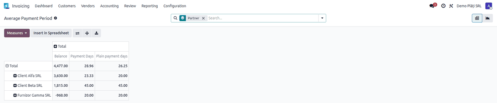
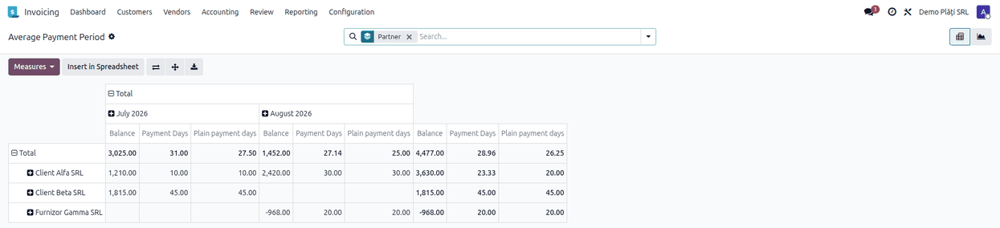
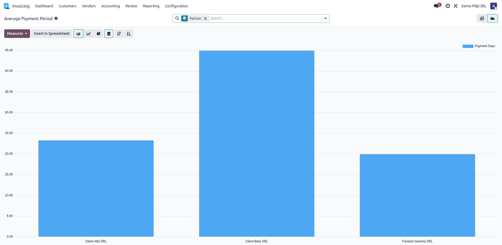

======================
Average Payment Period
======================

..
   !!!!!!!!!!!!!!!!!!!!!!!!!!!!!!!!!!!!!!!!!!!!!!!!!!!!
   !! This file is generated by oca-gen-addon-readme !!
   !! changes will be overwritten.                   !!
   !!!!!!!!!!!!!!!!!!!!!!!!!!!!!!!!!!!!!!!!!!!!!!!!!!!!
   !! source digest: sha256:6cde71e3a89d7f6006cc0ae33f5b10aeb9aea9b86b531ea08950ee536b356784
   !!!!!!!!!!!!!!!!!!!!!!!!!!!!!!!!!!!!!!!!!!!!!!!!!!!!

.. |badge1| image:: https://img.shields.io/badge/maturity-Mature-brightgreen.png
    :target: https://odoo-community.org/page/development-status
    :alt: Mature
.. |badge2| image:: https://img.shields.io/badge/github-dhongu%2Fdeltatech-lightgray.png?logo=github
    :target: https://github.com/dhongu/deltatech/tree/19.0/deltatech_average_payment_period
    :alt: dhongu/deltatech
.. |badge_fisa| image:: https://img.shields.io/badge/-Fi%C8%99%C4%83%20consultant-2ea44f.png
    :target: https://github.com/dhongu/deltatech/blob/19.0/deltatech_average_payment_period/readme/FISA_CONSULTANT.md
    :alt: Fișă consultant
.. |badge_tests| image:: https://img.shields.io/badge/-9%20automated%20tests%20%C2%B7%2079%25%20code%20coverage-2ea44f.png
    :target: https://app.codecov.io/gh/dhongu/deltatech/tree/19.0/deltatech_average_payment_period
    :alt: 9 automated tests · 79% code coverage

|badge1| |badge2| |badge_fisa| |badge_tests|

Tracks how long customers and suppliers actually take to pay, giving
finance teams a concrete measure of cash-collection and payment
efficiency.

For each customer invoice or vendor bill line fully reconciled with its
payment, the module records the exact payment date and computes the
number of days elapsed since the accounting date of the invoice. An
aggregated pivot/graph report — **Average Payment Period** — is added
directly to the Accounting Reports menu so managers can slice the data
by partner, journal, or period at a glance.

**✨ Key features:**

- **Payment Date** — automatically derived from the reconciliation
  partner line and stored on each ``account.move.line``.
- **Payment Days** — difference (in days) between the accounting date of
  the invoice and the accounting date of the payment.
- **Plain Payment Days** — simplified variant computed only on customer
  invoices (``out_invoice``) and vendor bills (``in_invoice``);
  reconciled credit notes count with 0 days in its average.
- **Average Payment Period report** — a dedicated pivot and graph view
  (menu: Invoicing / Accounting > Reporting > Average Payment Period)
  grouped by partner by default; searchable by partner, reference and
  date, and groupable by partner or date (other fields through a custom
  group).
- **Weighted average calculation** — when grouping rows, in the pivot
  and in the graph, Payment Days is averaged as the absolute value of
  ``sum(amount × days) / sum(amount)`` rather than a plain arithmetic
  mean, preventing distortion from small-amount outliers.

**Table of contents**

.. contents::
   :local:

Usage
=====

Before you start
----------------

The report only counts invoices that are **fully reconciled** with their
payment. Make sure the payment methods of your bank journal have an
account set (**Invoicing**, or **Accounting** on Enterprise, **→
Configuration → Journals → Bank**, **Incoming Payments** and **Outgoing
Payments** tabs): without it, a payment creates no journal entry, the
invoice stays **In Payment** and does not reach the report.

1. Pay an invoice in full
-------------------------

Open a posted customer invoice or vendor bill and click **Pay**. When
the payment covers the whole invoice, the receivable or payable line is
reconciled with the payment and the module stores the payment date and
the number of days automatically.

|Customer invoice of Client Alfa SRL dated Aug 5 for 2,420.00, with 30
days payment terms, the Paid ribbon and the payment of 09/04/2026, 30
days after the invoice date|

- **Payment Days** = accounting date of the payment − accounting date of
  the invoice.
- If the invoice is paid in several instalments, the date of the payment
  that closes it is kept.
- If the reconciliation is removed (on the invoice, the ⓘ icon next to
  **Paid on …** → **Unreconcile**), the payment date and days are
  cleared and the invoice leaves the report; a new full reconciliation
  computes them again.

2. Read the report by partner
-----------------------------

Go to **Invoicing** (or **Accounting** on Enterprise) **→ Reporting →
Average Payment Period**. The pivot opens grouped by **Partner**:

- **Balance** — total of the paid invoices: positive for customers,
  negative for vendors (the grand total mixes both, filter customers or
  vendors to read it);
- **Payment Days** — average days to payment, **weighted by the invoice
  amount**;
- **Plain payment days** — simple average of the days, computed on
  customer invoices and vendor bills; a reconciled credit note counts
  with 0 days.

|Average Payment Period pivot grouped by partner with the Balance,
Payment Days and Plain payment days columns|

Example: an invoice of 1,210.00 paid in 10 days and one of 2,420.00 paid
in 30 days give **Payment Days** 23.33 and **Plain payment days** 20.00.
Unpaid or partially paid invoices are not included. Use the **Date**
filter of the search bar to select the period, and **Download xlsx** to
export the table.

3. Break it down by month
-------------------------

In the same pivot, click the **Total** column header and choose **Date →
Month**: each partner gets one column per month, with the average days
of the invoices of that month.

|Average Payment Period pivot with partners as rows and the invoice
months as columns|

4. Compare partners on a graph
------------------------------

Switch to the **Graph** view: it opens on the **Payment Days** measure,
with one bar per partner for its weighted average days to payment, the
same values as in the pivot.

|Average Payment Period bar graph with one bar per partner for the
Payment Days measure|

.. |Customer invoice of Client Alfa SRL dated Aug 5 for 2,420.00, with 30 days payment terms, the Paid ribbon and the payment of 09/04/2026, 30 days after the invoice date| image:: https://raw.githubusercontent.com/dhongu/deltatech/19.0/deltatech_average_payment_period/static/description/en/01_factura_platita.png

Changelog
=========

19.0.1.0.7 (2026-11-19)
-----------------------

- Average Payment Period report: the pivot now shows the amount-weighted
  average of Payment Days, like the graph; before, the pivot showed a
  plain average (the weighting was only applied to ``_read_group``,
  while the Odoo 19 pivot reads through ``_read_grouping_sets``).
- Dedicated graph view, opening on the Payment Days measure.
- Consultant sheet (``readme/FISA_CONSULTANT.md``) with screenshots,
  ``readme/USAGE.md`` rewritten in English with the English screenshots,
  ``readme/DESCRIPTION.md`` aligned with the code.

19.0.1.0.6 (2026-11-19)
-----------------------

- Payment date and payment days on journal items are reset when the full
  reconciliation is removed; before, the old values stayed on the unpaid
  item (AVGPAY-001).
- Payment date and payment days are recomputed when an item is
  reconciled again: Odoo 19 links the full reconciliation through SQL,
  so the stored fields were not refreshed.

19.0.1.0.5 (2026-10-11)
-----------------------

- Docs: emoji symbols added to the bold headings of the module
  description, for a uniform look on the Odoo Apps page. No code change.

19.0.1.0.4 (2026-10-09)
-----------------------

- Average Payment Period report: company field and company record rule,
  users only see journal items of their active companies (AVGPAY-002).

19.0.1.0.3 (2026-10-09)
-----------------------

- Apps Store banner (banner.json).

19.0.1.0.2 (2026-09-29)
-----------------------

- Own module icon, instead of the generic gears it had.

Bug Tracker
===========

Bugs are tracked on `Terrabit Issues <https://www.terrabit.ro/helpdesk>`_.
In case of trouble, please check there if your issue has already been reported.

Do not contact contributors directly about support or help with technical issues.

Credits
=======

Authors
-------

* Terrabit
* Dorin Hongu

Maintainers
-----------

.. |maintainer-dhongu| image:: https://github.com/dhongu.png?size=40px
    :target: https://github.com/dhongu
    :alt: dhongu

Current maintainer:

|maintainer-dhongu| 

This module is part of the `dhongu/deltatech <https://github.com/dhongu/deltatech/tree/19.0/deltatech_average_payment_period>`_ project on GitHub.

You are welcome to contribute.