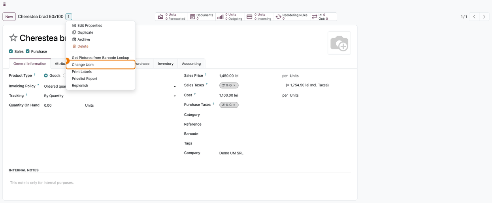
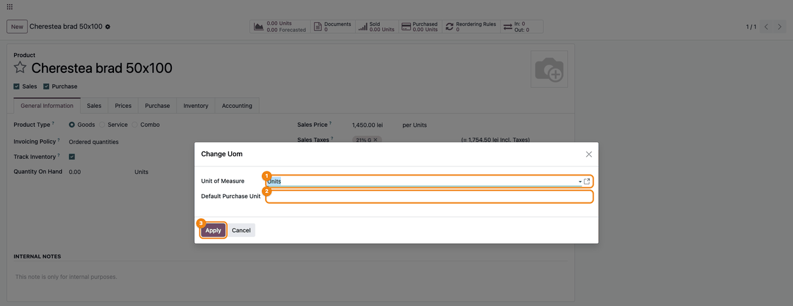
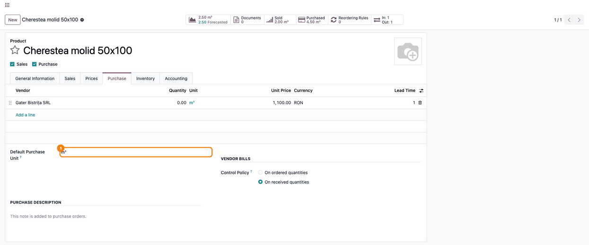
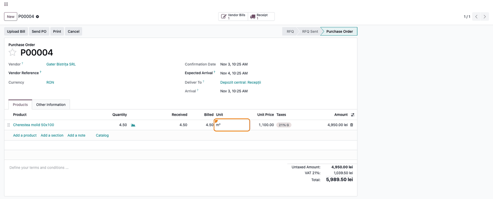
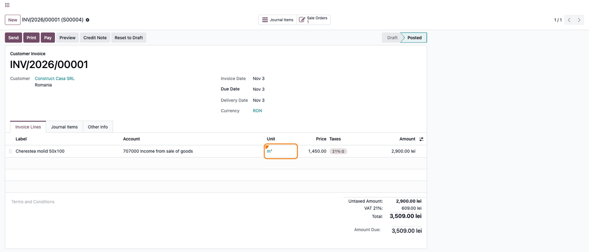
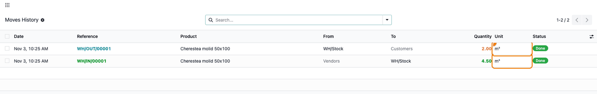

======================
Change Unit of measure
======================

..
   !!!!!!!!!!!!!!!!!!!!!!!!!!!!!!!!!!!!!!!!!!!!!!!!!!!!
   !! This file is generated by oca-gen-addon-readme !!
   !! changes will be overwritten.                   !!
   !!!!!!!!!!!!!!!!!!!!!!!!!!!!!!!!!!!!!!!!!!!!!!!!!!!!
   !! source digest: sha256:5f0cc06dbad3b4cb0df16b83b3d69b8d60b788816982ef67f6ddb3ed5e781d1d
   !!!!!!!!!!!!!!!!!!!!!!!!!!!!!!!!!!!!!!!!!!!!!!!!!!!!

.. |badge1| image:: https://img.shields.io/badge/maturity-Beta-yellow.png
    :target: https://odoo-community.org/page/development-status
    :alt: Beta
.. |badge2| image:: https://img.shields.io/badge/github-dhongu%2Fdeltatech-lightgray.png?logo=github
    :target: https://github.com/dhongu/deltatech/tree/20.0/deltatech_change_uom
    :alt: dhongu/deltatech
.. |badge_fisa| image:: https://img.shields.io/badge/-Fi%C8%99%C4%83%20consultant-2ea44f.png
    :target: https://github.com/dhongu/deltatech/blob/20.0/deltatech_change_uom/readme/FISA_CONSULTANT.md
    :alt: Fișă consultant

|badge1| |badge2| |badge_fisa|

A product created with the wrong unit of measure is often already used
on orders, invoices and stock moves. This module adds a *Change Uom*
action that replaces the unit on the product and those documents in one
step.

- **Change Uom action**: The product form's action menu offers *Change
  Uom*. Its window shows the current *Unit of Measure* and *Default
  Purchase Unit*; *Apply* runs the change.
- **Unit choices**: *Unit of Measure* accepts any unit. *Default
  Purchase Unit* offers only units convertible to the new one and is
  cleared when a new unit does not fit it.
- **Documents updated**: For every variant, lines in the old unit move
  to the new one on sales orders, purchase orders, invoices, stock
  moves, stock move lines and vendor pricelists. Lines in the old
  purchase unit move to the new *Default Purchase Unit*, or to the new
  unit when it is empty.
- **No conversion**: Quantities, prices and amounts stay as they are.
  The update goes straight to the database, so posted invoices and
  locked periods do not stop it.

It depends on *Products*, *Invoicing*, *Inventory*, *Sales*, *Purchase*
and *UoM Domain by Reference* (``deltatech_uom_domain``), which provides
the *Default Purchase Unit*. Only users of the group *Allow to change
unit of measure* (Settings administrators have it by default) can use
the action.

**Table of contents**

.. contents::
   :local:

Usage
=====

Install only **Change Unit of measure** (``deltatech_change_uom``): its
dependency **UoM Domain by Reference** (``deltatech_uom_domain``) is
installed with it. Both folders of the download must be in your addons
path; then use **Apps → Update Apps List** and search without the "Apps"
filter.

Enable **Units of Measure** in **Inventory → Configuration → Settings**.
Administrators can change units right away; give other users the **Allow
to change unit of measure** group (user form, in developer mode).

The module **relabels the unit, it does not convert quantities**: a line
of 4.50 Units becomes 4.50 m³, at the same price and amount. Use it when
the figures were already right in the new unit and only the unit was
chosen wrongly. When the product has not been invoiced yet, standard
Odoo lets you change the unit directly on the product form.

1. **Open the action** — open the product (**Inventory → Products →
   Products**), click the ⋮ button next to its name and choose **Change
   Uom**. The action is on the product form, not on a product variant.

   |Action menu (⋮) of the product form, with the Change Uom action|

2. **Choose the units** — in the **Change Uom** wizard, choose the new
   **Unit of Measure** (1), from any unit tree, and the **Default
   Purchase Unit** (2), among the units convertible to the new one; a
   purchase unit that no longer fits is cleared. Click **Apply** (3).

   |Change Uom wizard: Unit of Measure (1), Default Purchase Unit (2)
   and Apply (3)|

3. **Check the product** — the smart buttons show the same figures in
   the new unit (on hand 2.50 m³, sold 2.00 m³, purchased 4.50 m³). In
   the **Purchase** tab, the vendor line is in m³ at the same price, and
   **Default Purchase Unit** (1) is m³. Prices are not recalculated:
   check that the vendor price is the price per new unit.

   |Product after the change: vendor line in m³ and Default Purchase
   Unit m³ (1)|

4. **Purchase orders** — the received and billed purchase order line
   moved from Units to m³; quantity, received, billed, unit price and
   amount are unchanged. Lines in the old purchase unit move to the new
   purchase unit, so the order, the receipt and the bill stay in the
   same unit.

   |Received and billed purchase order, line in m³|

5. **Posted invoices** — the posted customer invoice line is in m³, at
   the same price and amount (2.00 m³, 2,900.00). This is the case
   standard Odoo refuses. The invoice is not reposted, and documents
   already sent outside Odoo (e-invoicing, tax reports) keep the old
   unit. The **Unit** column is optional on invoice lines: show it from
   the column menu.

   |Posted customer invoice, line in m³|

6. **Stock moves** — the receipt (4.50) and the delivery (2.00) are in
   m³, with the same quantities.

   |Moves history of the product, in m³|

No journal entry is created and no amount or account changes; only the
unit on the lines is replaced, also on posted entries and in locked
periods.

Changelog
=========

20.0.1.0.3 (2026-11-11)
-----------------------

- Apps Store page: a fuller description (what the module does, the
  problem it solves, its main functions, dependencies and limits). No
  change in behavior.

20.0.1.0.2 (2026-11-03)
-----------------------

- ``readme/USAGE.md`` for the Apps Store: installation, the wizard and
  the effect on orders, posted invoices and stock moves, with English
  screenshots in ``static/description/en/``. The screenshot test
  captures the same shots in both languages (``test_capture_fise`` RO,
  ``test_capture_usage`` EN).

20.0.1.0.1 (2026-10-21)
-----------------------

- One unit mapping on every document: lines in the old purchase unit
  move to the new purchase unit also on receipts and vendor bills, so a
  purchase order, its receipt and its bill stay in the same unit (since
  19.0 a conversion between incompatible units is no longer flagged).
- Own module icon (ruler with a change accent) instead of the generic
  gears, regenerated Apps banner, consultant sheet
  (``readme/FISA_CONSULTANT.md``) with screenshots generated by
  ``tests/test_screenshots.py``; Romanian name of the group corrected.

20.0.1.0.0 (2026-10-21)
-----------------------

- Migration to 20.0. The unit of measure is now ``uom_id`` on purchase
  order lines, stock moves, stock move lines and vendor pricelist lines
  (sale order lines and invoice lines keep ``product_uom_id``); access
  rights moved to ``ir.access``.

19.0.1.0.0 (2026-10-21)
-----------------------

- Migration to 19.0. The purchase unit of measure (``uom_po_id``) is
  gone from the product in 19.0; the wizard now changes the *Default
  Purchase Unit* (``purchase_uom_id``) added by
  ``deltatech_uom_domain``, a new dependency. Purchase order lines and
  vendor pricelist lines in the old purchase unit move to the new one; a
  purchase unit that cannot be converted to the new product unit is
  cleared on the form and refused on apply.
- ``product_uom_id`` on sale and purchase order lines, ``SQL()`` builder
  for the updates, cache invalidated after them; the *Allow to change
  unit of measure* group no longer sets ``category_id``.
- Changing the unit of measure is restricted to the *Allow to change
  unit of measure* group: the *Change Uom* action is shown only to its
  members, the wizard is accessible only to them and the change is
  refused for anyone else. Settings administrators get the group by
  default.

Bug Tracker
===========

Bugs are tracked on `Terrabit Issues <https://www.terrabit.ro/helpdesk>`_.
In case of trouble, please check there if your issue has already been reported.

Do not contact contributors directly about support or help with technical issues.

Credits
=======

Authors
-------

* Terrabit
* Dorin Hongu

Maintainers
-----------

.. |maintainer-dhongu| image:: https://github.com/dhongu.png?size=40px
    :target: https://github.com/dhongu
    :alt: dhongu

Current maintainer:

|maintainer-dhongu| 

This module is part of the `dhongu/deltatech <https://github.com/dhongu/deltatech/tree/20.0/deltatech_change_uom>`_ project on GitHub.

You are welcome to contribute.