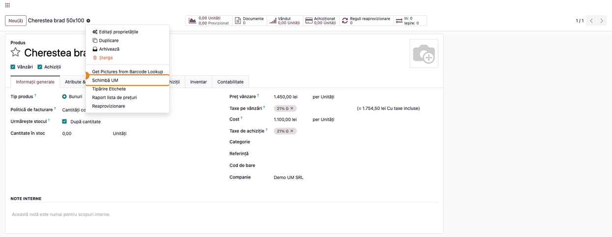
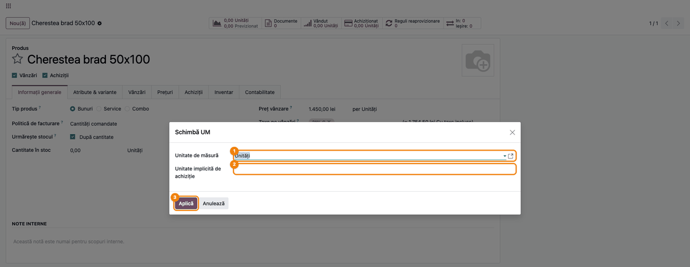
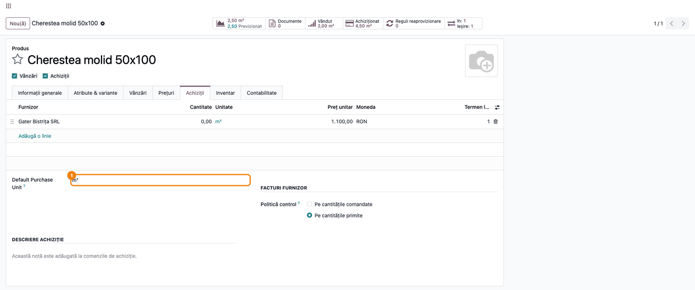
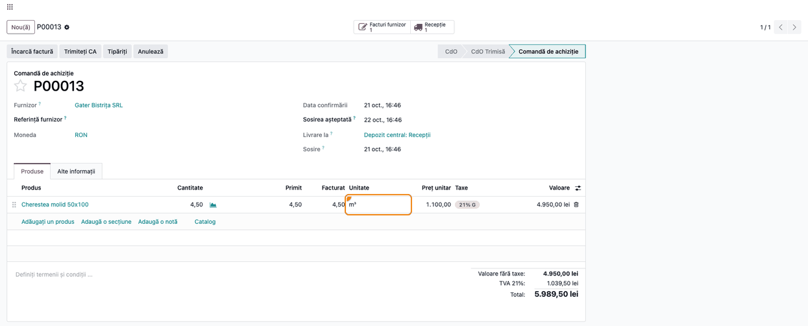
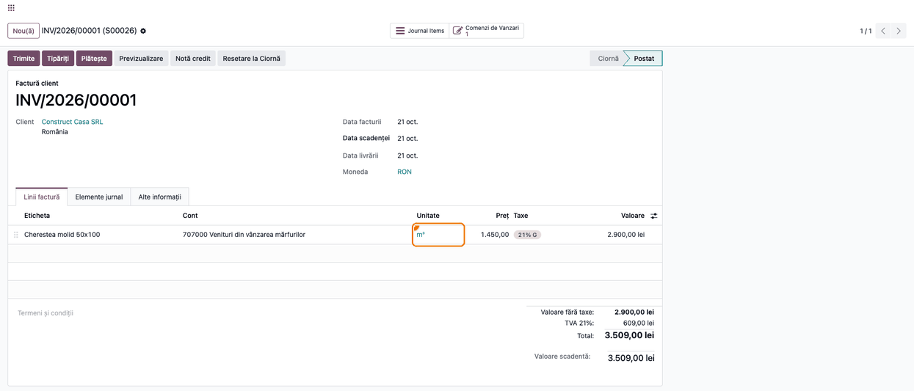
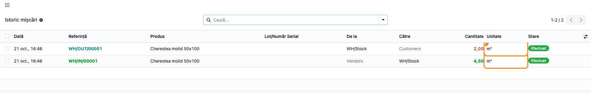

# Fișă Modul: Schimbarea unității de măsură a unui produs folosit deja în documente

**Modul:** `deltatech_change_uom`
**Utilizator principal:** Administratorul bazei sau responsabilul cu nomenclatorul de produse (membru
al grupului **Permite schimbarea unității de măsură**)
**Prioritate:** 🟡 Medie (corectează o greșeală de configurare pe care Odoo standard nu o mai permite
după primul document, dar operația e rară și rezervată unui număr mic de utilizatori)

---

## 1. Scop business

În Odoo 19, unitatea de măsură se poate schimba direct pe fișa produsului cât timp produsul n-a fost
facturat: comenzile, mișcările de stoc și listele de materiale trec singure în unitatea nouă.
Standardul refuză schimbarea în două cazuri:

- există **facturi sau note postate** cu produsul (mesajul cere arhivarea produsului și crearea unuia
  nou);
- există comenzi de vânzare sau de achiziție într-o **altă unitate** decât a produsului (de exemplu în
  unitatea de achiziție).

Când produsul a fost creat greșit, de exemplu cheresteaua în **Unități** în loc de **m³**, și a fost
deja facturat, rămân un produs nou (cu istoricul rupt în două) sau stornarea tuturor documentelor.

Modulul adaugă pe produs acțiunea **Schimbă UM**, care face schimbarea și în aceste cazuri. Ea
înlocuiește unitatea veche cu cea nouă pe produs și pe toate documentele în care produsul apare în
unitatea veche: comenzi de vânzare și de achiziție, facturi (inclusiv cele postate), mișcări de stoc
și linii de furnizor. Se schimbă și **unitatea implicită de achiziție** a produsului, iar documentele
din vechea unitate de achiziție trec în cea nouă.

Modulul **corectează eticheta unității, nu convertește cantitățile**. O linie de 4,50 Unități devine
4,50 m³, la același preț și aceeași valoare. Operația e potrivită doar când cifrele din documente
erau deja corecte în unitatea nouă și doar unitatea fusese aleasă greșit. Dacă produsul n-a fost
facturat, schimbarea se face direct pe fișa produsului, fără modul.

## 2. Bază legală și context

Nu există un temei legal propriu. Contextul este cel al evidenței cantitative a stocurilor: unitatea
de măsură din fișa produsului trebuie să fie cea în care se face efectiv recepția, gestiunea și
vânzarea, altfel cantitățile din stoc, de pe facturi și din inventar nu se mai pot compara.

Documentele deja transmise în afara Odoo nu se modifică retroactiv. O factură trimisă prin e-Factura
rămâne la ANAF cu unitatea de la momentul transmiterii, chiar dacă linia ei din Odoo trece în
unitatea nouă. La fel, un fișier SAF-T (D406) regenerat pentru o perioadă deja depusă iese cu unitatea
nouă și diferă de cel transmis (secțiunea 11).

## 3. Utilizatori și roluri

| Rol | Ce face | Drept Odoo |
|---|---|---|
| Administrator | are acțiunea implicit; acordă grupul altor utilizatori | **Administrare / Setări** (`base.group_system`) |
| Responsabil nomenclator | schimbă unitatea de măsură a produselor create greșit | grupul **Permite schimbarea unității de măsură** (`deltatech_change_uom.group_change_uom`) |
| Ceilalți utilizatori | nu văd acțiunea și nu pot aplica schimbarea | — |

Administratorii de sistem primesc grupul automat. Altor utilizatori li se dă din **Setări →
Utilizatori și companii → Utilizatori**: cu **modul dezvoltator** activat, pe fișa utilizatorului,
secțiunea **Extra drepturi**, bifați **Permite schimbarea unității de măsură**. Fără modul
dezvoltator, secțiunea nu apare.

Roluri recomandate pentru testare: administratorul (face schimbarea) și un utilizator intern fără
grup, care nu trebuie să vadă acțiunea **Schimbă UM**.

## 4. Conturi și date implicate

Modulul nu are conturi proprii și nu creează și nu modifică note contabile. Valorile din documente
rămân neschimbate (secțiunea 6, „Note de monografie și raportare").

Date minime pentru demo (folosite și în capturi):
- Companie **Demo UM SRL**, plan de conturi RO, monedă RON, cu **Unități de măsură** activat;
  depozitul **Depozit central**.
- Furnizorul **Gater Bistrița SRL** și clientul **Construct Casa SRL**.
- Două produse stocabile create greșit în **Unități**, cu prețul de vânzare 1.450 lei, costul
  1.100 lei și o linie de furnizor la Gater Bistrița SRL:
  - **Cherestea brad 50x100** — rămâne în Unități, cu o cerere de ofertă și o ofertă (pașii 1 și 2);
  - **Cherestea molid 50x100** — o comandă de achiziție de 4,50 Unități, recepționată și facturată
    (factura de furnizor postată), și o comandă de vânzare de 2,00 Unități, livrată și facturată
    (factura de client postată); stocul rămas este 2,50. Produsul e trecut apoi prin asistent în
    **m³**, cu unitatea implicită de achiziție **m³** (pașii 3–6).

## 5. Configurare inițială

1. Instalați `deltatech_change_uom`. Se instalează odată cu el `deltatech_uom_domain`, care aduce pe
   produs câmpul **Unitate implicită de achiziție** și listele de unități din același arbore pe
   achiziții.
2. În **Inventar → Configurare → Setări** (sau **Vânzări → Configurare → Setări**) activați **Unități
   de măsură**, ca unitățile să fie vizibile pe produse și pe comenzi.
3. Verificați că unitatea nouă există: **Inventar → Configurare → Unități și ambalaje** (ex. **m³**).
4. Dați grupul **Permite schimbarea unității de măsură** utilizatorilor care trebuie să facă
   schimbarea, dacă nu sunt administratori (secțiunea 3).
5. Încercați întâi schimbarea direct pe fișa produsului. Folosiți asistentul doar dacă Odoo o refuză
   (secțiunea 1).

## 6. Flux de utilizare

### Pasul 1 — Acțiunea „Schimbă UM" pe produs

Deschideți produsul din **Inventar → Produse → Produse** (sau din **Vânzări → Produse → Produse**).
În formularul produsului, apăsați rotița de lângă numele produsului (meniul **Acțiune**) și alegeți
**Schimbă UM**.

Acțiunea apare doar membrilor grupului **Permite schimbarea unității de măsură** și doar pe fișa
produsului, nu pe cea a unei variante (**Variante de produs**). Produsul din exemplu, **Cherestea brad
50x100**, e în **Unități**.



### Pasul 2 — Alegerea unităților în asistent

Asistentul **Schimbă UM** se deschide cu unitățile actuale ale produsului:

1. **Unitate de măsură** — unitatea nouă a produsului (ex. **m³**). Poate fi din orice arbore de unități:
   tocmai asta e corectura.
2. **Unitate implicită de achiziție** — unitatea propusă pe comenzile de achiziție. Lista conține doar
   unitățile convertibile la unitatea nouă a produsului. Dacă schimbați unitatea produsului într-un
   alt arbore, o unitate de achiziție veche, devenită incompatibilă, se golește. Lăsată goală,
   comenzile de achiziție folosesc unitatea de pe linia de furnizor sau unitatea produsului.
3. Apăsați **Aplică**.



### Pasul 3 — Produsul după schimbare

Redeschideți produsul. În exemplu, **Cherestea molid 50x100** a fost trecut în **m³**:

- butoanele din antet arată aceleași cifre în m³: stocul 2,50, **Vândut** 2,00, **Achiziționat** 4,50;
- în tab-ul **Achiziții**, linia furnizorului **Gater Bistrița SRL** e în **m³**, la același preț de
  1.100,00 RON;
- câmpul **Unitate implicită de achiziție** este **m³**.

Verificați pe ecran, înainte să continuați, că linia de furnizor are unitatea nouă și că prețul ei
este într-adevăr prețul pe unitatea nouă (pe m³). Prețul nu se recalculează.



### Pasul 4 — Comenzile de achiziție existente

Deschideți comanda de achiziție a produsului din **Achiziții → Comenzi → Comenzi de achiziție**.
Linia era în Unități și a trecut în **m³**. Cantitatea (4,50), cantitatea primită (4,50), cantitatea
facturată (4,50), prețul unitar (1.100,00) și valoarea (4.950,00 lei) au rămas aceleași.

Aceeași mapare se aplică pe toate documentele produsului: liniile din vechea unitate a produsului
trec în noua unitate a produsului, iar cele din vechea unitate implicită de achiziție trec în noua
unitate de achiziție. Comanda, recepția și factura de furnizor rămân astfel în aceeași unitate.



### Pasul 5 — Facturile postate

Deschideți factura de client din **Facturare → Clienți → Facturi** (sau factura de furnizor din
**Facturare → Furnizori → Facturi**). Factura e **Postată**, iar linia a trecut din Unități în **m³**,
la același preț (1.450,00) și aceeași valoare (2.900,00 lei pentru 2,00 m³). Coloana **Unitate** e
opțională pe liniile facturii: o afișați din meniul de coloane din dreapta antetului.

Acesta este cazul în care Odoo standard refuză schimbarea. Factura nu se repostează și nu se
retransmite prin e-Factura (secțiunea 11).



### Pasul 6 — Mișcările de stoc

Deschideți **Inventar → Raportare → Istoric mișcări** și filtrați după produs. Recepția (4,50) și
livrarea (2,00) sunt în **m³**, cu aceleași cantități. Stocul rămas, 2,50, se citește acum în m³.



### Note de monografie și raportare

Modulul nu generează note contabile și nu modifică sumele sau conturile notelor existente. Schimbă
doar unitatea de măsură de pe liniile lor, inclusiv pe notele postate și în perioadele blocate
(data de blocare nu oprește schimbarea). Cantitățile, prețurile, valorile și conturile rămân aceleași.
De aceea:

- soldurile conturilor de stoc (ex. 371) și de venituri / cheltuieli rămân neschimbate;
- stocul din locații păstrează aceeași cifră, citită acum în unitatea nouă (5 Unități devin 5 m³);
- rapoartele cantitative (stoc, vânzări, achiziții) arată după schimbare toate cantitățile istorice
  în unitatea nouă.

Dacă cifrele din documente nu erau corecte în unitatea nouă, schimbarea **nu** e soluția: valorile ar
rămâne aceleași, dar cantitățile ar fi greșite. Corectați documentele sau folosiți o unitate de
ambalare a produsului.

## 7. Legături cu alte module / declarații

| Modul / proces | Rol în flux | Tip legătură |
|---|---|---|
| `product`, `uom` | unitatea de măsură a produsului și unitățile disponibile | dependență (`uom` prin `product`) |
| `sale` | liniile comenzilor de vânzare | dependență (manifest) |
| `purchase` | liniile comenzilor de achiziție și liniile de furnizor | dependență (manifest) |
| `account` | liniile facturilor de client și de furnizor | dependență (manifest) |
| `stock` | mișcările de stoc și operațiile detaliate | dependență (manifest) |
| `deltatech_uom_domain` | **Unitatea implicită de achiziție** a produsului și listele de unități pe achiziții | dependență (manifest) |
| e-Factura / e-Transport / SAF-T (D406) | documentele și declarațiile deja transmise nu se modifică | proces |

**Ce e automat:**
- înlocuirea unității pe produs și pe toate variantele lui;
- înlocuirea pe comenzi de vânzare, comenzi de achiziție, facturi (inclusiv postate), mișcări de stoc
  și linii de furnizor;
- înlocuirea unității implicite de achiziție și a liniilor din vechea unitate de achiziție, pe toate
  documentele;
- golirea unei unități de achiziție incompatibile cu noua unitate a produsului.

**Ce rămâne manual:**
- decizia că cifrele din documente sunt corecte în unitatea nouă;
- verificarea prețurilor de pe liniile de furnizor și din listele de prețuri, care nu se convertesc;
- liniile într-o a treia unitate (ex. o vânzare în **Duzină** pe un produs în **Unități**, fără
  unitate de achiziție în Duzină), care nu sunt atinse (secțiunea 11);
- listele de materiale în care produsul e componentă sau produs finit;
- documentele și declarațiile deja transmise la ANAF.

## 8. Verificări pentru consultant

- [ ] Un utilizator intern fără grupul **Permite schimbarea unității de măsură** nu vede **Schimbă UM**
      în meniul **Acțiune** al produsului.
- [ ] Administratorul vede acțiunea fără să i se dea grupul manual.
- [ ] Asistentul se deschide cu unitatea actuală a produsului și cu unitatea implicită de achiziție a
      lui (sau gol, dacă produsul nu are una).
- [ ] La schimbarea unității produsului într-un alt arbore (ex. din Unități în m³), o unitate de
      achiziție din vechiul arbore (ex. Duzină) se golește în asistent.
- [ ] După **Aplică**, produsul și toate variantele lui au unitatea nouă.
- [ ] Linia de furnizor din vechea unitate e în unitatea nouă, la același preț.
- [ ] Pe un produs cu o factură postată, schimbarea direct pe fișa produsului e refuzată de Odoo, iar
      prin asistent reușește.
- [ ] Comenzile de vânzare și de achiziție existente au linia în unitatea nouă, cu aceeași cantitate,
      același preț și aceeași valoare.
- [ ] Facturile postate (de client și de furnizor) au linia în unitatea nouă, cu aceeași valoare.
- [ ] O comandă de achiziție în vechea unitate implicită de achiziție trece în noua unitate de
      achiziție, împreună cu factura de furnizor a ei.
- [ ] În **Istoric mișcări**, recepția și livrarea produsului sunt în unitatea nouă, cu aceleași
      cantități.
- [ ] Soldul contului de stoc (371) și stocul din locații au aceleași cifre ca înainte de schimbare.

## 9. Mesaje de eroare frecvente

| Mesaj / simptom | Cauză probabilă | Remediere |
|---|---|---|
| Acțiunea **Schimbă UM** nu apare în meniul **Acțiune** | Utilizatorul nu are grupul **Permite schimbarea unității de măsură** | Administratorul îi dă grupul, în modul dezvoltator, din **Extra drepturi** (secțiunea 3) |
| „Doar utilizatorii care au voie să schimbe unitatea de măsură pot aplica această modificare." | Asistentul a fost aplicat de un utilizator fără grup (de exemplu printr-un link salvat) | Administratorul îi dă grupul sau face el schimbarea |
| „Unitatea de achiziție *X* nu se poate converti în unitatea *Y*." | **Unitatea implicită de achiziție** e dintr-un alt arbore decât noua unitate a produsului | Alegeți o unitate de achiziție din lista propusă sau lăsați câmpul gol |
| După schimbare, o comandă are încă unitatea veche | Linia era într-o a treia unitate, diferită de unitatea produsului și de cea de achiziție | Corectați linia manual (secțiunea 11) |
| La schimbarea pe fișa produsului: „…the change of unit of measure can not be done. If you want to change it, please archive the product and create a new one." (sau mesajul similar despre facturi) | Odoo standard refuză: produsul are facturi postate sau linii în altă unitate | Folosiți asistentul **Schimbă UM** |
| Cantitățile din stoc arată greșit după schimbare | Cifrele erau corecte în unitatea veche, nu în cea nouă | Schimbarea nu convertește; reveniți la unitatea veche și corectați prin documente |

## 10. Capturi de ecran

Capturile (`static/description/`) se generează automat din `tests/test_screenshots.py`, cu mixinul
`ScreenshotCase` din `l10n_ro_doc_screenshots` (import defensiv). Sunt în **limba română**, pe
compania **Demo UM SRL**, cu planul de conturi RO și datele demo din secțiunea 4.

| # | Fișier | Conținut |
|---|---|---|
| 1 | `01_produs_actiune_schimba_um.png` | Formularul produsului, meniul **Acțiune** cu **Schimbă UM** |
| 2 | `02_asistent_schimba_um.png` | Asistentul **Schimbă UM**: **Unitate de măsură**, **Unitate implicită de achiziție**, **Aplică** |
| 3 | `03_produs_dupa_schimbare.png` | Tab-ul **Achiziții** al produsului schimbat: linia de furnizor și unitatea implicită de achiziție în m³ |
| 4 | `04_comanda_achizitie_dupa.png` | Comanda de achiziție recepționată și facturată, cu linia trecută în m³ |
| 5 | `05_factura_client_dupa.png` | Factura de client postată, cu linia trecută în m³ |
| 6 | `06_miscari_stoc_dupa.png` | **Istoric mișcări**: recepția și livrarea produsului, în m³ |

Regenerare:

```bash
./odoo/odoo-bin -c odoo.conf -d <db> -i deltatech_change_uom,l10n_ro,l10n_ro_doc_screenshots \
    --test-tags=fise_screenshots --stop-after-init --http-port=8987 --gevent-port=8988
```

## 11. Observații pentru manual

Păstrați ordinea de lucru:
1. încercarea pe fișa produsului; asistentul doar dacă Odoo refuză;
2. confirmarea că cifrele din documente sunt corecte în unitatea nouă;
3. alegerea unității noi și a unității implicite de achiziție;
4. aplicarea și verificarea produsului, a liniei de furnizor, a comenzilor și a facturilor;
5. verificarea prețurilor, care nu se convertesc.

Insistați pe ideea principală: modulul **corectează unitatea, nu convertește cantitățile**. Pentru o
conversie reală (ex. produsul vândut și în cutii de 10), se folosesc unitățile de ambalare ale
produsului, nu acest asistent.

### Limitări cunoscute

- **Fără conversie:** cantitățile, prețurile și valorile rămân aceleași, inclusiv stocul din locații.
- **A treia unitate:** se înlocuiesc doar vechea unitate a produsului și vechea unitate implicită de
  achiziție. O linie într-o altă unitate rămâne neschimbată și poate deveni neconvertibilă la noua
  unitate a produsului; în 19.0, Odoo nu mai semnalează conversia între unități incompatibile, deci
  verificați comenzile deschise înainte de schimbare.
- **Liste de materiale:** spre deosebire de schimbarea standard de pe fișa produsului, asistentul nu
  modifică listele de materiale în care apare produsul.
- **Perioade blocate:** schimbarea atinge și liniile notelor postate din perioadele blocate.
- **Liste de prețuri:** regulile din listele de prețuri nu se modifică.
- **Documente transmise:** facturile trimise prin e-Factura, documentele e-Transport și declarațiile
  SAF-T (D406) depuse rămân la ANAF cu unitatea de la transmitere; în Odoo, linia lor trece în unitatea
  nouă, iar un D406 regenerat pentru o perioadă depusă iese diferit.
- **Eticheta în engleză:** câmpul **Default Purchase Unit** din tab-ul **Achiziții** al produsului vine
  din `deltatech_uom_domain`, care nu are încă traducere în română (captura 3).
