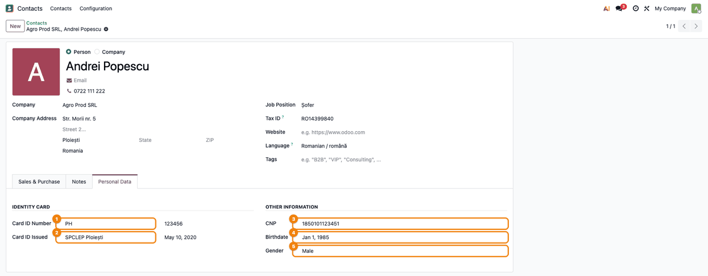
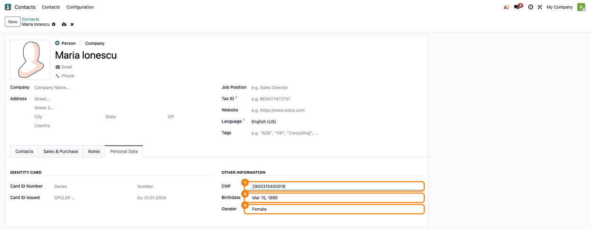
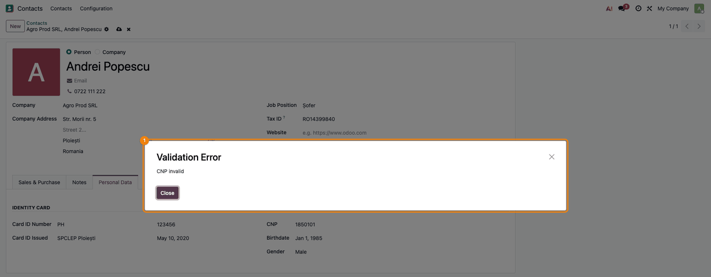
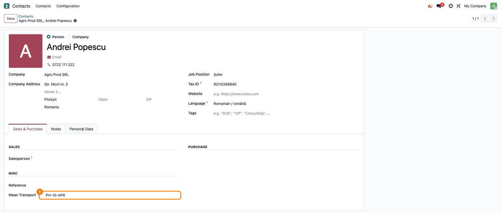
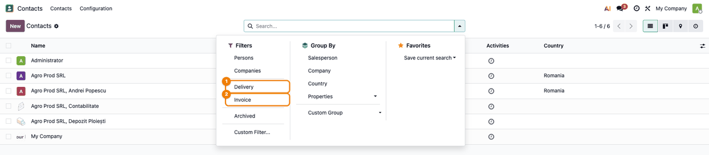

=====================
Contact Personal Data
=====================

..
   !!!!!!!!!!!!!!!!!!!!!!!!!!!!!!!!!!!!!!!!!!!!!!!!!!!!
   !! This file is generated by oca-gen-addon-readme !!
   !! changes will be overwritten.                   !!
   !!!!!!!!!!!!!!!!!!!!!!!!!!!!!!!!!!!!!!!!!!!!!!!!!!!!
   !! source digest: sha256:11c5e897f1a6a8d3522ebc9ab663a9a400fd2135bfc8ea1e8a1071519c68125e
   !!!!!!!!!!!!!!!!!!!!!!!!!!!!!!!!!!!!!!!!!!!!!!!!!!!!

.. |badge1| image:: https://img.shields.io/badge/maturity-Mature-brightgreen.png
    :target: https://odoo-community.org/page/development-status
    :alt: Mature
.. |badge2| image:: https://img.shields.io/badge/github-dhongu%2Fdeltatech-lightgray.png?logo=github
    :target: https://github.com/dhongu/deltatech/tree/19.0/deltatech_contact
    :alt: dhongu/deltatech
.. |badge_fisa| image:: https://img.shields.io/badge/-Fi%C8%99%C4%83%20consultant-2ea44f.png
    :target: https://github.com/dhongu/deltatech/blob/19.0/deltatech_contact/readme/FISA_CONSULTANT.md
    :alt: Fișă consultant
.. |badge_tests| image:: https://img.shields.io/badge/-7%20automated%20tests-2ea44f.png
    :target: https://github.com/dhongu/deltatech/tree/19.0/deltatech_contact/tests
    :alt: 7 automated tests

|badge1| |badge2| |badge_fisa| |badge_tests|

Extends the standard Odoo Contacts module with personal data for
individual contacts: the Romanian CNP (Personal Numeric Code) with
checksum validation, identity card details, birthdate, gender and means
of transport.

**Personal Data tab.** On a contact of type *Person* with the address
type *Contact*, the tab **Personal Data** groups the identity card
(**Card ID Number**: series and number; **Card ID Issued**: issuing
authority and date) and the **CNP**, **Birthdate** and **Gender**. The
same fields are on the form of a contact added from a company and on the
quick-create form.

**Birthdate and gender from the CNP.** When a CNP is entered, the
birthdate is taken from digits 2 to 7 and the gender from the first
digit. Changing the birthdate rewrites the date digits of the CNP and
recomputes its check digit.

**CNP validation.** The CNP must have 13 digits and a valid check digit.
Saving an existing contact with an invalid CNP stops with the message
*CNP invalid*. On a new contact, created from the form or by import, an
invalid CNP is cleared on save, without a message. An empty CNP is
accepted.

**Means of transport.** The field **Mean Transport** (for example the
plate number of a delegate's car) is shown under *Reference* in the
**Sales & Purchase** tab of a person.

**Search filters.** In **Contacts > Contacts**, the search gets the
filters **Delivery** and **Invoice** for addresses of these types. The
standard filters **Persons** and **Companies** show only contacts
without a parent company.

**Contacts tab.** On a contact that belongs to a company, the standard
**Contacts** tab is hidden.

**Contact name without the company.** When the system parameter
``contact.get_name_only`` is set, contacts of type *Contact* are shown
by their own name, without the name of their company.

**Display name options for developers.** The context keys
``show_phone``, ``show_category`` and ``address_inline`` add the phone
number or the tags to the contact name in relational fields, or put the
name and address on one line.

Limitations
-----------

- Because the birthdate is filled from the CNP, and the CNP is then
  rebuilt from the birthdate, a CNP typed in the form with a wrong check
  digit gets the correct check digit without any message. A CNP of 12
  digits is completed with a check digit the same way. Compare the CNP
  with the identity card.
- First digits 1 and 2 give a birth year in the 1900s, any other digit
  the 2000s; the gender is male only for the first digits 1 and 5.
- A CNP of 8 to 11 characters, or one whose digits 2 to 7 are not a
  valid date, makes the form fail with a technical error instead of a
  validation message.

**Table of contents**

.. contents::
   :local:

Usage
=====

The module has no settings: the **Personal Data** tab appears on every
contact of type **Person** with the address type **Contact**.

1. **Fill in the personal data** — **Contacts → Contacts**, open a
   person and go to the **Personal Data** tab. Under **Identity Card**,
   fill in the series and number (**Card ID Number**) and the issuing
   authority and date (**Card ID Issued**); under **Other Information**,
   the **CNP**, the **Birthdate** and the **Gender**. On a person linked
   to a company, the standard **Contacts** tab is hidden.

   |Personal Data tab of Andrei Popescu: ID series PH (1), issued by
   SPCLEP Ploiești (2), CNP (3), Birthdate (4) and Gender Male (5)|

2. **Let the CNP fill in the birthdate and gender** — on a new contact,
   choose **Person**, then type the CNP in the **Personal Data** tab.
   The birthdate comes from digits 2–7 and the gender from the first
   digit (1 or 5 = Male). Changing the birthdate rewrites the CNP with
   the new date and a recomputed check digit. The check digit is also
   corrected silently when you type a CNP with a wrong last digit, so
   compare the CNP with the identity card.

   |New person Maria Ionescu: CNP 2900315400018 (1), Birthdate Mar 15,
   1990 (2) and Gender Female (3) filled in from the CNP|

3. **Invalid CNP** — saving an existing contact whose CNP does not have
   13 digits or a valid check digit stops with **Validation Error — CNP
   invalid**. On a new contact, or on import, an invalid CNP is cleared
   on save without a message.

   |Validation Error dialog with the message CNP invalid (1), after
   saving a contact with the CNP 1850101|

4. **Means of transport** — in the **Sales & Purchase** tab of a person,
   group **Misc**, the **Mean Transport** field holds, for example, the
   plate number of the delegate's car.

   |Sales & Purchase tab: Mean Transport PH-10-APR (1) under Reference|

5. **Delivery and invoice addresses** — in the contacts search, the
   **Delivery** and **Invoice** filters list the delivery and invoice
   addresses. The standard **Persons** and **Companies** filters show
   only contacts without a parent company.

   |Search menu of the contacts list: the Delivery (1) and Invoice (2)
   filters under Persons and Companies|

Changelog
=========

19.0.1.4.14 (2026-11-03)
------------------------

- Description rewritten from the code: an invalid CNP is cleared on
  every new contact, the form included, not only at bulk import;
  documented the silent correction of the check digit and the other CNP
  limitations, the contact name without the company and the hidden
  Contacts tab on company contacts.

19.0.1.4.13 (2026-11-03)
------------------------

- Consultant sheet (readme/FISA_CONSULTANT.md), usage guide
  (readme/USAGE.md) and screenshots generated by
  tests/test_screenshots.py.
- Romanian translation completed: the Personal Data tab, its groups, the
  Mean Transport field and the Delivery / Invoice filters were shown in
  English.

19.0.1.4.12 (2026-10-11)
------------------------

- Docs: emoji symbols added to the bold headings of the module
  description, for a uniform look on the Odoo Apps page. No code change.

19.0.1.4.11 (2026-10-09)
------------------------

- Apps Store banner (banner.json).

19.0.1.4.10 (2026-10-01)
------------------------

- Contact display name with ``show_phone`` no longer fails for contacts
  without a phone: the removed ``mobile`` field is no longer read
  (CONTACT-001).

19.0.1.4.9 (2026-09-29)
-----------------------

- Own module icon, instead of the generic gears it had.

Bug Tracker
===========

Bugs are tracked on `Terrabit Issues <https://www.terrabit.ro/helpdesk>`_.
In case of trouble, please check there if your issue has already been reported.

Do not contact contributors directly about support or help with technical issues.

Credits
=======

Authors
-------

* Terrabit
* Dorin Hongu

Maintainers
-----------

.. |maintainer-dhongu| image:: https://github.com/dhongu.png?size=40px
    :target: https://github.com/dhongu
    :alt: dhongu

Current maintainer:

|maintainer-dhongu| 

This module is part of the `dhongu/deltatech <https://github.com/dhongu/deltatech/tree/19.0/deltatech_contact>`_ project on GitHub.

You are welcome to contribute.