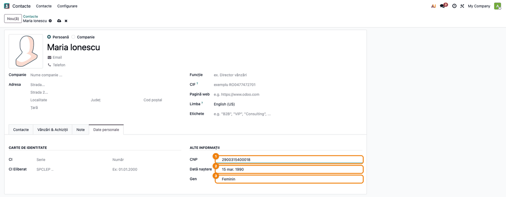
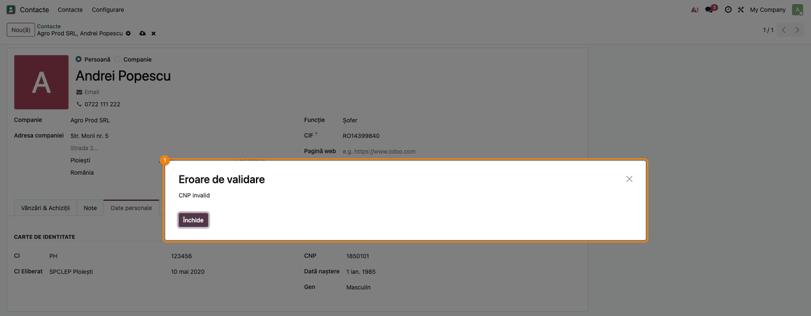
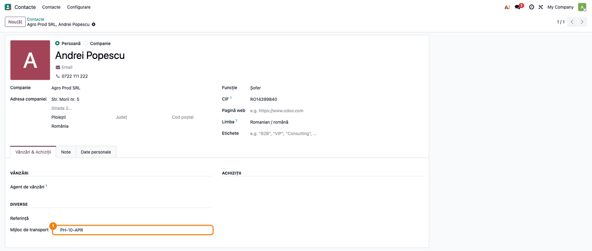
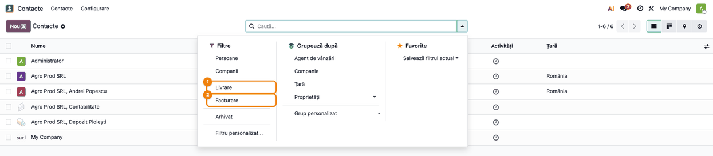

# Fișă Modul: Date personale pe contacte (CNP, carte de identitate)

**Modul:** `deltatech_contact`
**Utilizator principal:** Operator care întreține contactele (vânzări, resurse umane, administrativ)
**Prioritate:** 🟢 Scăzută (date de identificare ale persoanelor fizice; fără note contabile, dar CNP-ul ajunge drept cod fiscal în exporturile către programele de contabilitate)

---

## 1. Scop business

Fișa de contact standard din Odoo nu are loc pentru datele de identificare ale unei persoane fizice.
Modulul adaugă pe contactele de tip persoană:

- fila **Date personale**, cu datele cărții de identitate (serie, număr, emitent, data eliberării),
  **CNP**, **Data nașterii** și **Genul**;
- **validarea CNP-ului** după cifra de control, la salvare;
- **completarea automată** a datei nașterii și a genului din cifrele CNP-ului;
- câmpul **Mijloc de transport** (de exemplu numărul mașinii unui șofer), în fila **Vânzări &
  Achiziții**;
- filtrele **Livrare** și **Facturare** în căutarea contactelor, pentru adresele de livrare și de
  facturare ale firmelor.

Datele identifică persoana fizică în documentele și contractele firmei. CNP-ul are și un rol contabil:
exporturile către programele de contabilitate (WinMentor, ContWin) îl preiau drept **cod fiscal** al
persoanei fizice.

## 2. Bază legală și context

CNP-ul are 13 cifre: sexul și secolul nașterii (prima cifră), data nașterii (AAMMZZ), județul, un număr
de ordine și o cifră de control, calculată cu constanta `279146358279`; modulul verifică lungimea de 13
cifre și cifra de control.

CNP-ul și datele cărții de identitate sunt date cu caracter personal. Prelucrarea lor intră sub
Regulamentul (UE) 2016/679 (GDPR), iar prelucrarea numărului național de identificare are condiții
proprii în Legea 190/2018, art. 4. Ce date se colectează, pentru ce scop și cine le vede se stabilește
cu clientul la implementare; modulul nu restricționează accesul la aceste câmpuri (le vede oricine vede
contactul).

## 3. Utilizatori și roluri

| Rol | Ce face |
|---|---|
| Utilizator intern cu acces la **Contacte** | Completează și citește datele personale ale contactelor |
| Administrator | Instalează modulul; nu are configurare proprie |

Modulul nu adaugă grupuri de drepturi. Pentru testare ajunge un utilizator intern care poate crea și
modifica contacte.

## 4. Conturi și date implicate

Modulul nu generează note contabile și nu atinge conturi. CNP-ul e însă folosit drept cod fiscal al
persoanei fizice în exporturile contabile (vezi secțiunea 7), deci un CNP greșit ajunge ca cod fiscal
greșit în programul de contabilitate.

Date noi pe contact (`res.partner`): seria și numărul CI, emitentul (**Eliberat de**, de exemplu
„SPCLEP Ploiești"), data eliberării, CNP, data nașterii, genul (Masculin / Feminin / Altul), mijlocul de
transport.

Date minime pentru demo: o firmă (Agro Prod SRL) cu o persoană de contact (Andrei Popescu, cu CI, CNP și
mijloc de transport), o adresă de livrare și o adresă de facturare.

## 5. Configurare inițială

1. Instalați modulul `deltatech_contact` (depinde de `contacts`).
2. Nu există setări proprii: fila **Date personale** apare imediat pe contactele de tip persoană.

## 6. Flux de utilizare

### Pasul 1 — Datele personale ale unei persoane

**Contacte → Contacte**, deschideți persoana (în exemplu Andrei Popescu, persoană de contact la Agro
Prod SRL) și treceți pe fila **Date personale**. Fila apare doar pe contactele de tip **Persoană** cu
tipul de adresă **Contact**; la firme și la adresele de livrare sau facturare nu apare.

- grupul **Carte de identitate**: pe rândul **CI** seria și numărul, pe rândul **CI Eliberat**
  emitentul și data eliberării;
- grupul **Alte informații**: **CNP**, **Dată naștere** și **Gen**.

Pe o persoană legată de o firmă, fila standard **Contacte** (contactele și adresele) e ascunsă:
contactele se țin pe firmă, nu pe persoană.


### Pasul 2 — Completarea automată din CNP

**Contacte → Contacte**, butonul **Nou(ă)**. Alegeți **Persoană** (formularul pornește pe
**Companie**), scrieți numele, apoi pe fila **Date personale** scrieți CNP-ul. La ieșirea din câmp:

- **Dată naștere** se completează din cifrele 2–7 (prima cifră 1 sau 2 → anii 1900, altfel anii 2000);
- **Gen** devine **Masculin** dacă prima cifră e 1 sau 5, altfel **Feminin**.

Dacă modificați apoi data nașterii, CNP-ul se rescrie cu noua dată și cu cifra de control recalculată.



Atenție: completarea automată **corectează tăcut cifra de control**. Un CNP de 13 cifre cu ultima cifră
greșită (sau unul de 12 cifre) e rescris cu cifra de control calculată, fără niciun mesaj. Verificați CNP-ul
după ieșirea din câmp: dacă ultima cifră s-a schimbat, CNP-ul introdus avea o greșeală de tastare,
care poate fi și în altă cifră decât ultima (issue dhongu/deltatech#3921).

### Pasul 3 — CNP invalid la salvare

La salvarea unui contact **existent** cu un CNP invalid, Odoo refuză salvarea cu mesajul **Eroare de
validare — CNP invalid**. Corectați CNP-ul (sau ștergeți-l) și salvați din nou. Un CNP gol e acceptat.

În formular, eroarea apare practic doar la un CNP prea scurt (sub 8 caractere): de la 8 cifre
în sus, completarea automată de la pasul 2 intervine înainte de salvare (vezi secțiunea 9). O cifră de
control greșită dă eroarea doar la un import care modifică un contact existent.



La un contact **nou**, un CNP invalid nu oprește salvarea: contactul se salvează **fără CNP**, fără
mesaj. La fel la importul de contacte noi; un import care actualizează contacte existente se oprește cu
**CNP invalid**. Verificați după salvare că CNP-ul a rămas (issue dhongu/deltatech#3923).

### Pasul 4 — Mijlocul de transport

Pe contactul persoanei, fila **Vânzări & Achiziții**, grupul **Diverse**: câmpul **Mijloc de transport**
(sub **Referință**), de exemplu numărul de înmatriculare al mașinii cu care vine delegatul. Câmpul nu
apare pe firme.



### Pasul 5 — Filtrele Livrare și Facturare

**Contacte → Contacte**, vizualizarea listă, deschideți meniul căutării (săgeata din dreapta câmpului
**Caută...**). Sub **Persoane** și **Companii** apar filtrele noi:

- **Livrare** — adresele de tip Livrare;
- **Facturare** — adresele de tip Facturare.

Modulul schimbă și filtrele standard: **Persoane** și **Companii** arată doar contactele **fără firmă
părinte**. Persoanele de contact ale unei firme (ca Andrei Popescu) nu apar la **Persoane**; le găsiți
pe firmă sau căutând după nume.



### Note de monografie și raportare

Modulul nu generează note contabile și nu are rapoarte proprii. CNP-ul e preluat de exporturile
contabile din secțiunea 7.

## 7. Legături cu alte module / declarații

| Modul | Rol |
|---|---|
| `contacts` (standard) | Aplicația Contacte, pe care modulul o extinde |
| `deltatech_mentor` (export WinMentor), `deltatech_contwin` (export ContWin) | Preiau CNP-ul drept cod fiscal al persoanei fizice în exportul partenerilor |
| `deltatech_sale_contact` | Limitarea contactelor selectabile pe comenzi; depinde de acest modul |
| Module tehnice ale suitei | Pot cere numele contactului cu telefon (`show_phone`), cu etichete (`show_category`) sau pe un rând (`address_inline`) în câmpurile de alegere a partenerului |

**Ce e automat:** data nașterii și genul din CNP; recalcularea cifrei de control la schimbarea datei
nașterii; validarea CNP-ului la salvarea unui contact existent.

**Ce rămâne manual:** seria, numărul, emitentul și data CI, mijlocul de transport; verificarea că CNP-ul
introdus e chiar al persoanei (modulul verifică doar lungimea și cifra de control).

## 8. Verificări pentru consultant

- [ ] Pe o persoană (Contact), fila **Date personale** apare; pe o firmă și pe o adresă de livrare nu.
- [ ] CNP `2900315400018` pe un contact nou → **Dată naștere** 15.03.1990 și **Gen** Feminin.
- [ ] CNP `1850101123451` → 01.01.1985, Masculin.
- [ ] Schimbarea datei nașterii rescrie cifrele 2–7 ale CNP-ului și cifra de control.
- [ ] CNP `1850101` pe un contact existent → **Eroare de validare — CNP invalid**; CNP gol → salvare fără
      mesaj.
- [ ] CNP `1850101123459` (cifră de control greșită) → după ieșirea din câmp devine `1850101123451`, fără
      mesaj (comportamentul de la pasul 2).
- [ ] **Mijloc de transport** apare în **Vânzări & Achiziții → Diverse** pe persoană, nu pe firmă.
- [ ] Filtrul **Livrare** arată doar adresele de livrare, **Facturare** doar pe cele de facturare.
- [ ] Filtrul **Persoane** nu arată persoanele de contact ale firmelor.

## 9. Mesaje de eroare frecvente

| Mesaj | Cauză | Remediere |
|---|---|---|
| Eroare de validare — **CNP invalid** | La salvarea unui contact existent, CNP-ul e prea scurt (sub 8 caractere); la importul care modifică un contact existent, și cifra de control greșită | Corectați CNP-ul sau ștergeți-l |
| Eroare Server Odoo, „string index out of range" | CNP de 8–11 cifre: completarea automată nu are destule cifre | Scrieți CNP-ul complet, de 13 cifre (issue dhongu/deltatech#3922) |
| Eroare Server Odoo, „unconverted data remains" sau „does not match format" | Cifrele 2–7 nu formează o dată validă (de exemplu luna 13) sau CNP-ul conține litere | Verificați CNP-ul; cifrele 2–7 sunt data nașterii AAMMZZ (issue-urile dhongu/deltatech#3922 și #3379) |
| (fără mesaj) CNP-ul dispare după salvare | Contact nou sau import de contacte noi cu CNP invalid: CNP-ul e golit tăcut | Corectați CNP-ul și salvați din nou |

## 10. Capturi de ecran

Capturile sunt **generate automat** de `tests/test_screenshots.py` (mixinul `ScreenshotCase` din
`deltatech_doc_screenshots`, import defensiv), cu interfața în română. Aceleași shot-uri, în engleză,
sunt în `static/description/en/` pentru `readme/USAGE.md`.

| Fișier | Ce arată |
|---|---|
| `01_contact_date_personale.png` | Fila Date personale a unei persoane de contact, completată |
| `02_cnp_completare_automata.png` | Contact nou: data nașterii și genul completate din CNP |
| `03_cnp_invalid.png` | Eroarea de validare CNP invalid la salvare |
| `04_mijloc_transport.png` | Câmpul Mijloc de transport în fila Vânzări & Achiziții |
| `05_filtre_livrare_facturare.png` | Filtrele Livrare și Facturare în căutarea contactelor |

Regenerare:

```bash
./odoo/odoo-bin -c odoo.conf -d <db> -i deltatech_contact,deltatech_doc_screenshots \
    --test-tags=fise_screenshots --stop-after-init
```

## 11. Observații pentru manual

- Păstrați atenționarea de la pasul 2: completarea automată ascunde greșelile de tastare din CNP,
  pentru că rescrie cifra de control. Miza e contabilă: CNP-ul ajunge drept cod fiscal al persoanei
  fizice în exporturile WinMentor și ContWin. CNP-ul se verifică pe actul de identitate.
- Calculul secolului și al genului ține cont doar de cifrele 1, 2, 5 și 6. La prima cifră 3, 4 (născuți
  în anii 1800), 7, 8 sau 9 (rezidenți străini), anul nașterii iese greșit, în anii 2000 (de exemplu
  `7850101…` dă anul 2085). Genul iese greșit la 3 și 7 (apare Feminin), iar la 9 nu se poate deduce.
  Corectați-le manual (issue dhongu/deltatech#3924).
- În fereastra care se deschide la clic pe o persoană din fila **Contacte** a unei firme, câmpurile de
  CI și CNP **nu apar**, deși modulul le adaugă acolo. Datele personale se completează din fișa
  persoanei (pasul 1) (issue dhongu/deltatech#3925).
- Descrierea modulului menționează parametrul de sistem `contact.get_name_only` (numele contactului fără
  firmă). În Odoo 19 parametrul nu mai are efect: persoana apare tot ca „Agro Prod SRL, Andrei Popescu" (issue dhongu/deltatech#3926).
- Datele personale sunt vizibile oricui vede contactul. Dacă firma are nevoie de acces restrâns la CNP,
  se discută la implementare (nu e acoperit de modul).
