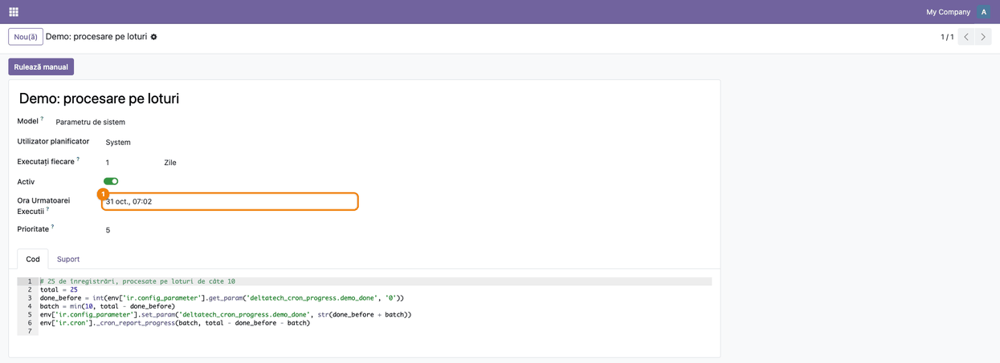
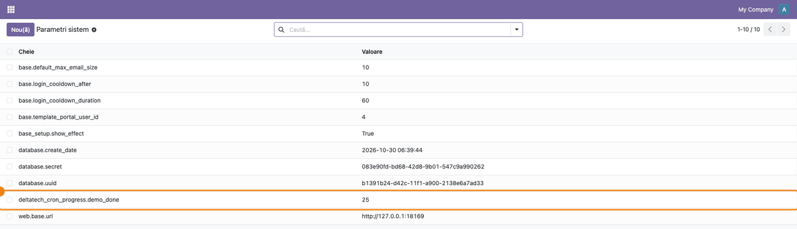
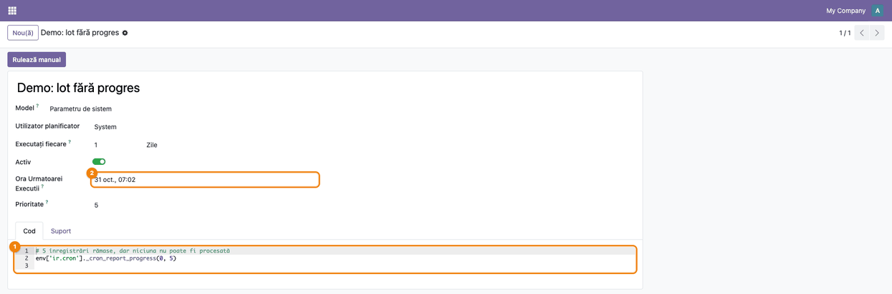

# Fișă Modul: Acțiuni programate care lucrează pe loturi până termină

**Modul:** `deltatech_cron_progress`
**Utilizator principal:** Administrator Odoo / consultant tehnic
**Prioritate:** 🟢 Scăzută (modul tehnic, fără ecrane proprii; îl vor folosi modulele Terrabit cu acțiuni programate pe loturi,
pe 18.0: `deltatech_actions`)

---

## 1. Scop business

Multe acțiuni programate procesează date pe loturi: unirea partenerilor duplicați, ștergerea
atașamentelor vechi, optimizarea imaginilor, facturarea automată a livrărilor. Un lot are o limită
(de exemplu 100 de înregistrări), ca rularea să nu depășească timpul permis de server.

Din Odoo 19, planificatorul rulează din nou o acțiune cât timp ea raportează că mai are de lucru. Dacă
însă acțiunea raportează înregistrări rămase fără să fi procesat vreuna (de exemplu toate dau eroare),
Odoo o reia imediat, iar și iar. Modulul aduce o regulă comună pentru modulele Terrabit: după fiecare
lot, acțiunea spune câte înregistrări a procesat și câte au rămas, progresul se salvează, iar un lot
care nu a procesat nimic oprește rularea. Regula are aceeași formă pe 18.0, 19.0 și 20.0, deci codul
modulelor care o folosesc nu se schimbă la migrare.

## 2. Bază legală și context

Nu există temei contabil sau fiscal. Contextul este operațional. Mecanismul de progres al acțiunilor
programate există din Odoo 18. Din Odoo 19, planificatorul rulează lotul următor imediat, salvează
progresul după fiecare lot, iar butonul **Rulează manual** se comportă la fel ca planificatorul.
Modulul păstrează aceeași regulă de apel pe toate versiunile; mecanismul de dedesubt diferă între ele.

## 3. Utilizatori și roluri

| Rol | Ce face |
|---|---|
| Administrator (Setări, mod dezvoltator) | Pornește manual acțiunile programate și urmărește rularea |
| Consultant tehnic | Verifică în jurnalul serverului că acțiunea a procesat tot și s-a oprit |
| Dezvoltator | Folosește regula comună în acțiunile programate ale modulelor noi |

Roluri recomandate pentru testare: un administrator cu **mod dezvoltator** activ (meniul **Tehnic** este
necesar pentru acțiunile programate) și acces la jurnalul serverului (pe Odoo.sh: **Logs**).

## 4. Conturi și date implicate

Modulul nu folosește conturi contabile.

Date minime pentru demo: două acțiuni planificate de test, de tip cod (secțiunea 5), care folosesc
regula pe un contor ținut într-un parametru de sistem:

- **Demo: procesare pe loturi** procesează 25 de înregistrări pe loturi de câte 10, ca rularea să aibă
  mai multe loturi;
- **Demo: lot fără progres** raportează 5 înregistrări rămase fără să proceseze vreuna.

Pe 19.0, deocamdată, niciun modul Terrabit nu folosește regula: trecerea `deltatech_actions` (unirea
partenerilor duplicați, curățarea atașamentelor) urmează. După trecere, testul se poate face și pe
acțiunile acelui modul.

## 5. Configurare inițială

1. Modulul nu are setări. Se instalează ca dependență a modulelor care îl folosesc sau direct, din
   **Aplicații**, după ce scoateți filtrul **Aplicații** din căutare.
2. Activați modul dezvoltator: **Setări** → blocul **Instrumente de dezvoltare** → **Activează modul de
   dezvoltare**.
3. **Setări → Tehnic → Automatizare → Acțiuni planificate** → **Nou(ă)**: numele **Demo: procesare pe
   loturi**, **Model** = **Parametru de sistem**, **Executați fiecare** 1 **Zile**, iar în tabul **Cod**:

   ```python
   # 25 de înregistrări, procesate pe loturi de câte 10
   total = 25
   done_before = int(env['ir.config_parameter'].get_param('deltatech_cron_progress.demo_done', '0'))
   batch = min(10, total - done_before)
   env['ir.config_parameter'].set_param('deltatech_cron_progress.demo_done', str(done_before + batch))
   env['ir.cron']._cron_report_progress(batch, total - done_before - batch)
   ```

4. La fel, a doua acțiune, **Demo: lot fără progres**, cu codul:

   ```python
   # 5 înregistrări rămase, dar niciuna nu poate fi procesată
   env['ir.cron']._cron_report_progress(0, 5)
   ```

## 6. Flux de utilizare

> Modulul nu are ecrane proprii: capturile arată acțiunile planificate de test din secțiunea 5. Starea
> fiecărei rulări se citește și în jurnalul serverului.

### Pasul 1 — Pornirea manuală a acțiunii planificate

**Setări → Tehnic → Automatizare → Acțiuni planificate** → deschideți **Demo: procesare pe loturi** →
butonul **Rulează manual** (①). În tabul **Cod** (②) se vede apelul regulii comune după fiecare lot:
câte înregistrări a procesat lotul și câte au rămas.


Odoo rulează lotul următor imediat, până nu mai rămâne nimic. Dacă după cel puțin 10 loturi și cel
puțin 10 secunde tot mai e de lucru, rularea se încheie, iar planificatorul o reia cât mai repede, după
celelalte acțiuni gata de rulare. Ecranul așteaptă până se termină rularea manuală. Ce nu încape în ea
continuă prin planificator, care trebuie să fie pornit pe server.

### Pasul 2 — Verificarea rezultatului

1. **Găsiți pe ecran:** după rulare, formularul acțiunii se reîncarcă. **Ora Urmatoarei Executii** (①)
   a trecut la următoarea rulare din program (a doua zi), deci acțiunea a terminat tot.

   

2. **Verificați datele:** **Setări → Tehnic → Parametri → Parametri sistem**: parametrul
   `deltatech_cron_progress.demo_done` are valoarea **25**, deci toate cele 3 loturi (10 + 10 + 5) au
   rulat la o singură apăsare a butonului.

   

3. **Verificați în jurnal:** la finalul rulării, serverul scrie un rând de forma

   ```text
   Job 'Demo: procesare pe loturi' (12) fully done (#loop 3; done 5; remaining 0; duration 0.05s)
   ```

   - `#loop` este numărul de loturi rulate, iar `done` și `remaining` sunt valorile ultimului lot;
   - starea este `fully done` și `remaining 0` când nu mai e nimic de procesat;
   - `partially done` cu `remaining` mai mare ca 0 apare doar când lucrul nu a încăput în rularea
     curentă; la rularea următoare `remaining` scade.
4. **Treceți mai departe:** abia după ce rularea manuală se termină corect, lăsați acțiunea pe
   programul ei normal.

### Pasul 3 — Lotul care nu poate procesa nimic

Deschideți **Demo: lot fără progres** și apăsați **Rulează manual**. Codul (①) raportează 5
înregistrări rămase, dar niciuna procesată. Regula comună oprește rularea: **Ora Urmatoarei Executii**
(②) trece la următoarea rulare din program, iar acțiunea nu este reluată imediat, la nesfârșit.



În jurnal, rândul final arată `fully done` cu `done 0` și `remaining 0`. În acest caz `fully done`
**nu** înseamnă că totul s-a procesat: la o acțiune reală, căutați în jurnal rândul cu `done 0` și
erorile înregistrărilor, scrise de modulul care folosește regula. Dacă modulul nu tratează erorile
fiecărei înregistrări, rularea apare ca `failed`.

### Note de monografie și raportare

Modulul nu generează note contabile (Dr/Cr). Notele generate de acțiunile programate care îl folosesc
sunt cele ale acțiunilor respective.

## 7. Legături cu alte module / declarații

| Modul | Rol |
|---|---|
| `base` | Acțiunile programate și mecanismul lor de progres |
| `deltatech_actions` | Pe 18.0 folosește regula la unirea partenerilor duplicați și la curățarea atașamentelor; pe 19.0 și 20.0 trecerea urmează |
| `deltatech_cron_monitor_webhook` | Pornește acțiunile din exterior, ca butonul **Rulează manual**; regula funcționează și acolo |

**Ce e automat:**

- salvarea progresului după fiecare lot și reluarea imediată cât timp mai e de lucru;
- oprirea când nu mai e nimic de procesat sau când lotul nu a procesat nimic;
- dezactivarea acțiunii după ce a procesat tot, când modulul care o folosește o cere (pentru acțiunile
  care trebuie să ruleze o singură dată, de exemplu o migrare de date): după ultimul lot, câmpul
  **Activ** se debifează singur;
- la apelul direct din cod, în afara unei rulări a acțiunii (de exemplu dintr-un buton al altui modul),
  progresul nu se salvează în acțiune, dar dacă mai e de lucru acțiunea e pornită în fundal pentru rest.

**Ce rămâne manual:** pornirea manuală pentru test, citirea jurnalului, stabilirea limitei lotului în
acțiunea programată, unde modulul care o folosește o permite.

## 8. Verificări pentru consultant

- [ ] După **Rulează manual** pe **Demo: procesare pe loturi**, parametrul
      `deltatech_cron_progress.demo_done` are valoarea 25, iar jurnalul arată `#loop 3`,
      `fully done` și `remaining 0`.
- [ ] **Ora Urmatoarei Executii** a acțiunii arată, după rulare, următoarea rulare din program.
- [ ] La a doua apăsare, fără date de procesat (valoarea rămâne 25), jurnalul arată `fully done` cu
      `#loop 1`.
- [ ] După **Rulează manual** pe **Demo: lot fără progres**, jurnalul arată `fully done` cu `done 0` și
      `remaining 0`, iar **Ora Urmatoarei Executii** trece la următoarea rulare din program.
- [ ] La o acțiune care cere dezactivarea după procesarea completă, câmpul **Activ** e debifat după
      ultimul lot.
- [ ] Testele automate ale modulului sunt verzi în CI (PR / Odoo.sh); dezvoltatorul le poate rula cu
      `odoo-bin … --test-tags=/deltatech_cron_progress …`.

## 9. Mesaje de eroare frecvente


| Mesaj | Cauză | Remediere |
|---|---|---|
| Pe ecran, la **Rulează manual**: „Sarcina „...” este deja în curs de execuție” | Acțiunea rulează deja (planificator sau altă pornire manuală) | Așteptați terminarea rulării în curs |
| În jurnal: `Job '...' ... partially done (... remaining N ...)` la fiecare rulare, cu N care nu scade | Fiecare lot procesează înregistrări, dar numărul celor rămase nu scade: aceleași înregistrări ajung din nou în lot, intră altele noi la fel de repede sau numărarea celor rămase e greșită | Verificați în jurnal erorile înregistrărilor și modulul care raportează progresul |
| În jurnal: `Job '...' ... failed` (la **Rulează manual**, eroarea apare și pe ecran) | Lotul curent a dat eroare înainte să raporteze progresul; loturile terminate înainte rămân salvate | Citiți eroarea din jurnal. Odoo dezactivează acțiunea după cel puțin 5 eșecuri la rând, întinse pe cel puțin 7 zile, și anunță administratorul |

## 10. Capturi de ecran

Capturile sunt **generate automat** din `tests/test_screenshots.py` (mixinul `ScreenshotCase` din
`deltatech_doc_screenshots`, import defensiv), în română, pe cele două acțiuni de test din secțiunea 5:

1. `01_actiune_planificata.png` — formularul acțiunii **Demo: procesare pe loturi**, cu **Rulează manual**
   și codul din tabul **Cod**;
2. `02_dupa_rulare_manuala.png` — aceeași acțiune după rulare, cu **Ora Urmatoarei Executii** mutată la
   următoarea rulare;
3. `03_inregistrari_procesate.png` — **Parametri sistem**, cu valoarea 25 a contorului;
4. `04_lot_fara_progres.png` — acțiunea **Demo: lot fără progres** după rulare.

Regenerare:

```bash
.venv/bin/python odoo/odoo-bin -c odoo.conf -d <baza> -i deltatech_cron_progress,deltatech_doc_screenshots \
    --test-tags=fise_screenshots --stop-after-init
```

## 11. Observații pentru manual

- După fiecare lot, progresul se salvează în baza de date. Dacă serverul oprește rularea pentru
  depășirea timpului, loturile deja terminate rămân procesate, iar rularea următoare continuă cu restul.
- Un lot foarte lung ține ocupat un proces de acțiuni programate. Între loturi, după 10 loturi și
  10 secunde, acțiunea lasă loc celorlalte.
- Regula se aplică doar acțiunilor programate ale modulelor care o folosesc; acțiunile standard Odoo
  nu se schimbă.
- Acțiunile **Demo** din secțiunea 5 sunt doar pentru test: ștergeți-le, împreună cu parametrul
  `deltatech_cron_progress.demo_done`, după verificare.
