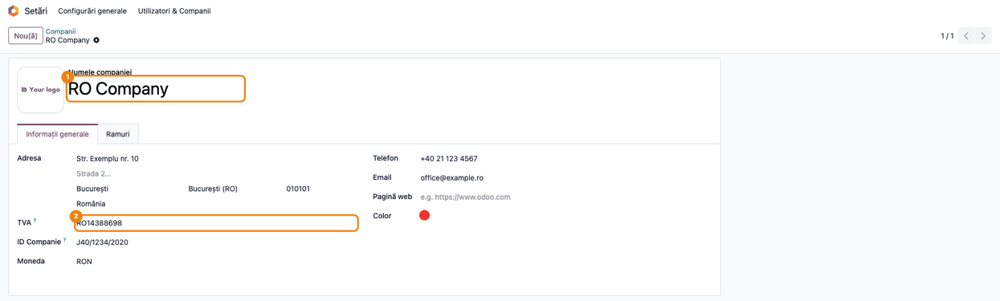
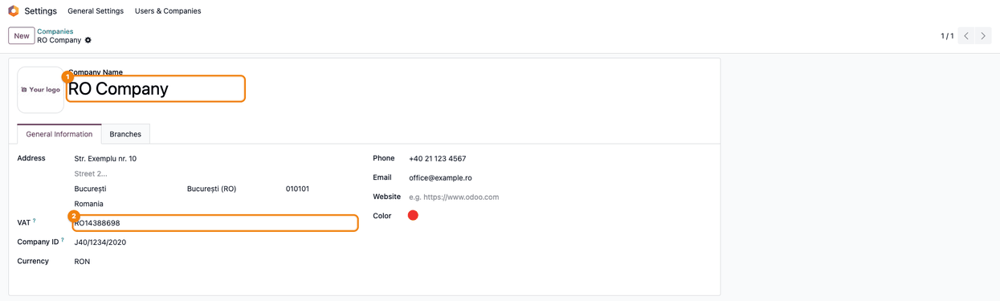

# Fișă Modul: Capturile automate ale fișelor consultant

**Modul:** `deltatech_doc_screenshots`
**Utilizator principal:** Dezvoltator sau consultant care pregătește fișele și USAGE.md ale modulelor
**Prioritate:** 🟢 Scăzută (unealtă de dezvoltare, fără funcție de business și fără ecrane proprii)

---

## 1. Scop business

Fișele consultant și paginile de pe Odoo Apps au nevoie de capturi de ecran actuale, identice la
fiecare regenerare. Modulul face aceste capturi automat, dintr-un test al modulului documentat: testul
creează datele demo, deschide ecranele într-un browser și salvează imaginile cu numele din fișă.

- capturile în **română** sunt pentru fișa consultant (`readme/FISA_CONSULTANT.md`);
- capturile în **engleză**, din aceleași ecrane, sunt pentru `readme/USAGE.md`, publicat pe Odoo Apps.

Modulul nu adaugă meniuri, câmpuri sau ecrane în Odoo. Nu se instalează la clienți.

## 2. Bază legală și context

Fără implicații contabile sau fiscale. Context: documentarea modulelor Terrabit. Capturile se fac pe o
companie demo („RO Company”, în RON), niciodată pe datele unui client.

## 3. Utilizatori și roluri

| Rol | Ce face |
|---|---|
| Dezvoltator | scrie testul de capturi al modulului documentat și îl rulează |
| Consultant | verifică pe capturi că ecranele arată fluxul din fișă |
| CI (Mentor) | regenerează capturile modulelor schimbate într-un PR |

## 4. Conturi și date implicate

Nu folosește conturi contabile. Datele de pe capturi le creează testul modulului documentat, pe
compania demo pregătită de modul (țara România, RON, limba română, drepturi contabile pentru admin).

## 5. Configurare inițială

1. În mediul Python al Odoo: `pip install playwright websocket-client pillow`, apoi
   `playwright install chrome`.
2. Modulul documentat are `tests/test_screenshots.py`, care pornește de la `ScreenshotCase`.
   Modulul de capturi nu se pune în `depends`; se instalează doar la rulare.
3. În test, lista capturilor se scrie **o singură dată** (`_shots`), în ordinea pașilor din fișă:
   adresa ecranului, numele fișierului (`01_...png`) și, opțional, câmpurile sau butoanele de
   evidențiat. O metodă o rulează în română, alta în engleză:

   ```python
   def test_capture_fise(self):  # RO, pentru fișă
       self.capture_screenshots(self._shots())

   def test_capture_usage(self):  # EN, pentru USAGE.md
       self.capture_screenshots(self._shots(), lang="en_US")
   ```

   Evidențierile se dau preferabil după numele câmpului (`div[name='vat']`), valabil în ambele limbi.
   Când un selector conține text din interfață, se dă pe limbă:
   `{"ro_RO": "button:has-text('Confirmă')", "en_US": "button:has-text('Confirm')"}`.
   Capturile de raport (PDF randat) ies singure în limba capturii.
4. Generarea, pentru ambele limbi:

   ```bash
   ./odoo/odoo-bin -c odoo.conf -d <baza> -i <modul>,deltatech_doc_screenshots \
       --test-tags=fise_screenshots --stop-after-init --http-port=<port liber>
   ```

   Pentru o singură limbă se numește metoda:
   `--test-tags=/<modul>:<ClasaTest>.test_capture_fise` (RO) sau `.test_capture_usage` (EN).
   Capturile se generează doar la cerere; o rulare obișnuită a testelor le sare, ca să nu rescrie
   imaginile.

## 6. Flux de utilizare

Exemplul de mai jos e chiar testul acestui modul (`tests/test_screenshots.py`): formularul companiei
demo, cu numele și codul fiscal evidențiate.

### Pasul 1 — Captura în română, pentru fișă

Metoda `test_capture_fise` deschide ecranul cu interfața în română și salvează captura în
`static/description/` (la modulele nemigrate, `readme/screenshots/`), cu numele din fișă. Câmpurile
evidențiate primesc contur portocaliu și numerele ①②, în ordinea din listă.



Se verifică pe captură: ecranul e cel din pasul fișei, datele promise apar, interfața e în română cu
diacritice, câmpurile evidențiate au eticheta lor.

### Pasul 2 — Aceeași captură în engleză, pentru USAGE.md

Metoda `test_capture_usage` rulează aceeași listă cu `lang="en_US"`: interfața și rapoartele sunt în
engleză, iar captura ajunge în `static/description/en/`, cu același nume. `readme/USAGE.md` o folosește
pe Odoo Apps.



Se verifică: același ecran și aceleași evidențieri ca în pasul 1, interfața în engleză, fără etichete
rămase în română. Datele demo („RO Company”, adresa, RON) rămân cele din test.

### Note de monografie și raportare

Nu generează note contabile.

## 7. Legături cu alte module / declarații

| Modul | Rol |
|---|---|
| `web` | singura dependență |
| `l10n_ro_doc_screenshots` (suita l10n_ro_ent) | vechiul loc al uneltei; acum doar o reexportă, ca testele existente să meargă |
| modulele cu `tests/test_screenshots.py` | consumatorii: fiecare își descrie capturile |

**Ce e automat:** pregătirea companiei demo, limba, tema luminoasă, navigarea, evidențierile, decuparea
marginilor, folderul pe limbă.
**Ce rămâne manual:** lista capturilor din test, datele demo ale fluxului și verificarea vizuală.

## 8. Verificări pentru consultant

- [ ] Rularea cu `--test-tags=fise_screenshots` produce câte o imagine pentru fiecare pas din fișă,
      cu numele din fișă.
- [ ] Capturile RO au interfața în română, cu diacritice; cele din `en/` au interfața în engleză.
- [ ] O captură de raport (PDF randat) din `en/` e în engleză, iar perechea ei RO în română.
- [ ] Rularea unei singure metode (`.test_capture_usage`) scrie doar capturile din `en/`.
- [ ] Fără `playwright` instalat, testele de capturi sunt sărite, nu picate.
- [ ] O rulare obișnuită a testelor modulului nu modifică imaginile.

## 9. Mesaje de eroare frecvente

| Mesaj | Cauză | Remediere |
|---|---|---|
| „playwright nu este instalat” (test sărit) | lipsește pachetul Python | `pip install playwright websocket-client` și `playwright install chrome` |
| „Capturile se generează doar la cerere” (test sărit) | rularea nu a cerut capturile | adăugați `--test-tags=fise_screenshots` |
| „Captura '…' a eșuat: Timeout …” | ecranul nu s-a încărcat sau selectorul nu există | citiți erorile JS din mesaj; verificați adresa și selectorul capturii |
| „HTTP 403 la /report/html/…” | raportul nu vede compania demo | lăsați implicit parametrul `companies` al capturii de raport |

## 10. Capturi de ecran

Generate automat de `tests/test_screenshots.py` al acestui modul, pe compania demo „RO Company”:

| Fișier | Ce arată |
|---|---|
| `static/description/01_formular_companie.png` | formularul companiei, în română, cu ①② pe nume și cod fiscal |
| `static/description/en/01_formular_companie.png` | același formular, în engleză (pentru USAGE.md) |

Regenerare: `-i deltatech_doc_screenshots --test-tags=fise_screenshots` (comanda de la secțiunea 5).

## 11. Observații pentru manual

- Modulul nu apare în manualul utilizatorului final: e o unealtă internă de documentare.
- Pe capturile EN, datele demo (parteneri, produse, „RO Company”, RON) rămân în română; doar interfața
  se traduce.
