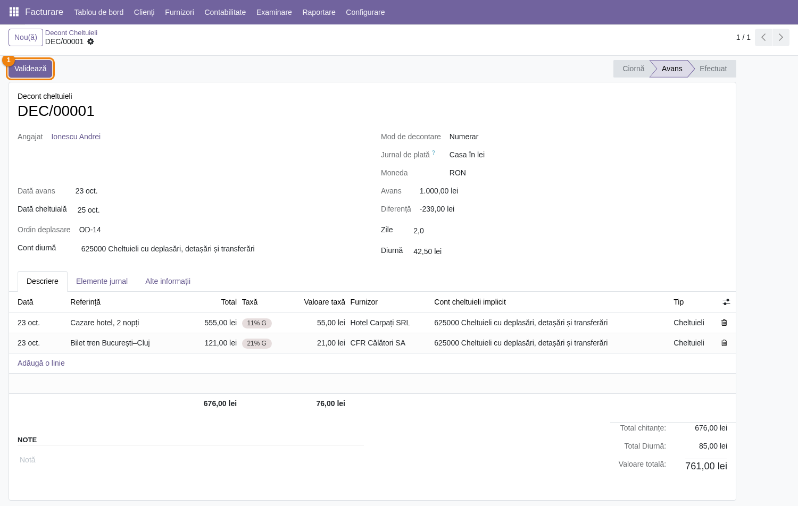
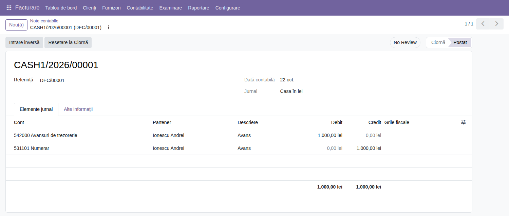
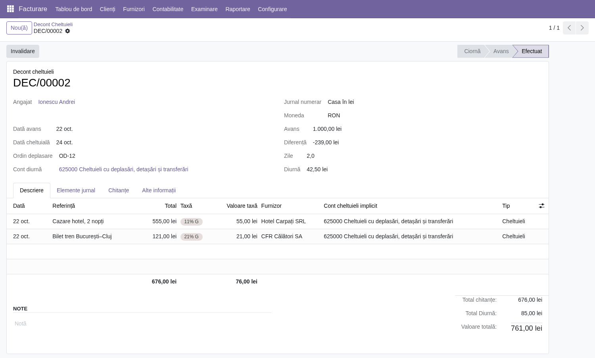
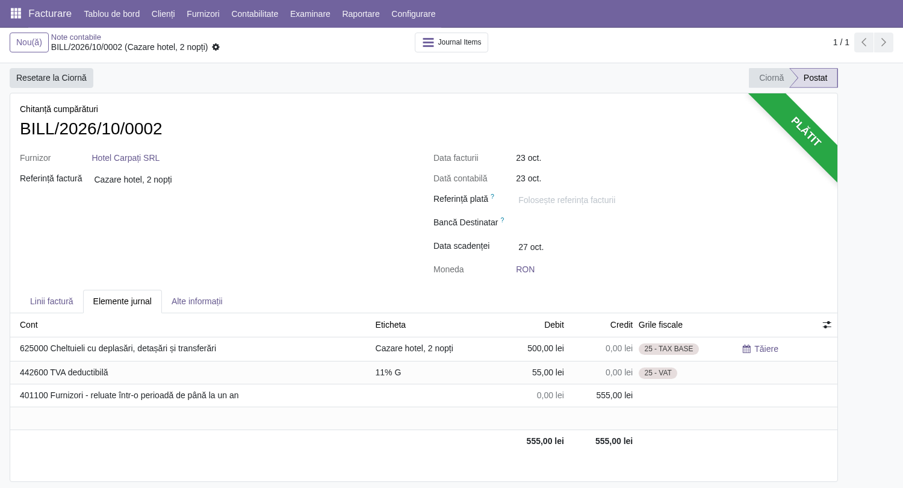
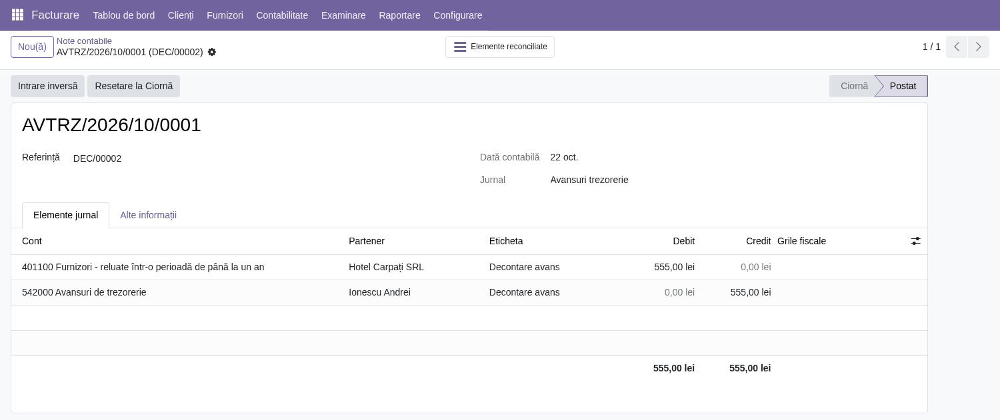
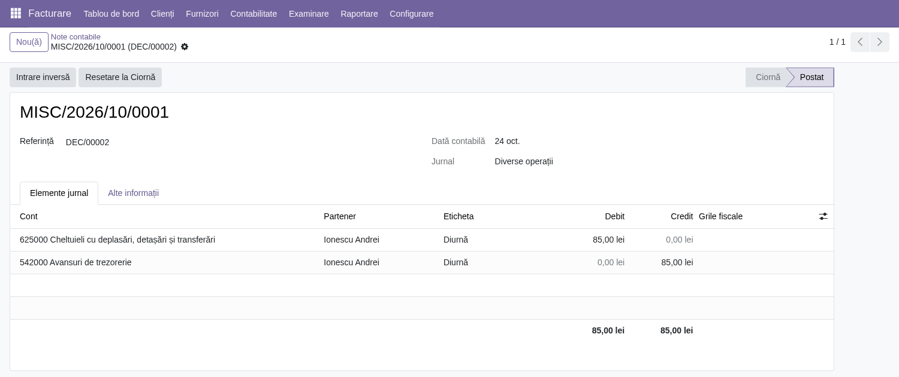
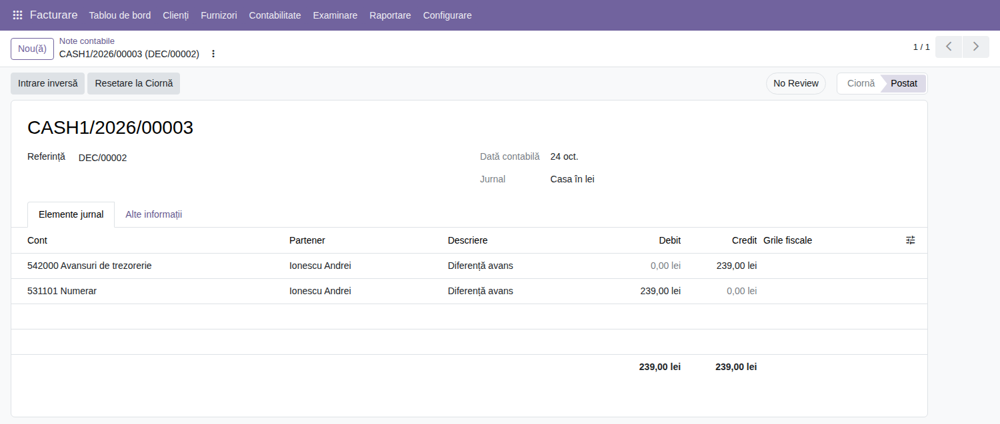
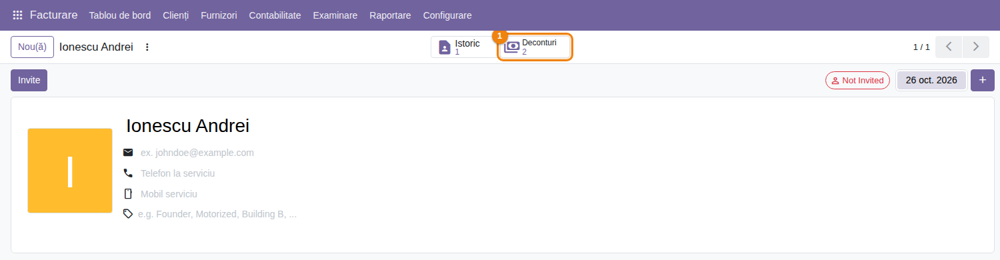

# Fișă Modul: Decont de cheltuieli din avans de trezorerie (542) și diurnă

**Modul:** `deltatech_expenses`
**Utilizator principal:** Contabil, Aprobator (casier / șef ierarhic), Angajat
**Prioritate:** 🔴 Ridicată (flux frecvent în practica românească)

---

## 1. Scop business

Modulul gestionează **decontul de cheltuieli al angajatului pornind de la un avans de trezorerie**
(cont 542), specific contabilității din România. Angajatul primește un avans, efectuează cheltuieli
(cazare, transport, protocol etc.) și, eventual, beneficiază de diurnă; la final, decontul calculează
automat diferența de restituit sau de încasat și generează notele contabile (chitanțele de achiziție,
decontarea din avans, diurna și regularizarea diferenței în casă), închizând soldul contului 542 al
angajatului.

Decontul are trei **moduri de decontare**: **Numerar** (avansul se dă din casă), **Virament (card
personal)** (avansul se virează din bancă pe cardul personal al angajatului) și **Card de firmă**
(cheltuielile se plătesc direct cu cardul firmei, fără avans pe 542).

## 2. Bază legală și context

- OMFP 2634/2015 — formularele „Decont de cheltuieli" și „Ordin de deplasare (delegație)"; chitanța
  și dispoziția de plată/încasare către casierie pentru avans și pentru regularizarea diferenței.
- OMFP 1802/2014 — funcțiunea conturilor: 542 „Avansuri de trezorerie", 625 „Cheltuieli cu
  deplasări, detașări și transferări", 623 „Cheltuieli de protocol, reclamă și publicitate",
  4426 „TVA deductibilă", 409 „Furnizori - debitori" (4091 bunuri de natura stocurilor, 4092
  servicii, 4093/4094 imobilizări).
- OMFP 1802/2014 pct. 319 și 322 — pentru decontul în valută, operațiunile se înregistrează în
  valută și în lei la cursul BNR din data fiecăreia, iar diferența de curs rămasă pe 542 la decontare
  se trece pe cheltuieli (665) sau venituri (765) din diferențe de curs.
- Legea 82/1991 art. 6 alin. (1) — operațiunea se înregistrează la data efectuării ei, pe baza unui
  document justificativ.
- Codul fiscal art. 76 alin. (2) lit. k) — diurna este neimpozabilă doar în limita a **2,5 ori**
  nivelul legal stabilit pentru instituțiile publice (HG 714/2018 pentru deplasări în țară,
  HG 518/1995 pentru străinătate) și a **3 salarii de bază** pe lună. Partea care depășește plafonul
  este venit de natură salarială (impozit, contribuții, D112).
- Codul fiscal art. 319 alin. (12) lit. a) și Normele metodologice (HG 1/2016) pct. 69 alin. (6) —
  bonul fiscal ține loc de factură simplificată, deci dă drept de deducere a TVA, doar dacă are
  tipărit **codul de TVA (RO…) al firmei** și valoarea lui, cu TVA, **nu depășește 100 euro**.
- Cote TVA 2026: 21% standard, 11% redusă (inclusiv cazarea hotelieră).

## 3. Utilizatori și roluri

Modulul are trei roluri proprii, alese pe utilizator în **Setări → Utilizatori și companii →
Utilizatori**, secțiunea **„Decont Cheltuieli"**. Fiecare rol îl include pe cel anterior:

| Rol | Ce poate face |
|---|---|
| **Angajat** | vede și completează doar deconturile proprii |
| **Aprobator** | vede toate deconturile; apasă **Avans** (aprobă și contabilizează acordarea avansului) |
| **Contabil** | apasă **Validează** (contabilizează decontul) și **Invalidare**; poate șterge deconturi în Ciornă |

Administratorii (grupul „Setări") primesc automat rolul de Contabil. Fără rolul potrivit,
butoanele respective nu apar pe formular.

Meniul decontului se află în aplicația Facturare/Contabilitate, deci utilizatorul are nevoie și de un
drept de acces în Facturare. Butonul „Deconturi" de pe fișa angajatului apare doar utilizatorilor care
văd fișa completă a angajatului (drepturi în aplicația Angajați).

## 4. Conturi și date implicate

- **542** — Avansuri de trezorerie (contul angajatului care se închide la final).
- **5311** — Casa (sursa avansului în modul Numerar).
- **5125** — Sume în curs de decontare: contul de plăți / încasări în curs al metodei de plată a
  jurnalului de bancă sau de card. Pe el se contabilizează avansul prin virament, restituirea
  diferenței și decontarea chitanțelor plătite cu cardul firmei; se închide la importul extrasului
  (Dr 5125 = Cr 5121 sau Dr 5121 = Cr 5125), nu direct pe 5121, ca nota să nu se dubleze cu extrasul.
- **625 / 623** — Cheltuieli cu deplasări / de protocol (contul se alege pe fiecare linie).
- **4426** — TVA deductibilă aferentă cheltuielilor.
- **401** — Furnizori (chitanțele de achiziție și plățile directe din avans).
- **4092** — Furnizori-debitori pentru servicii (plată directă din avans fără factură deschisă;
  pentru bunuri se reclasifică manual pe 4091, pentru imobilizări pe 4093).

Pentru deconturile în valută:
- **5314** — Casa în valută (contul registrului de casă în valută, sursa avansului);
- **542 în valută** — contul jurnalului de avansuri, ținut în moneda decontului;
- **665 / 765** — Cheltuieli / Venituri din diferențe de curs valutar (diferența de curs rămasă pe 542
  la validare).

Date minime pentru demo:
- companie românească cu localizarea contabilă instalată (RON);
- un angajat `hr.employee` cu „Work Contact" completat (partenerul folosit pe notele contabile);
- jurnal de numerar (Casă), un jurnal general cu **contul implicit = 542** (pentru avans/decont) și
  un jurnal pentru diurnă.

## 5. Configurare inițială

1. Instalați modulul `deltatech_expenses` (atrage și `hr`). Dacă folosiți și modulul standard de
   cheltuieli (`hr_expense`), instalați și `deltatech_expenses_hr_expense` pentru puntea de preluare
   a cheltuielilor standard în decont (vezi fișa acelui modul).
2. În **Facturare → Configurare → Jurnale**, creați un jurnal de tip „Diverse" al cărui **cont
   implicit este 542** (de ex. „Avansuri trezorerie"). Pe decont îl alegeți în tabul **„Alte
   informații"**, câmpul **„Jurnal avansuri (542)"**.
3. Verificați jurnalul de numerar (Casă) și contul său implicit (5311); pe decont este câmpul
   **„Jurnal de plată"** din antet (în modul Numerar alegeți jurnalul de numerar, în modul Virament
   un jurnal de bancă).
4. Pe decont, **„Cont diurnă"** (implicit primul cont 625) se află în antet, iar **„Jurnal diurnă"**
   (implicit primul jurnal „Diverse") în tabul „Alte informații".
5. Atribuiți utilizatorilor rolurile din secțiunea 3.
6. Asigurați-vă că angajații au „Work Contact" completat (sau lăsați-l gol pentru note interne, fără
   partener).
7. Opțional, pentru verificarea automată a plafonului fiscal al diurnei, instalați
   `l10n_ro_expense_allowance`.
8. Doar pentru deconturi în valută: creați un registru de casă cu **Moneda** respectivă (cont 5314) și
   un jurnal de avansuri pe un cont 542 în valută, actualizați cursurile valutare și setați conturile
   de diferențe de curs (765/665) în **Contabilitate → Configurare → Setări**. Fără aceste conturi,
   validarea unui decont în valută cu diferență de curs se oprește cu o eroare (vezi secțiunea 9).
9. Doar pentru modurile Virament și Card de firmă: pe metodele de plată ale jurnalului de bancă / card
   setați un cont de **plăți în curs** și unul de **încasări în curs** (5125 „Sume în curs de
   decontare"). Jurnalul cardului de firmă se poate seta o dată pe angajat, în fișa angajatului
   (câmpul **„Jurnal card firmă"**, vizibil doar utilizatorilor cu drepturi de Facturare), și se
   propune apoi pe fiecare decont, la alegerea angajatului sau a modului Card de firmă.
10. La actualizarea modulului la versiunea 20.0.3.6.0, deconturile existente al căror jurnal de plată
    este de bancă sau de card trec automat pe modul **Virament**; restul rămân pe **Numerar**. Un
    decont deja în starea „Avans" își păstrează nota de avans (Dr 542 = Cr 5121, postată direct pe
    bancă); diferența lui se postează la validare pe 5125, deci jurnalul de bancă trebuie să aibă
    contul 5125 setat pe metodele de plată (pasul 9).

## 6. Flux de utilizare

### Pasul 1 — Crearea decontului și acordarea avansului

Meniul este **Facturare → Furnizori → Decont Cheltuieli** (cu Enterprise: **Contabilitate →
Furnizori → Decont Cheltuieli**). Apăsați **Nou**, alegeți **angajatul**, **modul de decontare**
(implicit **Numerar**) și **jurnalul de plată** (jurnalul de numerar), completați **data avansului**,
**data cheltuielii** (data decontului; se completează din data avansului dacă e goală), **ordinul de
deplasare**, **avansul** acordat și, dacă e cazul, **diurna** (sumă/zi și număr de zile). În tabul
„Alte informații" verificați **jurnalul de avansuri (542)**.

**Moneda decontului** (câmpul **„Monedă"**, sub jurnalul de plată; apare utilizatorilor cu
monede multiple activate) se preia din registrul de casă ales: moneda registrului, sau moneda
companiei dacă registrul nu are una; în modul Card de firmă se preia din jurnalul cardului. Se poate
schimba doar în Ciornă și se blochează după **Avans**.
Avansul, liniile de cheltuieli, diurna și diferența se introduc în această monedă, iar lista
deconturilor are o coloană „Monedă". Un decont în valută este descris la „Decont în valută" mai jos.

Aprobatorul apasă **Avans**: documentul primește număr (`DEC/…`) și trece în starea „Avans". Pe
măsură ce adăugați liniile de cheltuieli, se calculează automat totalul și **diferența** față de
avans: o valoare **pozitivă** înseamnă că firma îi mai datorează angajatului, una **negativă** că
angajatul restituie restul în casă.



În modul Numerar, acordarea avansului generează nota contabilă **Dr 542 = Cr 5311** (avansul iese din
casă în contul de avansuri de trezorerie al angajatului); în modul Virament nota este Dr 542 = Cr 5125
(vezi „Moduri de decontare").



> **Preluare din modulul standard de cheltuieli:** dacă instalați și `deltatech_expenses_hr_expense`,
> pe formularul decontului apare butonul **„Preia cheltuieli HR"**, care preia cheltuielile eligibile
> din `hr.expense` ca linii de decont. Detaliile acelui flux sunt descrise în fișa modulului-punte.

### Pasul 2 — Introducerea cheltuielilor și validarea decontului

Adăugați liniile de cheltuieli: dată, referință (ce s-a cumpărat), **Total** = suma de pe bon sau
factură, **cu TVA inclus**, taxa de achiziție, furnizor și contul de cheltuială. Modulul extrage
baza și TVA-ul din total, oricum ar fi configurată taxa („inclusă în preț" sau „pe deasupra"); cu o
taxă „pe deasupra" poate apărea o rotunjire de 1 ban față de bon. Alegeți cota corectă la data
operațiunii (de ex. cazarea are 11%) și puneți taxă doar dacă documentul dă drept de deducere:
factura sau un bon fiscal de cel mult 100 euro cu **codul de TVA al firmei** tipărit. Un bon fără cod
de TVA sau peste 100 euro se introduce fără taxă, iar TVA-ul rămâne în cheltuială (pentru sume mari
cereți factură; în exemplu, cazarea are factură).

Contul de cheltuială se vede în coloana **„Cont cheltuieli implicit"** (pentru utilizatorii cu
drepturi de contabilitate). Implicit este primul cont **623** (protocol): pentru deplasări schimbați-l
în **625**.

Fiecare linie are un **tip**:

- **Cheltuieli** — justificată cu bon/factură; la validare se generează o **chitanță de achiziție** și
  decontarea din avans (vezi mai jos);
- **Plată furnizor** — angajatul a achitat direct o datorie a firmei către un furnizor (fără chitanță
  proprie); la validare se generează nota `Dr 401 = Cr 542`, care se **reconciliază cu facturile
  furnizor deschise** ale aceluiași furnizor (stinge datoria, ca o plată). Partea neacoperită de
  facturi deschise este un **avans acordat furnizorului** și se reclasifică automat
  `Dr 4092 = Cr 401`. De exemplu, o plată de 300 lei către un furnizor fără facturi deschise dă
  `Dr 401 = Cr 542` 300 lei și `Dr 4092 = Cr 401` 300 lei. La primirea facturii, contabilul compensează
  avansul (`Dr 401 = Cr 4092`). Modulul folosește mereu 4092 (servicii); dacă avansul e pentru bunuri
  (4091) sau imobilizări (4093), contabilul îl reclasifică manual.

Contabilul apasă **Validează**: decontul trece în starea „Efectuat", iar modulul generează
chitanțele de achiziție, notele de decontare din avans, nota de diurnă și nota de regularizare a
diferenței, închizând soldul contului 542. Chitanțele se văd în tabul **„Chitanțe"**, iar toate
liniile contabile în tabul **„Elemente jurnal"**.



Pentru fiecare cheltuială se generează o **notă de decontare din avans** care stinge datoria către
furnizor pe seama avansului: **Dr 401 (Furnizori) = Cr 542 (Avansuri de trezorerie)**, reconciliată cu
chitanța de achiziție. Linia de 542 poartă partenerul angajatului, cea de 401 pe al furnizorului.





Diurna se înregistrează cu data cheltuielii (**Dr 625 = Cr 542**), iar diferența dintre avans și
total se regularizează în casă cu aceeași dată, cea a decontului: în exemplu, angajatul restituie
239 lei (**Dr 5311 = Cr 542**).





**Atenție la diurnă:** modulul contează integral diurna introdusă și **nu verifică plafonul fiscal**.
Valoarea implicită de 42,50 lei/zi e doar un punct de pornire, nu plafonul legal. Ce depășește
plafonul de neimpozitare (secțiunea 2) trebuie preluat în salarizare ca venit impozabil. Modulul
`l10n_ro_expense_allowance` calculează automat plafonul și surplusul.

Dacă decontul a fost validat greșit, contabilul apasă **Invalidare**: **toate** notele decontului,
inclusiv nota de avans și chitanțele, se șterg, iar decontul revine în Ciornă. Fluxul se reia de la
**Avans** (care regenerează nota de avans) și **Validează**. Nu folosiți Invalidare pe o perioadă
declarată sau închisă: acolo corecția se face prin stornare.

Decontul se tipărește din meniul cu rotița (⚙) → **Tipărire → Tipărire decont cheltuieli**; documentul tipărit e
justificativul semnat de titularul avansului.

### Moduri de decontare

Câmpul **„Mod de decontare"** din antet (editabil doar în Ciornă) stabilește cum ajung banii la
angajat. Schimbarea lui propune automat un jurnal de plată potrivit (de numerar sau de bancă).

- **Numerar** — fluxul descris mai sus: avansul și diferența trec prin casă (5311). Jurnalul de plată
  trebuie să fie de numerar.
- **Virament (card personal)** — avansul se virează pe cardul personal al angajatului. Jurnalul de
  plată trebuie să fie de bancă. Nota de avans este **Dr 542 = Cr 5125** (plăți în curs ale metodei
  de plată), nu direct pe 5121; restituirea diferenței este **Dr 5125 = Cr 542** (încasări în curs),
  plata suplimentară **Dr 542 = Cr 5125**. Notele se reconciliază apoi cu liniile extrasului
  (Dr 5125 = Cr 5121), deci banca nu se contabilizează de două ori.
- **Card de firmă** — angajatul plătește cu cardul firmei, deci **nu există avans** (câmpul **Avans**
  se ascunde și se pune pe zero) și chitanțele nu trec prin 542. Se alege **„Jurnal card firmă"**
  (obligatoriu; se propune din fișa angajatului, inclusiv pentru utilizatorii care nu văd câmpul
  pe angajat). La validare, chitanța de achiziție (Dr 6xx + Dr 4426 = Cr 401) se decontează
  **Dr 401 = Cr 5125** al jurnalului cardului, cu partenerul furnizor, și se reconciliază cu extrasul
  cardului; la fel, o linie „Plată furnizor" plătită cu cardul stinge factura furnizorului prin
  **Dr 401 = Cr 5125**, fără 542. Angajatului i se datorează doar **diurna**:
  **Diferența** din antet este egală cu totalul diurnei, iar plata ei se face din jurnalul de plată
  (Dr 542 = Cr casă). O retragere de numerar cu cardul firmei nu face parte din decontul cu card, ci
  este un decont separat, în modul **Virament**.

### Decont în valută

Când registrul de casă este în valută, fiecare notă contabilă poartă **suma în valută** și
**contravaloarea în lei**, la cursul BNR din data ei: avansul la data avansului, fiecare chitanță la
data ei, diurna și diferența la data cheltuielii (a decontului). În tabul „Elemente jurnal" apare
coloana cu **suma în valută** (doar pentru decontul în valută). Chitanțele de achiziție sunt emise în
moneda decontului, iar nota de decontare din avans preia aceleași sume (în valută și în lei) ca datoria
chitanței, ca reconcilierea să o închidă complet.

Cursurile diferă între data avansului și cea a cheltuielilor, deci 542 se închide în valută, dar
poate rămâne un sold în lei. La validare, acesta se înregistrează ca **diferență de curs**
(**Dr 665 = Cr 542** nefavorabilă sau **Dr 542 = Cr 765** favorabilă), în jurnalul de diferențe de
curs al companiei (dacă nu e setat, în jurnalul de avansuri 542). Exemplu: avans 100 la 5,00 lei și
cheltuială 121 la 5,10 lei, cu plata suplimentară de 21: 542 este zero în valută, iar cei 100 × (5,00 −
5,10) = −10 lei rămași se trec pe **765**.

### Note de monografie și raportare (notele generate la fiecare pas)

- **Acordare avans** (Pasul 1): **Dr 542 = Cr 5311** în modul Numerar, **Dr 542 = Cr 5125** în modul
  Virament (suma avansului); în modul Card de firmă nu există avans;
- **Decontare cheltuieli** (Pasul 2, la validare), pentru liniile de tip „Cheltuieli", în două note:
  - chitanța de achiziție: **Dr 6xx + Dr 4426 = Cr 401** (cheltuială fără TVA + TVA deductibil),
    cu data liniei;
  - decontarea din avans: **Dr 401 = Cr 542** (reconciliată cu chitanța); în modul Card de firmă,
    **Dr 401 = Cr 5125** al jurnalului cardului (partenerul furnizor), fără 542;
- **Plată furnizor** (Pasul 2, liniile de tip „Plată furnizor"): **Dr 401 = Cr 542**, reconciliată cu
  facturile furnizor deschise (în modul Card de firmă: **Dr 401 = Cr 5125** al jurnalului cardului);
  restul neacoperit: **Dr 4092 = Cr 401**;
- **Diurnă** (la validare): **Dr 625 = Cr 542** (totalul diurnei), cu data cheltuielii;
- **Diferență** (la validare), cu data cheltuielii (a decontului), ca soldul 542 al angajatului să
  devină **zero**:
  - angajatul restituie restul avansului: **Dr 5311 = Cr 542** (în modul Virament: **Dr 5125 = Cr 542**);
  - firma îi plătește angajatului diferența: **Dr 542 = Cr 5311** (în modul Virament: **Dr 542 = Cr 5125**);
  - cu cardul de firmă, diferența este doar diurna: **Dr 542 = Cr casă** (jurnalul de plată);
- **Decont în valută** (la validare): casa este **5314**, iar toate notele de mai sus poartă suma în
  valută și contravaloarea în lei la cursul din data lor; în plus, soldul în lei rămas pe 542 se
  închide cu **Dr 665 = Cr 542** (diferență nefavorabilă) sau **Dr 542 = Cr 765** (favorabilă).

### Pasul 3 — Urmărirea deconturilor pe angajat

Fișa angajatului afișează butonul smart **„Deconturi"** cu numărul deconturilor; un clic deschide
lista filtrată pentru acel angajat.



## 7. Legături cu alte module / declarații

| Modul / proces | Rol în flux |
|---|---|
| `account` | note contabile de avans, decontare, diurnă și diferență; chitanțe `in_receipt` |
| `hr` | angajatul (`hr.employee`); partenerul contabil derivă din `work_contact_id` |
| `deltatech_expenses_hr_expense` (opțional) | preluarea cheltuielilor standard `hr_expense` în decont și prevenirea dublei contabilizări |
| `l10n_ro` | planul de conturi și TVA-ul românesc |
| `deltatech_partner_generic` | partener generic pentru liniile fără furnizor explicit |
| `l10n_ro_expense_allowance` (opțional) | plafonul fiscal al diurnei și surplusul impozabil |
| Salarizare / D112 | surplusul de diurnă peste plafon se declară manual ca venit salarial |
| D300 | chitanțele cu TVA intră în decontul de TVA prin grilele taxei de achiziție |

Ce este automat: generarea notelor contabile, calculul diferenței și al diurnei, închiderea contului 542,
conversia în lei la cursul din data fiecărei note și diferența de curs la decontul în valută.
Ce rămâne manual: configurarea jurnalelor/conturilor, alegerea cotei TVA și a contului pe fiecare
linie, plafonul fiscal al diurnei (fără `l10n_ro_expense_allowance`), reclasificarea avansului la
furnizor pe 4091/4093 când nu e pentru servicii, compensarea lui la primirea facturii și verificarea
soldului 542 după validare.

## 8. Verificări pentru consultant

- [ ] Modulul se instalează fără erori pe baza demo.
- [ ] „Jurnal avansuri (542)" are contul implicit 542.
- [ ] În modul Numerar, acordarea avansului produce nota Dr 542 = Cr 5311.
- [ ] Utilizatorii au rolurile potrivite (Angajat / Aprobator / Contabil).
- [ ] Liniile de deplasare au contul 625, nu 623 implicit.
- [ ] Un bon de 555 lei cu TVA 11% dă bază 500 și TVA 55; „Total chitanțe" este egal cu suma bonurilor.
- [ ] Diferența = cheltuieli + diurnă − avans (negativă = angajatul restituie).
- [ ] Nota de diferență din casă are data decontului, nu data avansului.
- [ ] O plată furnizor fără factură deschisă ajunge pe 4092, iar pe 401 nu rămâne sold debitor.
- [ ] Diurna se încadrează în plafonul fiscal sau surplusul a fost transmis la salarizare.
- [ ] După validare, soldul contului 542 al angajatului este zero.
- [ ] Virament: avansul ajunge pe 5125 (plăți în curs), nu pe contul băncii, iar jurnalul de plată este de bancă.
- [ ] Card de firmă: avansul este zero, chitanțele sunt decontate pe 5125 al cardului, fără sold pe 542,
  iar diferența din antet este egală cu diurna.
- [ ] Card de firmă: „Jurnal card firmă" este completat (sau propus din fișa angajatului).
- [ ] Decont în valută: moneda decontului este cea a registrului de casă, iar liniile o preiau.
- [ ] Decont în valută: nota de avans are suma în valută și contravaloarea în lei la cursul din data avansului.
- [ ] Decont în valută: după validare, 542 este zero atât în valută, cât și în lei; diferența de curs
  este pe 665 (nefavorabilă) sau 765 (favorabilă).

## 9. Mesaje de eroare frecvente

| Mesaj / simptom | Cauză probabilă | Remediere |
|-----------------|-----------------|-----------|
| Notele de avans nu au partener | Angajatul nu are „Work Contact" | Completați partenerul pe fișa angajatului (sau acceptați note interne) |
| Contul 542 nu se închide | „Jurnal avansuri (542)" nu are contul implicit 542 | Setați contul implicit 542 pe jurnal |
| „Furnizorul ... nu are un cont de datorii (401)" | Linie „Plată furnizor" cu un furnizor fără cont de plătit configurat | Completați „Cont de plătit" pe fișa furnizorului |
| „Nu aveți rolul necesar pentru a ... decontul" / lipsesc butoanele Avans, Validează | Utilizatorul nu are rolul Aprobator sau Contabil | Atribuiți rolul în Setări → Utilizatori, secțiunea „Decont Cheltuieli" |
| „Set an outstanding payments (or receipts) account (5125) on the … payment method of the journal …" | Jurnalul de bancă / card nu are cont de plăți (încasări) în curs pe metoda de plată | Setați contul 5125 pe metodele de plată ale jurnalului |
| „The expenses deduction … is settled in cash: choose a cash journal." / „… is settled by bank transfer: choose a bank journal." | Jurnalul de plată nu corespunde modului de decontare | Alegeți un jurnal de numerar (Numerar) sau de bancă (Virament) |
| „The expenses deduction … is paid with a company card: choose the company card journal." | Mod Card de firmă fără „Jurnal card firmă" | Completați jurnalul cardului pe decont sau pe fișa angajatului |
| „… is paid with a company card: it has no advance …" | Mod Card de firmă cu avans diferit de zero | Lăsați avansul 0; retragerea de numerar cu cardul este un decont separat în modul Virament |
| „The journal … is in <monedă>, but the expenses deduction … is in <monedă>." | Jurnalul de plată sau al cardului este în altă monedă decât decontul (jurnalul în valută primește doar note în moneda lui) | Alegeți un jurnal în moneda decontului; moneda decontului urmează jurnalul ales, deci nu o schimbați manual după aceea |
| „The expenses deduction … is paid with a company card in <monedă>: the per diem is paid from the payment journal …, which is in <monedă>." | Mod Card de firmă cu jurnal de plată (cel din care se plătește diurna) într-o altă valută decât cardul | Alegeți un jurnal de plată în moneda cardului sau în moneda companiei |
| Plata furnizor rămâne cu sold debitor pe 401 | Planul de conturi nu are un cont 4092 | Creați contul 4092 sau reclasificați manual |
| „Set the gain and loss exchange rate accounts (765/665) in the accounting settings of the company …" | Decont în valută cu diferență de curs la validare, iar compania nu are setate conturile de diferențe de curs | Setați conturile de câștig/pierdere din diferențe de curs (765/665) în Contabilitate → Configurare → Setări |
| Contravaloarea în lei a unei note în valută este neașteptată | Cursul BNR lipsește sau este vechi pentru data notei (Odoo ia cursul zilei precedente) | Actualizați cursurile valutare și reluați decontul (Invalidare, apoi Avans / Validează) |
| „Total chitanțe" diferă cu 1 ban de bon | Taxă „pe deasupra": TVA-ul se recalculează pe baza rotunjită | Folosiți o taxă „inclusă în preț" pentru potrivire exactă |

Pentru mesajele legate de preluarea cheltuielilor standard (`hr_expense`), vezi fișa modulului
`deltatech_expenses_hr_expense`.

## 10. Capturi de ecran

Capturile (`readme/screenshots/`) sunt **generate automat** din `tests/test_screenshots.py` al acestui
modul (mixinul `ScreenshotCase` din `l10n_ro_doc_screenshots`, import defensiv), în **limba română**,
pe planul de conturi RO (`setup_country("ro")`), pe o bază **fără** `hr_expense`:

1. `01_decont_avans.png` — decontul în starea „Avans": avans 1.000 lei, cazare 555 lei (TVA 11%) și
   bilet de tren 121 lei (TVA 21%), cu TVA inclus, diurnă 2 zile × 42,50 lei și diferența −239 lei.
2. `02_nota_avans.png` — nota contabilă de acordare a avansului (Dr 542 = Cr 5311).
3. `05_angajat_deconturi.png` — antetul fișei angajatului, cu butonul smart „Deconturi".
4. `06_decont_validat.png` — decontul în starea „Efectuat" după validare.
5. `07_nota_decontare.png` — nota de decontare din avans (Dr 401 = Cr 542), cu 542 pe angajat.
6. `08_chitanta_achizitie.png` — chitanța de achiziție pentru cazare (Dr 625 + Dr 4426 = Cr 401).
7. `09_nota_restituire.png` — restituirea diferenței în casă (Dr 5311 = Cr 542).
8. `10_nota_diurna.png` — nota de diurnă (Dr 625 = Cr 542).

Capturile wizard-ului „Preia cheltuieli HR" (`03`/`04`) sunt în modulul
`deltatech_expenses_hr_expense`, generate de testul de capturi al acelui modul.

Regenerare (pe o bază fără `hr_expense`, altfel apare și butonul „Preia cheltuieli HR"):

```bash
./odoo/odoo-bin -c odoo.conf -d <db> -i deltatech_expenses,l10n_ro_doc_screenshots \
    --test-tags=/deltatech_expenses:TestExpensesScreenshots --stop-after-init
```

## 11. Observații pentru manual

În manualul final, păstrați explicația orientată pe activitatea utilizatorului: când se acordă avansul,
ce documente justificative se adaugă, cum se citește diferența de restituit/încasat și cum se verifică
închiderea contului 542; pentru decontul în valută, explicați cursul din data fiecărei note și diferența de
curs de la validare. Notele contabile se prezintă în detaliu (liniile Dr/Cr), iar integrarea cu
`hr_expense` se menționează ca opțiune pentru companiile care folosesc și fluxul standard de cheltuieli.
