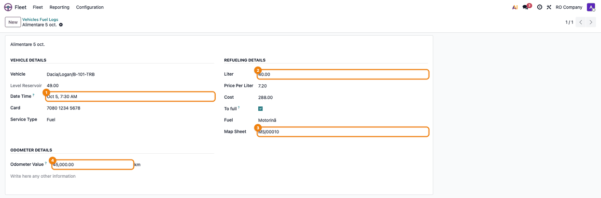
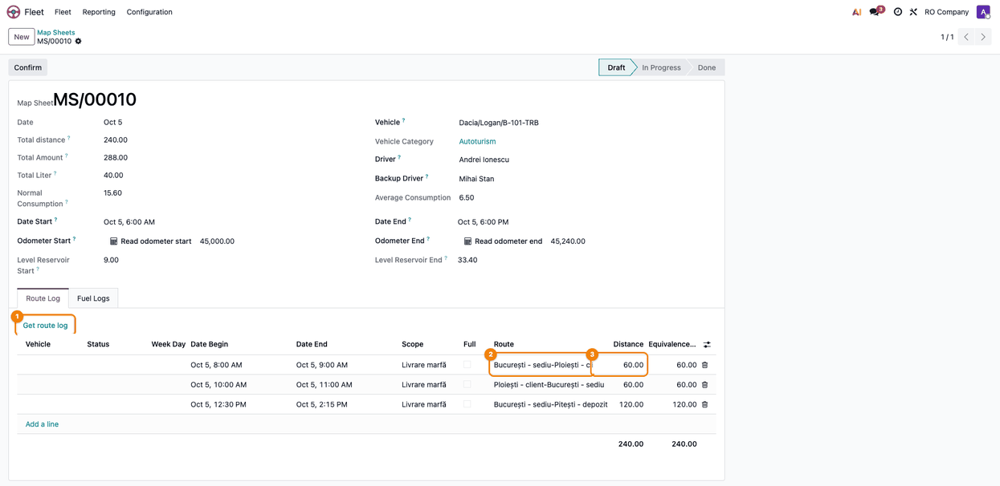
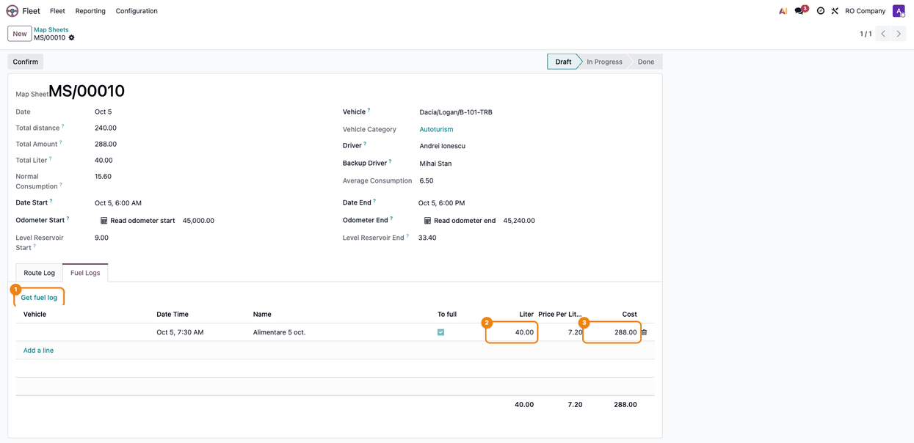
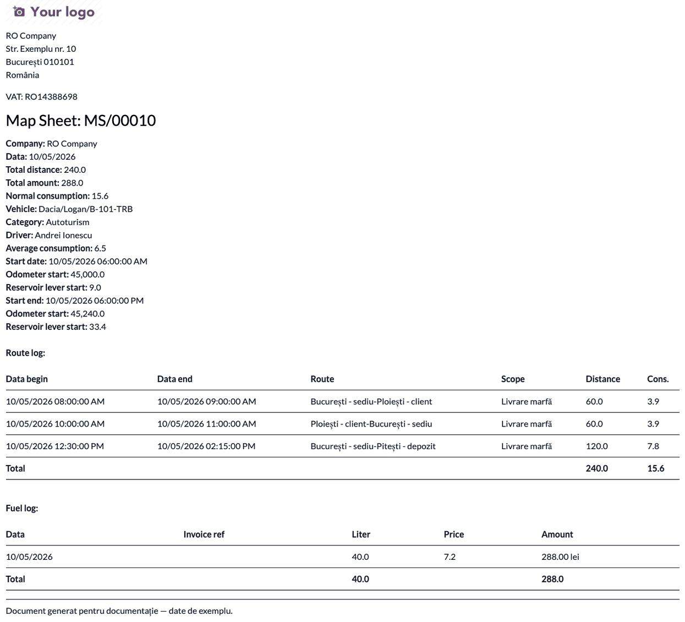
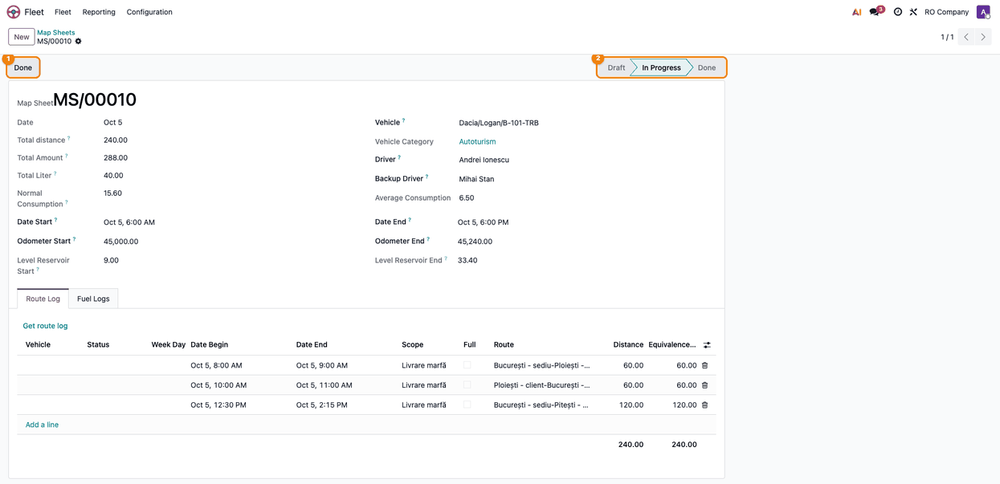
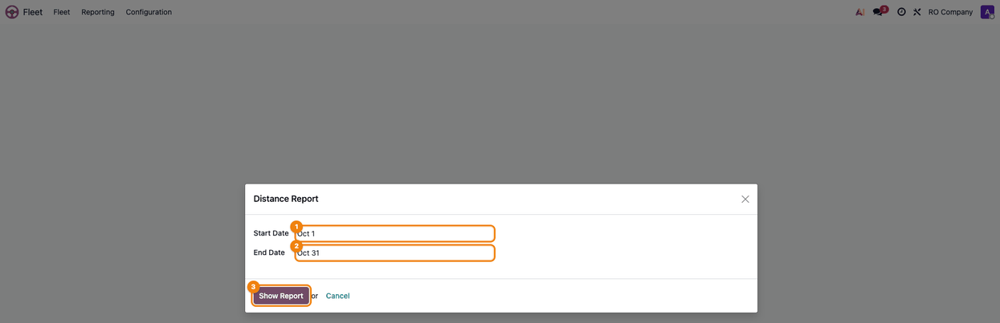
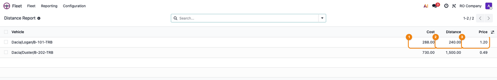

=======================
Fleet Map Sheets & Fuel
=======================

..
   !!!!!!!!!!!!!!!!!!!!!!!!!!!!!!!!!!!!!!!!!!!!!!!!!!!!
   !! This file is generated by oca-gen-addon-readme !!
   !! changes will be overwritten.                   !!
   !!!!!!!!!!!!!!!!!!!!!!!!!!!!!!!!!!!!!!!!!!!!!!!!!!!!
   !! source digest: sha256:d44cdf73405abe9757bb3a56241503f44dd6c02024f45f66b39865b33cbdc35f
   !!!!!!!!!!!!!!!!!!!!!!!!!!!!!!!!!!!!!!!!!!!!!!!!!!!!

.. |badge1| image:: https://img.shields.io/badge/maturity-Beta-yellow.png
    :target: https://odoo-community.org/page/development-status
    :alt: Beta
.. |badge2| image:: https://img.shields.io/badge/github-dhongu%2Fdeltatech-lightgray.png?logo=github
    :target: https://github.com/dhongu/deltatech/tree/19.0/deltatech_fleet
    :alt: dhongu/deltatech
.. |badge_fisa| image:: https://img.shields.io/badge/-Fi%C8%99%C4%83%20consultant-2ea44f.png
    :target: https://github.com/dhongu/deltatech/blob/19.0/deltatech_fleet/readme/FISA_CONSULTANT.md
    :alt: Fișă consultant
.. |badge_tests| image:: https://img.shields.io/badge/-45%20automated%20tests%20%C2%B7%2097%25%20code%20coverage-2ea44f.png
    :target: https://app.codecov.io/gh/dhongu/deltatech/tree/19.0/deltatech_fleet
    :alt: 45 automated tests · 97% code coverage

|badge1| |badge2| |badge_fisa| |badge_tests|

Extends the Fleet application with map sheets (route sheets), fuel logs
and fuel cards.

Features:

- Additional vehicle data: indicative, backup driver, vehicle category,
  engine serial number, mass capacity, useful weight, reservoir
  capacity, average consumption (urban / exterior / mixed), average
  speed, ownership and allocation details, fuel cards.
- Fuel cards: allocate cards to vehicles and to refuelling entries.
- Fuel logs: refuelling entries per vehicle, linked to a fuel card and
  to a map sheet; the reservoir level is computed at the refuelling
  moment.
- Routes and locations: locations, distances and travel durations
  between them, with one-click creation of the reverse route.
- Map sheets: route logs and fuel logs per vehicle and period, start/end
  odometer, total distance, normal consumption, reservoir level at start
  and end, PDF report.
- Automatic computation of the fuel level in the reservoir from
  refuelling entries and the normal consumption of the route logs.
- Cost per kilometre report per vehicle and period.

**Table of contents**

.. contents::
   :local:

Usage
=====

Map sheets and route logs are managed by a **Fleet Administrator**; a
**Fleet Officer** can record fuel logs. Before you start, fill in on the
vehicle the **Average Consumption** (l/100 km, used for the normal
consumption of the routes), the **Reservoir capacity**, the vehicle
category and the fuel cards, and create the locations and the routes
between them (**Fleet → Fleet → Master data**).

1. **Record the fuel logs** — **Fleet → Fleet → Vehicles Fuel Logs**,
   **New**. Fill in the vehicle, the **Date Time**, the card, the
   liters, the price per liter and the amount (any two compute the
   third), **To full**, the fuel and the odometer. Optionally link the
   map sheet; only the sheets of the vehicle that include the date are
   proposed. The odometer becomes an odometer reading of the vehicle.

   |Fuel log of vehicle Dacia/Logan/B-101-TRB: Date Time (1), Liter 40
   (2), Map Sheet MS/00010 (3) and the odometer 45,000 (4)|

2. **Create the map sheet** — **Fleet → Fleet → Map Sheets**, **New**
   (or the **Map Sheets** button on the vehicle). The number is given
   automatically. Choose the vehicle (the drivers, the category and the
   average consumption are filled in), then the **Date Start** and
   **Date End**. **Odometer Start** and **Odometer End** are read from
   the odometer readings of the vehicle or written by hand; the **Read
   odometer** buttons repeat the reading while the sheet is in
   **Draft**.

   |Draft map sheet: Vehicle (1), Date Start (2), Date End (3), Odometer
   Start with Read odometer start (4) and Odometer End with Read
   odometer end (5)|

3. **Add the route logs** — in the **Route Log** tab, add one line per
   trip: choosing the route fills in the distance and the end time.
   Route logs recorded separately (**Fleet → Fleet → Route Log**) for
   the vehicle and the period are brought in with **Get route log**.

   |Route Log tab: the Get route log button (1), the route (2) and the
   distance (3) of the first line, total 240 km|

4. **Add the fuel logs** — in the **Fuel Logs** tab, add the fuel logs
   directly, or bring the ones of the vehicle and the period with **Get
   fuel log**.

   |Fuel Logs tab: the Get fuel log button (1), the liters (2) and the
   amount (3) of the fuel log|

5. **Check the sheet** — the header shows **Total distance**, **Total
   Liter**, **Total Amount**, **Normal Consumption** (distance × average
   consumption / 100) and the computed reservoir level at the start and
   at the end. **Odometer End** − **Odometer Start** should equal
   **Total distance**, and the end level should be about the start level
   + liters − normal consumption.

   |Map sheet header: Total distance 240 (1), Total Liter 40 (2), Normal
   Consumption 15.60 (3), Level Reservoir Start 9 (4) and Level
   Reservoir End 33.40 (5)|

   Print the sheet from **Print → Map Sheet**: the PDF contains the
   header, the route logs and the fuel logs.

   |Map Sheet PDF with the header, the Route log table (240 km, 15.6 l)
   and the Fuel log table (40 l, 288 lei)|

6. **Confirm and close the sheet** — **Confirm** moves the sheet to **In
   Progress**; **Done** closes it and marks its fuel logs as done. A
   sheet with a total distance of zero cannot be closed. Duplicating a
   sheet creates the sheet of the next day.

   |Map sheet In Progress (2) with the Done button (1)|

7. **Cost per kilometer** — **Fleet → Reporting → Distance Report**
   (Fleet Administrator) asks for the **Start Date** and **End Date**
   (the current month by default). **Show Report** lists, per vehicle,
   the **Cost** (services and contracts of the vehicle, fuel logs
   included), the **Distance** (from the odometer readings at the ends
   of the period) and the **Price** per km. The distance goes from the
   reading before the period (or the first one in it) to the reading
   after the period (or the last one in it); with a single reading, the
   distance and the price are zero.

   |Distance Report window: Start Date (1), End Date (2) and Show Report
   (3)|

   |Distance Report list for October 2026: Dacia/Logan/B-101-TRB with
   Cost 288 (1), Distance 240 (2) and Price 1.20 (3)|

.. |Draft map sheet: Vehicle (1), Date Start (2), Date End (3), Odometer Start with Read odometer start (4) and Odometer End with Read odometer end (5)| image:: https://raw.githubusercontent.com/dhongu/deltatech/19.0/deltatech_fleet/static/description/en/02_foaie_parcurs.png

.. |Map sheet header: Total distance 240 (1), Total Liter 40 (2), Normal Consumption 15.60 (3), Level Reservoir Start 9 (4) and Level Reservoir End 33.40 (5)| image:: https://raw.githubusercontent.com/dhongu/deltatech/19.0/deltatech_fleet/static/description/en/05_verificare_foaie.png

Changelog
=========

19.0.1.0.5 (2026-11-01)
-----------------------

- The cost per km report includes the costs changed in the same
  transaction: a fuel or service log whose date was just edited was
  counted in the month of its old date (or not at all), because the cost
  view read the tables before the pending changes were saved.

19.0.1.0.4 (2026-10-22)
-----------------------

- Listed on Odoo Apps as *Fleet Map Sheets & Fuel* (was *Fleet Routes
  and Map Sheets*). The technical name ``deltatech_fleet`` does not
  change.

19.0.1.0.3 (2026-10-12)
-----------------------

- The normal consumption of a route log is recomputed when its distance
  or vehicle changes; it used to keep the value from creation, so the
  map sheet total and the reservoir level stayed wrong after editing a
  route.
- Opening a map sheet no longer creates an odometer reading on the
  vehicle. The odometer start used to write the end value as a side
  effect, and the next opening took that reading as start, losing the
  distance of the sheet. The readings of the sheet itself are no longer
  taken as the other end.
- The reservoir level includes the fuel logs and route logs not yet
  saved in the same transaction (for example when a map sheet is saved
  with new routes); it used to show the level without their consumption.
- Changing the vehicle of a map sheet moves its fuel logs, route logs
  and odometer readings to the new vehicle; they used to keep the old
  one.
- Moving the start of a map sheet moves its draft routes by that change
  only. The first change used to move nothing and the later ones were
  measured from the first start, so the routes drifted.
- A route log without a begin date no longer crashes on the week day.
- Map sheet default dates work for users without a time zone (UTC is
  used).
- Removed unused odometer methods on fuel logs and a no-op domain in the
  route log onchange.
- Tests for map sheets, fuel logs, vehicles, routes, the distance report
  and the map sheet printout.

19.0.1.0.2 (2026-10-09)
-----------------------

- New module icon (yellow car, flat Terrabit style).

19.0.1.0.1 (2026-10-09)
-----------------------

- Apps Store banner (banner.json).

19.0.1.0.0 (2026-10-08)
-----------------------

- Migration to 19.0: ``models.Constraint`` instead of
  ``_sql_constraints``, ``SQL()`` builder for the raw queries and the
  cost report view, ``_read_group`` in the cost per kilometre report,
  ``self.env._()`` translations, company check on map sheets.

18.0.1.0.0 (2026-10-08)
-----------------------

- Migration to 18.0: ``list`` views, ``<chatter/>``, kanban ``card``
  template, ``aggregator`` instead of ``group_operator``.
- The vehicle category (M1, N1, O1...) is now ``vehicle_category_id``.
  The module used to replace the standard ``category_id`` of the vehicle
  (model category) with a different comodel, which broke the install on
  databases with vehicles. A migration script moves the existing values
  and restores the standard category from the vehicle model.
- The map sheet sequence gets its ``fleet.map.sheet`` code, so map
  sheets are numbered again instead of named "/"; a duplicated map sheet
  no longer fails.
- The cost report view includes the standard ``vehicle_type`` column.
- Access rights without a group are now given to the Fleet user group.
- Description rewritten.

Bug Tracker
===========

Bugs are tracked on `Terrabit Issues <https://www.terrabit.ro/helpdesk>`_.
In case of trouble, please check there if your issue has already been reported.

Do not contact contributors directly about support or help with technical issues.

Credits
=======

Authors
-------

* Dorin Hongu
* Terrabit

Maintainers
-----------

.. |maintainer-dhongu| image:: https://github.com/dhongu.png?size=40px
    :target: https://github.com/dhongu
    :alt: dhongu

Current maintainer:

|maintainer-dhongu| 

This module is part of the `dhongu/deltatech <https://github.com/dhongu/deltatech/tree/19.0/deltatech_fleet>`_ project on GitHub.

You are welcome to contribute.