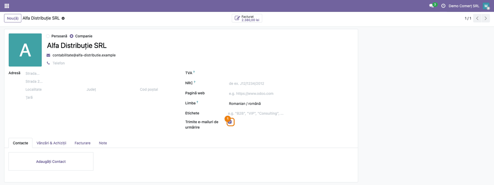
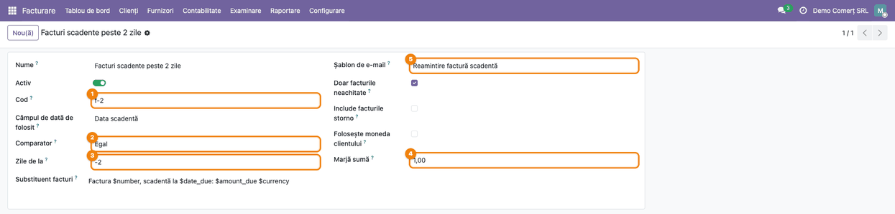
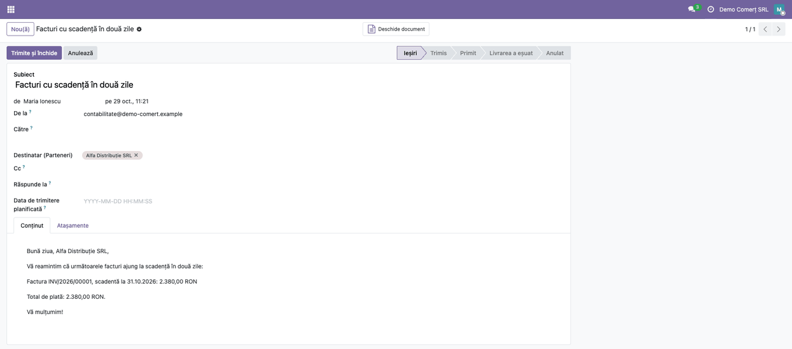
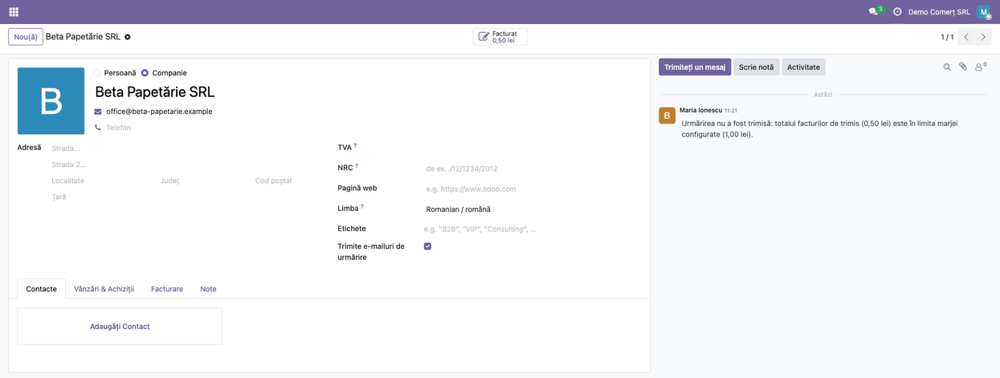

================
Invoice Followup
================

..
   !!!!!!!!!!!!!!!!!!!!!!!!!!!!!!!!!!!!!!!!!!!!!!!!!!!!
   !! This file is generated by oca-gen-addon-readme !!
   !! changes will be overwritten.                   !!
   !!!!!!!!!!!!!!!!!!!!!!!!!!!!!!!!!!!!!!!!!!!!!!!!!!!!
   !! source digest: sha256:1c9d813b6a823b79b1a7317dd6afaafc13460d118ed24b8a6a9a62b219e56a19
   !!!!!!!!!!!!!!!!!!!!!!!!!!!!!!!!!!!!!!!!!!!!!!!!!!!!

.. |badge1| image:: https://img.shields.io/badge/maturity-Alpha-red.png
    :target: https://odoo-community.org/page/development-status
    :alt: Alpha
.. |badge2| image:: https://img.shields.io/badge/github-dhongu%2Fdeltatech-lightgray.png?logo=github
    :target: https://github.com/dhongu/deltatech/tree/19.0/deltatech_followup
    :alt: dhongu/deltatech
.. |badge_fisa| image:: https://img.shields.io/badge/-Fi%C8%99%C4%83%20consultant-2ea44f.png
    :target: https://github.com/dhongu/deltatech/blob/19.0/deltatech_followup/readme/FISA_CONSULTANT.md
    :alt: Fișă consultant
.. |badge_tests| image:: https://img.shields.io/badge/-25%20automated%20tests%20%C2%B7%2098%25%20code%20coverage-2ea44f.png
    :target: https://app.codecov.io/gh/dhongu/deltatech/tree/19.0/deltatech_followup
    :alt: 25 automated tests · 98% code coverage

|badge1| |badge2| |badge_fisa| |badge_tests|

This module sends your customers automatic e-mail reminders for their
invoices: a few days before the due date, on the due date, or some days
after it. For each reminder step (a *followup*) you choose the reference
date, the offset in days and the mail template, and the e-mail can list
the invoices concerned together with the customer's totals.

**✨ Key features:**

- **Reminder steps you configure yourself**: the date used (invoice date
  or due date), the offset in days (``-2`` means two days before, ``3``
  three days after), and whether only that exact day or every day from
  then on is processed.
- **Open invoices only**: credit notes are optional, and totals are
  shown in the company currency or in the customer currency.
- **Your own mail template**: set on the Contact, with the invoices
  inserted where you place ``[invoices]``, one row per invoice (number,
  dates, payment term, amounts), plus the total to pay, the customer's
  total debit and the amount already overdue.
- **Only the customers you flag**: those with *Send followup e-mails*
  ticked receive reminders.
- **Amount margin**: nothing is sent when the invoices in the e-mail add
  up to less than the margin (or to a negative amount, when credit notes
  exceed the invoices), and a note on the customer says why.
- **Amounts and dates in the customer's language**: credit notes are
  shown negative and subtracted from the total.
- **Errors stay local**: if one customer cannot be processed (for
  example an unknown placeholder), the error is logged and noted on that
  customer, and all the other customers are still processed.
- **Run from a scheduled action**: for all the followups or only for
  those with given codes, so different steps can run at different times.

.. IMPORTANT::
   This is an alpha version, the data model and design can change at any time without warning.
   Only for development or testing purpose, do not use in production.
   `More details on development status <https://odoo-community.org/page/development-status>`_

**Table of contents**

.. contents::
   :local:

Configuration
=============

Scheduled action
----------------

1. Activate the developer mode and go to **Settings > Technical >
   Automation > Scheduled Actions**.
2. Create an action on the model **Followup Send Wizard**
   (``followup.send.wizard``), with the frequency you want (usually
   daily), and this Python code:

   - for all the followups: ``model.run_followup()``
   - for selected followups only:
     ``model.run_followup(["f-1", "AZI"])``, where the values are the
     **Code** of the followups to run.

3. The user of the scheduled action needs the **Followup manager**
   group.

Mail template
-------------

Create a mail template on the model **Contact**. In its body you can use
``${object.name}``, ``$total_debit``, ``$total_all_debit``,
``$total_due_debit``, ``$currency`` and ``[invoices]``. By default the
template deletes the mail after it is sent (**Auto Delete**); untick it
if you want to keep a trace in **Settings > Technical > Email >
Emails**.

Testing
-------

To test without writing to customers, create the system parameter
``followup.override_partner_id`` (**Settings > Technical > Parameters >
System Parameters**) with the id of a contact: the e-mails go to that
contact instead of the customers. Remove the parameter before going
live.

Usage
=====

Choosing the customers to remind
--------------------------------

1. Open the customer (**Invoicing > Customers > Customers**).
2. Tick **Send followup e-mails**, under the **Tags** field. The box
   must be on the same contact that appears on the invoice, not on its
   parent company.

|Followup box on the customer|

Defining a followup
-------------------

1. Go to **Invoicing > Configuration > Followups** and click **New**.
   You need accounting manager rights and the **Followup manager**
   group.
2. Fill in the **Name** and the **Code**, then choose the **Date field
   to use** (invoice date or due date), the **Comparator** and the
   **Days from**:

   - **Equal** processes only the invoices whose date plus the offset is
     today; a day on which the scheduled action does not run is lost.
   - **Greater or equal** processes every invoice from that day on, so
     the reminder is repeated daily.

3. Choose the **Mail template** (required) and, under **Invoices
   placeholder**, the HTML of one invoice row, with ``$number``,
   ``$payment_term_id``, ``$date_invoice``, ``$date_due``,
   ``$amount_untaxed``, ``$amount_tax``, ``$amount_total``,
   ``$amount_due`` and ``$currency``.
4. Set the options: **Only open invoices**, **Parse refund invoices**,
   **Use customer currency** and the **Amount margin**.

|Followup form|

What happens when it runs
-------------------------

For each active followup and each flagged customer, the module takes the
posted invoices that match the followup, adds up the totals and sends
the e-mail built from the template. Amounts and dates follow the
language of the customer.

|E-mail generated for the customer|

- If the invoices in the e-mail add up to the margin or less, or to a
  negative amount (credit notes over invoices), no e-mail is sent and a
  note is posted on the customer.
- If a customer cannot be processed, a note says that the followup
  failed and why; the other customers are processed normally.
- The e-mails appear in **Settings > Technical > Email > Emails** until
  they are sent; with **Auto Delete** on the template they are removed
  afterwards.

|Note posted when the amount is within the margin|

A reminder does not replace a formal notice of non-payment.

Changelog
=========

19.0.0.1.4 (2026-10-29)
-----------------------

- Fix: the amount margin is now compared with the total of the invoices
  included in the followup, not with the partner's overdue debit.
  Followups sent before or on the due date were skipped for partners
  without other overdue invoices.
- Fix: credit notes included in a followup are now subtracted from the
  total to pay (they were added) and shown with a negative sign; the
  total uses the same currency as the ``$currency`` placeholder.
- Amounts in the e-mail are formatted in the language of the partner.
- The "Followup not sent" note is translatable and uses the currency
  format of the followup totals.
- Fix: ``$payment_term_id`` shows the name of the payment term instead
  of the technical recordset text.
- Fix: a followup whose invoices total a negative amount (credit notes
  over invoices) is no longer sent.
- Fix: a partner without language or an error on one partner (invoice
  without due date, unknown placeholder) no longer stops the whole run;
  the error is logged and noted on the partner.
- The mail template is required on the followup form (a followup without
  template failed for every partner).
- Followup form: options moved to the right column; list shows the
  comparator and the mail template; help texts and Romanian translation
  updated.

19.0.0.1.3 (2026-10-04)
-----------------------

- Add unit tests covering followup date matching, residual amount
  computation and the followup mail sending wizard (codes filter, margin
  skip, refunds, customer currency, override partner).

19.0.0.1.2 (2026-09-30)
-----------------------

- New module icon in the flat style of the other modules; it replaces
  the old one.

Bug Tracker
===========

Bugs are tracked on `Terrabit Issues <https://www.terrabit.ro/helpdesk>`_.
In case of trouble, please check there if your issue has already been reported.

Do not contact contributors directly about support or help with technical issues.

Credits
=======

Authors
-------

* Terrabit
* Dan Stoica

Maintainers
-----------

.. |maintainer-danila12| image:: https://github.com/danila12.png?size=40px
    :target: https://github.com/danila12
    :alt: danila12

Current maintainer:

|maintainer-danila12| 

This module is part of the `dhongu/deltatech <https://github.com/dhongu/deltatech/tree/19.0/deltatech_followup>`_ project on GitHub.

You are welcome to contribute.