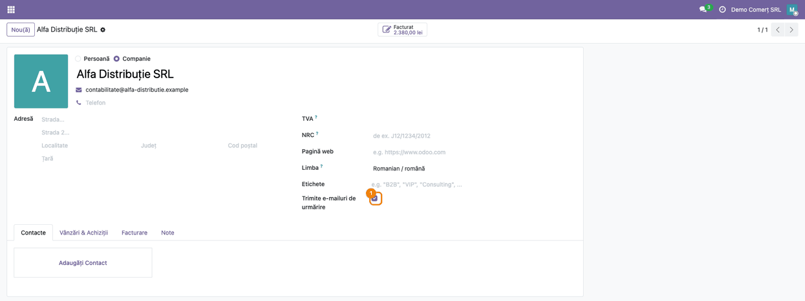
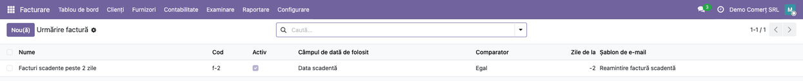
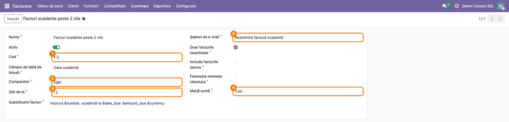
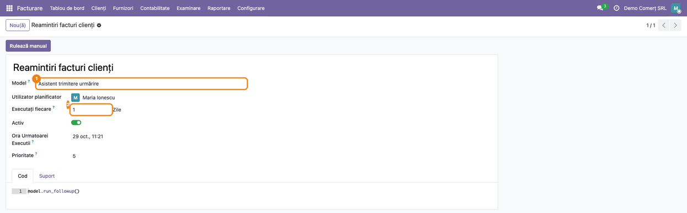
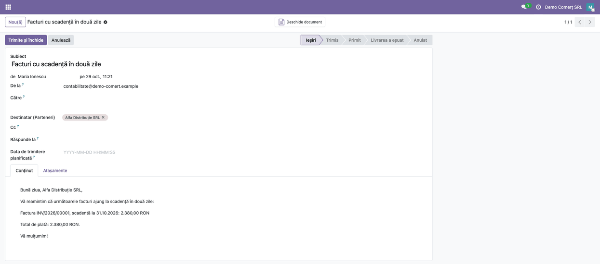
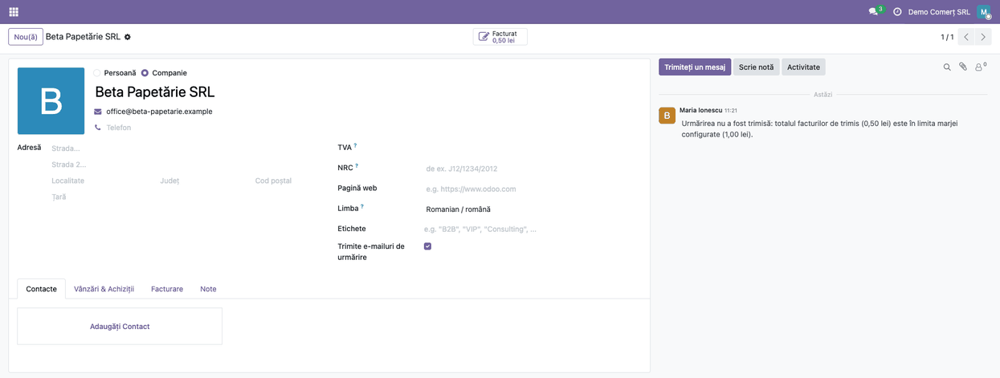

# Fișă Modul: Reamintiri automate pentru facturile clienților (Invoice Followup)

**Modul:** `deltatech_followup`
**Utilizator principal:** Contabil clienți / Responsabil încasări
**Prioritate:** 🟡 Medie (reduce întârzierile la încasare, dar nu generează note contabile)

---

## 1. Scop business

Modulul trimite automat clienților e-mailuri de reamintire pentru facturile emise: înainte de
scadență, în ziua scadenței sau la un număr de zile după. Pentru fiecare etapă de reamintire
(„followup”) se alege data de referință (data facturii sau scadența), decalajul în zile și șablonul
de e-mail. Mesajul poate include un tabel cu facturile vizate și totalurile clientului: suma de
plată, datoria totală și suma deja scadentă. Responsabilul de încasări nu mai urmărește manual
calendarul scadențelor.

## 2. Bază legală și context

Modulul nu ține de o prevedere fiscală și nu generează înregistrări contabile. Este un instrument
operațional de gestiune a creanțelor:

- reamintirile se trimit doar clienților bifați pentru acest lucru;
- mesajele sunt e-mailuri obișnuite, create din șabloane de e-mail pe partener; implicit șablonul are
  bifat **Șterge automat**, deci după trimiterea efectivă urma e-mailului dispare din **Setări →
  Tehnic → Email → Email-uri** și din istoricul partenerului (debifați opțiunea pe șablon dacă
  vreți să păstrați urma);
- reamintirile nu înlocuiesc somația sau notificarea formală de neplată.

## 3. Utilizatori și roluri

- **Responsabil încasări / Contabil clienți** — configurează etapele, bifează clienții și urmărește
  rezultatul.
- **Administrator** — configurează acțiunea programată (cron) și șabloanele de e-mail.

Rol recomandat pentru testare: utilizator cu grupul **Administrator urmăriri** (este în grupul de drepturi
de contabilitate). Fără acest grup, utilizatorul nu poate vedea, crea sau modifica etapele de followup.
Același grup trebuie să-l aibă și utilizatorul planificator al acțiunii programate (vezi Pasul 3).
Meniul **Facturare → Configurare** cere în plus drepturi de administrator contabil: cu doar
**Administrator urmăriri**, utilizatorul nu vede meniul **Urmăriri**.

## 4. Conturi și date implicate

Modulul nu mișcă niciun cont contabil. Citește facturile clienților (note de credit incluse, dacă se
bifează) și folosește:

| Dată | Rol |
|---|---|
| Facturi de client în stare **Postată** | sursa reamintirilor |
| Starea de plată (**Neplătită**, **Parțial plătită**) | filtrul **Doar facturile neachitate** |
| Data facturii / data scadenței | referința pentru calculul zilei de trimitere |
| Soldul rămas de plată al facturii | sumele din mesaj |

Date minime pentru demo:
- un client cu adresă de e-mail și limba setată;
- una sau două facturi postate, cu scadență apropiată;
- un șablon de e-mail pe modelul **Contact** (partener).

## 5. Configurare inițială

1. Instalați modulul `deltatech_followup` (depinde doar de `account`).
2. Creați un șablon de e-mail pe modelul **Contact** (partener). În corp puteți folosi `${object.name}`,
   `$total_debit`, `$total_all_debit`, `$total_due_debit`, `$currency` și marcajul `[invoices]`, care
   se înlocuiește cu rândurile facturilor.
3. Creați etapele în **Facturare → Configurare → Urmăriri** (necesită drepturi de administrator contabil
   și grupul **Administrator urmăriri**; vezi Pasul 2).
4. Bifați clienții în fișa partenerului (vezi Pasul 1).
5. Creați acțiunea programată care rulează `model.run_followup()` pe modelul **Asistent trimitere urmărire**
   (`followup.send.wizard`). Se găsește în **Setări → Tehnic → Automatizare → Acțiuni planificate** (mod dezvoltator). Utilizatorul
   planificator al acțiunii trebuie să aibă grupul **Administrator urmăriri**.
   Pentru a rula doar unele etape: `model.run_followup(["f-1", "AZI"])`, cu codurile etapelor.
6. Opțional, pentru teste: în **Setări → Tehnic → Parametri → Parametri sistem** (mod dezvoltator) puneți
   `followup.override_partner_id` cu id-ul unui partener; mesajele ajung la acel partener, nu la
   clienți. Redirecționarea funcționează dacă șablonul are bifat **Destinatari impliciți** (implicit)
   sau destinatarul în **Destinatar (Parteneri)**. Dacă debifați **Destinatari impliciți** și
   completați **Destinatar (Email-uri)** sau **Cc** (tabul **Setări** al șablonului, mod
   dezvoltator), clientul real poate primi totuși e-mailul.

## 6. Flux de utilizare

### Pasul 1 — Bifați clienții care primesc reamintiri

Acțiune: **Facturare → Clienți → Clienți**, deschideți clientul și bifați **Trimite e-mailuri de urmărire**
(sub câmpul **Etichete**).

Doar clienții bifați sunt procesați. Bifa trebuie să fie pe **același partener care apare pe
factură**: căutarea facturilor se face după partenerul facturii, nu după firma-mamă.



### Pasul 2 — Configurați etapele de followup

Acțiune: **Facturare → Configurare → Urmăriri**, apoi **Nou**. Meniul e vizibil doar pentru utilizatorii cu
drepturi de administrator contabil și cu grupul **Administrator urmăriri**.

Câmpuri:

- **Nume** și **Cod** — codul se folosește în acțiunea programată, ca să rulați doar anumite etape.
- **Câmpul de dată de folosit** — **Data scadentă** sau **Data facturii**.
- **Comparator** — **Egal**: se procesează doar facturile care ies exact azi; **Mai mare sau egal**:
  toate facturile cu data calculată azi sau mai veche (se retrimite zilnic).
- **Zile de la** — zile față de data aleasă: `-2` înseamnă cu două zile înainte, `0` în ziua respectivă,
  `3` la trei zile după.
- **Doar facturile neachitate** — doar facturile neplătite sau parțial plătite.
- **Include facturile storno** — include și notele de credit. Nota de credit apare cu semn negativ pe
  rândul ei și se scade din **Total de plată** (`$total_debit`).
- **Folosește moneda clientului** — totalurile din mesaj sunt în moneda facturilor (a primei facturi din
  mesaj), nu în moneda companiei; rândurile arată oricum moneda fiecărei facturi. Bifați-o doar pentru
  clienții ale căror facturi sunt toate în aceeași monedă: la monede diferite totalurile se adună fără
  conversie și nu au sens.
- **Marjă sumă** — vezi „Regula marjei” mai jos.
- **Șablon de e-mail** — șablon pe modelul Contact (partener).
- **Substituent facturi** — HTML-ul unui rând de factură, cu `$number`, `$payment_term_id`,
  `$date_invoice`, `$date_due`, `$amount_untaxed`, `$amount_tax`, `$amount_total`, `$amount_due`,
  `$currency`.

Sumele și datele din e-mail urmează formatul limbii clientului, indiferent de opțiuni (de exemplu
`2.380,00` și `31.10.2026` pentru limba română).

**Regula marjei.** Mesajul nu se trimite dacă **totalul facturilor care ar intra în mesaj** este
mai mic sau egal cu marja (implicit 1,00); un total negativ (note de credit peste facturi) nu se
trimite nici el. Astfel nu trimiteți reamintiri pentru diferențe de bănuți rămase după o plată aproape
completă. Marja se compară cu facturile din mesajul respectiv, nu cu
restanțele totale ale clientului: un client care plătește la timp primește reamintirea „înainte de
scadență” chiar dacă nu are nicio restanță.





### Pasul 3 — Programați rularea

Acțiune: **Setări → Tehnic → Automatizare → Acțiuni planificate**, creați sau deschideți acțiunea care rulează:

```
model.run_followup()
```

pe modelul **Asistent trimitere urmărire**, cu frecvența zilnică dorită. Pentru a rula doar unele etape, folosiți
`model.run_followup(["f-1", "AZI"])`. Butonul **Rulează manual** de pe acțiunea programată declanșează rularea imediată.

La fiecare rulare, pentru fiecare etapă activă și fiecare client bifat, modulul:

1. caută facturile postate ale clientului (după opțiunile etapei);
2. păstrează facturile a căror dată, plus decalajul etapei, ajunge azi (sau a trecut, la **Mai mare sau
   egal**);
3. calculează sumele: de plată (facturile din mesaj), datoria totală (facturile neachitate ale
   clientului, nu soldul contabil: plățile nereconciliate, avansurile și soldurile inițiale nu se
   scad; notele de credit se scad doar dacă etapa are **Include facturile storno** bifat) și suma
   scadentă;
4. aplică regula marjei;
5. generează mesajul din șablon și îl trimite clientului.



### Pasul 4 — Verificați rezultatul

Acțiune: **Setări → Tehnic → Email → Email-uri** (mod dezvoltator) pentru e-mailurile generate și
deschideți clientul pentru notele interne din istoric (chatter).

- Mesajul generat apare în e-mailuri, în coada de trimitere (starea **Ieșiri**), cu rândurile
  facturilor și sumele completate. După trimiterea efectivă dispare, dacă șablonul are **Șterge
  automat** bifat.
- Dacă totalul facturilor din mesaj a fost sub marjă, pe client apare o notă internă:
  „Urmărirea nu a fost trimisă: totalul facturilor de trimis (…) este în limita marjei configurate (…).”
  Nota apare în limba utilizatorului care rulează acțiunea. Aceeași notă apare și când totalul este
  negativ (note de credit peste facturi): clientul nu datorează nimic și nu e nevoie de reamintire.
- Dacă mesajul unui client a eșuat (date incomplete, marcaj necunoscut), pe client apare o notă
  „Urmărirea … a eșuat și nu a fost trimisă: …”, iar ceilalți clienți sunt procesați normal.





### Note de monografie și raportare

Modulul nu generează note contabile și nu alimentează declarații (D300, D394 etc.).

## 7. Legături cu alte module / declarații

| Modul | Rol |
|---|---|
| `account` | facturile, starea de plată, scadențele |
| `mail` | șabloanele de e-mail și trimiterea |

**Ce e automat:** selecția facturilor după zi, calculul sumelor, completarea șablonului, trimiterea,
nota internă la marjă și nota de eșec pe clientul cu date greșite, fără oprirea celorlalți clienți.

**Ce rămâne manual:** bifarea clienților, configurarea etapelor și a acțiunii programate, urmărirea
răspunsurilor și somațiile formale.

## 8. Verificări pentru consultant

- [ ] Clientul are bifat **Trimite e-mailuri de urmărire** și adresă de e-mail, iar bifa este pe partenerul
  care apare pe factură.
- [ ] Etapa este activă, are șablon de e-mail și codul corect în acțiunea programată (dacă se
  filtrează după cod).
- [ ] Acțiunea programată folosește modelul **Asistent trimitere urmărire** și are o dată viitoare de rulare.
- [ ] Pentru etapa cu **Egal**: data facturii (sau scadența) plus decalajul dă exact ziua rulării;
  dacă acțiunea nu rulează într-o zi, facturile acelei zile nu mai sunt reamintite. Pentru acoperire
  completă folosiți **Mai mare sau egal**.
- [ ] „Substituent facturi” folosește doar marcajele din lista de mai sus; un `$` necunoscut sau
  izolat (de exemplu „100 $”) acolo face să eșueze mesajul clientului respectiv (apare o notă pe
  client). În corpul șablonului, un `$` necunoscut rămâne ca text.
- [ ] Un client cu o singură factură mică (sub marjă) primește nota internă, nu e-mail.
- [ ] Un client care plătește la timp primește reamintirea „înainte de scadență” (etapă cu zile
  negative).
- [ ] Pentru test, `followup.override_partner_id` redirecționează mesajele (dacă șablonul are
  **Destinatari impliciți** bifat sau destinatarul în **Destinatar (Parteneri)**); scoateți-l înainte
  de folosirea reală.
- [ ] Utilizatorul planificator al acțiunii programate are grupul **Administrator urmăriri**.

## 9. Mesaje de eroare frecvente

| Mesaj / simptom | Cauză | Remediere |
|---|---|---|
| Nu pleacă nimic, deși factura pare să se potrivească | clientul nu e bifat sau factura e pe un contact copil | bifați partenerul de pe factură |
| Notă „Urmărirea nu a fost trimisă … în limita marjei configurate” | totalul facturilor din mesaj ≤ marjă | micșorați marja sau tratați manual suma mică. Dacă totalul este negativ (note de credit peste facturi), clientul nu datorează nimic: compensați sau rambursați nota de credit, nu e nevoie de reamintire |
| Notă pe client „Urmărirea … a eșuat și nu a fost trimisă: …” | eroare la mesajul clientului respectiv, de exemplu un `$marcaj` necunoscut în „Substituent facturi” (nota arată numele marcajului, de exemplu `'unknown'`; în log apare `KeyError`) sau un `$` izolat | corectați marcajul sau datele clientului și rulați din nou; ceilalți clienți au fost procesați normal |
| Notă pe client „Urmărirea … a eșuat și nu a fost trimisă: Expected singleton: mail.template()” | etapa nu are **Șablon de e-mail** (câmp obligatoriu în formular; poate lipsi doar la etape create înainte de această regulă, prin import sau API) | completați **Șablon de e-mail** pe etapă |
| Clientul nu are limba setată | — | nu e eroare: mesajul pleacă în limba utilizatorului care rulează acțiunea |
| Facturile unei zile nu au fost reamintite | etapa are **Egal** și acțiunea nu a rulat în ziua respectivă | folosiți **Mai mare sau egal** sau rulați manual acțiunea programată |

## 10. Capturi de ecran

Capturile sunt generate automat din `tests/test_screenshots.py` (mixinul `ScreenshotCase` din
`l10n_ro_doc_screenshots`), în RO, pe planul RO, și se află în
`static/description/`. Regenerare:

```
./odoo/odoo-bin -c odoo.conf -d <db> -i l10n_ro,deltatech_followup,l10n_ro_doc_screenshots \
    --test-tags=fise_screenshots --stop-after-init
```

1. `01_partener_bifa_followup.png` — bifa „Trimite e-mailuri de urmărire” pe fișa partenerului
2. `02_lista_followups.png` — lista etapelor
3. `03_formular_followup.png` — formularul unei etape
4. `04_actiune_programata.png` — acțiunea programată
5. `05_email_trimis.png` — e-mailul de reamintire generat, în coada de trimitere
6. `06_nota_marja.png` — nota internă de marjă

## 11. Observații pentru manual

- Explicați clar diferența dintre **Egal** și **Mai mare sau egal** și efectul asupra retrimiterii.
- Marja se aplică facturilor din mesaj, nu restanțelor totale; exemplificați cu etapa „înainte de
  scadență”.
- Avertizați că reamintirea nu înlocuiește somația formală.
- Mențineți avertismentul despre `followup.override_partner_id`: util la teste, periculos dacă rămâne.
