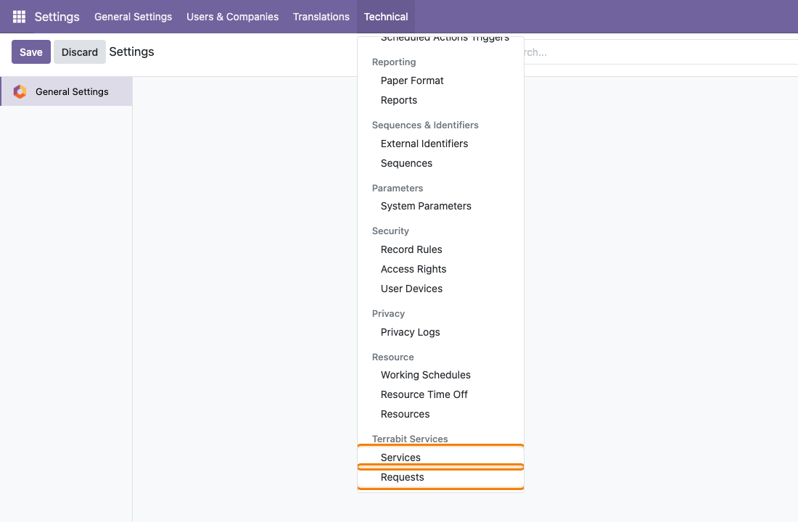
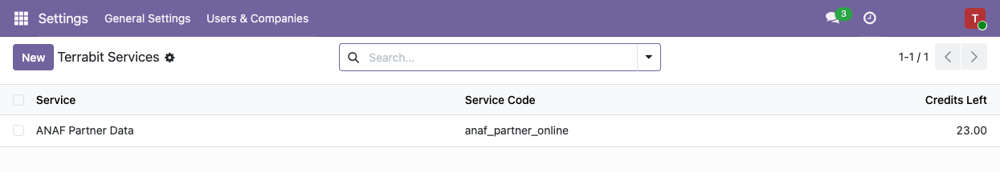
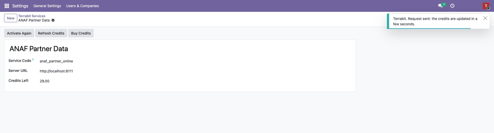

============================
IAP Services for Odoo Online
============================

..
   !!!!!!!!!!!!!!!!!!!!!!!!!!!!!!!!!!!!!!!!!!!!!!!!!!!!
   !! This file is generated by oca-gen-addon-readme !!
   !! changes will be overwritten.                   !!
   !!!!!!!!!!!!!!!!!!!!!!!!!!!!!!!!!!!!!!!!!!!!!!!!!!!!
   !! source digest: sha256:45643058e729cfdfda21a1949ef2e24d42002598e54edd6a338263373e05d1e7
   !!!!!!!!!!!!!!!!!!!!!!!!!!!!!!!!!!!!!!!!!!!!!!!!!!!!

.. |badge1| image:: https://img.shields.io/badge/maturity-Alpha-red.png
    :target: https://odoo-community.org/page/development-status
    :alt: Alpha
.. |badge2| image:: https://img.shields.io/badge/license-LGPL--3-blue.png
    :target: http://www.gnu.org/licenses/lgpl-3.0-standalone.html
    :alt: License: LGPL-3
.. |badge3| image:: https://img.shields.io/badge/github-dhongu%2Fdeltatech-lightgray.png?logo=github
    :target: https://github.com/dhongu/deltatech/tree/19.0/deltatech_iap_online
    :alt: dhongu/deltatech
.. |badge_fisa| image:: https://img.shields.io/badge/-Fi%C8%99%C4%83%20consultant-2ea44f.png
    :target: https://github.com/dhongu/deltatech/blob/19.0/deltatech_iap_online/readme/FISA_CONSULTANT.md
    :alt: Fișă consultant

|badge1| |badge2| |badge3| |badge_fisa|

The base of the Terrabit services for **Odoo Online**: data-only modules
(no Python, imported as a zip) send their requests to a Terrabit server,
which does the heavy work and writes the answer back in your database.
This module holds what all those services share; each service module
adds only its own fields, buttons and the way it writes the answer.

- **One account per service**: *Settings > Technical > Terrabit
  Services* lists the services installed, with their credits left.
- **Activation in one click**: the **Activate** button registers the
  database at the Terrabit server; the account token comes back by
  itself, with the trial credits of the service. Nothing to copy or
  paste.
- **Buy and check credits**: **Buy Credits** opens the credit page of
  your account on the Terrabit server; **Refresh Credits** asks the
  credits left, which are also updated with every answer.
- **Requests you can follow**: *Terrabit Services > Requests* shows each
  request, its status and the error, if any. A request without answer
  after 10 minutes is sent once more.
- **Safe answers**: the answer comes on an *On webhook* automation whose
  secret URL accepts only a request still waiting, identified by its
  token.
- **Secrets kept for administrators**: the account token and the
  callback URL are read by administrators only; other users can create
  requests of the services, not read them, and only administrators can
  activate a service. A service module gives its users read access to
  the service when its buttons need the token.
- **What leaves your database**: the input of the request, its token,
  the address and the UUID of your database (for the answer) and, at
  activation, the name and the Tax ID of the company.

For developers: a service module creates an ``x_iap_online_service``
record (``x_code``, ``x_server``) and, optionally, an *apply* server
action (``x_apply_action_id``) that receives the answer in the context
key ``iap_answer``; its documents create ``x_iap_online_request``
records with ``x_kind = 'request'``.

.. IMPORTANT::
   This is an alpha version, the data model and design can change at any time without warning.
   Only for development or testing purpose, do not use in production.
   `More details on development status <https://odoo-community.org/page/development-status>`_

**Table of contents**

.. contents::
   :local:

Usage
=====

The screens of this module are for administrators, in developer mode
(*Settings > Technical*). Install it together with a Terrabit service
module (e.g. ``l10n_ro_anaf_partner_online``), which creates the service
record.

1. **Open the menu**: activate the developer mode, then go to *Settings
   > Technical > Terrabit Services*. It has two entries: **Services**
   and **Requests**.

   |Technical menu of Settings scrolled to the Terrabit Services
   section, with the Services and Requests entries highlighted|

2. **Check the service**: *Terrabit Services > Services* lists one line
   per installed service, with its **Service Code** and **Credits
   Left**.

   |Terrabit Services list with one line: the ANAF Partner Data service,
   the code anaf_partner_online and the credits left|

3. **Activate the service**: open it and click **Activate**, the only
   button of a service not yet active. The database is registered at the
   Terrabit server and an activation request (``register``) appears in
   *Requests*; a few seconds later the account token comes back by
   itself, with the trial credits. Nothing to copy or paste.

   |Form of the ANAF Partner Data service not yet active: only the
   Activate button in the header, highlighted (1), then Service Code
   anaf_partner_online, the Server URL and Credits Left at 0.00|

4. **Use the active service**: right after the click, the header shows
   **Activate Again**, **Refresh Credits** and **Buy Credits**. Check in
   *Requests* that the activation is *Done* before using them; if it is
   in error, click **Activate Again**.

   |Form of the active ANAF Partner Data service: Activate Again,
   Refresh Credits (1) and Buy Credits (2) in the header, then Service
   Code, Server URL and Credits Left (3)|

5. **Refresh the credits**: **Refresh Credits** asks the server for the
   credits left; a notification confirms the request and **Credits
   Left** is updated in a few seconds. The credits are also updated with
   every answer of the service.

   |Service form after Refresh Credits, with the Terrabit notification:
   Request sent: the credits are updated in a few seconds|

6. **Buy credits**: **Buy Credits** opens, in a new browser tab, the
   credit page of your account on the Terrabit server. After the
   purchase, click **Refresh Credits**.

   |Credit page of the Terrabit server: Buy credits for ANAF Partner
   (Odoo Online) and the Your account box with the credits of the
   account|

7. **Follow the requests**: *Terrabit Services > Requests* lists the
   requests, newest first, with their **Request Type**, **Status** and
   **Error**. Requests in error are red, requests still waiting are
   blue; the **Errors** and **Waiting** filters narrow the list. A
   request without answer 10 minutes after its creation is sent once
   more, automatically.

   |Terrabit Requests list, newest first, with credit (balance) and
   partner lookup (request) requests: the lines with the Error status
   are red and their Invalid CUI errors are highlighted|

8. **Read a request in error**: open it to see the service, the input,
   the document it was sent from (**Document Model**, **Document ID**),
   the **Status** and the **Error**. Fix the data on that document and
   send the request again from the service module.

   |Read-only form of an ANAF Partner Data request with Input 1234567 on
   res.partner 7: Status Error (1) and Error Invalid CUI (2)
   highlighted|

Only administrators read the services (account token) and the requests
(callback URL); other users create requests from the buttons of the
service modules, without reading them.

.. |Form of the ANAF Partner Data service not yet active: only the Activate button in the header, highlighted (1), then Service Code anaf_partner_online, the Server URL and Credits Left at 0.00| image:: https://raw.githubusercontent.com/dhongu/deltatech/19.0/deltatech_iap_online/static/description/en/03_activare_serviciu.png
.. |Form of the active ANAF Partner Data service: Activate Again, Refresh Credits (1) and Buy Credits (2) in the header, then Service Code, Server URL and Credits Left (3)| image:: https://raw.githubusercontent.com/dhongu/deltatech/19.0/deltatech_iap_online/static/description/en/04_formular_serviciu.png

.. |Credit page of the Terrabit server: Buy credits for ANAF Partner (Odoo Online) and the Your account box with the credits of the account| image:: https://raw.githubusercontent.com/dhongu/deltatech/19.0/deltatech_iap_online/static/description/en/06_cumparare_credite.png
.. |Terrabit Requests list, newest first, with credit (balance) and partner lookup (request) requests: the lines with the Error status are red and their Invalid CUI errors are highlighted| image:: https://raw.githubusercontent.com/dhongu/deltatech/19.0/deltatech_iap_online/static/description/en/07_lista_cereri.png
.. |Read-only form of an ANAF Partner Data request with Input 1234567 on res.partner 7: Status Error (1) and Error Invalid CUI (2) highlighted| image:: https://raw.githubusercontent.com/dhongu/deltatech/19.0/deltatech_iap_online/static/description/en/08_cerere_eroare.png

Changelog
=========

19.0.1.0.0
==========

- First version: services and requests, activation by callback, credits
  (refresh, buy), retry of a request without answer.
- Consultant sheet (``readme/FISA_CONSULTANT.md``), ``readme/USAGE.md``
  and screenshots (RO, EN).

Bug Tracker
===========

Bugs are tracked on `Terrabit Issues <https://www.terrabit.ro/helpdesk>`_.
In case of trouble, please check there if your issue has already been reported.

Do not contact contributors directly about support or help with technical issues.

Credits
=======

Authors
-------

* Terrabit
* Dorin Hongu

Maintainers
-----------

.. |maintainer-dhongu| image:: https://github.com/dhongu.png?size=40px
    :target: https://github.com/dhongu
    :alt: dhongu

Current maintainer:

|maintainer-dhongu| 

This module is part of the `dhongu/deltatech <https://github.com/dhongu/deltatech/tree/19.0/deltatech_iap_online>`_ project on GitHub.

You are welcome to contribute.