# Fișă Modul: Import linii document din fișier

**Modul:** `deltatech_import_lines` (cu punțile `deltatech_import_lines_sale`, `deltatech_import_lines_purchase`,
`deltatech_import_lines_stock`, `deltatech_import_lines_mrp`)
**Utilizator principal:** Agent de vânzări, achizitor, gestionar sau planificator de producție care primește
liste de produse în Excel
**Prioritate:** 🟡 Medie (scutește introducerea manuală a comenzilor și avizelor lungi; fără efect contabil propriu)

---

## 1. Scop business

Clienții trimit comenzi în Excel, furnizorii trimit oferte și avize cu codurile lor, iar inventarul se
numără adesea pe foi de calcul. În Odoo standard, liniile se introduc una câte una sau prin ecranul generic
de import, care cere o coloană cu numărul comenzii și nu arată dinainte ce produse nu au fost găsite.

Modulul adaugă pe document butonul **Import linii**. Operatorul alege fișierul (XLSX, XLS, ODS, CSV sau TXT),
spune ce conține fiecare coloană, vede în previzualizare rândurile cu probleme și abia apoi importă. Liniile
se creează prin documentul însuși, deci prețul, taxele și descrierea se completează ca la o linie adăugată de
mână. Maparea coloanelor se poate salva pe partener, ca fișierul următor al aceluiași client sau furnizor să
fie recunoscut singur.

Documente acoperite:

| Document | Buton | Modul |
|---|---|---|
| Ofertă de vânzare (ciornă / trimisă) | **Import linii** | `deltatech_import_lines_sale` |
| Cerere de ofertă de achiziție (ciornă / trimisă) | **Import linii** | `deltatech_import_lines_purchase` |
| Recepție, livrare, transfer intern (nefinalizat) | **Import linii** | `deltatech_import_lines_stock` |
| Inventariere fizică (cantități numărate) | **Import cantități numărate** | `deltatech_import_lines_stock` |
| Comandă de producție (ciornă / confirmată) | **Import componente** | `deltatech_import_lines_mrp` |

## 2. Bază legală și context

Modul operațional, fără temei fiscal propriu. Importul doar completează documentele; recepția, livrarea,
inventarul și facturarea se validează în continuare în fluxul standard, cu notele contabile standard.

Pentru inventar, modulul doar completează **cantitatea numărată**. Diferențele se înregistrează abia când
gestionarul apasă **Aplică** în **Inventariere fizică**, ca la o numărătoare introdusă manual.

## 3. Utilizatori și roluri

| Rol | Ce face |
|---|---|
| **Agent de vânzări** | importă comanda primită de la client în oferta de vânzare |
| **Achizitor** | importă oferta sau lista furnizorului în cererea de ofertă, după codurile furnizorului |
| **Gestionar** | importă avizul furnizorului în recepție, cu loturi, și numărătoarea în inventarul fizic |
| **Planificator producție** | adaugă componente într-o comandă de producție |

Drepturi: butonul apare oricui poate modifica documentul. **Import cantități numărate** cere rolul de
utilizator de stoc. Mapările salvate sunt comune utilizatorilor companiei.

Roluri recomandate la testare: un utilizator de vânzări, un achizitor și un gestionar cu loturi activate
(**Inventar → Configurare → Setări → Loturi și numere de serie**).

## 4. Conturi și date implicate

Modulul nu creează note contabile. Datele folosite:

- **produsele**, găsite după **Referință internă**, **Cod de bare** sau **Nume produs**; pe achiziții și
  după **Cod produs furnizor** (din lista de prețuri a furnizorului de pe comandă);
- **unitățile de măsură**, după nume (trebuie să fie înrudite cu unitatea produsului, ex. Bucăți și Duzine);
- **loturile**, după nume, pentru produsele urmărite pe lot sau număr de serie;
- **mapările de coloane** (**Mapări import linii**), pe tip de document și, opțional, pe partener.

Date minime pentru demo:
- un client și un furnizor, câteva produse cu referință internă, unul cu cod de furnizor și unul urmărit pe lot;
- un fișier Excel cu coloanele Cod, Cantitate și, opțional, Preț unitar, U.M. și Lot.

## 5. Configurare inițială

1. **Instalați modulul** `deltatech_import_lines`. Punțile se instalează singure pentru aplicațiile deja
   instalate (Vânzări, Achiziții, Inventar, Producție).
2. Pentru importul loturilor, activați **Loturi și numere de serie** în setările Inventarului. Pe tipul de
   operațiune al recepțiilor, **Creare loturi/numere de serie noi** trebuie să fie bifat (implicit este).
3. Opțional, pregătiți mapări din **Vânzări / Achiziții / Inventar → Configurare → Mapări import linii**.
   De obicei nu e nevoie: maparea se salvează direct din asistent, la primul import.

## 6. Flux de utilizare

Scenariul: **Client Exemplu SRL** trimite comanda în fișierul `comanda_client.xlsx`, cu patru rânduri. Unul
dintre ele are un cod care nu există în Odoo. Apoi se importă oferta furnizorului, avizul cu loturi,
numărătoarea de inventar și componentele unei comenzi de producție.

### Pasul 1 — Deschideți oferta și apăsați „Import linii"

**Vânzări → Comenzi → Oferte** → deschideți oferta clientului → butonul **Import linii** din antet.
Butonul apare doar cât oferta e în ciornă sau trimisă.

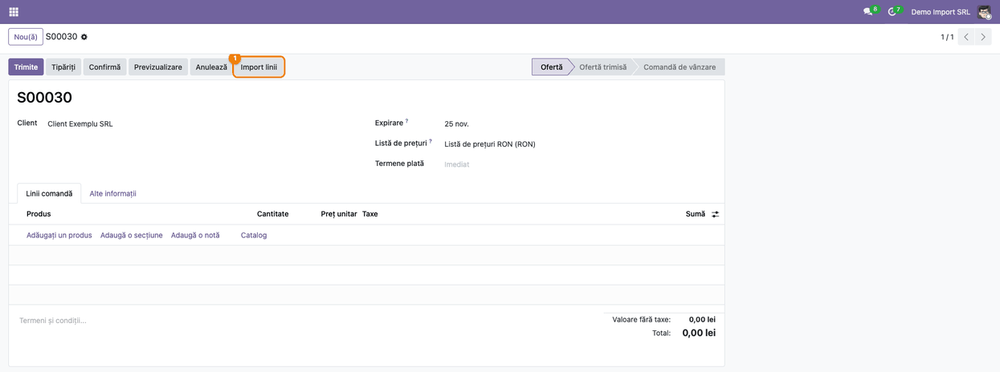

### Pasul 2 — Alegeți fișierul

În asistent:
1. **Fișier**: alegeți fișierul primit;
2. **Rând de antet**: bifat dacă primul rând conține titlurile coloanelor;
3. **Caută produsul după**: **Referință internă**, **Cod de bare** sau **Nume produs**;
4. **Separator**: doar pentru CSV și TXT, dacă nu e detectat corect;
5. apăsați **Următorul**.

Dacă partenerul are o mapare salvată, câmpul **Mapare salvată** e deja completat.

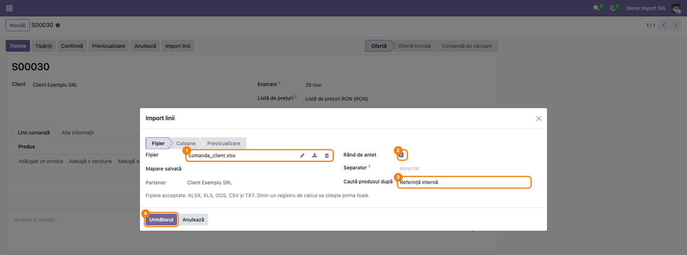

### Pasul 3 — Spuneți ce conține fiecare coloană

Lista arată coloanele fișierului, cu titlul și prima valoare. Coloanele cu titluri uzuale (Cod, Cantitate,
Preț, U.M., Lot…) primesc singure ținta în **Importă ca**.

- **Găsiți pe ecran:** coloana **Importă ca** din dreptul fiecărei coloane din fișier.
- **Verificați:**
  - o coloană e pusă pe **Produs** și una pe **Cantitate** (obligatorii);
  - coloanele de ignorat (aici **Denumire**) au **Importă ca** gol;
  - **Preț unitar** e mapat doar dacă vreți prețul din fișier; altfel prețul vine din lista de prețuri.
- Opțional, completați **Nume mapare**, bifați **Doar pentru acest partener** și apăsați **Salvează
  maparea**.
- Apăsați **Previzualizare**.

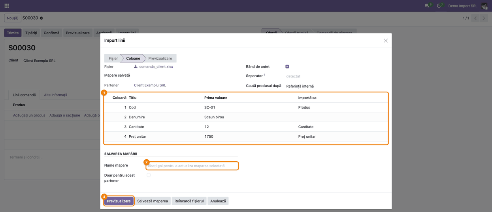

### Pasul 4 — Verificați previzualizarea

Fiecare rând din fișier apare cu produsul găsit și cu **Starea** lui. Rândurile cu probleme sunt roșii și
au motivul în coloana **Mesaj**.

- **Găsiți pe ecran:** bara galbenă cu numărul de rânduri cu erori și coloanele **Produs**, **Stare**, **Mesaj**.
- **Verificați:**
  - fiecare rând **OK** are produsul corect și cantitatea din fișier;
  - rândurile **Produs negăsit** (aici `SC-99`) sunt produse care trebuie create sau coduri greșite;
  - rândurile cu **Mai multe produse**, **Cantitate invalidă** sau **Unitate de măsură invalidă** se corectează în fișier.
- Apoi fie corectați fișierul și apăsați **Înapoi** și **Previzualizare**, fie bifați **Omite rândurile cu
  erori** și apăsați **Importă**.

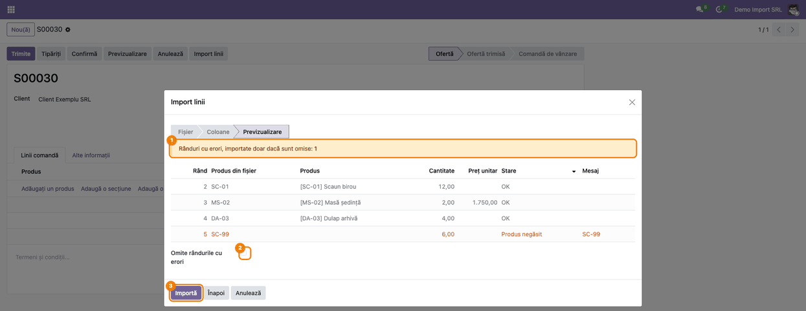

### Pasul 5 — Liniile importate în comandă

Asistentul se închide, iar oferta are liniile valide. Scaunul și dulapul au prețul din lista de prețuri, masa
are prețul din fișier (1.750,00), iar taxele vin din produs și din poziția fiscală, ca la o linie adăugată manual.

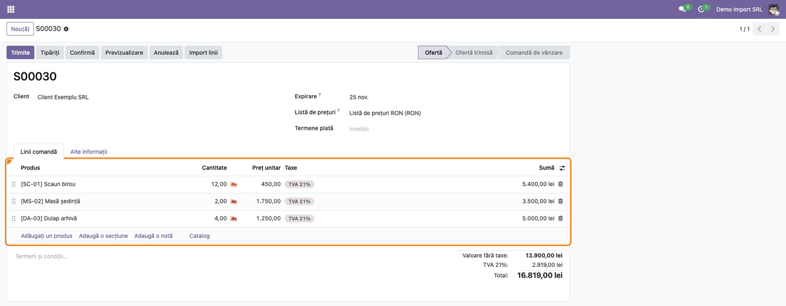

### Pasul 6 — Maparea salvată

**Vânzări → Configurare → Mapări import linii** → maparea **Comenzi Client Exemplu**.

Maparea reține tipul de document, partenerul, dacă fișierul are antet, cheia de căutare a produsului și
coloanele (după titlu, sau după poziție la fișierele fără antet). La următorul fișier al clientului, asistentul
o aplică singur. Maparea fără partener se aplică tuturor documentelor de acel tip.

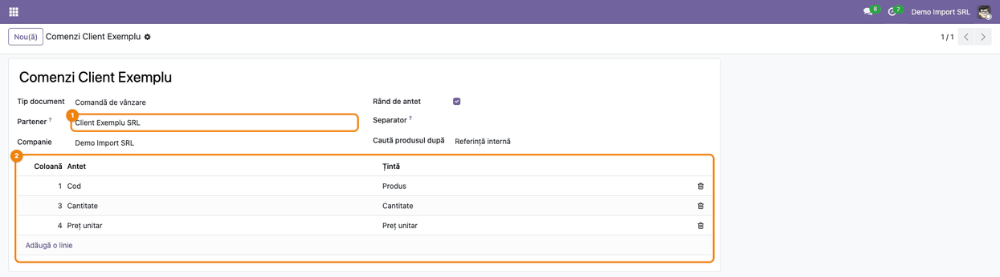

### Pasul 7 — Achiziții: lista furnizorului, după codurile lui

**Achiziții → Comenzi → Cereri de ofertă** → cererea furnizorului → **Import linii**. La **Caută produsul
după** alegeți **Cod produs furnizor**: codurile din fișier (`F-7710`, `F-2018`) se caută în lista de prețuri a
furnizorului de pe comandă. Prețul vine din lista de prețuri a furnizorului, dacă fișierul nu are coloană de preț.

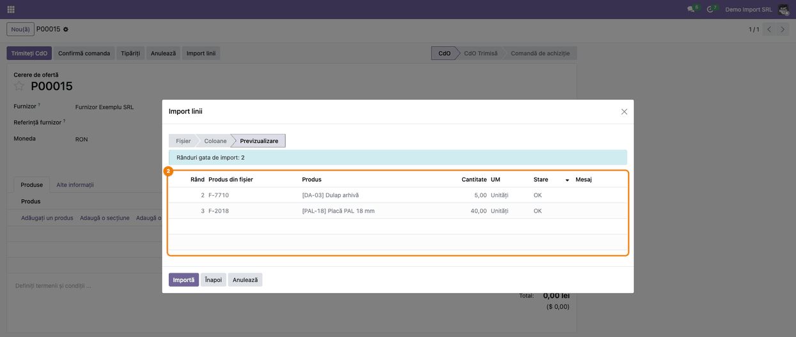

### Pasul 8 — Recepție cu loturi

**Inventar → Operațiuni → Recepții** → recepția → **Import linii**, cu o coloană mapată pe **Lot/Număr de serie**.

- **Găsiți pe ecran:** coloana **Lot/Număr de serie** din previzualizare.
- **Verificați:**
  - lotul existent (`L2610-01`) și lotul nou (`L2610-02`) sunt **OK**: pe recepții, lotul nou se creează la validare;
  - produsele fără urmărire au lotul gol;
  - un rând cu număr de serie are cantitatea 1.
- Apăsați **Importă**.

Pe livrări și transferuri interne, lotul trebuie să existe deja.

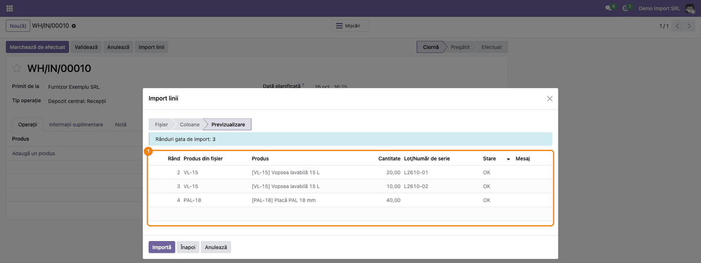

### Pasul 9 — Recepția cu liniile importate

Recepția are câte o linie pe produs. Cele două rânduri ale vopselei apar într-o singură linie de 30, cu
două operațiuni detaliate, câte una pe lot. Validarea recepției rămâne pasul standard (**Validează**).

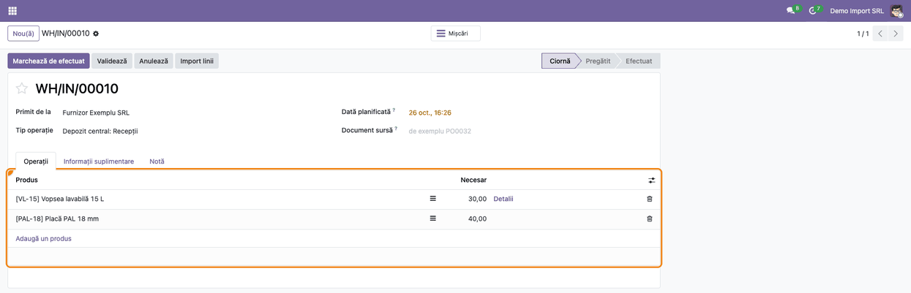

### Pasul 10 — Inventar: butonul „Import cantități numărate"

**Inventar → Operațiuni → Inventariere fizică** → butonul **Import cantități numărate** din antetul listei.

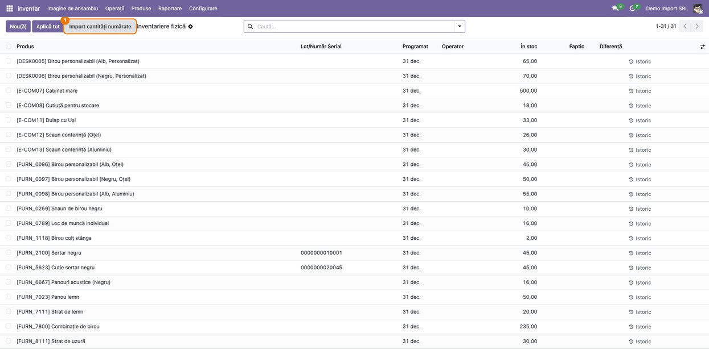

### Pasul 11 — Locația numărată și previzualizarea

În asistent alegeți **Locație inventariată** (implicit stocul depozitului), apoi fișierul și coloanele, ca la
pașii 2–4. Un produs urmărit pe lot cere un lot existent. Rândurile aceluiași produs și lot se adună.

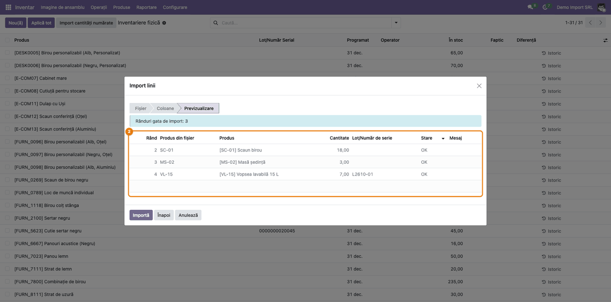

### Pasul 12 — Cantitățile numărate în inventarul fizic

După import, lista **Inventariere fizică** arată cantitățile din fișier în coloana **Faptic**, lângă
cantitatea **În stoc** și **Diferență**.

- **Găsiți pe ecran:** coloanele **În stoc**, **Faptic** și **Diferență** pe fiecare produs (și lot) din
  locația inventariată; rândurile importate apar primele, cu data de azi.
- **Verificați:**
  - cantitatea numărată e cea din fișier (sumată, dacă produsul apare de mai multe ori);
  - diferențele mari sunt explicate înainte de aplicare.
- Abia apoi apăsați **Aplică tot** (sau **Aplică** pe rând).

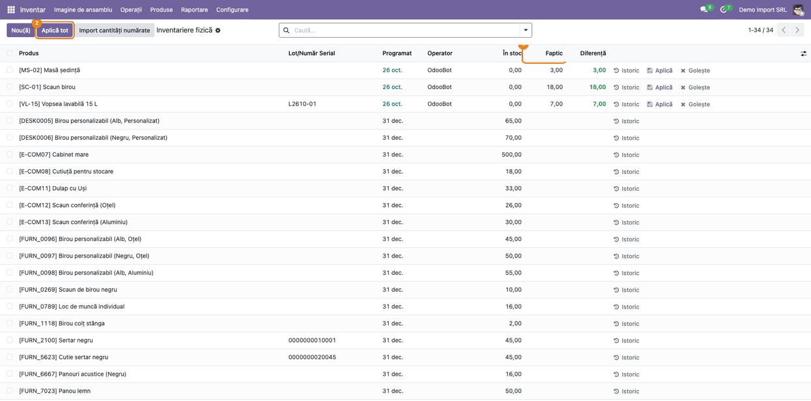

### Pasul 13 — Componentele unei comenzi de producție

**Producție → Operațiuni → Comenzi de producție** → comanda → **Import componente**. Fiecare rând devine o
componentă, pregătită ca una adăugată manual. Pe o comandă confirmată, componentele noi se confirmă imediat.
Produsul de fabricat nu poate fi importat ca propria componentă.

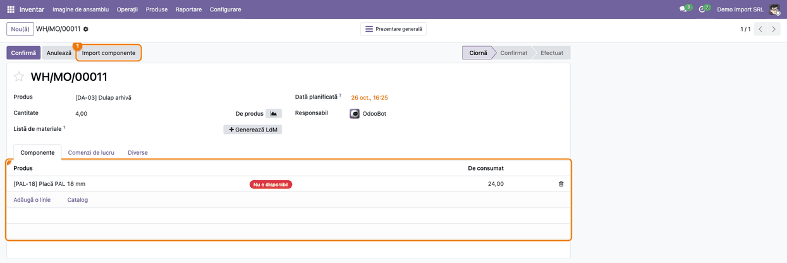

### Note de monografie și raportare

Modulul **nu** generează note contabile. Documentele completate urmează fluxul standard:

| Operațiune (după validare) | Debit | Credit |
|---|---|---|
| Recepție mărfuri / materii prime (stoc perpetuu) | 371 Mărfuri / 301 Materii prime | 408 Furnizori - facturi nesosite (sau 401 la factura furnizorului) |
| Livrare către client | 607 Cheltuieli privind mărfurile | 371 Mărfuri |

Plusurile și minusurile de inventar se înregistrează la **Aplică**, pe conturile configurate pentru locația
de ajustare a inventarului, la fel ca la o numărătoare introdusă manual.

## 7. Legături cu alte module / declarații

| Modul | Rol |
|---|---|
| `base_import` (standard) | citirea fișierelor XLSX, XLS, ODS, CSV și TXT |
| `sale`, `purchase` (standard) | prețul, taxele și descrierea liniilor, calculate de comandă |
| `stock` (standard) | mișcările, loturile, inventarul fizic și aplicarea lui |
| `mrp` (standard) | pregătirea componentelor comenzii de producție |

**Ce e automat:**
- recunoașterea coloanelor cu titluri uzuale și a mapării salvate pe partener;
- găsirea produselor și verificarea cantităților, unităților și loturilor înainte de import;
- prețul, taxele și descrierea liniilor, când fișierul nu le are;
- confirmarea mișcărilor adăugate într-un transfer sau într-o comandă de producție confirmată.

**Ce rămâne manual:**
- crearea produselor lipsă (rândurile **Produs negăsit**);
- validarea recepției sau a livrării și aplicarea inventarului;
- confirmarea comenzii de vânzare sau de achiziție.

## 8. Verificări pentru consultant

- [ ] Butonul **Import linii** apare pe oferte și cereri de ofertă în ciornă sau trimise și dispare după confirmare.
- [ ] Un fișier cu antet Cod / Cantitate / Preț unitar e mapat singur în pasul de coloane.
- [ ] Un cod inexistent apare ca **Produs negăsit**, iar **Importă** e refuzat până se bifează **Omite rândurile cu erori**.
- [ ] Fără coloană de preț, linia de vânzare are prețul din lista de prețuri; cu coloană, prețul din fișier.
- [ ] Cantitățile cu virgulă zecimală (`1,5`) și cu separator de mii (`1.234,50`) sunt citite corect.
- [ ] O mapare salvată **Doar pentru acest partener** e propusă la următoarea comandă a partenerului, dar nu la alt partener.
- [ ] Pe cererea de ofertă, căutarea după **Cod produs furnizor** găsește doar codurile furnizorului de pe comandă.
- [ ] Pe recepție, un lot nou e acceptat, iar pe livrare același lot e marcat **Eroare lot/serie**.
- [ ] Rândurile aceluiași produs și lot dintr-o numărătoare se adună în coloana **Faptic**, fără aplicarea inventarului.
- [ ] Pe o comandă de producție confirmată, componenta importată e confirmată.

## 9. Mesaje de eroare frecvente

| Mesaj | Cauză | Remediere |
|---|---|---|
| Liniile se pot importa doar în oferte. | comanda de vânzare e confirmată | importați într-o ofertă nouă sau adăugați liniile manual |
| Mapați o coloană pe ținta Produs. / Cantitate. | lipsește coloana de produs sau de cantitate | alegeți **Importă ca** pe coloana respectivă |
| Acest document nu folosește țintele: … | o coloană e mapată pe o țintă pe care documentul nu o are (ex. Lot pe o ofertă) | goliți **Importă ca** pe acea coloană |
| X rânduri au erori. Corectați fișierul sau bifați Omite rândurile cu erori. | previzualizarea are rânduri roșii | corectați fișierul sau omiteți rândurile |
| Lotul … nu există, iar această operațiune nu poate crea loturi. | lot nou pe o livrare sau pe un transfer intern | creați lotul sau corectați numele |
| Fișierul nu poate fi citit: … | fișier deteriorat, protejat cu parolă sau în alt format | salvați din nou fișierul ca XLSX sau CSV |

## 10. Capturi de ecran

Capturile sunt **generate automat** din `tests/test_screenshots.py` (mixinul `ScreenshotCase` din
`deltatech_doc_screenshots`, import defensiv), în română, pe compania „Demo Import SRL" în RON. Fișierele
stau în `static/description/`:

1. `01_comanda_buton_import.png` — oferta de vânzare, cu butonul **Import linii**;
2. `02_asistent_fisier.png` — asistentul, pasul de alegere a fișierului;
3. `03_asistent_coloane.png` — maparea coloanelor, cu salvarea mapării;
4. `04_asistent_previzualizare.png` — previzualizarea, cu rândul negăsit;
5. `05_comanda_linii_importate.png` — oferta, cu liniile importate;
6. `06_mapare_salvata.png` — maparea salvată pe client;
7. `07_achizitie_cod_furnizor.png` — previzualizarea pe cererea de ofertă, după codul furnizorului;
8. `08_receptie_loturi.png` — previzualizarea pe recepție, cu loturile;
9. `09_receptie_linii_importate.png` — recepția, cu liniile importate;
10. `10_inventar_buton_import.png` — lista **Inventariere fizică**, cu butonul **Import cantități numărate**;
11. `11_inventar_previzualizare.png` — asistentul de inventar, cu locația și previzualizarea;
12. `12_inventar_cantitati_numarate.png` — lista **Inventariere fizică**, cu cantitățile numărate;
13. `13_productie_componente.png` — comanda de producție, cu componenta importată.

Regenerare:

```bash
./odoo/odoo-bin -c odoo.conf -d <db> \
    -i deltatech_import_lines_sale,deltatech_import_lines_purchase,deltatech_import_lines_stock,deltatech_import_lines_mrp,deltatech_doc_screenshots \
    --test-tags=fise_screenshots --stop-after-init --http-port=8987 --gevent-port=8988
```

## 11. Observații pentru manual

- Prezentați importul ca pe un flux în trei pași: fișier → coloane → previzualizare. Nimic nu se scrie în
  document înainte de **Importă**.
- Subliniați că prețul din fișier e opțional: fără coloană de preț, se aplică lista de prețuri.
- Recomandați salvarea mapării pe partenerii care trimit mereu același format.
- La inventar, importul nu aplică numărătoarea: gestionarul verifică diferențele și apasă **Aplică tot**.
