================
Invoice Pickings
================

..
   !!!!!!!!!!!!!!!!!!!!!!!!!!!!!!!!!!!!!!!!!!!!!!!!!!!!
   !! This file is generated by oca-gen-addon-readme !!
   !! changes will be overwritten.                   !!
   !!!!!!!!!!!!!!!!!!!!!!!!!!!!!!!!!!!!!!!!!!!!!!!!!!!!
   !! source digest: sha256:68ded0581a7e78332f3f718d333be2281c65abe89860c21347b7a83a1703e833
   !!!!!!!!!!!!!!!!!!!!!!!!!!!!!!!!!!!!!!!!!!!!!!!!!!!!

.. |badge1| image:: https://img.shields.io/badge/maturity-Beta-yellow.png
    :target: https://odoo-community.org/page/development-status
    :alt: Beta
.. |badge2| image:: https://img.shields.io/badge/license-LGPL--3-blue.png
    :target: http://www.gnu.org/licenses/lgpl-3.0-standalone.html
    :alt: License: LGPL-3
.. |badge3| image:: https://img.shields.io/badge/github-dhongu%2Fdeltatech-lightgray.png?logo=github
    :target: https://github.com/dhongu/deltatech/tree/19.0/deltatech_invoice_picking
    :alt: dhongu/deltatech
.. |badge_fisa| image:: https://img.shields.io/badge/-Fi%C8%99%C4%83%20consultant-2ea44f.png
    :target: https://github.com/dhongu/deltatech/blob/19.0/deltatech_invoice_picking/readme/FISA_CONSULTANT.md
    :alt: Fișă consultant

|badge1| |badge2| |badge3| |badge_fisa|

- Features:

  - an invoice can be created from one or more pickings
  - an invoice can be created from a batch
  - only the products in the picking(s) with their respective done
    quantities will be added to the invoice
  - only pickings that come from a sale order or purchase orders can be
    invoiced
  - a picking must be in "done" state to be invoiced
  - a "to invoice" field is added to pickings, for filtering purposes.
    When a picking that comes from a sale or purchase order is
    validated, the field is set to True. When an invoice is created, it
    is set to False. When the invoice is cancelled or deleted, it is set
    back to True and the link to the invoice is cleared
  - a field with link to the invoice is added to pickings. The field is
    computed to point to the invoice generated from the picking
  - **on an invoice created from pickings, the quantity or product of
    storable product lines cannot be changed and those lines cannot be
    deleted, so the invoice stays aligned with the delivered
    quantities**

**Table of contents**

.. contents::
   :local:

Usage
=====

**Invoice a delivery**

1. Go to **Inventory → Operations → Transfers → Deliveries** and apply
   the **To invoice** filter. The list shows the done deliveries that
   are not invoiced yet, or only partly invoiced. To invoice several
   deliveries at once, select them and use **Actions → Create Sale
   Invoices**.

   |Deliveries list with the To invoice filter: the done deliveries of
   orders S00101, S00102 and S00103|

2. Open a done delivery that comes from a sale order. The **Invoice**
   button is shown while the delivery is to invoice.

   |Done delivery of order S00101 with the Invoice button and the
   delivered quantities, 6 chairs and 2 desks|

3. Click **Invoice**. The standard **Create invoice(s)** wizard opens:
   keep **Regular invoice** and click **Create Draft**.

   |Create invoice(s) wizard opened from the delivery, with Regular
   invoice selected and the Create Draft button|

4. The invoice contains only the products of the selected deliveries,
   with the delivered quantities (6 chairs out of the 10 ordered). Its
   product lines cannot be changed or deleted, so the invoice stays
   equal to the delivery.

   |Customer invoice created from the delivery: 6 Scaun ergonomic Nova
   and 2 Birou reglabil Flex, with 21% VAT|

5. On the delivery, the **Additional Info** tab shows the invoice, and
   **To invoice** is cleared. If the invoice is cancelled or deleted,
   the delivery is to invoice again.

   |Invoiced delivery: the Additional Info tab shows the invoice and To
   invoice is cleared|

6. A delivery that is only partly invoiced is linked to the invoice but
   stays **To invoice**, so the rest can be invoiced. The flag follows
   all the done moves of the transfer and the quantity invoiced on each
   order line (invoices minus refunds, cancelled ones excluded).

   |Partly invoiced delivery of order S00102: the invoice is linked, To
   invoice is still set and the Invoice button is still shown|

**Bill a receipt**

1. In **Inventory → Operations → Transfers → Receipts**, open a done
   receipt that comes from a purchase order, fill in **Supplier Invoice
   No** and click **Bill**. Several receipts can be billed from the list
   with **Actions → Create Purchase Invoices**.

   |Done receipt of order P00101 with Supplier Invoice No BM-2026-0457
   and the Bill button|

2. A draft vendor bill is created with the received quantities. The
   supplier invoice number is copied to the purchase order as **Vendor
   Reference** and shown on the **Purchases** button of the bill; fill
   in **Bill Reference** and **Bill Date** before **Confirm**. A receipt
   that is already fully billed cannot be billed again.

   |Draft vendor bill created from the receipt: the Purchases button
   shows P00101 (BM-2026-0457) and the line has 5 Birou reglabil Flex|

**Invoice a batch**

Open a done batch in **Inventory → Operations → Jobs → Batch Transfers**
and click **Invoice**. The transfers of the batch that are not invoiced,
or only partly invoiced, go on the invoice; the fully invoiced ones are
skipped. For a batch of receipts, fill in **Supplier Invoice No** on
each receipt first.

|Done batch BATCH/00101 with the Invoice button|

**Refund a return**

A validated return of an invoiced delivery is **To invoice**, with no
invoice linked. Click **Invoice** on the return and **Create Draft**:
Odoo creates the customer credit note with the returned quantity and
links it to the return. A credit note made from the invoice with
**Credit Note** does not update the return.

|Return of delivery DC/OUT/00001, done: no invoice, To invoice set and
the Invoice button|

|Credit note created from the return: 2 Scaun ergonomic Nova, 1,089.00
lei|

**Invoice the ordered quantities**

On the sale order, the **Other Info** tab has **Force Invoice Order**:
the order lines are invoiced on the ordered quantities, whatever the
invoicing policy of the product. When the invoice starts from a
transfer, the quantities are still those of the transfer.

|Sale order S00101, Other Info tab, with the Force Invoice Order field|

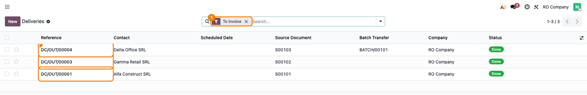
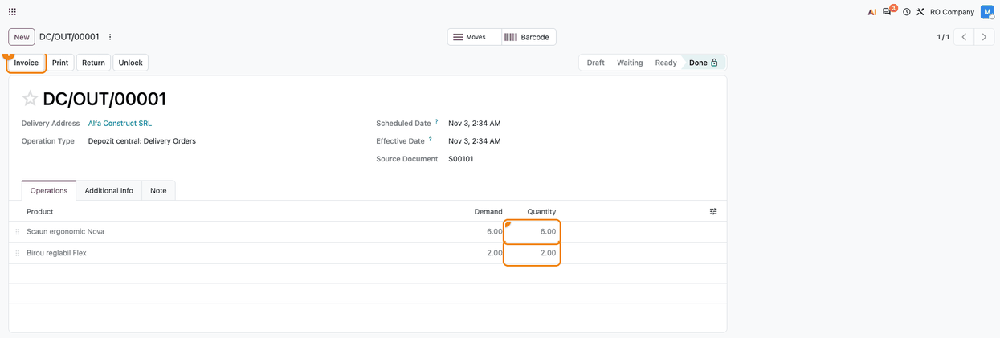
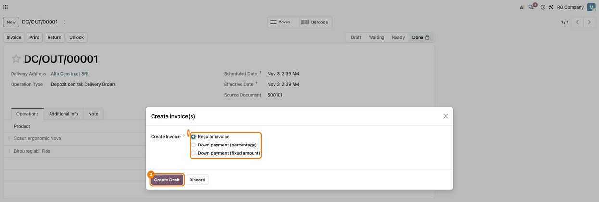
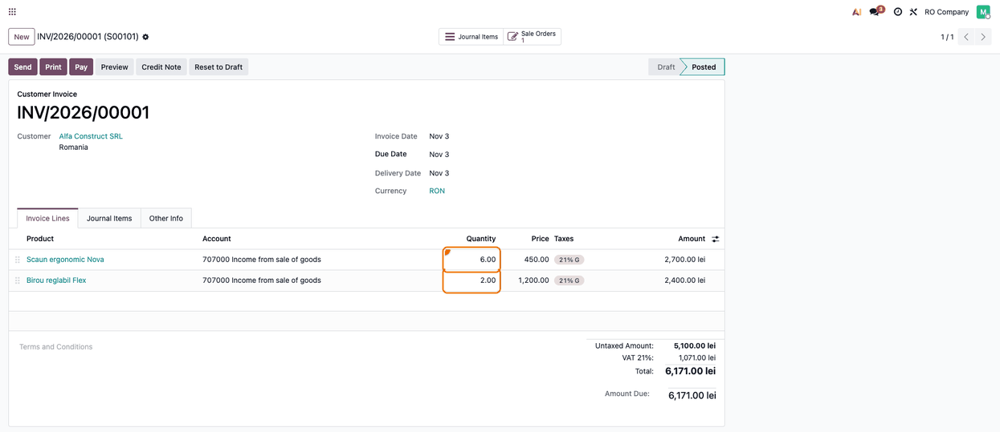
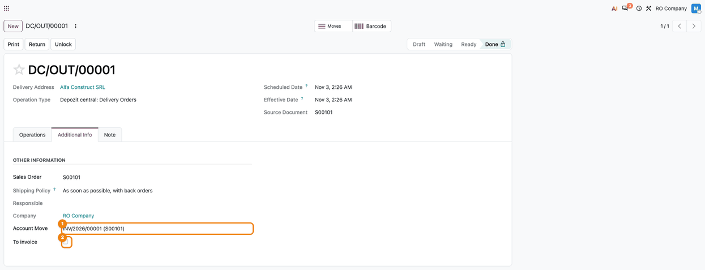
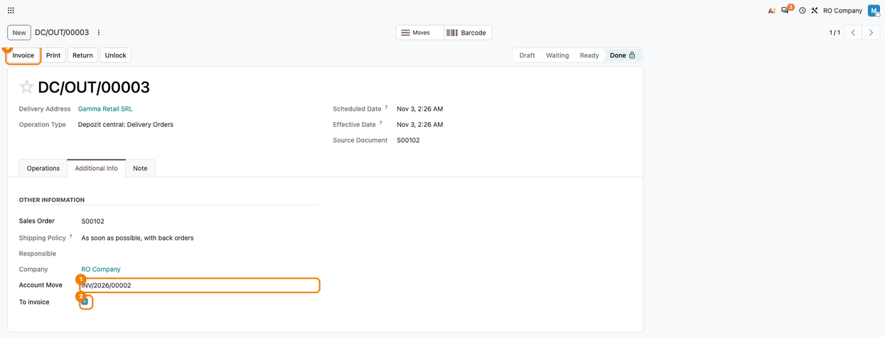
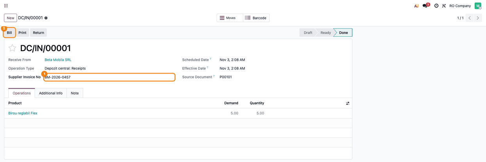
.. |Draft vendor bill created from the receipt: the Purchases button shows P00101 (BM-2026-0457) and the line has 5 Birou reglabil Flex| image:: https://raw.githubusercontent.com/dhongu/deltatech/19.0/deltatech_invoice_picking/static/description/en/08_factura_furnizor.png
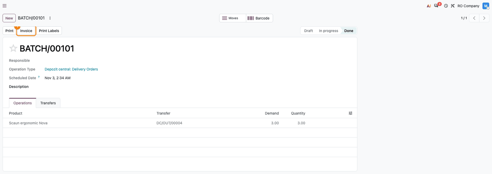
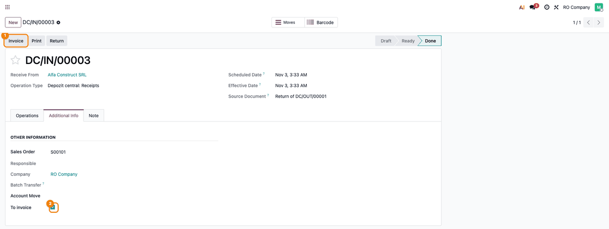
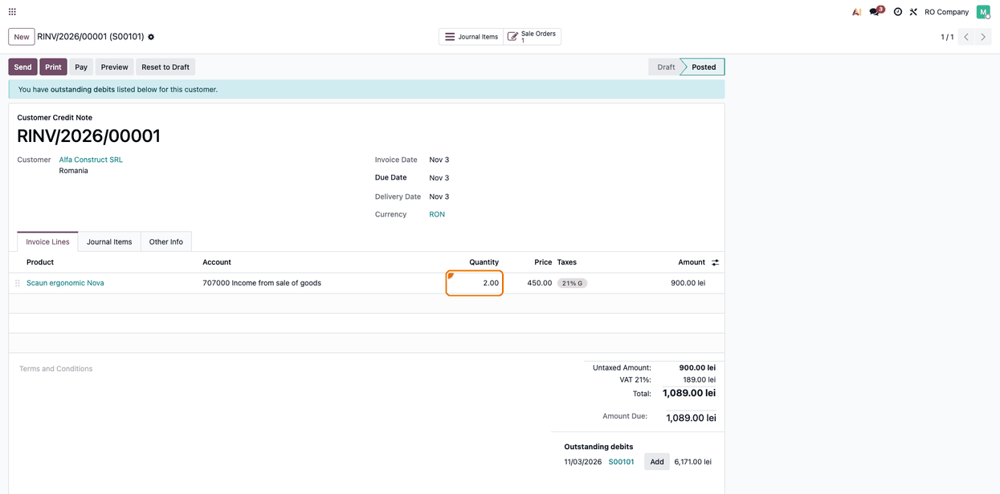
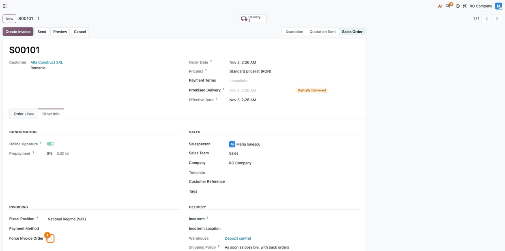

Changelog
=========

19.0.1.0.19 (2026-11-03)
------------------------

- Fixed: the transfer list showed two empty columns on deliveries (the
  hidden operation type and the supplier invoice number); they are now
  hidden as columns.
- Fixed: a return (or a copy) of an invoiced transfer kept the invoice
  of the original transfer, so it was not left to invoice; the invoice
  link is no longer copied.
- Tests for returns, refunds and partial vendor bills.
- Consultant sheet: step 11 (return of an invoiced delivery and the
  credit note issued from the return), with RO and EN screenshots,
  checks and manual notes.

19.0.1.0.18 (2026-11-03)
------------------------

- Description aligned with the code: the to-invoice flag is set when the
  picking is validated, and storable lines of invoices created from
  pickings are locked.
- Usage guide headings as bold lines, so the module README can be
  generated with the usage section.

19.0.1.0.17 (2026-11-03)
------------------------

- Fixed: the Force Invoice Order checkbox on the sale order was shown
  without its label, in the row of the fiscal position; it is now a
  field of the Invoicing group. Its Romanian label is „Facturează
  cantitatea comandată".
- Consultant sheet (``readme/FISA_CONSULTANT.md``) and usage page, with
  RO and EN screenshots generated by ``tests/test_screenshots.py``.

19.0.1.0.16 (2026-10-17)
------------------------

- Fixed: the To invoice flag of a transfer was decided by a single
  invoice line, so a fully invoiced product could clear the flag of a
  transfer with another product only partly invoiced, and two partial
  invoices covering the whole delivery left the transfer to invoice. The
  flag is now derived from all the done moves of the transfer and the
  cumulative invoiced quantity of each order line (non-cancelled
  invoices minus refunds); the quantity not invoiced yet is attributed
  to the most recent transfers (PICKINV-002). Resetting a cancelled
  invoice to draft links its transfers again.
- Fixed: a batch with a partially invoiced transfer was reported as
  invoiced and the batch Invoice action left that transfer out; it is
  now kept, so the rest can be invoiced (PICKINV-003).

19.0.1.0.15 (2026-10-16)
------------------------

- Fixed: invoicing several selected batch transfers stopped after the
  first batch; the not yet invoiced transfers of all the selected
  batches are now invoiced together (delivery and receipt batches cannot
  be mixed).
- Fixed: a batch without transfers was reported as invoiced.
- Fixed: the Invoice button on the batch form was shown on batches that
  were not done or were already invoiced (``and`` instead of ``or`` in
  its visibility condition).

19.0.1.0.14 (2026-10-07)
------------------------

- Fixed: the Create Purchase Invoices action could bill an already
  billed receipt again, with the full receipt quantity, and moved the
  receipt's invoice link to the new bill. The billed quantity is now
  capped at what is still to bill on the purchase order line (received
  minus billed on non-cancelled bills), and receipts with nothing left
  to bill are refused with an error (PICKINV-004). After a bill is
  cancelled, the receipt can be billed again.

19.0.1.0.13 (2026-10-06)
------------------------

- Summary in English, as the Apps Store requires, the same as the
  banner; support address.

19.0.1.0.12 (2026-10-03)
------------------------

- Fixed: invoicing from transfers copied the stock move quantity into
  the invoice line without unit conversion. A purchase line of 1 Dozen
  received as 12 Units was billed as 12 Dozen (12 times the amount), and
  a partial delivery of 12 Units on a 2 Dozen sale line was invoiced as
  2 Dozen. Move quantities are now converted from the move unit to the
  order line unit before summing and before the remaining-quantity cap
  (PICKINV-001). Invoice quantities change whenever the order unit
  differs from the stock move unit.
- Declared the missing ``purchase_stock`` dependency: the transfer form
  uses ``stock.picking.purchase_id``, added by ``purchase_stock``, so a
  standalone install failed with ``Field "purchase_id" does not exist``.
  No change on existing databases, where ``purchase_stock`` is
  auto-installed with ``purchase`` and ``stock``.

19.0.1.0.11 (2026-09-29)
------------------------

- Own module icon, instead of the generic gears it had.

Bug Tracker
===========

Bugs are tracked on `Terrabit Issues <https://www.terrabit.ro/helpdesk>`_.
In case of trouble, please check there if your issue has already been reported.

Do not contact contributors directly about support or help with technical issues.

Credits
=======

Authors
-------

* Terrabit
* Dorin Hongu

Maintainers
-----------

.. |maintainer-dhongu| image:: https://github.com/dhongu.png?size=40px
    :target: https://github.com/dhongu
    :alt: dhongu
.. |maintainer-danila12| image:: https://github.com/danila12.png?size=40px
    :target: https://github.com/danila12
    :alt: danila12

Current maintainers:

|maintainer-dhongu| |maintainer-danila12| 

This module is part of the `dhongu/deltatech <https://github.com/dhongu/deltatech/tree/19.0/deltatech_invoice_picking>`_ project on GitHub.

You are welcome to contribute.