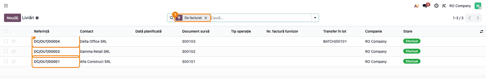
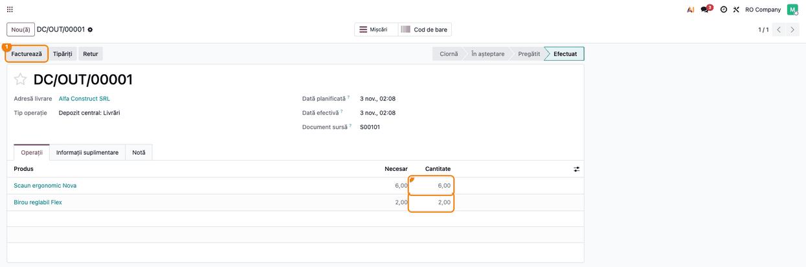
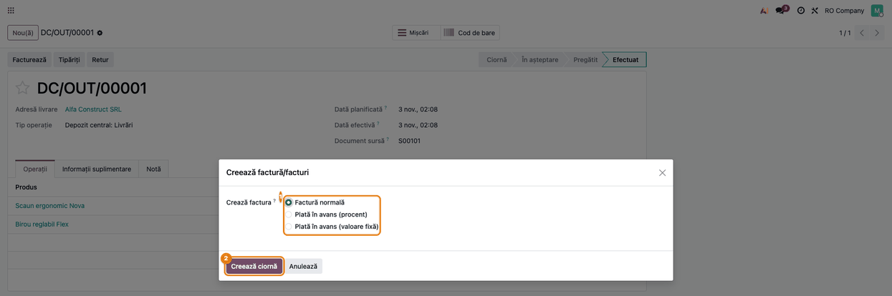
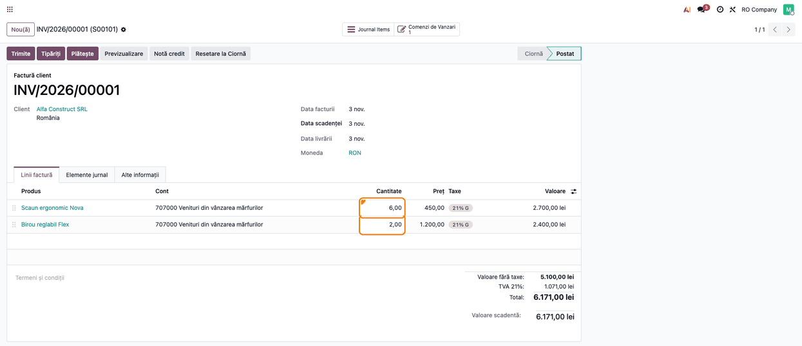
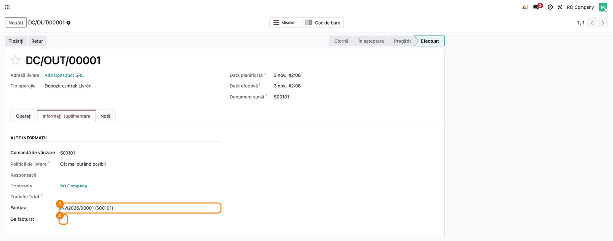
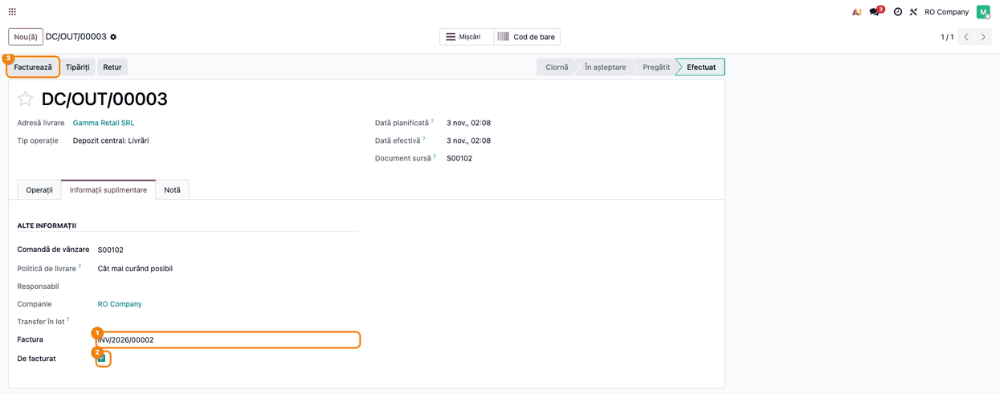
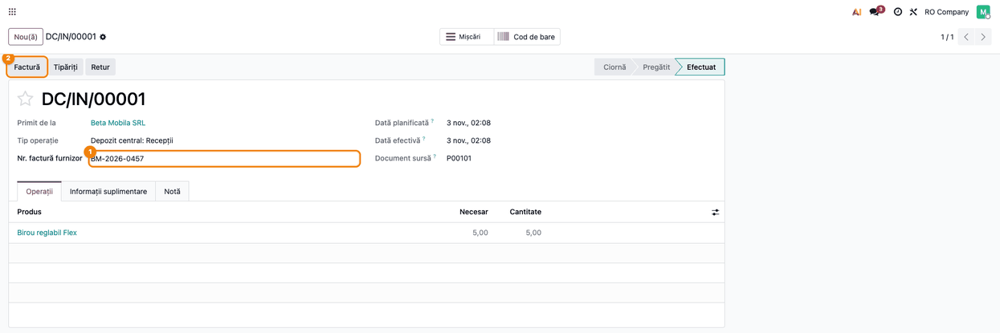
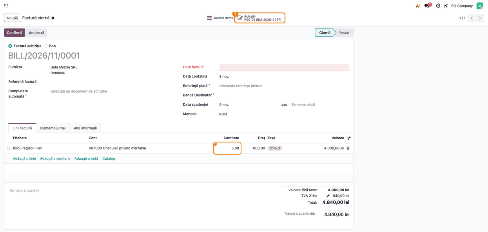
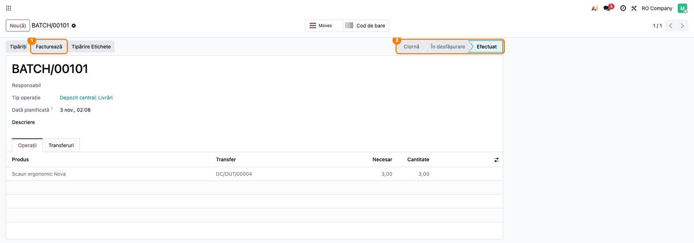
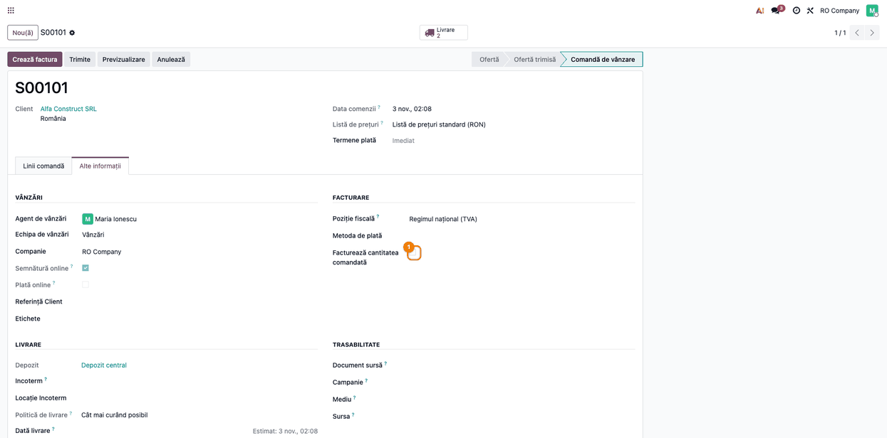

# Fișă Modul: Facturare din transferuri și loturi

**Modul:** `deltatech_invoice_picking`
**Utilizator principal:** Operator facturare / gestionar depozit
**Prioritate:** 🟡 Medie (leagă factura de avizul de livrare sau de recepție; facturarea în sine e cea standard Odoo)

---

## 1. Scop business

În multe firme, factura se emite **după aviz**: clientul primește marfa în mai multe tranșe, iar
operatorul facturează exact ce a plecat cu un anumit transfer, nu tot ce e de facturat pe comandă.
La fel la achiziții: factura furnizorului vine cu recepția și trebuie înregistrată pe cantitățile
recepționate de acel transfer. Modulul adaugă facturarea direct din transferuri:

- butoanele **Facturează** (pe livrare) și **Factură** (pe recepție), plus acțiunile din listă
  **Creează factură vânzare** și **Creează factură furnizor**, pentru mai multe transferuri odată;
- butonul **Facturează** pe lotul de transferuri (**Transferuri în lot**);
- pe factură intră doar produsele transferurilor alese, cu cantitățile efectiv livrate sau recepționate;
- pe transfer, câmpul **De facturat** (și filtrul cu același nume) și legătura către factură, ca
  operatorul să vadă ce transferuri au rămas nefacturate.

## 2. Bază legală și context

Factura se emite în termenul legal, pe baza livrării de bunuri (Codul fiscal, art. 319 alin. (16) —
emiterea facturii până cel târziu în a 15-a zi a lunii următoare celei în care a avut loc livrarea), iar
în relațiile B2B se transmite în RO e-Factura în 5 zile lucrătoare de la emitere. Avizul de
însoțire a mărfii și NIR-ul rămân documentele fiecărui transfer. Modulul nu schimbă regulile fiscale ale
facturii: ajută doar ca fiecare aviz să ajungă facturat o singură dată și integral.

## 3. Utilizatori și roluri

| Rol | Ce face |
|---|---|
| Operator facturare (vânzări) | Filtrează livrările **De facturat**, emite factura din livrare sau din lot |
| Gestionar / operator recepție | Completează **Nr. factură furnizor** pe recepție și creează factura furnizorului |
| Contabil | Verifică facturile create din transferuri și legătura transfer → factură |
| Consultant | Explică regulile de facturare parțială și opțiunea **Facturează cantitatea comandată** |

Roluri recomandate pentru testare: **Sales / Administrator**, **Inventory / Administrator**,
**Purchase / Administrator** și **Invoicing / Billing Administrator**.

## 4. Conturi și date implicate

Modulul nu folosește conturi proprii. Facturile create din transferuri sunt facturi standard și
generează notele obișnuite (vezi „Note de monografie și raportare").

Date minime pentru demo (cele din capturi):

- produsele stocabile **Scaun ergonomic Nova** (450 lei, cost 300 lei) și **Birou reglabil Flex**
  (1.200 lei, cost 800 lei), cu TVA 21% și **Politică de facturare** = **Cantități livrate**;
- comanda de vânzare **S00101** (Alfa Construct SRL): 10 scaune și 2 birouri, livrate parțial — 6 scaune
  și 2 birouri, restul în livrarea ulterioară;
- comanda **S00102** (Gamma Retail SRL): 10 scaune livrate, din care s-au facturat doar 5;
- comanda de achiziție **P00101** (Beta Mobila SRL): 5 birouri la prețul de achiziție de 800 lei/buc.,
  recepționate, cu factura furnizorului **BM-2026-0457**;
- lotul de livrare **BATCH/00101** cu livrarea comenzii **S00103** (Delta Office SRL, 3 scaune).

## 5. Configurare inițială

1. Instalați modulul `deltatech_invoice_picking` (depinde de `account`, `sale_management`, `stock`,
   `sale_stock`, `stock_picking_batch`, `purchase` și `purchase_stock`).
2. Pentru produsele facturate din transfer, alegeți pe produs **Politică de facturare** = **Cantități
   livrate** (vânzări) și **Politică control** = **Pe cantitățile primite** (achiziții), ca factura să
   urmeze cantitățile efective.
3. Nu este necesară altă configurare: câmpurile și butoanele apar pe transferuri, loturi și comenzi
   imediat după instalare.
4. Dacă folosiți evaluarea automată a stocului, verificați conturile categoriei de produse: în
   planul de conturi RO, contul implicit de evaluare a stocului al companiei este 301, deci pentru
   mărfuri setați 371 pe categorie.

## 6. Flux de utilizare

### Pasul 1 — Găsirea livrărilor de facturat

**Inventar → Operații → Transferuri → Livrări**, în căutare alegeți filtrul **De facturat**.



Găsiți pe ecran: fiecare rând este o livrare validată care încă nu e facturată sau e facturată doar
parțial. Verificați că livrările din listă sunt în starea **Efectuat** — doar acestea se pot factura.
Pentru mai multe livrări odată, bifați-le și alegeți **Acțiuni → Creează factură vânzare**.

### Pasul 2 — Factura din livrare

Deschideți livrarea comenzii **S00101**. Butonul **Facturează** apare doar pe o livrare **Efectuat**,
care provine dintr-o comandă de vânzare și este **De facturat**. Verificați în lista operațiilor
cantitățile livrate: 6 scaune și 2 birouri.



### Pasul 3 — Asistentul de facturare

Apăsați **Facturează**. Se deschide asistentul standard Odoo **Creează factură/facturi**.
Lăsați **Factură normală** și apăsați **Creează ciornă**; factura se creează în ciornă și se validează
apoi cu **Confirmă**.



### Pasul 4 — Factura cu cantitățile livrate

Factura conține doar produsele livrării alese, cu **cantitățile livrate**: 6 scaune și 2 birouri, nu
cele 10 scaune comandate. Restul de 4 scaune se facturează din livrarea ulterioară. Liniile unei
facturi create din transferuri nu se pot modifica sau șterge (vezi secțiunea 9), ca factura să rămână
egală cu avizul. În fila **Alte informații**, câmpul **Creat din transferuri** este bifat.



### Pasul 5 — Livrarea facturată

Reveniți pe livrare, fila **Informații suplimentare**: **Factura** arată factura emisă, iar **De
facturat** nu mai este bifat. Butonul **Facturează** dispare, iar livrarea iese din filtrul de la
Pasul 1. Dacă factura se anulează sau se șterge, livrarea redevine **De facturat**.



### Pasul 6 — Livrare facturată parțial

Pasul descrie o stare, nu o operație nouă. Când facturile unei comenzi acoperă doar o parte din
livrare (aici, o factură de 5 din cele 10 scaune livrate ale comenzii **S00102**; din interfață: pe
comandă, **Crează factura**, pe ciornă schimbați cantitatea 10 → 5, apăsați **Anulează**, apoi
**Resetare la Ciornă** și **Confirmă**), livrarea primește
legătura către factură, dar **rămâne De facturat** și păstrează butonul **Facturează**, ca restul să
poată fi facturat. Starea se calculează din toate cantitățile livrate ale transferului și din cantitatea
facturată cumulat pe fiecare linie de comandă (facturi minus facturi storno, fără cele anulate), la
crearea facturii din transfer sau din comandă și la **Resetare la Ciornă** a unei facturi anulate. Pe
o factură creată din comandă (nu din transfer), cantitatea se poate modifica, dar starea transferului
nu se recalculează singură: după corectură, apăsați **Anulează** (livrarea redevine De facturat), apoi
**Resetare la Ciornă** (livrarea se leagă din nou de factură, după cantitatea corectată) și
**Confirmă**. O factură deja confirmată se aduce întâi în ciornă, se corectează, apoi urmează aceiași
pași.



### Pasul 7 — Recepția cu numărul facturii furnizorului

**Inventar → Operații → Transferuri → Recepții**, deschideți recepția validată a comenzii **P00101**. Completați
**Nr. factură furnizor** (aici **BM-2026-0457**) și apăsați **Factură**. Fără numărul facturii, Odoo
refuză operația. Pentru mai multe recepții odată, din listă: **Acțiuni → Creează factură furnizor**;
numărul facturii furnizorului apare și ca coloană în lista recepțiilor.



### Pasul 8 — Factura furnizorului

Se creează factura furnizorului, în ciornă, cu cantitățile recepționate (5 birouri). Numărul facturii
furnizorului se copiază pe comanda de achiziție, ca **Referință furnizor**, și apare pe butonul
**Achiziții** al facturii (**P00101 (BM-2026-0457)**). **Referință factură** nu se completează singură
în Odoo 19: introduceți-o, împreună cu **Data facturii**, înainte de **Confirmă**. O recepție deja
facturată integral nu se mai poate factura a doua oară: Odoo refuză cu mesaj și nu creează o factură
goală.



### Pasul 9 — Facturarea unui lot

**Inventar → Operații → Locuri de muncă → Transferuri în lot**, deschideți lotul **BATCH/00101**.
Butonul **Facturează** apare când lotul este **Efectuat** și nu e încă facturat. Lotul se facturează
împreună: transferurile nefacturate sau facturate parțial ale lotului intră pe factură, cele facturate
integral se sar. La un lot de **recepții**, completați întâi **Nr. factură furnizor** pe fiecare recepție
din lot, altfel Odoo refuză facturarea.



### Pasul 10 — Facturarea după cantitatea comandată

Pe comanda de vânzare, fila **Alte informații**, câmpul **Facturează cantitatea comandată** face ca liniile
comenzii să fie facturate după **cantitatea comandată**, indiferent de politica de facturare a
produsului (de exemplu, comenzi plătite în avans). Când factura pornește dintr-un transfer, cantitățile
rămân tot cele ale transferului.



### Note de monografie și raportare

Modulul nu generează note contabile proprii. Facturile create din transferuri sunt facturi standard,
iar contul fiecărei linii vine din configurarea produsului și a categoriei.

**Fără evaluare automată a stocului (inventar intermitent)** — cazul din capturi:

- factura clientului din Pasul 4: Dr 4111 „Clienți" 6.171 = Cr 707 „Venituri din vânzarea mărfurilor"
  5.100 + Cr 4427 „TVA colectată" 1.071 (6 × 450 + 2 × 1.200 = 5.100 lei, TVA 21%);
- factura furnizorului din Pasul 8: Dr 607 „Cheltuieli privind mărfurile" 4.000 + Dr 4426 „TVA
  deductibilă" 840 = Cr 401 „Furnizori" 4.840 (5 × 800 lei, TVA 21%).

**Cu evaluare automată (perpetuă), Odoo 19 standard:**

- factura furnizorului: Dr 371 „Mărfuri" 4.000 + Dr 4426 840 = Cr 401 4.840 (recepția nu înregistrează
  o notă proprie);
- factura clientului: pe lângă nota de mai sus, descărcarea din gestiune Dr 607 = Cr 371, la costul
  mărfurilor livrate (6 × 300 + 2 × 800 = 3.400 lei).

**Cu localizarea `l10n_ro_stock_account`** (nu e dependență a modulului):

- recepția obișnuită, cu factura sosită (cazul din Pasul 7), nu înregistrează notă; factura furnizorului
  înregistrează Dr 371 4.000 + Dr 4426 840 = Cr 401 4.840;
- doar la recepția **pe aviz** (factura nesosită), recepția înregistrează Dr 371 = Cr 408 „Furnizori –
  facturi nesosite", iar factura furnizorului închide 408: Dr 408 4.000 + Dr 4426 840 = Cr 401 4.840;
- livrarea obișnuită: descărcarea din gestiune Dr 607 = Cr 371 (3.400 lei) se înregistrează la
  validarea livrării, iar factura clientului are doar Dr 4111 6.171 = Cr 707 5.100 + Cr 4427 1.071;
- livrarea **pe aviz** (factura ulterioară): la validare Dr 607 = Cr 371 (3.400) și Dr 418 „Clienți –
  facturi de întocmit" = Cr 707 5.100, iar factura închide 418: Dr 4111 6.171 = Cr 418 5.100 +
  Cr 4427 1.071.

## 7. Legături cu alte module / declarații

| Modul | Rol |
|---|---|
| `sale_stock` | livrările comenzilor de vânzare și asistentul de facturare al comenzii |
| `purchase_stock` | recepțiile comenzilor de achiziție și crearea facturii furnizorului |
| `stock_picking_batch` | loturile de transferuri și butonul **Facturează** de pe lot |
| `account` | facturile; jurnalul de vânzări/cumpărări și declarațiile TVA le preiau ca pe orice factură |

**Ce e automat:** cantitățile de pe factură din transferurile alese (convertite în unitatea liniei de
comandă), legătura transfer → factură, starea **De facturat** după facturare, anulare, ștergere sau
readucere în ciornă, numărul facturii furnizorului copiat pe comandă.

**Ce rămâne manual:** alegerea transferurilor de facturat, completarea **Nr. factură furnizor**, a
câmpurilor **Referință factură** și **Data facturii** pe factura furnizorului, validarea facturii, corecțiile pe factură (care nu se mai propagă pe transfer).

## 8. Verificări pentru consultant

- [ ] O livrare validată dintr-o comandă de vânzare apare la filtrul **De facturat**.
- [ ] **Facturează** pe o livrare parțială creează factura doar cu cantitățile livrate (6 din 10 scaune).
- [ ] După facturare, livrarea are **Factura** completată, **De facturat** nebifat și nu mai are butonul.
- [ ] La anularea facturii, livrarea redevine **De facturat** și pierde legătura; la readucerea facturii
  în ciornă, legătura revine.
- [ ] O livrare facturată doar în parte rămâne **De facturat**, cu legătura către factură.
- [ ] Pe o recepție fără **Nr. factură furnizor**, **Factură** se oprește cu mesaj; cu numărul completat,
  comanda de achiziție are **Referință furnizor** egală cu el (butonul **Achiziții** al facturii).
- [ ] A doua încercare de facturare a aceleiași recepții e refuzată cu „Recepțiile selectate sunt deja
  facturate".
- [ ] Lotul efectuat se facturează cu **Facturează**; un lot cu o livrare facturată parțial nu apare ca
  facturat, iar livrarea intră pe factura lotului.
- [ ] Pe o factură creată din transferuri, modificarea cantității sau ștergerea unei linii de produs
  stocabil este refuzată.

## 9. Mesaje de eroare frecvente

| Mesaj | Cauză | Remediere |
|---|---|---|
| `Nu puteți factura transferuri neconfirmate (...)` | Transferul nu e în starea **Efectuat** | Validați transferul, apoi facturați |
| `Completați nr. factură furnizor` | **Nr. factură furnizor** gol pe recepție | Completați numărul facturii furnizorului |
| `Recepțiile selectate sunt deja facturate: ...` | Recepțiile alese sunt deja facturate integral | Verificați factura existentă a recepției |
| `Nu puteți factura loturi neconfirmate (...)` | Lotul nu e în starea **Efectuat** | Validați lotul |
| `Nu puteți factura împreună loturi de livrare și de recepție.` | Lot de livrare facturat împreună cu un lot de recepție | Facturați separat loturile de livrare și cele de recepție |
| `Nu puteți factura acest tip de transfer: ...` / `... acest tip de loturi: (...)` | Transfer sau lot intern (nici livrare, nici recepție) | Facturați doar livrări și recepții |
| `Nu puteți modifica această linie: factura a fost generată din transferuri` | Modificarea cantității sau a produsului pe o factură creată din transferuri | Anulați factura și refaceți-o din transferurile corecte |
| `Nu puteți șterge linii: factura a fost generată din transferuri` | Ștergerea unei linii de produs pe o factură creată din transferuri (iconița de ștergere apare, dar Odoo refuză) | Ca mai sus |

## 10. Capturi de ecran

Capturile sunt **generate automat** de `tests/test_screenshots.py` (mixinul `ScreenshotCase` din
`deltatech_doc_screenshots`, import defensiv), în română, pe planul de conturi RO, și sunt în
`static/description/` (cele în engleză, pentru `readme/USAGE.md`, în `static/description/en/`):

1. `01_livrari_de_facturat.png` — lista livrărilor cu filtrul **De facturat**;
2. `02_livrare_buton_factura.png` — livrarea efectuată, cu butonul **Facturează**;
3. `03_asistent_facturare.png` — asistentul de facturare deschis din livrare;
4. `04_factura_din_livrare.png` — factura cu cantitățile livrate;
5. `05_livrare_facturata.png` — livrarea facturată, cu legătura către factură;
6. `06_livrare_facturata_partial.png` — livrarea facturată parțial, încă **De facturat**;
7. `07_receptie_numar_factura.png` — recepția cu **Nr. factură furnizor** și butonul **Factură**;
8. `08_factura_furnizor.png` — factura furnizorului creată din recepție;
9. `09_lot_buton_factura.png` — lotul efectuat, cu butonul **Facturează**;
10. `10_comanda_facturare_fortata.png` — comanda, cu **Facturează cantitatea comandată**.

Regenerare:

```bash
./odoo/odoo-bin -c odoo.conf -d <db> -i l10n_ro,deltatech_invoice_picking,deltatech_doc_screenshots \
    --test-tags=fise_screenshots --stop-after-init
```

## 11. Observații pentru manual

- Corecțiile făcute pe factură după creare **nu se propagă** pe transfer: dacă factura trebuie
  schimbată, se anulează și se refac din transferurile corecte, sau se anulează și se aduce în ciornă
  (**Anulează**, apoi **Resetare la Ciornă**), ceea ce recalculează starea **De facturat**.
- Câmpul **Factura** de pe transfer se poate corecta de mână, dar schimbarea lui nu recalculează
  **De facturat**.
- Starea **De facturat** a unui transfer facturat parțial ține cont de toate facturile și facturile
  storno ale liniilor de comandă; cantitatea încă nefacturată se atribuie celor mai recente transferuri.
- Pe facturile furnizorilor, numărul facturii furnizorului se completează pe recepție și ajunge pe
  comanda de achiziție; pe factură, **Referință factură** se completează încă de mână (issue dhongu/deltatech#3916).
