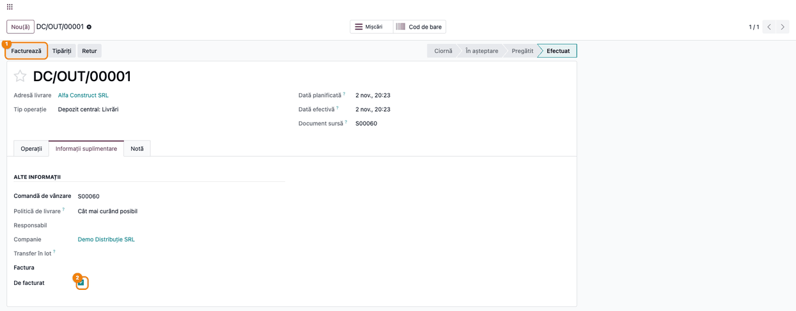
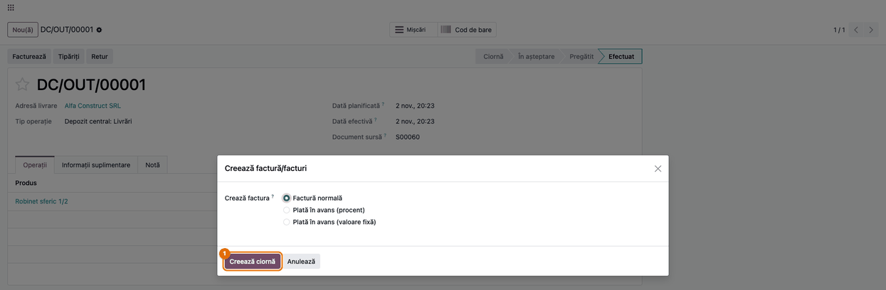
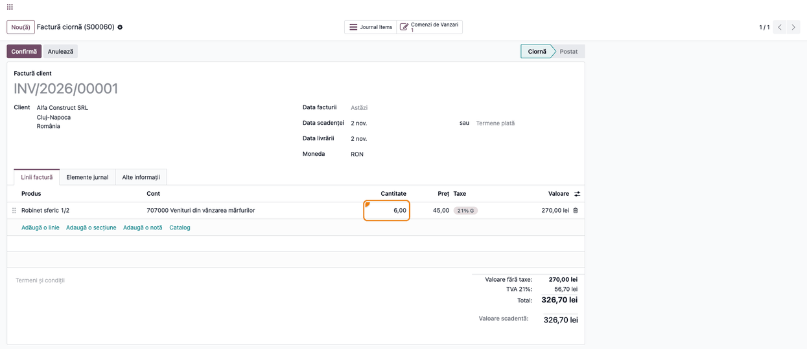
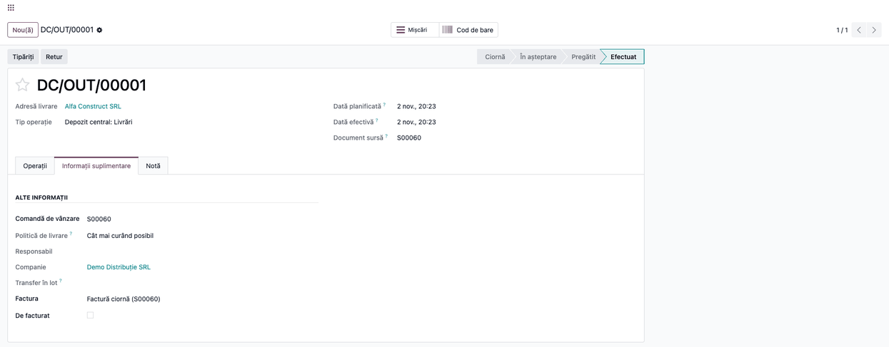
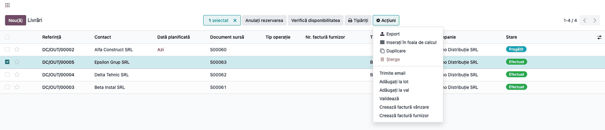
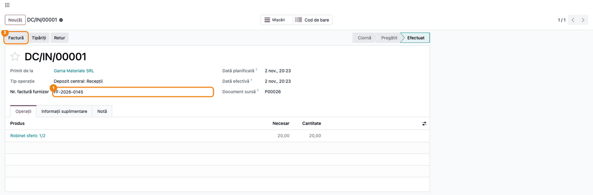
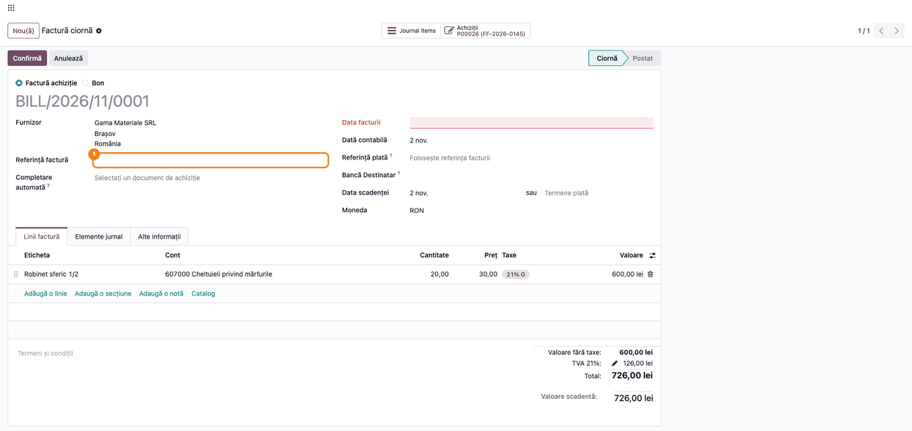
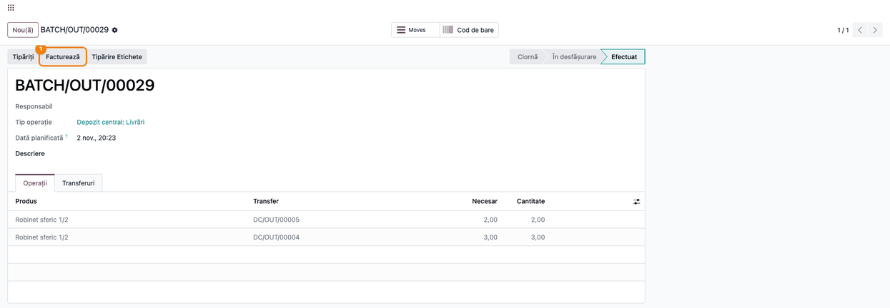

# Fișă Modul: Facturare din transferuri (livrări și recepții)

**Modul:** `deltatech_invoice_picking`
**Utilizator principal:** Operator facturare / gestionar (livrări), Contabil furnizori (recepții)
**Prioritate:** 🟡 Medie (frecvent la firmele care facturează după livrare, pe aviz)

---

## 1. Scop business

În Odoo standard, factura se creează din comanda de vânzare și preia tot ce s-a livrat și nu s-a
facturat încă pe comandă. Când o comandă se livrează în mai multe tranșe, iar fiecare livrare se
facturează separat (factura însoțește marfa sau se emite pe baza avizului), operatorul trebuie să
corecteze manual cantitățile de pe factură. Modulul creează factura **direct din transferul validat**
(livrare sau recepție): pe factură ajung **doar produsele și cantitățile efectiv livrate sau recepționate
în transferurile alese**. Pe fiecare transfer rămâne legătura cu factura și un indicator **De
facturat**, după care se filtrează transferurile încă nefacturate. Se poate factura și un **lot de
transferuri** (batch) dintr-un singur clic.

## 2. Bază legală și context

- **Codul fiscal, art. 319 alin. (16)** — factura se emite cel târziu până la data de 15 a lunii
  următoare celei în care a luat naștere faptul generator (livrarea). Filtrul **De facturat** arată
  livrările care încă nu au factură, ca să nu rămână nefacturate peste termen.
- **Livrarea pe aviz de însoțire** — când marfa pleacă cu aviz și se facturează ulterior, factura
  trebuie să corespundă cantităților din aviz. Modulul ia cantitățile direct din transfer și blochează
  modificarea lor pe factură.
- Modulul nu schimbă notele contabile: factura și factura furnizorului se postează prin fluxul
  standard Odoo, cu conturile din configurarea produselor și a taxelor.

## 3. Utilizatori și roluri

Modulul nu adaugă grupuri proprii. Folosește drepturile standard:

- **Inventar / Utilizator** + **Vânzări / Utilizator** + **Facturare / Facturare** — vede butonul
  **Facturează** pe livrare și creează factura client (fereastra de facturare a comenzii cere dreptul
  de vânzări);
- **Achiziții / Utilizator** + **Facturare / Facturare** — completează **Nr. factură furnizor** pe
  recepție și creează factura furnizorului cu butonul **Factură**.

Roluri recomandate pentru testare: un utilizator cu Vânzări + Inventar + Facturare (fluxul de
livrare) și un contabil cu Achiziții + Facturare (fluxul de recepție).

## 4. Conturi și date implicate

Modulul nu introduce conturi. Notele vin din facturile standard:

| Cont | Rol |
|---|---|
| 4111 „Clienți” | debitul facturii client |
| 707 „Venituri din vânzarea mărfurilor” | venitul de pe factura client (contul de venit al produsului) |
| 4427 „TVA colectată” | TVA-ul facturii client |
| 401 „Furnizori” | creditul facturii furnizorului |
| 607 „Cheltuieli privind mărfurile” sau 371 „Mărfuri” / 408 „Furnizori - facturi nesosite” | debitul facturii furnizorului: 607 la inventar intermitent (ca în capturi), 371 sau 408 la inventar permanent, după configurarea categoriei de produs |
| 4426 „TVA deductibilă” | TVA-ul facturii furnizorului |

Date minime pentru demo:
- companie românească cu planul de conturi RO și taxa de 21% (`l10n_ro`);
- un produs stocabil, cu politica de facturare **Cantități livrate**;
- o comandă de vânzare de 10 bucăți, livrată în două tranșe (6 + 4);
- o comandă de achiziție recepționată, pentru fluxul de furnizor.

## 5. Configurare inițială

1. Instalați modulul `deltatech_invoice_picking` (dependențe: `sale_management`, `sale_stock`,
   `purchase_stock`, `stock_picking_batch`, `account`).
2. Pe produsele stocabile, **Vânzări → Produse → produs**, tabul **Informații generale**: **Politică
   de facturare** = **Cantități livrate**. Cu **Cantități comandate**, Odoo facturează comanda întreagă,
   indiferent de transfer.
3. Opțional, pe o comandă care trebuie facturată integral, deși produsele au politica **Cantități
   livrate**, bifați **Forțează ordinea facturării**: la facturare, liniile comenzii trec pe politica
   **Cantități comandate**. Bifa stă în tabul **Alte informații** al comenzii, grupul **Facturare**,
   lipită de **Poziție fiscală** și fără etichetă proprie.

Nu există alte setări. Butoanele și filtrul apar imediat după instalare.

## 6. Flux de utilizare

Exemplul folosește comenzi de **10 buc.** livrate în tranșe: prima livrare are **6 buc.**, restul de 4
buc. rămâne în livrarea următoare (backorder). Fiecare livrare primește factura ei.

### Pasul 1 — Livrarea validată, cu butonul „Facturează”

Validați livrarea din **Inventar → Operațiuni → Transferuri → Livrări**. După validare, livrarea provenită dintr-o
comandă de vânzare primește bifa **De facturat** (tabul **Informații suplimentare**), iar în antet
apare butonul **Facturează**. Butonul apare doar pe transferurile în starea **Efectuat**, cu comandă de
vânzare și încă nefacturate.



### Pasul 2 — Fereastra de creare a facturii

Apăsați **Facturează**. Se deschide fereastra standard **Creează factură/facturi** a comenzii, cu opțiunea
**Factură normală**. Confirmați cu **Creează ciornă**. Modulul trimite ferestrei transferurile
alese, deci factura nu va lua tot ce s-a livrat pe comandă, ci doar aceste transferuri.



### Pasul 3 — Factura creată din livrare

Se deschide factura în ciornă. Verificați pe ecran, înainte de postare:
- în tabul **Linii factură**, cantitatea liniei = cantitatea livrată în transfer (**6,00**), nu
  cantitatea comenzii (10 buc.): 6 × 45,00 = **270,00 lei**, TVA 21% **56,70 lei**, total
  **326,70 lei**;
- clientul și comanda sunt cele ale livrării;
- în tabul **Alte informații**, câmpul **Creat din transferuri** este bifat;
- în tabul **Elemente jurnal**, nota care se va posta (vezi „Note de monografie și raportare”).

Liniile cu produse stocabile care nu sunt în transferurile alese se șterg automat. Serviciile încă
nefacturate ale comenzii (de exemplu transportul) rămân pe factură, cu cantitatea lor. Pe o factură creată din
transferuri nu se poate modifica **cantitatea** sau **produsul** unei linii cu produs stocabil și nu se
pot șterge astfel de linii: Odoo afișează „Nu puteți modifica această linie, linie de factura a fost
generat din transferuri”. Factura rămâne aliniată cu cantitățile livrate. Liniile de servicii rămân editabile.



### Pasul 4 — Livrarea facturată

Pe livrare, după crearea facturii, **De facturat** se debifează, câmpul **Factura** arată factura
creată, iar butonul **Facturează** dispare.

Dacă factura se **anulează**, livrarea revine la **De facturat** și pierde legătura cu factura. Dacă
factura se **șterge**, livrarea revine la **De facturat**. În ambele cazuri se poate factura din nou.



### Pasul 5 — Lista livrărilor de facturat și facturarea mai multor livrări

**Inventar → Operațiuni → Transferuri → Livrări**, filtrul **De facturat**: lista arată livrările validate care nu au
încă factură. Verificați:
- rândurile de facturat sunt cele în starea **Efectuat**;
- clientul și documentul de origine (comanda) corespund facturilor pe care urmează să le emiteți.

În listă apar și livrările rămase de livrat (backorder), în starea **Pregătit**: ele preiau bifa **De
facturat** de la livrarea din care provin. Nu se pot factura până nu sunt validate (modulul refuză
transferurile neefectuate), deci selectați doar rândurile **Efectuat**.

Selectați livrările, apoi **Acțiuni → Creează factură vânzare**. Livrările aceleiași comenzi intră pe
aceeași factură; comenzile diferite primesc facturi separate, după regulile standard ale ferestrei
**Creează factură/facturi**.



### Pasul 6 — Recepția cu numărul facturii furnizorului

Pe o recepție validată dintr-o comandă de achiziție (**Inventar → Operațiuni → Transferuri → Recepții**),
completați **Nr. factură furnizor** cu numărul de pe factura primită, apoi apăsați butonul
**Factură**. Fără număr, modulul cere „Completați nr. factură furnizor”.



### Pasul 7 — Factura furnizorului creată din recepție

Se creează factura furnizorului cu **cantitățile recepționate** în transfer. Numărul introdus pe
recepție se scrie ca **referință a furnizorului pe comanda de achiziție** (apare în butonul
**Achiziții** al facturii, lângă numărul comenzii). Pe Odoo 19, câmpul **Referință factură** al
facturii **nu se completează automat**: copiați numărul în el și completați **Data facturii** înainte
de **Confirmă**. Recepția se leagă de factură și pierde bifa **De facturat**. Dacă facturați pe rând
mai multe recepții ale aceleiași comenzi, referința comenzii păstrează doar ultimul număr introdus. Dacă recepțiile alese nu mai au nimic de
facturat, modulul refuză: „Recepțiile selectate sunt deja facturate”.



### Pasul 8 — Facturarea unui lot de transferuri

Un lot de livrări (**Inventar → Operațiuni → Locuri de muncă → Transferuri în lot**) în starea **Efectuat** are butonul
**Facturează**, care deschide aceeași fereastră de la pasul 2 pentru transferurile din lot încă
nefacturate. Un lot de recepții creează factura furnizorului; fiecare recepție din lot trebuie să aibă
**Nr. factură furnizor** completat. Loturile de livrări și de recepții nu se
pot factura împreună.



### Note de monografie și raportare

Modulul nu creează note contabile proprii. Facturile se postează prin fluxul standard:

| Operațiune | Notă contabilă | Când |
|---|---|---|
| Factura client din livrare | **Dr 4111 = Cr 707 + Cr 4427** (în exemplu 326,70 = 270,00 + 56,70 lei) | la postarea facturii (pasul 3) |
| Factura furnizorului din recepție | **Dr 607 + Dr 4426 = Cr 401** la inventar intermitent (în exemplu 600,00 + 126,00 = 726,00 lei); la inventar permanent, **Dr 371 sau 408 + Dr 4426 = Cr 401** | la postarea facturii furnizorului (pasul 7) |

Cantitățile de pe facturi sunt cele din transferuri, deci venitul și TVA-ul se recunosc pe tranșa
livrată, nu pe toată comanda. Descărcarea din gestiune (la inventar permanent, **Dr 607 = Cr 371**) se
face la validarea livrării, de fluxul standard de stoc, nu la factură.

Închiderea lunii: o livrare nefacturată până la sfârșitul lunii se înregistrează în luna livrării ca
**Dr 418 = Cr 707**, fără TVA; TVA-ul se colectează la factură. Nota se stornează când se emite
factura în luna următoare. Altfel, venitul ar ajunge în altă perioadă decât livrarea. Controlul lunar: filtrul **De facturat** pe livrări trebuie să fie gol
(sau să conțină doar livrările din ultimele zile ale lunii, facturabile până la 15 ale lunii următoare).

## 7. Legături cu alte module / declarații

| Modul / proces | Rol în flux |
|---|---|
| `sale_stock` | livrările din comandă și fereastra standard **Creează facturi** |
| `purchase_stock` | recepțiile din comandă și crearea facturii furnizorului |
| `stock_picking_batch` | loturile de transfer facturate dintr-un clic |
| `account` | facturile și notele contabile, prin fluxul standard |
| e-Factura (`l10n_ro_edi`) | factura creată din livrare este o factură obișnuită și se transmite în SPV prin fluxul standard |
| D300 / D394 | TVA-ul intră prin taxele facturii, nu printr-o logică a modulului |

Ce este automat: cantitățile din transfer pe factură, ștergerea liniilor fără livrare, legătura
transfer–factură, indicatorul **De facturat** (setat la validarea transferului, resetat la anularea sau
ștergerea facturii), blocarea liniilor stocabile pe factură.

Ce rămâne manual: alegerea transferurilor de facturat, numărul facturii furnizorului pe recepție și
**Referință factură** pe factura furnizorului, postarea facturii.

## 8. Verificări pentru consultant

- [ ] După validare, o livrare din comandă de vânzare are **De facturat** bifat și butonul **Facturează**.
- [ ] Factura creată din prima livrare are 6 buc., nu 10: 270,00 lei + TVA 56,70 lei = 326,70 lei.
- [ ] Pe factură, câmpul **Creat din transferuri** e bifat, iar modificarea cantității unei linii stocabile e refuzată.
- [ ] După facturare, livrarea are **De facturat** debifat și câmpul **Factura** completat.
- [ ] Anularea facturii readuce livrarea la **De facturat**, fără factură legată.
- [ ] Filtrul **De facturat** pe livrări arată livrările validate nefacturate și backorder-urile lor în starea **Pregătit**, care nu se pot factura încă.
- [ ] Recepția fără **Nr. factură furnizor** nu se poate factura; cu număr, comanda de achiziție primește referința furnizorului egală cu el, iar **Referință factură** se completează manual pe factură.
- [ ] O recepție deja facturată, facturată din nou, dă „Recepțiile selectate sunt deja facturate”.
- [ ] Lotul de livrări validat se facturează cu **Facturează**; un lot de livrări și unul de recepții împreună sunt refuzate.

## 9. Mesaje de eroare frecvente

| Mesaj | Cauză | Remediere |
|---|---|---|
| „Nu puteți factura transferuri neconfirmate (…)” | Transferul nu e în starea **Efectuat** | Validați transferul, apoi facturați |
| „Completați nr. factură furnizor” | Recepția nu are **Nr. factură furnizor** | Completați numărul de pe factura primită |
| „Recepțiile selectate sunt deja facturate: …” | Nu mai e nimic de facturat pe liniile recepțiilor | Verificați factura existentă a recepției |
| „Nu puteți factura acest tip de transfer: …” | Transferul nu e livrare sau recepție (de exemplu un transfer intern) | Facturați doar livrări și recepții |
| „Nu puteți factura împreună loturi de livrare și de recepție.” | Selecție mixtă de loturi | Facturați separat loturile de livrări și de recepții |
| „Nu puteți factura acest tip de loturi: (…)” | Lotul nu este nici de livrări, nici de recepții | Facturați doar loturi de livrări sau de recepții |
| „Nu puteți factura loturi neconfirmate (…)” | Lotul nu e în starea **Efectuat** | Validați lotul |
| „Nu puteți modifica această linie, linie de factura a fost generat din transferuri” | Modificare de cantitate sau produs pe o linie stocabilă a unei facturi din transferuri | Corecția se face pe transfer (retur), apoi se facturează retura |
| „Nu puteți șterge linii, linie de factura a fost generat din transferuri” | Ștergere de linie stocabilă pe o factură din transferuri | Anulați factura și refaceți-o din transferurile corecte |

## 10. Capturi de ecran

Capturile din `static/description/` sunt **generate automat** din `tests/test_screenshots.py`
(mixinul `ScreenshotCase` din `l10n_ro_doc_screenshots`, import defensiv), în **limba română**, pe
planul de conturi RO (`setup_country("ro")`), pe compania de test „Demo Distribuție SRL”:

1. `01_livrare_de_facturat.png` — livrarea validată, cu butonul **Facturează** și bifa **De facturat**.
2. `02_fereastra_creare_factura.png` — fereastra **Creează factură/facturi**, deschisă din livrare.
3. `03_factura_din_livrare.png` — factura client, tabul **Linii factură**, cu cantitatea livrată (6,00).
4. `04_livrare_facturata.png` — livrarea după facturare, legată de factură.
5. `05_livrari_de_facturat.png` — lista livrărilor filtrată **De facturat**, cu meniul **Acțiuni**.
6. `06_receptie_nr_factura.png` — recepția cu **Nr. factură furnizor** și butonul **Factură**.
7. `07_factura_furnizor.png` — factura furnizorului creată din recepție.
8. `08_lot_facturare.png` — lotul de livrări validat, cu butonul **Facturează**.

Regenerare:

```bash
./odoo/odoo-bin -c odoo.conf -d <db> \
    -i l10n_ro,deltatech_invoice_picking,l10n_ro_doc_screenshots \
    --test-tags=/deltatech_invoice_picking:TestInvoicePickingScreenshots.test_capture_fise --stop-after-init
```

## 11. Observații pentru manual

Păstrați ideea centrală: **factura urmează transferul**, nu comanda. Pe factură ajunge exact ce s-a
livrat sau recepționat în transferurile alese, iar factura nu mai poate fi modificată pe liniile
stocabile. Filtrul **De facturat** este instrumentul de control lunar al livrărilor nefacturate.
Pentru recepții, subliniați că numărul facturii furnizorului se introduce pe recepție și devine
referința furnizorului pe comanda de achiziție; pe factură se copiază manual în **Referință factură**.
