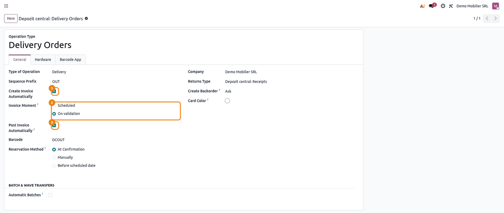
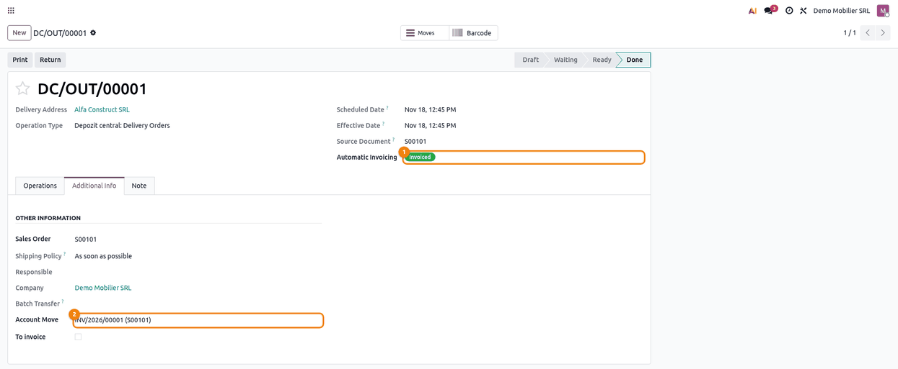
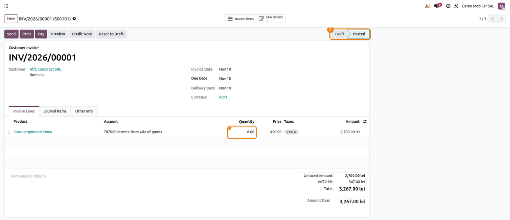
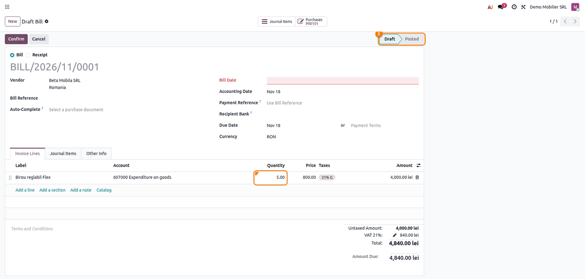
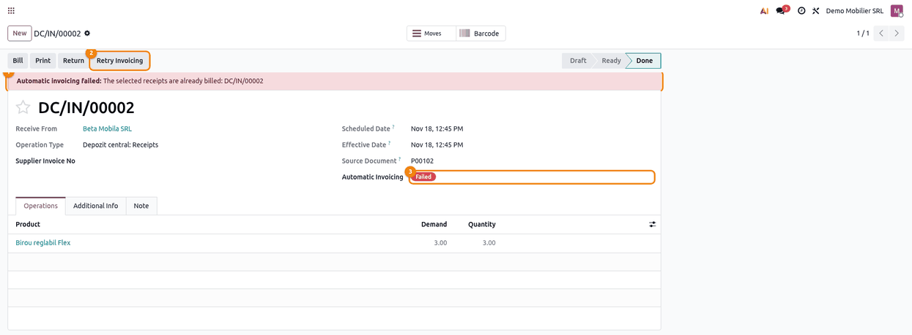
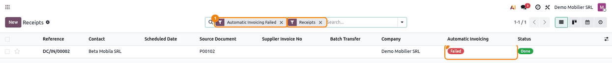

==========================
Auto-Invoice from Delivery
==========================

..
   !!!!!!!!!!!!!!!!!!!!!!!!!!!!!!!!!!!!!!!!!!!!!!!!!!!!
   !! This file is generated by oca-gen-addon-readme !!
   !! changes will be overwritten.                   !!
   !!!!!!!!!!!!!!!!!!!!!!!!!!!!!!!!!!!!!!!!!!!!!!!!!!!!
   !! source digest: sha256:39048cc94cad0613a510e09492bebc506e946b94d8dcbade9a22b301c96c8cfc
   !!!!!!!!!!!!!!!!!!!!!!!!!!!!!!!!!!!!!!!!!!!!!!!!!!!!

.. |badge1| image:: https://img.shields.io/badge/maturity-Beta-yellow.png
    :target: https://odoo-community.org/page/development-status
    :alt: Beta
.. |badge2| image:: https://img.shields.io/badge/license-LGPL--3-blue.png
    :target: http://www.gnu.org/licenses/lgpl-3.0-standalone.html
    :alt: License: LGPL-3
.. |badge3| image:: https://img.shields.io/badge/github-dhongu%2Fdeltatech-lightgray.png?logo=github
    :target: https://github.com/dhongu/deltatech/tree/20.0/deltatech_invoice_picking_automatically
    :alt: dhongu/deltatech
.. |badge_fisa| image:: https://img.shields.io/badge/-Fi%C8%99%C4%83%20consultant-2ea44f.png
    :target: https://github.com/dhongu/deltatech/blob/20.0/deltatech_invoice_picking_automatically/readme/FISA_CONSULTANT.md
    :alt: Fișă consultant
.. |badge_tests| image:: https://img.shields.io/badge/-18%20automated%20tests-2ea44f.png
    :target: https://github.com/dhongu/deltatech/tree/20.0/deltatech_invoice_picking_automatically/tests
    :alt: 18 automated tests

|badge1| |badge2| |badge3| |badge_fisa| |badge_tests|

Invoices the validated transfers automatically, each transfer on its own
document and with the quantities it moved:

- delivery → customer invoice, posted when **Post Invoice
  Automatically** is set;
- customer return → customer credit note;
- receipt → vendor bill, always left in draft (it is posted when the
  vendor's document arrives);
- return to vendor → vendor refund, in draft.

Features:

- Configuration on the operation type: **Create Invoice Automatically**,
  **Invoice Moment** and **Post Invoice Automatically**.
- **Invoice Moment**: *Scheduled* (the daily scheduled action invoices
  the queued transfers, the default) or *On validation* (the transfer is
  invoiced right after it is validated).
- Backorders and partial deliveries are invoiced separately, with the
  quantities of each transfer. A transfer that is already invoiced is
  not invoiced again.
- Only transfers that come from a sale or a purchase order are queued.
- The invoicing runs with system rights, so a warehouse user without
  invoicing rights can validate transfers of an operation type that
  invoices on validation.
- Error handling: each transfer is invoiced in its own savepoint. If the
  invoicing fails, the transfer stays done, is marked **Failed** and
  keeps the reason, shown on the transfer. The **Retry Invoicing**
  button invoices it again after the cause is fixed.
- The **Automatic Invoicing** status on the transfer form and as an
  optional column in the list, and the **Automatic Invoicing Failed**
  and **To Invoice Automatically** filters.

**Table of contents**

.. contents::
   :local:

Usage
=====

**Configure the operation type**

1. Go to **Inventory → Configuration → Operation Types** and open the
   operation type (for example **Delivery Orders**). Check **Create
   Invoice Automatically**, choose the **Invoice Moment** and, for
   customer invoices, **Post Invoice Automatically**.

   |Delivery Orders operation type with Create Invoice Automatically,
   Invoice Moment On validation and Post Invoice Automatically|

**Invoice on validation**

2. Validate a delivery of a sale order. The invoice is created right
   away, with the delivered quantities. The transfer shows **Automatic
   Invoicing** = **Invoiced**, and the **Additional Info** tab links the
   invoice. A return uses the return operation type (for deliveries,
   usually **Receipts**), so the moment and the posting of the credit
   note are the ones set there.

   |Validated delivery of order S00101 with Automatic Invoicing Invoiced
   and the linked invoice|

3. With **Post Invoice Automatically**, the customer invoice is posted.

   |Posted customer invoice with the delivered quantity, 6 Scaun
   ergonomic Nova|

**Scheduled invoicing**

4. On an operation type with **Invoice Moment** = **Scheduled**, the
   validated transfers wait as **To Invoice** and are invoiced by the
   daily scheduled action *Generate Invoices from Pickings*. A receipt
   gets a vendor bill in draft, with the received quantities.

   |Draft vendor bill created for the receipt of order P00101, 5 Birou
   reglabil Flex|

**When the invoicing fails**

5. The transfer stays done and is marked **Failed**. The reason is shown
   at the top of the form. Fix the cause, then click **Retry
   Invoicing**. Here the receipt was billed by hand from the purchase
   order before the scheduled action, so there is nothing left to bill:
   in the **Additional Info** tab, select the existing bill in
   **Invoice**, clear **To invoice**, then click **Retry Invoicing**.

   |Receipt with Automatic Invoicing Failed, the reason The selected
   receipts are already billed and the Retry Invoicing button|

6. In **Inventory → Operations → Transfers → Receipts** (or
   **Deliveries**), add the **Automatic Invoicing Failed** filter.
   Remove the **Receipts** filter to see the failed transfers of all
   types. The **Automatic Invoicing** column can be shown from the
   optional columns menu.

   |Receipts list with the Receipts and Automatic Invoicing Failed
   filters and the Automatic Invoicing column|

Changelog
=========

20.0.1.0.0 (2026-11-21)
-----------------------

- Migration to Odoo 20.0. Tests: customer return through
  ``picking._create_return()`` (the ``stock.return.picking`` wizard is
  gone), no write on the computed ``is_company``.

19.0.1.0.0 (2026-11-18)
-----------------------

- Each transfer gets its own document, with its own quantities: a
  delivery gets a customer invoice, a customer return a credit note, a
  receipt a draft vendor bill and a return to vendor a draft refund.
  Backorders are invoiced separately. Depends on
  ``deltatech_invoice_picking`` (dhongu/deltatech#4033).
- Only transfers with a sale or purchase order are queued. A queued
  transfer without an order fails with a reason instead of staying in
  the queue (dhongu/deltatech#3583).
- New **Invoice Moment** on the operation type: *Scheduled* (default, as
  before) or *On validation*. The invoicing runs with system rights, so
  warehouse users need no invoicing rights. A failure keeps the reason
  on the transfer, shown on the form, with a **Retry Invoicing** button,
  an optional list column and the **Automatic Invoicing Failed** / **To
  Invoice Automatically** filters (dhongu/deltatech#4035).

19.0.0.0.7 (2026-10-22)
-----------------------

- Listed on Odoo Apps as *Auto-Invoice from Delivery* (was *Invoice
  Pickings Automatically*). The technical name
  ``deltatech_invoice_picking_automatically`` does not change.

19.0.0.0.6 (2026-10-09)
-----------------------

- Each automatic invoicing in the cron now runs in its own savepoint. An
  error (posting validation or database error) rolls back only that
  picking's work, so no orphan draft invoice is left behind, the picking
  is marked as failed and logged, and the other pickings of the run are
  still invoiced.

19.0.0.0.5 (2026-09-29)
-----------------------

- Own module icon, instead of the generic gears it had.

Bug Tracker
===========

Bugs are tracked on `Terrabit Issues <https://www.terrabit.ro/helpdesk>`_.
In case of trouble, please check there if your issue has already been reported.

Do not contact contributors directly about support or help with technical issues.

Credits
=======

Authors
-------

* Terrabit
* Dorin Hongu

Maintainers
-----------

.. |maintainer-dhongu| image:: https://github.com/dhongu.png?size=40px
    :target: https://github.com/dhongu
    :alt: dhongu
.. |maintainer-VoicuStefan2001| image:: https://github.com/VoicuStefan2001.png?size=40px
    :target: https://github.com/VoicuStefan2001
    :alt: VoicuStefan2001

Current maintainers:

|maintainer-dhongu| |maintainer-VoicuStefan2001| 

This module is part of the `dhongu/deltatech <https://github.com/dhongu/deltatech/tree/20.0/deltatech_invoice_picking_automatically>`_ project on GitHub.

You are welcome to contribute.