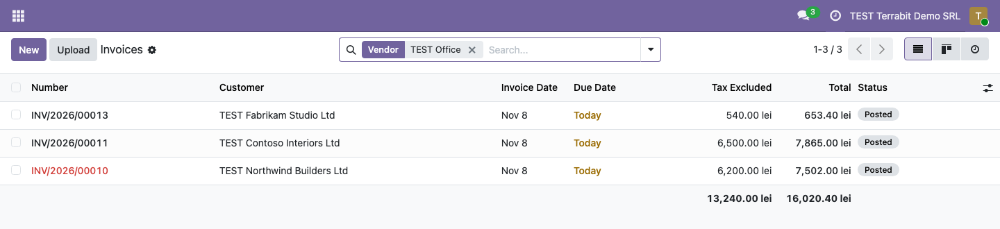

======================
Invoice Product Filter
======================

..
   !!!!!!!!!!!!!!!!!!!!!!!!!!!!!!!!!!!!!!!!!!!!!!!!!!!!
   !! This file is generated by oca-gen-addon-readme !!
   !! changes will be overwritten.                   !!
   !!!!!!!!!!!!!!!!!!!!!!!!!!!!!!!!!!!!!!!!!!!!!!!!!!!!
   !! source digest: sha256:8e4f82700ce24522e35359c6a1ccd9b2056e475a7796311f552a88d73c2a2406
   !!!!!!!!!!!!!!!!!!!!!!!!!!!!!!!!!!!!!!!!!!!!!!!!!!!!

.. |badge1| image:: https://img.shields.io/badge/maturity-Mature-brightgreen.png
    :target: https://odoo-community.org/page/development-status
    :alt: Mature
.. |badge2| image:: https://img.shields.io/badge/license-LGPL--3-blue.png
    :target: http://www.gnu.org/licenses/lgpl-3.0-standalone.html
    :alt: License: LGPL-3
.. |badge3| image:: https://img.shields.io/badge/github-dhongu%2Fdeltatech-lightgray.png?logo=github
    :target: https://github.com/dhongu/deltatech/tree/19.0/deltatech_invoice_product_filter
    :alt: dhongu/deltatech
.. |badge_fisa| image:: https://img.shields.io/badge/-Fi%C8%99%C4%83%20consultant-2ea44f.png
    :target: https://github.com/dhongu/deltatech/blob/19.0/deltatech_invoice_product_filter/readme/FISA_CONSULTANT.md
    :alt: Fișă consultant

|badge1| |badge2| |badge3| |badge_fisa|

- Features:

  - Searching invoice using product
  - Searching invoice using the product's vendor (supplier) name

Odoo Online
===========

The module contains no Python code, only a search view extension.
Besides Odoo.sh and on-premise installations, it can be used on Odoo
Online (Custom plan): download the zip and load it from **Apps > Import
Module**.

**Table of contents**

.. contents::
   :local:

Usage
=====

1. Install the module, or on Odoo Online import the zip from **Apps >
   Import Module** (Custom plan, developer mode). There is nothing to
   configure; for the vendor search, the products need their vendors in
   the **Purchase** tab of the product form.

2. Open **Invoicing > Customers > Invoices** and type a product name, or
   part of it, in the search bar. Two new suggestions appear: **Search
   Product for: ...** and **Search Vendor for: ...**.

   |Invoices list with TEST Ergonomic typed in the search bar; the
   suggestions include Search Product for: TEST Ergonomic (highlighted)
   and Search Vendor for: TEST Ergonomic|

3. Choose **Search Product**: the list keeps only the invoices that have
   the product on at least one line. The search uses the product name,
   its internal reference or its barcode.

   |Invoices list filtered by Product: TEST Ergonomic, showing the
   invoices of TEST Contoso Interiors Ltd and TEST Northwind Builders
   Ltd|

4. Remove the facet, type a vendor name and choose **Search Vendor**:
   the list keeps the invoices with products bought from that vendor,
   whatever the product.

   |Invoices list filtered by Vendor: TEST Office, showing three
   invoices with products supplied by TEST Office Supply Ltd|

Both criteria are available in every invoice list: customer invoices and
credit notes, vendor bills and refunds. They can be combined with each
other and with the standard filters.

.. |Invoices list with TEST Ergonomic typed in the search bar; the suggestions include Search Product for: TEST Ergonomic (highlighted) and Search Vendor for: TEST Ergonomic| image:: https://raw.githubusercontent.com/dhongu/deltatech/19.0/deltatech_invoice_product_filter/static/description/en/01_cautare_dupa_produs.png
.. |Invoices list filtered by Product: TEST Ergonomic, showing the invoices of TEST Contoso Interiors Ltd and TEST Northwind Builders Ltd| image:: https://raw.githubusercontent.com/dhongu/deltatech/19.0/deltatech_invoice_product_filter/static/description/en/02_facturi_filtrate_produs.png

Changelog
=========

19.0.1.2.1 (2026-11-09)
-----------------------

- The "(importable, Odoo Online)" suffix was removed from the module
  name. Odoo Apps already shows the module as available on Odoo Online
  (Manifest > Availability), and the Apps banner now carries an "Odoo
  Online" label instead.

19.0.1.2.0 (2026-11-08)
-----------------------

- Data-only module: the empty ``__init__.py`` was removed, so the module
  has no Python code. It can be installed on Odoo Online (Custom plan)
  as a zip from Apps > Import Module, as well as on Odoo.sh and
  on-premise.
- Odoo Apps does not mark data-only modules as available on Odoo Online,
  so the module name, the summary, the banner and the Apps Store page
  now say it: "Invoice Product Filter (importable, Odoo Online)".

19.0.1.1.1 (2026-09-29)
-----------------------

- Own module icon, instead of the generic gears it had.

Bug Tracker
===========

Bugs are tracked on `Terrabit Issues <https://www.terrabit.ro/helpdesk>`_.
In case of trouble, please check there if your issue has already been reported.

Do not contact contributors directly about support or help with technical issues.

Credits
=======

Authors
-------

* Terrabit
* Dorin Hongu

Maintainers
-----------

.. |maintainer-dhongu| image:: https://github.com/dhongu.png?size=40px
    :target: https://github.com/dhongu
    :alt: dhongu

Current maintainer:

|maintainer-dhongu| 

This module is part of the `dhongu/deltatech <https://github.com/dhongu/deltatech/tree/19.0/deltatech_invoice_product_filter>`_ project on GitHub.

You are welcome to contribute.