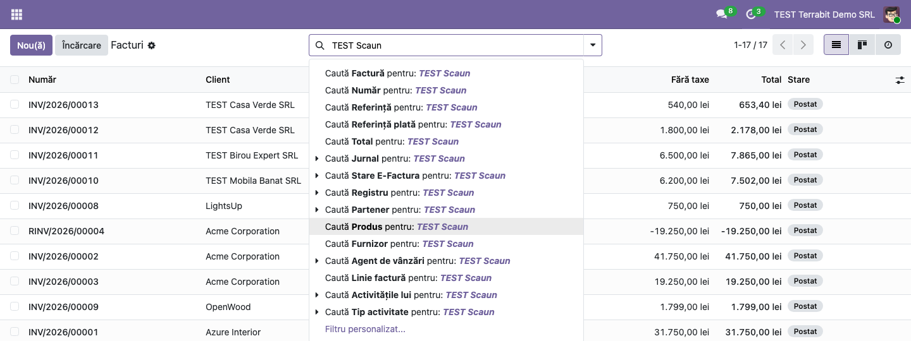
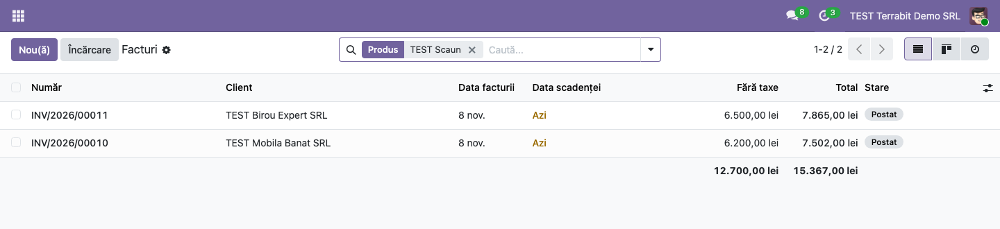
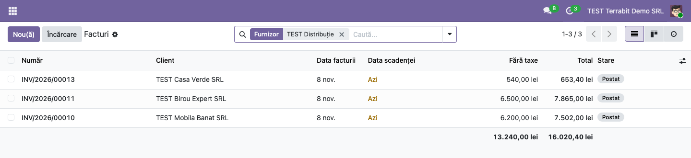

# Fișă Modul: Căutarea facturilor după produs și după furnizorul produsului

**Modul:** `deltatech_invoice_product_filter`
**Utilizator principal:** Contabili, facturiste, agenți de vânzări și achizitori care caută facturi
**Prioritate:** 🟢 Scăzută (adaugă două criterii de căutare, nu modifică datele)

---

## 1. Scop business

În Odoo, căutarea din lista de facturi găsește documentele după număr, partener, referință sau
jurnal; criteriul standard **Linie factură** caută doar în textul liniilor, nu după produs,
referința lui internă, codul de bare sau furnizorul produsului. Ca să afle pe ce facturi a fost vândut un anumit produs,
utilizatorul trebuie să deschidă analiza facturilor sau să caute în liniile contabile. Modulul
adaugă în bara de căutare a facturilor două criterii:

- **Produs**: găsește facturile care au pe linii un produs al cărui nume sau referință internă
  conține textul căutat (sau al cărui cod de bare este exact textul căutat);
- **Furnizor**: găsește facturile care au pe linii produse cumpărate de la furnizorul căutat, adică
  produse care au furnizorul în fila **Achiziție** a fișei produsului (lista de prețuri ale
  furnizorilor).

Criteriile apar în toate listele care folosesc căutarea facturilor: facturi și note de credit
clienți, facturi și rambursări furnizori.

Modulul nu are cod Python, doar o extensie a vederii de căutare. Pe lângă Odoo.sh și instalările
proprii, se poate folosi și pe Odoo Online (planul Custom), încărcat ca arhivă zip: cu modul
dezvoltator activ, din **Aplicații → Importați Modulul**.

## 2. Bază legală și context

Modulul nu are bază legală. Contextul este lucrul zilnic: răspunsul la întrebări ca „pe ce facturi
am vândut produsul X?”, „ce clienți au cumpărat marfă de la furnizorul Y?”, verificarea unei
reclamații sau a unui retur, pregătirea unei discuții comerciale cu un furnizor.

## 3. Utilizatori și roluri

| Rol | Ce face |
|---|---|
| Utilizator cu acces la Facturare | Caută facturi după produs sau după furnizorul produsului |
| Administrator | Instalează sau importă modulul; nu are nimic de configurat |

Modulul nu adaugă grupuri de drepturi: fiecare utilizator vede doar facturile la care are deja
acces. Pentru testare ajunge un utilizator administrator.

## 4. Conturi și date implicate

Nu se folosesc conturi contabile și nu se generează note contabile. Pentru demo sunt necesare:

- câteva produse, unele cu furnizor completat în fila **Achiziție** (în capturi: *TEST Scaun
  ergonomic* și *TEST Lampă de birou*, cu furnizorul *TEST Distribuție Mobilier SRL*; *TEST Birou
  reglabil*, cu furnizorul *TEST Lemn Prelucrat SRL*);
- câteva facturi clienți validate cu aceste produse (în capturi: facturile către *TEST Mobila
  Banat SRL*, *TEST Birou Expert SRL* și *TEST Casa Verde SRL*).

## 5. Configurare inițială

1. Instalați modulul `deltatech_invoice_product_filter` (depinde doar de `account`). Pe Odoo Online,
   activați modul dezvoltator și încărcați arhiva zip din **Aplicații → Importați Modulul**.
2. Pentru criteriul **Furnizor**, completați furnizorii pe produse: fișa produsului, fila
   **Achiziție**, lista de furnizori. Nu există alte setări.

## 6. Flux de utilizare

### Pasul 1 — Căutarea după produs

Deschideți **Facturare → Clienți → Facturi**. Scrieți în bara de căutare numele produsului sau o
parte din el (de exemplu *TEST Scaun*). În lista de sugestii apar două rânduri noi: **Caută Produs
pentru: …** și **Caută Furnizor pentru: …**. Alegeți **Caută Produs**.

### Pasul 2 — Facturile care conțin produsul

Lista se reduce la facturile care au produsul pe cel puțin o linie, iar în bara de căutare apare
eticheta **Produs**. Totalurile de sub listă se recalculează pe facturile găsite (sunt totalurile
facturilor întregi, nu doar ale liniilor cu produsul căutat).

### Pasul 3 — Căutarea după furnizorul produsului

Ștergeți eticheta cu **×**, scrieți numele furnizorului (de exemplu *TEST Distribuție*) și alegeți
**Caută Furnizor pentru: …**. Lista arată facturile clienți pe care s-au vândut produse ale acelui
furnizor, indiferent de produs: aici, scaunele și lămpile de birou.

Criteriile se pot combina între ele și cu filtrele standard (de exemplu **Produs** plus filtrul pe
perioadă sau pe stare). Mai multe valori puse pe același criteriu se leagă cu „sau”.

### Note de monografie și raportare

Modulul nu generează note contabile (Dr/Cr): doar filtrează lista de facturi existente.

## 7. Legături cu alte module / declarații

| Modul | Rol |
|---|---|
| `account` | Lista de facturi și vederea de căutare pe care modulul o extinde |
| `product` (instalat odată cu `account`) | Produsele și furnizorii lor (fila **Achiziție**) |
| `purchase` (opțional) | Adaugă automat furnizorul comenzii pe produs la confirmarea comenzii de achiziție (dacă produsul are cel mult 10 furnizori) |
| `base_import_module` | Importul arhivei zip pe Odoo Online |

**Ce e automat:** criteriile **Produs** și **Furnizor** apar în căutarea tuturor listelor de
facturi și note de credit, de vânzare și de achiziție.

**Ce rămâne manual:** completarea furnizorilor pe produse, pentru criteriul **Furnizor**.

## 8. Verificări pentru consultant

- [ ] În **Facturare → Clienți → Facturi**, după ce scrieți un text în căutare, apar sugestiile
  **Caută Produs** și **Caută Furnizor**.
- [ ] Căutarea după produs găsește facturile care au produsul pe linii, inclusiv după referința
  internă a produsului (codul dintre paranteze drepte).
- [ ] Căutarea după furnizor găsește facturile cu produse care au furnizorul în fila **Achiziție**.
- [ ] Criteriile apar și în **Facturare → Furnizori → Facturi** și în listele de note de credit.
- [ ] Pe Odoo Online, după importul arhivei zip (modul dezvoltator, **Aplicații → Importați
  Modulul**), modulul apare în **Aplicații** și criteriile apar în căutarea facturilor.

## 9. Mesaje de eroare frecvente

| Mesaj | Cauză | Remediere |
|---|---|---|
| Căutarea după furnizor nu găsește nicio factură | Produsele nu au furnizorul completat în fila **Achiziție** (furnizorul de pe factura de achiziție nu contează) | Completați furnizorii pe produse sau folosiți criteriul **Partener** pe facturile furnizorilor |
| Căutarea după produs găsește facturi în plus | Textul căutat apare în numele mai multor produse | Scrieți un text mai precis sau referința internă a produsului |
| Sugestiile **Caută Produs** și **Caută Furnizor** nu apar | Modulul nu e instalat sau browserul folosește încă vederea veche | Verificați în **Aplicații** și reîncărcați pagina |

## 10. Capturi de ecran

Capturile sunt în `static/description/` (cele în engleză, pentru `readme/USAGE.md`, în
`static/description/en/`), făcute în română pe o bază de test cu localizarea RO (`l10n_ro`, TVA 21%, moneda RON) și cu
modulul instalat:

| Fișier | Ce arată |
|---|---|
| `01_cautare_dupa_produs.png` | Lista de sugestii cu rândurile noi **Caută Produs** și **Caută Furnizor** |
| `02_facturi_filtrate_produs.png` | Facturile care conțin produsul *TEST Scaun ergonomic* |
| `03_facturi_filtrate_furnizor.png` | Facturile cu produse ale furnizorului *TEST Distribuție Mobilier SRL* |

Modulul nu are `tests/test_screenshots.py`, ca să rămână fără cod Python: capturile s-au făcut
cu Playwright.

## 11. Observații pentru manual

- Criteriul **Furnizor** caută după furnizorii declarați pe produs, nu după furnizorul de pe
  factura de achiziție; un produs cu mai mulți furnizori apare la căutarea oricăruia dintre ei.
- Furnizorul se poate căuta și după CUI, email sau referința internă a partenerului.
- Totalurile listei sunt ale facturilor întregi; pentru cantitățile și valorile vândute pe produs
  se folosește analiza facturilor, din meniul **Facturare → Raportare**.
- Pe Odoo Online, importul unui modul cere planul Custom.
