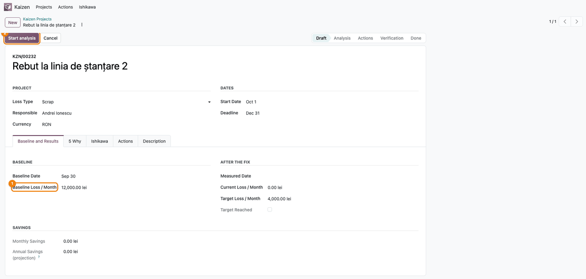
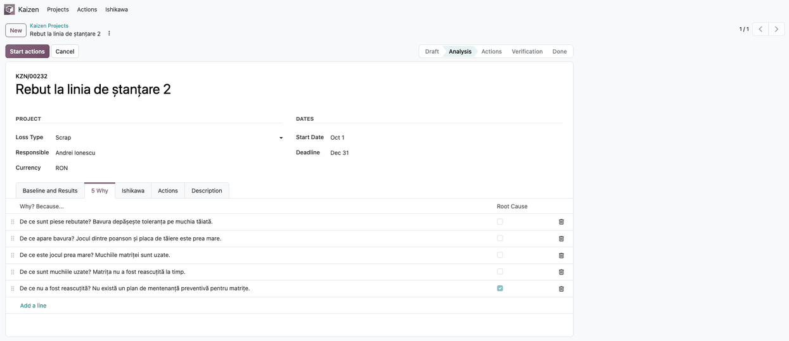
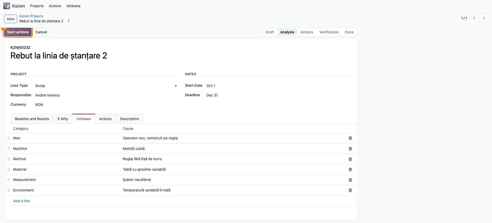
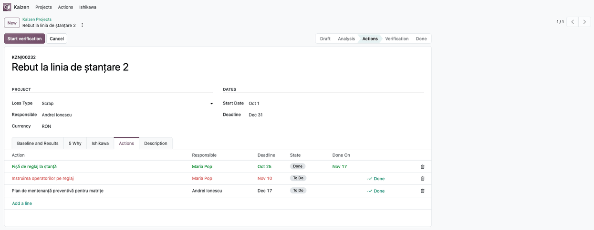
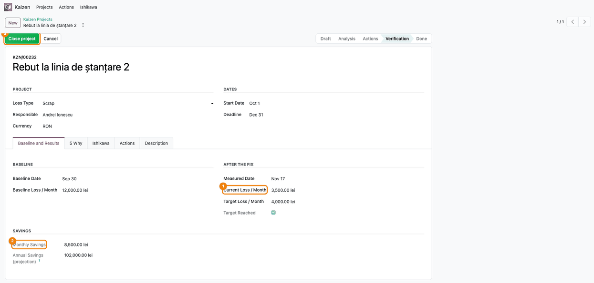
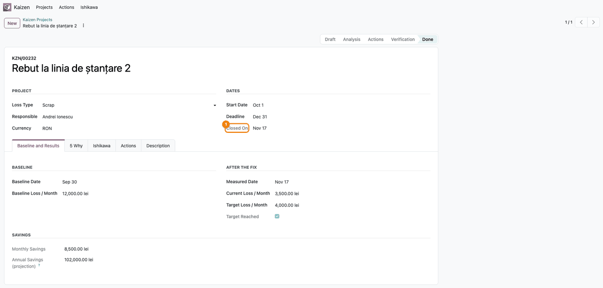
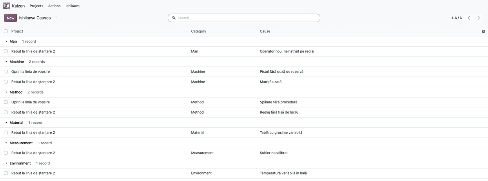
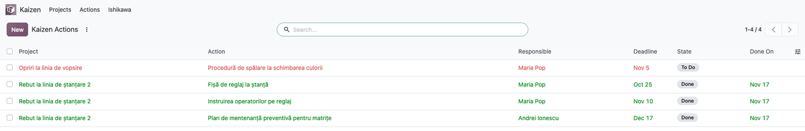

===========================
Kaizen Improvement Projects
===========================

..
   !!!!!!!!!!!!!!!!!!!!!!!!!!!!!!!!!!!!!!!!!!!!!!!!!!!!
   !! This file is generated by oca-gen-addon-readme !!
   !! changes will be overwritten.                   !!
   !!!!!!!!!!!!!!!!!!!!!!!!!!!!!!!!!!!!!!!!!!!!!!!!!!!!
   !! source digest: sha256:b400b72521acd8a4e7305c61ad0be9d164de3052e75293b998b445a26e2fae10
   !!!!!!!!!!!!!!!!!!!!!!!!!!!!!!!!!!!!!!!!!!!!!!!!!!!!

.. |badge1| image:: https://img.shields.io/badge/maturity-Beta-yellow.png
    :target: https://odoo-community.org/page/development-status
    :alt: Beta
.. |badge2| image:: https://img.shields.io/badge/license-LGPL--3-blue.png
    :target: http://www.gnu.org/licenses/lgpl-3.0-standalone.html
    :alt: License: LGPL-3
.. |badge3| image:: https://img.shields.io/badge/github-dhongu%2Fdeltatech-lightgray.png?logo=github
    :target: https://github.com/dhongu/deltatech/tree/20.0/deltatech_kaizen
    :alt: dhongu/deltatech
.. |badge_fisa| image:: https://img.shields.io/badge/-Fi%C8%99%C4%83%20consultant-2ea44f.png
    :target: https://github.com/dhongu/deltatech/blob/20.0/deltatech_kaizen/readme/FISA_CONSULTANT.md
    :alt: Fișă consultant

|badge1| |badge2| |badge3| |badge_fisa|

Kaizen is a continuous improvement method: small, focused projects that
fix one measured loss at a time.

This module records each improvement as a project tied to a loss you can
measure:

- the baseline loss per month before the fix, with its date;
- the 5 Why analysis (up to five lines, one marked as the root cause);
- the Ishikawa causes, grouped in the six categories Man, Machine,
  Method, Material, Measurement and Environment;
- the corrective actions, each with a responsible person and a deadline,
  and an overdue flag;
- the loss per month measured after the fix, and the savings against the
  baseline, including an annual projection.

A project can be closed only by a Kaizen manager, from the Verification
state, when a root cause is recorded, every action is done, the baseline
is positive and the loss after the fix has been measured.

**Table of contents**

.. contents::
   :local:

Usage
=====

Kaizen projects follow a fixed flow: Draft → Analysis → Actions →
Verification → Done.

1. Go to **Kaizen → Projects**. The list opens on the **Open** filter,
   with the loss type, responsible, deadline, baseline loss, current
   loss, monthly savings and state of each project.

   |Kaizen Projects list with the Open filter: two projects in the
   Actions state, with baseline loss, current loss and monthly savings|

2. Click **New**, enter the project name, **Loss Type**,
   **Responsible**, **Start Date** and **Deadline**. On save the project
   gets a ``KZN/`` reference. In the **Baseline and Results** tab, enter
   the **Baseline Date** and the **Baseline Loss / Month**, and
   optionally the **Target Loss / Month**. Savings stay at zero until a
   measurement after the fix is recorded. Click **Start analysis**.

   |Project in Draft: Baseline and Results tab with the baseline loss of
   12,000.00 per month, the target and savings still at zero|

3. In the **5 Why** tab, add up to five lines, each answering "why?" for
   the line above, and tick **Root Cause** on the line where the
   analysis stops. Only one line can be the root cause.

   |5 Why tab: five lines, the last one about the missing preventive
   maintenance plan is marked as root cause|

4. In the **Ishikawa** tab, add the possible causes, each with a
   **Category** (Man, Machine, Method, Material, Measurement,
   Environment). Click **Start actions**.

   |Ishikawa tab: one cause in each of the six categories|

5. In the **Actions** tab, add each corrective action with a
   **Responsible** and a **Deadline**. Click the **Done** button on the
   line when the action is finished: **Done On** gets today's date.
   Overdue open actions are shown in red, finished ones in green.

   |Actions tab: a finished action in green, an overdue one in red and
   one within its deadline|

6. When every action is done, click **Start verification**. Enter the
   **Measured Date** and the **Current Loss / Month** measured after the
   fix. **Monthly Savings** is the baseline loss minus the current loss,
   **Annual Savings (projection)** is the monthly savings × 12, and
   **Target Reached** is ticked when a target is set and the measured
   current loss is at or below it.

   |Project in Verification: current loss 3,500.00, monthly savings
   8,500.00, annual projection 102,000.00 and Target Reached ticked|

7. A Kaizen manager clicks **Close project**. Closing is refused without
   a root cause, with open actions, with a zero baseline or without a
   measured date. The state becomes **Done** and **Closed On** is set.
   **Cancel**, also manager-only, stops a project in any state except
   Done.

   |Closed project in the Done state, with the Closed On date|

8. **Kaizen → Ishikawa** lists the causes of all projects, grouped by
   category.

   |Ishikawa Causes list grouped by category, with the project and the
   cause on each line|

9. **Kaizen → Actions** lists the actions of all projects, with overdue
   ones in red: the follow-up list for the weekly improvement meeting.

   |Kaizen Actions list: the actions of both projects, the overdue one
   in red|

.. |Kaizen Projects list with the Open filter: two projects in the Actions state, with baseline loss, current loss and monthly savings| image:: https://raw.githubusercontent.com/dhongu/deltatech/20.0/deltatech_kaizen/static/description/en/01_lista_proiecte.png

Changelog
=========

20.0.1.0.0
----------

- Initial version: Kaizen projects with baseline and savings, 5 Why,
  Ishikawa causes, actions with owner and deadline.

Bug Tracker
===========

Bugs are tracked on `Terrabit Issues <https://www.terrabit.ro/helpdesk>`_.
In case of trouble, please check there if your issue has already been reported.

Do not contact contributors directly about support or help with technical issues.

Credits
=======

Authors
-------

* Terrabit
* Dorin Hongu

Maintainers
-----------

.. |maintainer-dhongu| image:: https://github.com/dhongu.png?size=40px
    :target: https://github.com/dhongu
    :alt: dhongu

Current maintainer:

|maintainer-dhongu| 

This module is part of the `dhongu/deltatech <https://github.com/dhongu/deltatech/tree/20.0/deltatech_kaizen>`_ project on GitHub.

You are welcome to contribute.