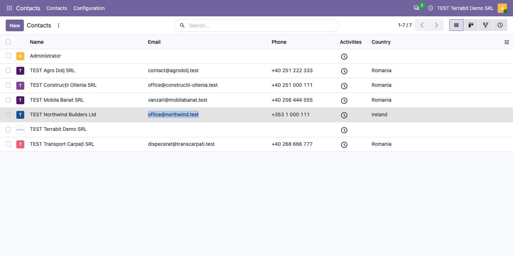
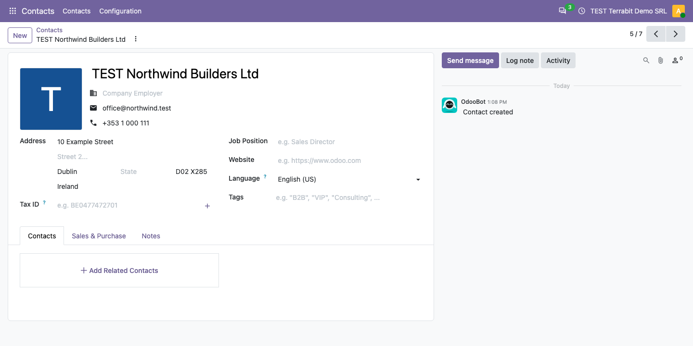

=====================
List View Select Text
=====================

..
   !!!!!!!!!!!!!!!!!!!!!!!!!!!!!!!!!!!!!!!!!!!!!!!!!!!!
   !! This file is generated by oca-gen-addon-readme !!
   !! changes will be overwritten.                   !!
   !!!!!!!!!!!!!!!!!!!!!!!!!!!!!!!!!!!!!!!!!!!!!!!!!!!!
   !! source digest: sha256:6e1349f56785c4272bb3dd8949a2aeba1bcb121829012924cee6b5c209756212
   !!!!!!!!!!!!!!!!!!!!!!!!!!!!!!!!!!!!!!!!!!!!!!!!!!!!

.. |badge1| image:: https://img.shields.io/badge/maturity-Production%2FStable-green.png
    :target: https://odoo-community.org/page/development-status
    :alt: Production/Stable
.. |badge2| image:: https://img.shields.io/badge/github-dhongu%2Fdeltatech-lightgray.png?logo=github
    :target: https://github.com/dhongu/deltatech/tree/19.0/deltatech_list_view
    :alt: dhongu/deltatech
.. |badge_fisa| image:: https://img.shields.io/badge/-Fi%C8%99%C4%83%20consultant-2ea44f.png
    :target: https://github.com/dhongu/deltatech/blob/19.0/deltatech_list_view/readme/FISA_CONSULTANT.md
    :alt: Fișă consultant

|badge1| |badge2| |badge_fisa|

Function:

- Block opening an item from the list when selecting text
- Deleting an unsaved one2many line twice (e.g. Enter pressed twice on
  its trash icon) no longer breaks the save of the form with a
  ``virtual_N`` id error

Functions:

- Blocheaza deschiderea unui item din lista la selecta unui text
- Stergerea de doua ori a unei linii one2many nesalvate nu mai blocheaza
  salvarea formularului cu eroarea ``virtual_N``

Odoo Online
===========

The module contains no Python code, only JavaScript and a style sheet.
Besides Odoo.sh and on-premise installations, it can be used on Odoo
Online (Custom plan): download the zip and load it from **Apps > Import
Module**.

**Table of contents**

.. contents::
   :local:

Usage
=====

1. Install the module, or on Odoo Online import the zip from **Apps >
   Import Module** (Custom plan, developer mode), then reload the page.
   There is nothing to configure.

2. Open any list, for example **Contacts > Contacts** in the list view.
   Press the mouse button at the start of a value (an email, a phone, a
   reference), drag to its end and release: the text stays selected and
   the record does not open. Copy it with Ctrl+C.

   |Contacts list view: in the row TEST Northwind Builders Ltd the
   email| office@northwind.test |is selected and the list is still
   displayed|

3. Click a row without selecting text: the record opens as usual.

   |The form of TEST Northwind Builders Ltd, opened by a plain click on
   its row|

The module also fixes the save of a form after an unsaved one2many line
was deleted twice (for example with Enter pressed twice on its trash
icon), which failed with a ``virtual_N`` error. In the dark theme, it
removes the light background of images in forms and kanban views.

Changelog
=========

19.0.1.1.2 (2026-11-09)
-----------------------

- The "(importable, Odoo Online)" suffix was removed from the module
  name. Odoo Apps already shows the module as available on Odoo Online
  (Manifest > Availability), and the Apps banner now carries an "Odoo
  Online" label instead.

19.0.1.1.1 (2026-11-08)
-----------------------

- The Python test runner (``tests/test_js.py``) was removed: Odoo Apps
  treats any ``.py`` file as Python code and showed the module as not
  available on Odoo Online. The JavaScript test
  (``static/tests/static_list_delete.test.js``) stays in the module and
  runs with the web unit tests
  (``/web/tests?filter=deltatech_list_view``).

19.0.1.1.0 (2026-11-08)
-----------------------

- Data-only module: the empty ``__init__.py`` was removed, so the module
  has no Python code at runtime (``tests/`` stays, for the JavaScript
  test in CI). It can be installed on Odoo Online (Custom plan) as a zip
  from Apps > Import Module, as well as on Odoo.sh and on-premise.
- The JavaScript test is listed by name in the manifest assets: an
  imported module does not accept wildcards (``**/*``) in asset paths.
  The obsolete ``qweb`` key, pointing to a folder that does not exist,
  was removed.
- Odoo Apps does not mark data-only modules as available on Odoo Online,
  so the module name, the summary, the banner and the Apps Store page
  now say it: "List View Select Text (importable, Odoo Online)".

19.0.1.0.5 (2026-10-19)
-----------------------

- Fixed the ``invalid input syntax for type integer: "virtual_N"`` error
  when saving a form (e.g. the stock return wizard) after a one2many
  line that was never saved got deleted twice, for instance with Enter
  pressed twice on its trash icon: the second delete no longer sends a
  ``DELETE`` command with the line's virtual id to the server.

19.0.1.0.4 (2026-10-16)
-----------------------

- Development status raised from Beta to Production/Stable: the module
  has been in production use at customers for a long time.

19.0.1.0.3 (2026-10-09)
-----------------------

- Apps Store banner (banner.json).

19.0.1.0.2 (2026-09-29)
-----------------------

- Own module icon, instead of the generic gears it had.

Bug Tracker
===========

Bugs are tracked on `Terrabit Issues <https://www.terrabit.ro/helpdesk>`_.
In case of trouble, please check there if your issue has already been reported.

Do not contact contributors directly about support or help with technical issues.

Credits
=======

Authors
-------

* Terrabit
* Dorin Hongu

Maintainers
-----------

This module is part of the `dhongu/deltatech <https://github.com/dhongu/deltatech/tree/19.0/deltatech_list_view>`_ project on GitHub.

You are welcome to contribute.