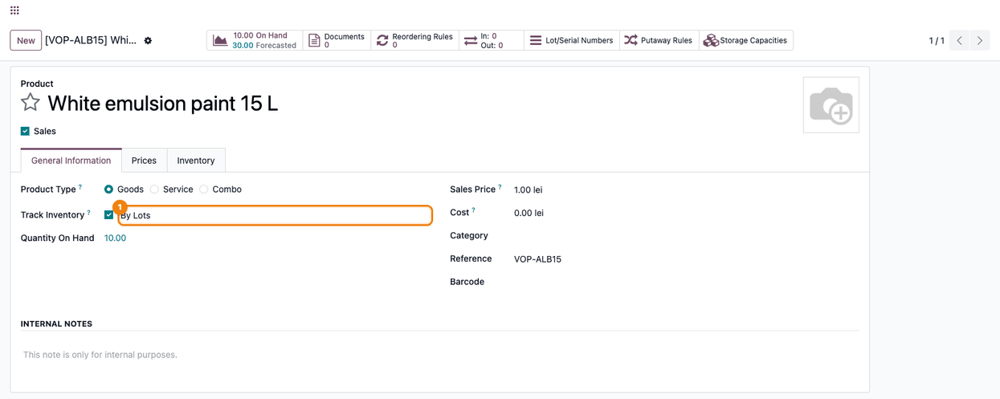
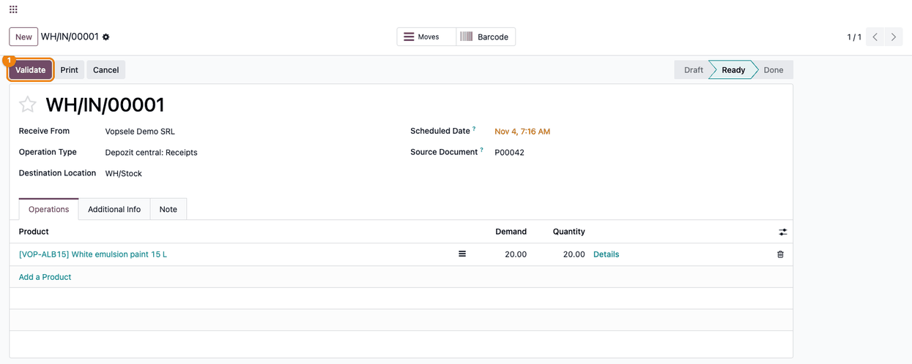
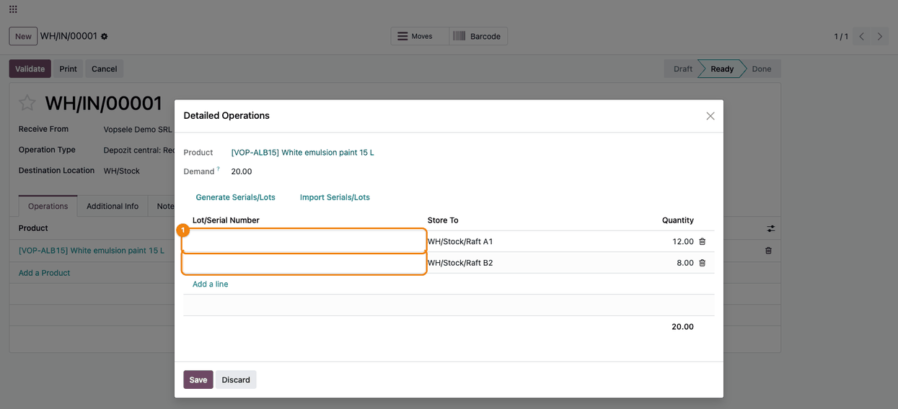
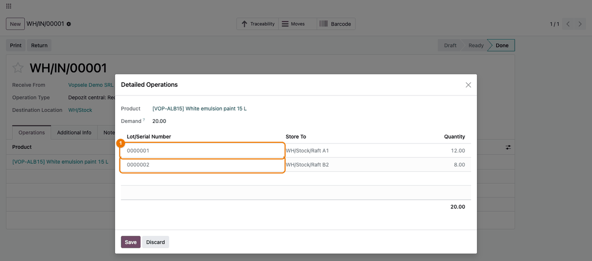
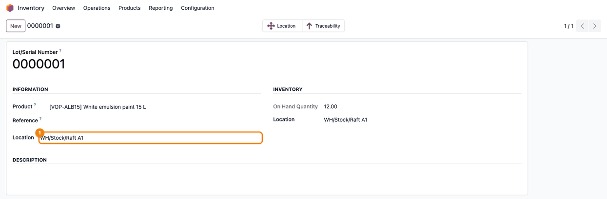
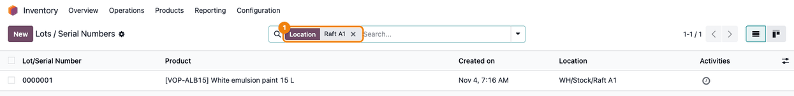

==========================
Lot Generation & Selection
==========================

..
   !!!!!!!!!!!!!!!!!!!!!!!!!!!!!!!!!!!!!!!!!!!!!!!!!!!!
   !! This file is generated by oca-gen-addon-readme !!
   !! changes will be overwritten.                   !!
   !!!!!!!!!!!!!!!!!!!!!!!!!!!!!!!!!!!!!!!!!!!!!!!!!!!!
   !! source digest: sha256:cd33dd01e7f229870a27937f803dfa28946b1cc6b809f72a3a3c9a250bfaea5b
   !!!!!!!!!!!!!!!!!!!!!!!!!!!!!!!!!!!!!!!!!!!!!!!!!!!!

.. |badge1| image:: https://img.shields.io/badge/maturity-Production%2FStable-green.png
    :target: https://odoo-community.org/page/development-status
    :alt: Production/Stable
.. |badge2| image:: https://img.shields.io/badge/license-LGPL--3-blue.png
    :target: http://www.gnu.org/licenses/lgpl-3.0-standalone.html
    :alt: License: LGPL-3
.. |badge3| image:: https://img.shields.io/badge/github-dhongu%2Fdeltatech-lightgray.png?logo=github
    :target: https://github.com/dhongu/deltatech/tree/20.0/deltatech_lot
    :alt: dhongu/deltatech
.. |badge_fisa| image:: https://img.shields.io/badge/-Fi%C8%99%C4%83%20consultant-2ea44f.png
    :target: https://github.com/dhongu/deltatech/blob/20.0/deltatech_lot/readme/FISA_CONSULTANT.md
    :alt: Fișă consultant

|badge1| |badge2| |badge3| |badge_fisa|

Generates lot numbers on supplier receipts and shows where each lot is
stored.

- **Lots generated on validation**: When a receipt from a vendor (or a
  dropship) is validated, every line of a product tracked by lots that
  has no lot number gets the next number of the **Serial Numbers**
  sequence, one lot per line. Lots typed by the user are kept.
- **Lot location**: The **Location** field of the lot shows the location
  that holds all its stock (empty when the lot is spread over several
  locations), on the lot form for every inventory user and as a column
  in the list of lots.
- **Search by location**: The list of lots can be searched by
  **Location**.

**Table of contents**

.. contents::
   :local:

Usage
=====

1. Track the product by lots: open the product (*Inventory > Products >
   Products*), tab **General Information**, tick **Track Inventory** and
   choose **By Lots**.

   |Product form, General Information tab: Track Inventory ticked with
   By Lots (1)|

2. Open the receipt from the vendor (*Inventory > Operations > Transfers
   > Receipts*), in the **Ready** state. The receipt operation type must
   have **Create New** ticked in its **Lots/Serial Numbers** group (the
   default for receipts).

   |Receipt from Vopsele Demo SRL in the Ready state, with the Validate
   button (1)|

3. In **Details**, the **Lot/Serial Number** column can stay empty;
   split the quantity over the storage locations in **Store To** if
   needed. Type the vendor's lot number only on the lines where it must
   be kept. Save and press **Validate**.

   |Detailed Operations: two lines, 12 to WH/Stock/Raft A1 and 8 to
   WH/Stock/Raft B2, with an empty Lot/Serial Number column (1)|

4. The receipt is done and every line without a lot got its own lot
   number from the **Serial Numbers** sequence.

   |The done receipt: lot 0000001 on Raft A1 and lot 0000002 on Raft B2
   (1)|

5. In *Inventory > Products > Lots / Serial Numbers*, remove the default
   **Location** grouping: the **Location** column shows where each lot
   is. A lot spread over several locations has no location.

   |List of lots: 0000001 on WH/Stock/Raft A1, 0000002 on WH/Stock/Raft
   B2 and VOP-2509-07, spread over two shelves, with an empty Location
   (1)|

6. The lot form shows the same **Location**. Changing it moves the stock
   of the lot when it is all in one location.

   |Lot 0000001 with Location WH/Stock/Raft A1 (1)|

7. Search the lots by location: type the location and choose **Search
   Location for**. Only the lots held entirely in that location are
   listed.

   |The list of lots filtered by Location: Raft A1 (1), showing only lot
   0000001|

Lot numbers are generated only on receipts and dropships, only for
products tracked by lots (not by serial numbers), and always from the
general **Serial Numbers** sequence, not from the custom prefix set on
the product.

.. |List of lots: 0000001 on WH/Stock/Raft A1, 0000002 on WH/Stock/Raft B2 and VOP-2509-07, spread over two shelves, with an empty Location (1)| image:: https://raw.githubusercontent.com/dhongu/deltatech/20.0/deltatech_lot/static/description/en/05_lista_loturi_locatie.png

Changelog
=========

19.0.1.0.4 (2026-10-22)
-----------------------

- Listed on Odoo Apps as *Lot Generation & Selection* (was
  *Generate/Select lot*). The technical name ``deltatech_lot`` does not
  change.

19.0.1.0.3 (2026-10-17)
-----------------------

- The lot location is refreshed when the quantity of an existing quant
  changes (for example when a location is emptied), not only when quants
  are added or removed.
- A lot held in a single location on several quants (different owners or
  packages) keeps its location instead of showing none.

19.0.1.0.2 (2026-10-16)
-----------------------

- Development status raised from Beta to Production/Stable: the module
  has been in production use at customers for a long time.

19.0.1.0.1 (2026-09-29)
-----------------------

- Own module icon, instead of the generic gears it had.

Bug Tracker
===========

Bugs are tracked on `Terrabit Issues <https://www.terrabit.ro/helpdesk>`_.
In case of trouble, please check there if your issue has already been reported.

Do not contact contributors directly about support or help with technical issues.

Credits
=======

Authors
-------

* Terrabit
* Dorin Hongu

Maintainers
-----------

.. |maintainer-dhongu| image:: https://github.com/dhongu.png?size=40px
    :target: https://github.com/dhongu
    :alt: dhongu

Current maintainer:

|maintainer-dhongu| 

This module is part of the `dhongu/deltatech <https://github.com/dhongu/deltatech/tree/20.0/deltatech_lot>`_ project on GitHub.

You are welcome to contribute.