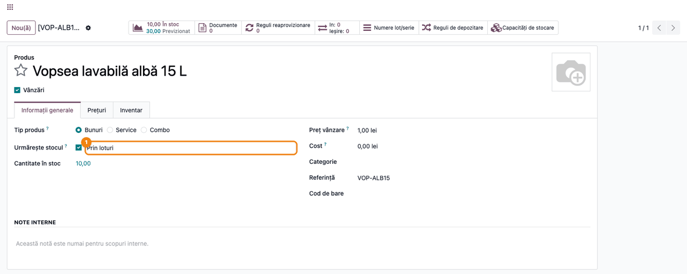
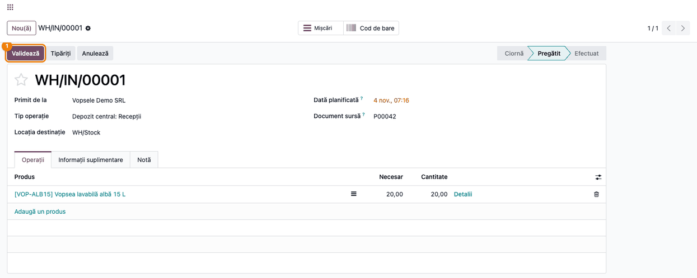
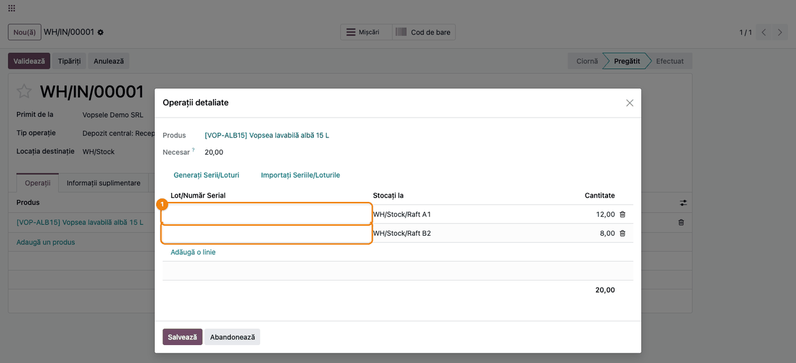
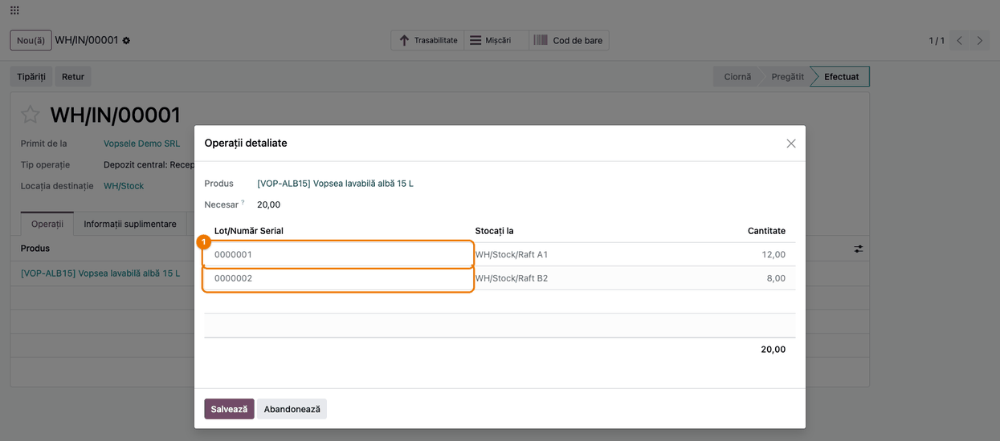
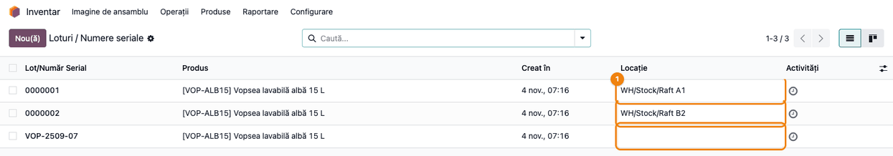
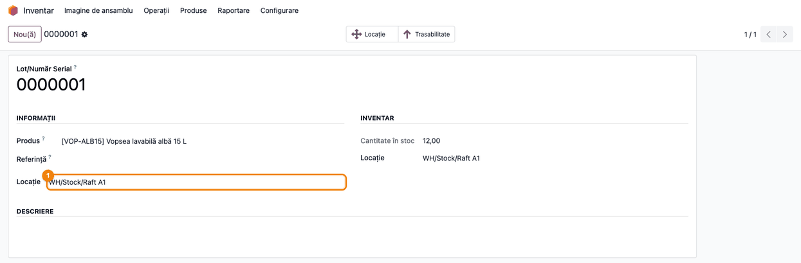
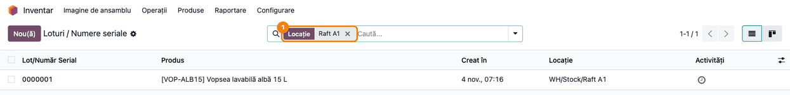

# Fișă Modul: Generarea loturilor la recepție și locația lotului

**Modul:** `deltatech_lot`
**Utilizator principal:** Gestionar / operator de depozit (recepții de la furnizori, urmărirea loturilor)
**Prioritate:** 🟡 Medie (scurtează recepția produselor urmărite pe loturi; nu are efect contabil)

---

## 1. Scop business

La produsele urmărite pe loturi (vopsele, alimente, chimicale, materiale de construcții), fiecare recepție
de la furnizor trebuie să aibă un număr de lot pe fiecare rând. Fără modul, Odoo nu validează recepția
până când operatorul nu scrie sau nu generează numerele de lot, rând cu rând. Modulul `deltatech_lot`
face două lucruri:

- **la validarea recepției de la furnizor**, rândurile produselor urmărite pe loturi care nu au număr de
  lot primesc automat următorul număr din secvența de loturi a Odoo; operatorul poate valida direct;
- **locația lotului**: pe lot apare locația în care se află stocul lui (raftul, celula), coloana
  **Locație** în lista loturilor și căutarea loturilor după locație.

## 2. Bază legală și context

Modulul nu are temei legal specific: este un instrument operațional de depozit. Context pentru consultant:

- Trasabilitatea pe loturi este o cerință a clientului sau a domeniului (de exemplu, siguranța
  alimentelor, retragerea unui lot de pe piață); modulul doar numerotează automat loturile la intrare,
  nu schimbă regulile de trasabilitate ale Odoo.
- Numărul de lot generat este **intern** (din secvența Odoo). Când furnizorul are propriul număr de lot
  și trebuie păstrat pe documente, operatorul îl scrie manual pe rând înainte de validare; modulul
  completează doar rândurile rămase fără lot.

## 3. Utilizatori și roluri

| Rol | Ce face |
|---|---|
| Operator de depozit (*Inventar / Utilizator*) | Validează recepțiile; caută loturile după locație |
| Gestionar (*Inventar / Administrator*) | Configurează urmărirea pe loturi, locațiile și tipurile de operație; vede și câmpul **Locație** standard din grupul **Inventar** al lotului |

Cu modulul, și operatorii (*Inventar / Utilizator*) pot muta stocul unui lot schimbând **Locație** în fișa
lotului (Pasul 6); în Odoo standard, doar gestionarii văd și pot modifica acest câmp.

**Roluri recomandate la testare:** un utilizator *Inventar / Utilizator*, pentru recepție și căutarea
loturilor, și un *Inventar / Administrator*, pentru configurare.

## 4. Conturi și date implicate

Modulul **nu generează note contabile** și nu atinge conturi. Date minime pentru demo:

- un produs stocabil urmărit pe loturi, de exemplu **Vopsea lavabilă albă 15 L** (cod `VOP-ALB15`);
- un furnizor, de exemplu **Vopsele Demo SRL**;
- locații de stocare sub stocul depozitului, de exemplu `WH/Stock/Raft A1`, `WH/Stock/Raft B2`,
  `WH/Stock/Raft C3`;
- o recepție de 20 buc. împărțită pe două rânduri: 12 buc. pe Raft A1 și 8 buc. pe Raft B2, fără număr de lot;
- opțional, un lot mai vechi aflat pe două rafturi (de exemplu `VOP-2509-07`: 4 buc. pe Raft A1 și 6 buc.
  pe Raft C3), ca să se vadă cazul lotului fără o singură locație.

Câmpul folosit de modul: **Locație** (`location_id`) pe lot. Numerele de lot generate vin din secvența
standard **Serial Numbers** (cod `stock.lot.serial`, implicit 7 cifre: `0000001`, `0000002`...).

## 5. Configurare inițială

1. *Inventar → Configurare → Setări*, blocul **Trasabilitate**: bifați **Loturi & Numere seriale**.
   Pentru locația pe rafturi, în blocul **Depozit** bifați și **Locații de stocare**. Salvați.
2. Pe produs (*Inventar → Produse → Produse*), tabul **Informații generale**: bifați **Urmărește stocul**
   și alegeți **Prin loturi** (vezi Pasul 1).
3. Verificați tipul de operație al recepțiilor (*Inventar → Configurare → Tip operație*, de exemplu
   **Recepții**): în grupul **Lot/Număr serial** trebuie bifat **Creați nou** (implicit pe recepții).
   Loturile se generează doar pe operațiile de tip *Recepție* sau *Dropship* care au bifat **Creați nou**.
   Cu doar **Folosește cele existente**, modulul completează numărul, dar Odoo nu creează lotul și
   validarea se oprește (secțiunea 9), iar numărul consumat rămâne gol în secvență.
4. Opțional, prefixul numerelor de lot se schimbă în secvența **Serial Numbers** (*Setări → Tehnic →
   Secvențe*, în modul dezvoltator). Atenție la câmpul de pe produs pentru prefixul propriu al loturilor
   (vezi secțiunea 11): modulul nu îl folosește.

## 6. Flux de utilizare

### Pasul 1 — Produsul urmărit pe loturi

**Meniu:** *Inventar → Produse → Produse*, deschideți produsul, tabul **Informații generale**.

În dreptul câmpului **Urmărește stocul**, bifa trebuie să fie pusă și să fie aleasă varianta **Prin
loturi**. Doar rândurile acestor produse primesc lot generat automat; produsele urmărite **Prin număr
serial unic** nu sunt atinse de modul.



### Pasul 2 — Recepția de la furnizor, gata de validare

**Meniu:** *Inventar → Operații → Transferuri → Recepții*, deschideți recepția (de exemplu creată din
comanda de achiziție).

Recepția este în starea **Pregătit**, cu produsul și cantitatea primită. Butonul **Validează** este cel
care, cu modulul instalat, completează numerele de lot lipsă.



### Pasul 3 — Operațiile detaliate: rândurile fără număr de lot

Pe rândul produsului, apăsați **Detalii**. Se deschide fereastra **Operații detaliate**, cu câte un rând
pentru fiecare loc de depozitare.

1. **Găsiți pe ecran** coloanele **Lot/Număr Serial**, **Stocați la** și **Cantitate**.
2. **Verificați** că suma cantităților este egală cu **Necesar** (aici 12 + 8 = 20) și că fiecare rând are
   raftul corect în **Stocați la**. Coloana **Lot/Număr Serial** poate rămâne goală: la validare, fiecare
   rând gol primește propriul număr de lot. Dacă furnizorul a trimis numărul lui de lot și vreți să-l
   păstrați, scrieți-l aici; rândul acela nu mai primește număr generat.
3. **Mergeți mai departe**: **Salvează** fereastra, apoi **Validează** recepția.

Fără modul, validarea cu coloana goală se oprește cu mesajul „Este necesar să specificați un nr de
Lot/Număr serial pentru produse …” (secțiunea 9); butonul standard **Generați Serii/Loturi** rămâne disponibil pentru cine vrea să
genereze loturile manual, înainte de validare.



### Pasul 4 — Recepția validată: loturile generate

După **Validează**, recepția trece în starea **Efectuat**. Deschideți din nou **Detalii** pe rândul
produsului.

1. **Găsiți pe ecran** coloana **Lot/Număr Serial**.
2. **Verificați** că fiecare rând are un număr de lot diferit, luat în ordine din secvență (aici
   `0000001` pe Raft A1 și `0000002` pe Raft B2), și că rândurile cu lot scris manual și-au păstrat numărul.
   Lotul se creează la validare, deci apare imediat și în *Inventar → Produse → Loturi / Numere seriale*.



### Pasul 5 — Lista loturilor, cu locația fiecăruia

**Meniu:** *Inventar → Produse → Loturi / Numere seriale*.

Lista se deschide grupată după locație (gruparea standard a Odoo); scoateți gruparea **Locație** din bara
de căutare ca să vedeți lista simplă. Modulul adaugă coloana **Locație**.

1. **Găsiți pe ecran** coloana **Locație**, pe fiecare lot.
2. **Verificați**: un lot cu tot stocul într-un singur loc arată locația (aici `0000001` pe Raft A1 și
   `0000002` pe Raft B2); un lot împărțit pe mai multe locații sau fără stoc are coloana **goală** (aici
   `VOP-2509-07`, aflat pe Raft A1 și pe Raft C3). Locația se actualizează singură la fiecare mișcare de stoc.



### Pasul 6 — Fișa lotului, cu câmpul Locație

Deschideți un lot din listă. Câmpul **Locație** adăugat de modul apare în stânga, sub **Produs** și
**Referință**, pentru toți utilizatorii depozitului. Gestionarii (*Inventar / Administrator*) mai văd o
dată aceeași valoare în grupul **Inventar**, în dreapta, prin câmpul standard al Odoo.

Câmpul se poate modifica: dacă tot stocul lotului este într-o singură locație, alegerea altei locații
**mută stocul lotului** acolo (mișcare internă cu mesajul „Lot/Număr Serial Relocat”). Dacă lotul este în
mai multe locații, Odoo refuză mutarea (secțiunea 9). Pentru mutările obișnuite folosiți un transfer intern.



### Pasul 7 — Căutarea loturilor după locație

**Meniu:** *Inventar → Produse → Loturi / Numere seriale*, bara de căutare.

Scrieți numele locației (de exemplu `Raft A1`) și alegeți **Caută Locație pentru: Raft A1**.

1. **Găsiți pe ecran** filtrul **Locație: Raft A1** în bara de căutare și loturile rămase în listă.
2. **Verificați** că apar doar loturile aflate **în întregime** pe acel raft (aici `0000001`). Lotul
   `VOP-2509-07` are 4 buc. pe Raft A1, dar nu apare, pentru că este împărțit pe două rafturi. Pentru stocul
   complet al unui raft, pe loturi, folosiți *Inventar → Raportare → Locații* (pentru gestionari), filtrat pe locație și grupat pe
   lot.



### Note de monografie și raportare

Modulul nu generează note contabile: recepția validată produce aceleași mișcări de stoc (și, la stocul
evaluat permanent, aceleași note) ca fără modul. Modulul doar completează numărul de lot de pe rândurile
recepției și afișează locația lotului. Nu există monografie contabilă asociată.

## 7. Legături cu alte module / declarații

| Modul | Rol |
|---|---|
| `stock` (Inventar) | Recepțiile, loturile, secvența **Serial Numbers**, locațiile de stocare; câmpul **Locație** standard al lotului |
| `purchase` (Achiziții, opțional) | Creează recepțiile pe care modulul le completează la validare |

**Ce e automat:** numărul de lot pe rândurile fără lot ale recepțiilor de la furnizor (și dropship), la
validare; locația lotului, recalculată la fiecare mișcare de stoc.

**Ce rămâne manual:** numărul de lot al furnizorului, când trebuie păstrat; împărțirea recepției pe rafturi
(**Stocați la**); loturile pe celelalte operații (livrări, transferuri interne, producție).

## 8. Verificări pentru consultant

- [ ] Setarea **Loturi & Numere seriale** este bifată; produsul are **Urmărește stocul** cu **Prin loturi**.
- [ ] Tipul de operație **Recepții** are bifat **Creați nou** în grupul **Lot/Număr serial**.
- [ ] O recepție cu coloana **Lot/Număr Serial** goală se validează fără mesaj de eroare.
- [ ] După validare, fiecare rând al recepției are un lot propriu, în ordine din secvența **Serial Numbers**.
- [ ] Un rând cu lotul furnizorului scris manual își păstrează numărul după validare.
- [ ] Un produs urmărit **Prin număr serial unic** nu primește număr generat (Odoo cere în continuare numerele de serie).
- [ ] În lista loturilor, coloana **Locație** arată raftul pentru loturile aflate într-un singur loc și e goală pentru loturile împărțite.
- [ ] După un transfer intern care golește un raft, locația lotului se actualizează.
- [ ] Căutarea **Locație** din lista loturilor întoarce doar loturile aflate în întregime în locația căutată.

## 9. Mesaje de eroare frecvente

| Mesaj | Cauză | Remediere |
|---|---|---|
| „Este necesar să specificați un nr de Lot/Număr serial pentru produse …” la validare | Operația nu este o recepție de la furnizor sau dropship, ori produsul este urmărit pe număr de serie, iar rândurile nu au lot | Scrieți sau alegeți lotul pe rând; la numerele de serie folosiți **Generați Serii/Loturi** |
| „Trebuie să furnizați un număr de lot/serie pentru produsul: …” la validarea recepției | Tipul de operație are doar **Folosește cele existente**, fără **Creați nou**: modulul pune numărul, dar Odoo nu creează lotul | Bifați **Creați nou** pe tipul de operație sau alegeți un lot existent pe rând |
| „Puteți muta un lot/serie într-o locație nouă doar dacă există într-o singură locație.” | S-a modificat **Locație** pe un lot aflat în mai multe locații | Mutați stocul printr-un transfer intern |
| Coloana **Locație** goală pe un lot cu stoc | Lotul are stoc în mai multe locații | Comportament normal; vedeți locațiile din butonul **Locație** al fișei lotului |

## 10. Capturi de ecran

Capturile sunt **generate automat** din `tests/test_screenshots.py`, cu mixinul `ScreenshotCase` din
`deltatech_doc_screenshots` (import defensiv), în română (pentru această fișă) și în engleză
(`static/description/en/`, pentru `readme/USAGE.md`), pe o companie RO de demonstrație:

1. `01_produs_urmarire_loturi.png` — produsul, cu **Urmărește stocul** **Prin loturi**.
2. `02_receptie_de_validat.png` — recepția în starea **Pregătit**, cu butonul **Validează**.
3. `03_operatii_detaliate_fara_lot.png` — **Operații detaliate**: rândurile pe rafturi, fără lot.
4. `04_loturi_generate_receptie.png` — recepția **Efectuat**: loturile `0000001` și `0000002` generate.
5. `05_lista_loturi_locatie.png` — lista loturilor cu coloana **Locație**.
6. `06_fisa_lot_locatie.png` — fișa lotului, cu câmpul **Locație**.
7. `07_cautare_loturi_locatie.png` — lista loturilor filtrată după **Locație: Raft A1**.

Regenerare:

```bash
./odoo/odoo-bin -c odoo.conf -d <db> -i deltatech_lot,deltatech_doc_screenshots \
    --test-tags=/deltatech_lot:TestLotScreenshots --stop-after-init
```

## 11. Observații pentru manual

- Mesajul cheie pentru operator: la recepție, coloana **Lot/Număr Serial** poate rămâne goală; numărul se
  pune singur la **Validează**, câte unul pe fiecare rând.
- Loturile generate au număr intern; dacă firma trebuie să păstreze lotul furnizorului (de exemplu pentru o
  retragere de pe piață), operatorul îl scrie înainte de validare.
- Câmpul de pe produs pentru prefixul propriu al loturilor (**Lot/Serial personalizat**, tabul **Inventar**, grupul **Trasabilitate**) nu
  este folosit de modul: loturile generate la recepție vin din secvența generală **Serial Numbers**. Dacă
  pe unele produse s-a definit un prefix propriu, Odoo creează pentru el o secvență nouă cu același cod, iar
  modulul poate lua numărul din oricare dintre ele. Pe bazele unde se folosesc prefixe pe produs,
  verificați numerele generate înainte de a pune modulul în producție.
- Locația lotului există și în Odoo standard (vizibilă doar gestionarilor, în grupul **Inventar**);
  modulul o face vizibilă tuturor, o adaugă ca coloană în listă și o face căutabilă. Câmpul rămâne
  modificabil, deci și operatorii pot muta stocul unui lot din fișa lui.
- Nu resetați secvența **Serial Numbers** pe o bază cu loturi existente: un număr generat care există deja
  pentru produs leagă rândul de lotul vechi, în loc să creeze unul nou.
- În fereastra **Operații detaliate**, modulul trimite locația sursă a rândului ca filtru implicit
  **Locație** la căutarea extinsă a lotului (**Caută mai mult...**), pe operațiile unde se alege lotul
  existent; acest comportament nu este ilustrat cu captură.
- Pe livrări, transferuri interne și producție modulul nu generează loturi.
