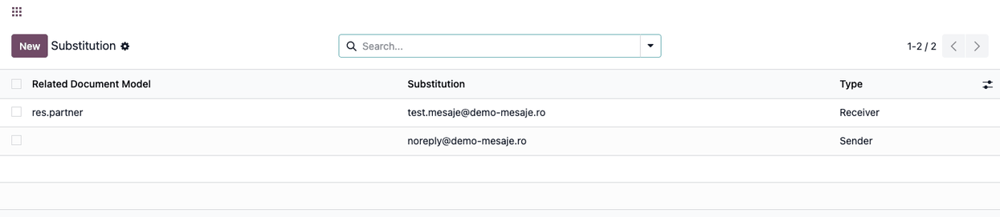
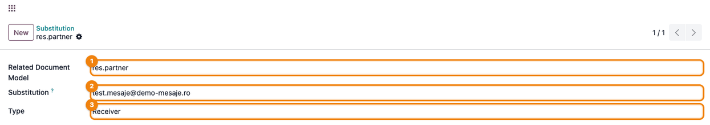
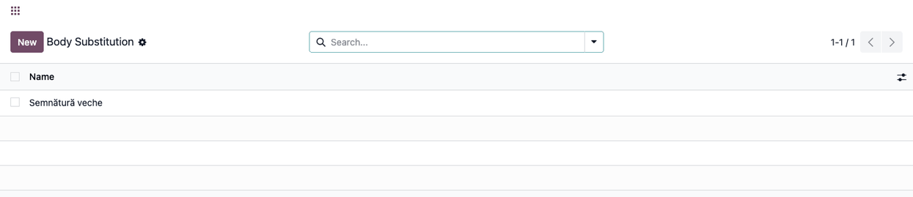
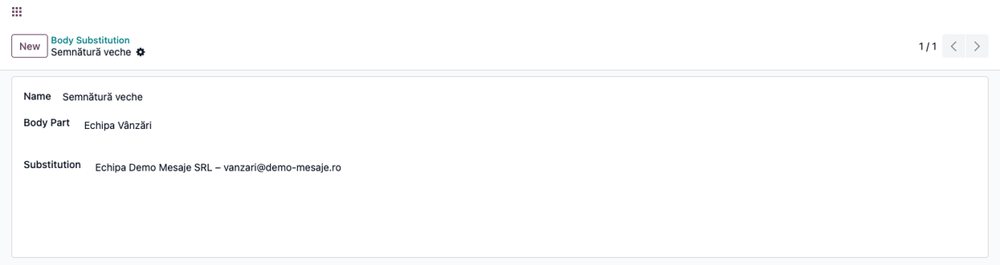
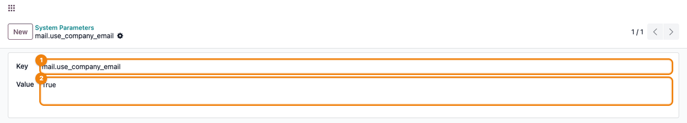

=================
Mail Substitution
=================

..
   !!!!!!!!!!!!!!!!!!!!!!!!!!!!!!!!!!!!!!!!!!!!!!!!!!!!
   !! This file is generated by oca-gen-addon-readme !!
   !! changes will be overwritten.                   !!
   !!!!!!!!!!!!!!!!!!!!!!!!!!!!!!!!!!!!!!!!!!!!!!!!!!!!
   !! source digest: sha256:099a29bd76a90ffbf5618f99b89d3c83f4f5f9fc98f6922ef80e03718d3c94b2
   !!!!!!!!!!!!!!!!!!!!!!!!!!!!!!!!!!!!!!!!!!!!!!!!!!!!

.. |badge1| image:: https://img.shields.io/badge/maturity-Production%2FStable-green.png
    :target: https://odoo-community.org/page/development-status
    :alt: Production/Stable
.. |badge2| image:: https://img.shields.io/badge/github-dhongu%2Fdeltatech-lightgray.png?logo=github
    :target: https://github.com/dhongu/deltatech/tree/19.0/deltatech_mail
    :alt: dhongu/deltatech
.. |badge_fisa| image:: https://img.shields.io/badge/-Fi%C8%99%C4%83%20consultant-2ea44f.png
    :target: https://github.com/dhongu/deltatech/blob/19.0/deltatech_mail/readme/FISA_CONSULTANT.md
    :alt: Fișă consultant
.. |badge_tests| image:: https://img.shields.io/badge/-24%20automated%20tests%20%C2%B7%2096%25%20code%20coverage-2ea44f.png
    :target: https://app.codecov.io/gh/dhongu/deltatech/tree/19.0/deltatech_mail
    :alt: 24 automated tests · 96% code coverage

|badge1| |badge2| |badge_fisa| |badge_tests|

Test and training databases must not send real emails to customers. This
module redirects outgoing emails to another address, sets the sender,
and rewrites text in posted messages.

- **Redirect recipients**: A *Receiver* rule under *Substitution* sends
  the emails of its *Related Document Model* to its *Substitution*
  address instead of the real recipients, and drops the CC copies. With
  no model, it redirects every email.
- **Fixed sender**: A *Sender* rule sets its address as the sender of
  the matching outgoing emails; the first matching rule applies.
- **Company sender**: When the system parameter
  ``mail.use_company_email`` is ``True``, posted messages and queued
  emails go out from the company email address. Posting a message is
  refused if the company has no email.
- **Body text replacement**: Under *Body Substitution*, the *Body Part*
  text is replaced by the *Substitution* text in every message posted on
  a record. Messages already posted stay as they are, and the match
  includes formatting.

The module depends on Discuss (``mail``). The rules apply to all users
and companies; only Settings administrators can change them, and other
internal users can only read them. A *Receiver* rule with no model
redirects every outgoing email, so remove it before going live.

**Table of contents**

.. contents::
   :local:

Usage
=====

The rules are managed by administrators, in developer mode, under
**Settings → Technical → Email**. They apply to every user and every
company of the database.

1. **Substitution**: the list of the rules that change the recipients or
   the sender of the outgoing emails. An empty *Related Document Model*
   means every document.

   |Substitution list: a Receiver rule for res.partner to|
   test.mesaje@demo-mesaje.ro |and a Sender rule without model, with|
   noreply@demo-mesaje.ro

2. Open or create a rule:

   - **Related Document Model**: the technical name of the model whose
     emails are redirected (``res.partner``, ``account.move``...); leave
     it empty for every email;
   - **Substitution**: the email address to use;
   - **Type**: *Receiver* replaces all the recipients of the email and
     drops the CC copies, so the original recipients are not reached;
     *Sender* replaces the sender.

   Use a generic *Receiver* rule on test and training databases, so that
   customers and vendors do not receive their emails. Remove it before
   using the database in production.

   |Substitution form: Related Document Model res.partner, Substitution|
   test.mesaje@demo-mesaje.ro\ |, Type Receiver|

3. **Body Substitution**: the list of the rules that replace a text in
   the body of posted messages.

   |Body Substitution list with the rule Semnătură veche|

4. Open or create a rule: the text of *Body Part* is replaced by the
   text of *Substitution* in every message posted from the chatter.
   Messages already posted are not changed.

   |Body Substitution form: Body Part Echipa Vânzări, Substitution
   Echipa Demo Mesaje SRL –| vanzari@demo-mesaje.ro

5. **Company email as sender**: set the system parameter
   ``mail.use_company_email`` to ``True`` (**Settings → Technical →
   Parameters → System Parameters**). Posted messages and queued emails
   are then sent from the email address of the author's company; an
   explicit sender (incoming email, template) is kept. The company must
   have an email address, otherwise posting a message is refused.

   |System parameter mail.use_company_email with value True|

Only administrators (*Administration: Settings*) can create or change
the rules; internal users can only read them.

Changelog
=========

19.0.1.0.8 (2026-11-11)
-----------------------

- Apps Store page: a fuller description (what the module does, the
  problem it solves, its main functions, dependencies and limits). No
  change in behavior.

19.0.1.0.7 (2026-11-07)
-----------------------

- Security: only administrators (Settings) can create or change email
  and body substitutions. Before, any internal user could add a
  "Receiver" rule that redirected every outgoing email of the database,
  or a body rule that changed the messages of all users. Internal users
  keep read access. (#3540)
- The body substitutions are read with sudo when posting, so authors
  without access to the rules (portal) still get them applied.

19.0.1.0.6 (2026-10-01)
-----------------------

- Fix: email redirection and the company sender work again on Odoo 19.
  The overrides used hooks that Odoo 19 no longer calls
  (``_send_prepare_values`` on ``mail.mail``, ``_get_default_from`` on
  ``mail.message``), so substitutions and the "Use Company Email" option
  had no effect.

  - "Receiver" substitutions replace the recipients of every outgoing
    email (``_prepare_outgoing_list``); the CC copies are dropped, so
    the original recipients are not reached.
  - "Sender" substitutions set the sender. Before, with a document model
    they were added as a recipient.
  - "Use Company Email" sets the company address as sender of posted
    messages (``mail.thread._message_compute_author``) and of queued
    emails (``send``). An explicit sender (incoming email, template) is
    kept on posted messages. The ``mail.message`` override was removed.

19.0.1.0.5 (2026-09-29)
-----------------------

- Own module icon, instead of the generic gears it had.

19.0.1.0.4 (2026-09-23)
-----------------------

- Translatable strings in code use ``self.env._()`` instead of ``_()``,
  the Odoo 19 convention (pylint-odoo ``prefer-env-translation``). The
  translated messages are unchanged.

Bug Tracker
===========

Bugs are tracked on `Terrabit Issues <https://www.terrabit.ro/helpdesk>`_.
In case of trouble, please check there if your issue has already been reported.

Do not contact contributors directly about support or help with technical issues.

Credits
=======

Authors
-------

* Terrabit
* Dorin Hongu

Maintainers
-----------

.. |maintainer-dhongu| image:: https://github.com/dhongu.png?size=40px
    :target: https://github.com/dhongu
    :alt: dhongu

Current maintainer:

|maintainer-dhongu| 

This module is part of the `dhongu/deltatech <https://github.com/dhongu/deltatech/tree/19.0/deltatech_mail>`_ project on GitHub.

You are welcome to contribute.