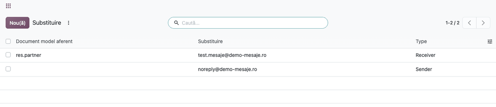
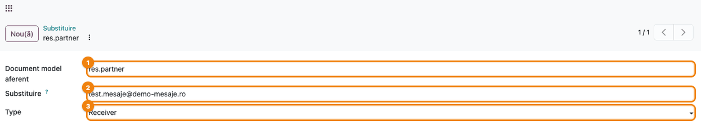
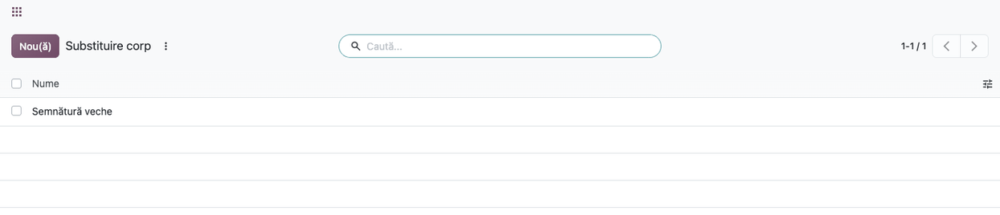
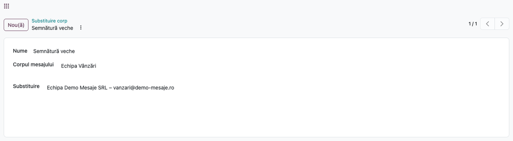
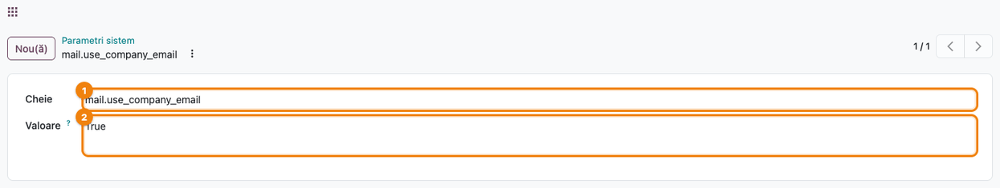

# Fișă Modul: Redirecționarea și înlocuirea textului în e-mailurile trimise

**Modul:** `deltatech_mail`
**Utilizator principal:** Administrator Odoo (configurare), consultant la testarea fluxurilor de e-mail
**Prioritate:** 🟡 Medie (schimbă destinatarii, expeditorul și textul tuturor e-mailurilor care se potrivesc regulilor)

---

## 1. Scop business

Modulul controlează e-mailurile pe care Odoo le trimite, fără să schimbe fluxurile care le generează:

- **redirecționarea destinatarilor**: e-mailurile unui tip de document (de exemplu Contacte) sau toate
  e-mailurile bazei de date ajung la o adresă fixă, în locul destinatarilor reali. Se folosește pe o
  bază de test sau de instruire, ca facturile și ofertele să nu plece la clienți;
- **expeditorul fix**: e-mailurile pleacă de la o adresă aleasă (de exemplu `noreply@...`);
- **adresa companiei ca expeditor**: mesajele postate pleacă de la adresa companiei, nu de la adresa
  personală a utilizatorului;
- **înlocuirea unui text în corpul mesajelor**: un fragment (o semnătură veche, o adresă schimbată)
  se înlocuiește automat în toate mesajele postate.

Regulile sunt globale: se aplică tuturor utilizatorilor și tuturor companiilor din baza de date.

## 2. Bază legală și context

Modulul nu are implicații contabile sau fiscale. Contextul este operațional:

- bazele de test și de instruire, copiate din producție, nu trebuie să trimită e-mailuri clienților
  sau furnizorilor reali;
- serverele de e-mail ale unor firme acceptă doar expeditori din domeniul propriu;
- protecția datelor (GDPR): o regulă de redirecționare trimite conținutul mesajelor la altă adresă,
  de aceea doar administratorii o pot configura.

## 3. Utilizatori și roluri

| Rol | Ce face |
|---|---|
| Administrator (rolul **Administrator** / *Role / Administrator*) | Creează, modifică și șterge regulile; setează parametrul de sistem |
| Utilizator intern | Nu are acces la meniu (**Setări** și **Tehnic** cer drepturi de administrare); prin drepturi poate doar citi regulile, nu le poate crea sau modifica |
| Utilizator de portal | Nu vede regulile; înlocuirea textului se aplică și mesajelor lui |

Din versiunea 20.0.1.0.7, doar administratorii pot crea sau modifica regulile
([#3540](https://github.com/dhongu/deltatech/issues/3540)). Pentru testare: utilizatorul
**Administrator** pentru configurare și un utilizator intern căruia i se adaugă, în modul dezvoltator,
grupul *Drepturi de acces* (*Access Rights*), dar fără rolul *Administrator*, pentru a verifica restricția.

## 4. Conturi și date implicate

Nu se folosesc conturi contabile. Date minime pentru demo:

- o adresă de redirecționare la care aveți acces (de exemplu `test.mesaje@firma-dvs.ro`);
- un server de e-mail de ieșire configurat (**Setări → Tehnic → Email → Servere Ieșire E-mail-uri**),
  pentru a vedea efectul la trimitere;
- un contact cu adresă de e-mail, pe care să postați un mesaj de probă;
- adresa de e-mail a companiei completată (**Setări → Utilizatori și companii → Companii**), dacă folosiți opțiunea de adresă a
  companiei ca expeditor.

## 5. Configurare inițială

1. Instalați modulul `deltatech_mail` (depinde doar de `mail`).
2. Autentificați-vă cu un utilizator administrator și activați **modul dezvoltator**
   (din **Setări**, secțiunea pentru dezvoltatori, sau cu `?debug=1` în adresă): meniurile
   modulului sunt în **Setări → Tehnic**.
3. Verificați serverul de e-mail de ieșire și adresa de e-mail a companiei.

## 6. Flux de utilizare

### Pasul 1 — Lista regulilor de substituție

Din **Setări → Tehnic → Email → Substituire** se deschide lista regulilor care schimbă destinatarii sau
expeditorul. Fiecare regulă are tipul de document (gol înseamnă toate documentele), adresa folosită și
tipul regulii.



### Pasul 2 — Regula de redirecționare a destinatarilor

Apăsați **Nou(ă)** sau deschideți o regulă existentă și completați:

- **Document model aferent**: numele tehnic al modelului ale cărui e-mailuri se redirecționează (de
  exemplu `res.partner` pentru Contacte, `account.move` pentru facturi). Lăsați câmpul gol pentru ca
  regula să se aplice **tuturor** e-mailurilor;
- **Substituire**: adresa la care ajung e-mailurile;
- **Type**: `Receiver` înlocuiește destinatarii; `Sender` înlocuiește expeditorul.

La trimitere, o regulă `Receiver` înlocuiește toți destinatarii e-mailului cu adresa din regulă și
elimină copiile (CC), astfel încât destinatarii inițiali nu mai primesc mesajul. O regulă `Sender`
schimbă expeditorul și, odată cu el, serverul de ieșire ales de Odoo.



### Pasul 3 — Lista regulilor de înlocuire în corpul mesajelor

Din **Setări → Tehnic → Email → Substituire corp** se deschide lista regulilor care înlocuiesc un text
în corpul mesajelor postate. Lista afișează numele fiecărei reguli.



### Pasul 4 — Regula de înlocuire a textului

Deschideți sau creați o regulă și completați:

- **Nume**: o descriere scurtă (de exemplu „Semnătură veche”);
- **Corpul mesajului**: textul căutat, exact cum apare în mesaj. Textul se compară cu formatarea lui:
  un fragment aflat în mijlocul unui paragraf se potrivește doar dacă e introdus fără paragraf separat;
- **Substituire**: textul nou.

La fiecare mesaj postat pe un document (chatter, compozitor de e-mail, mesaje automate), fragmentul căutat este înlocuit cu textul nou, înainte de
salvarea și trimiterea mesajului. Mesajele deja postate nu se modifică.



### Pasul 5 — Adresa companiei ca expeditor

Opțiunea nu are un câmp în ecranul **Setări**: se activează din parametrul de sistem
**Setări → Tehnic → Parametri → Parametri sistem**, cu cheia `mail.use_company_email` și valoarea
`True`.

Cu parametrul activ, mesajele postate și e-mailurile din coadă pleacă de la adresa companiei
autorului, cu numele companiei. Expeditorul ales explicit (un e-mail primit, un șablon cu expeditor
propriu) nu se schimbă. Dacă firma nu are adresă de e-mail, postarea unui mesaj se oprește cu un
mesaj de eroare.



### Note de monografie și raportare

Modulul nu generează note contabile (Dr/Cr) și nu are rapoarte tipăribile.

## 7. Legături cu alte module / declarații

| Modul | Rol |
|---|---|
| `mail` | Trimiterea e-mailurilor (`mail.mail`) și postarea mesajelor în chatter, pe care modulul le extinde |
| `base` | Parametrii de sistem și meniul **Setări → Tehnic** |

**Ce e automat:** alegerea regulilor potrivite la fiecare e-mail, înlocuirea destinatarilor și a
expeditorului, înlocuirea textului la postare.

**Ce rămâne manual:** crearea regulilor, activarea parametrului de sistem, ștergerea regulilor de
redirecționare când baza de test devine bază de producție.

## 8. Verificări pentru consultant

- [ ] Cu o regulă `Receiver` fără model, un mesaj trimis unui contact ajunge doar la adresa din
  regulă (verificați în **Setări → Tehnic → Email → Email-uri**, câmpul destinatar).
- [ ] Cu o regulă `Receiver` pe `res.partner`, e-mailurile altor documente (de exemplu o factură)
  ajung în continuare la destinatarii reali.
- [ ] O regulă `Sender` schimbă expeditorul e-mailurilor trimise.
- [ ] Un mesaj postat care conține textul din **Corpul mesajului** apare în chatter cu textul din
  **Substituire**.
- [ ] Cu `mail.use_company_email` = `True`, mesajul postat are ca expeditor adresa companiei.
- [ ] Un utilizator cu grupul *Drepturi de acces*, dar fără rolul *Administrator*, în modul dezvoltator,
  vede lista regulilor, dar la salvarea unei reguli primește o eroare de acces.
- [ ] Înainte de trecerea în producție, lista **Substituire** nu mai conține reguli `Receiver`.

## 9. Mesaje de eroare frecvente

| Mesaj | Cauză | Remediere |
|---|---|---|
| „Unable to post message, please configure the company's email address.” (mesajul nu este tradus în română) | Parametrul `mail.use_company_email` este activ, dar compania nu are adresă de e-mail | Completați adresa în **Setări → Utilizatori și companii → Companii** sau dezactivați parametrul |
| Eroare de acces la salvarea unei reguli | Utilizatorul nu este administrator | Regulile le creează un administrator |
| Meniul **Substituire** nu apare | Modul dezvoltator nu este activ sau utilizatorul nu este administrator | Activați modul dezvoltator, cu un utilizator administrator |
| Clienții nu mai primesc e-mailuri | A rămas o regulă `Receiver` fără model (de exemplu după copierea unei baze de test în producție) | Ștergeți regula din **Substituire** |
| Textul nu se înlocuiește | Fragmentul din **Corpul mesajului** nu apare identic în mesaj (formatare, spații) | Copiați fragmentul exact cum apare în mesaj |

## 10. Capturi de ecran

Capturile sunt **generate automat** din `tests/test_screenshots.py` (mixinul `ScreenshotCase` din
`deltatech_doc_screenshots`, import defensiv), în română, pe compania demo „Demo Mesaje SRL”. Aceleași
ecrane în engleză, pentru `readme/USAGE.md`, sunt în `static/description/en/`.

| Fișier | Ce arată |
|---|---|
| `01_lista_substitutii.png` | Lista regulilor de substituție, cu o regulă de destinatar și una de expeditor |
| `02_formular_substitutie.png` | Formularul regulii de redirecționare pentru Contacte |
| `03_lista_substitutii_corp.png` | Lista regulilor de înlocuire în corpul mesajelor |
| `04_formular_substitutie_corp.png` | Regula „Semnătură veche”, cu textul căutat și textul nou |
| `05_parametru_email_companie.png` | Parametrul de sistem `mail.use_company_email` activ |

Regenerare:

```bash
./odoo/odoo-bin -c odoo.conf -d <db> -i deltatech_mail,deltatech_doc_screenshots \
    --test-tags=/deltatech_mail:TestMailScreenshots --stop-after-init
```

## 11. Observații pentru manual

- O regulă `Receiver` fără model redirecționează **toate** e-mailurile bazei de date: este utilă pe
  bazele de test, dar trebuie ștearsă înainte de folosirea în producție.
- Regulile sunt comune tuturor companiilor din baza de date.
- Coloana și câmpul **Type**, cu valorile `Receiver` și `Sender`, nu sunt traduse în română.
- Opțiunea de adresă a companiei se activează doar din parametrii de sistem.
