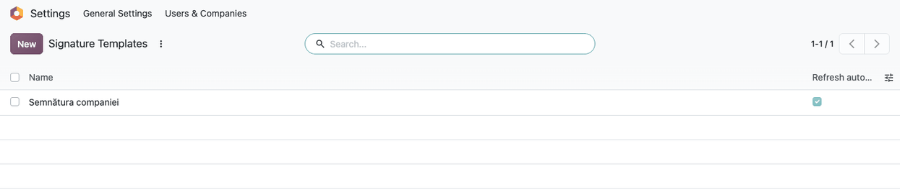
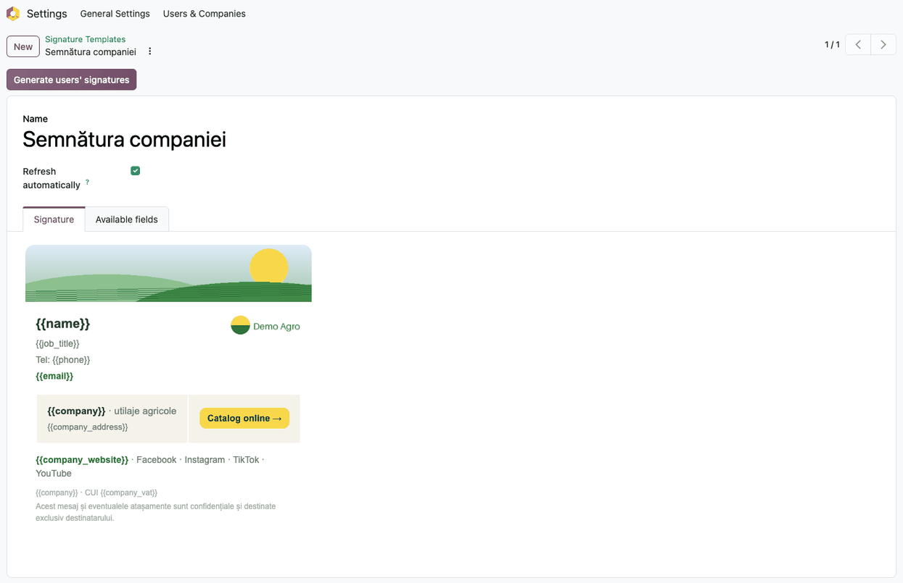
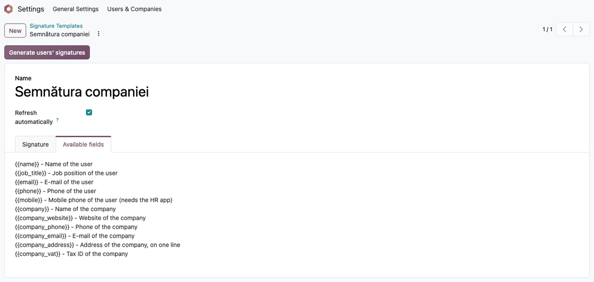
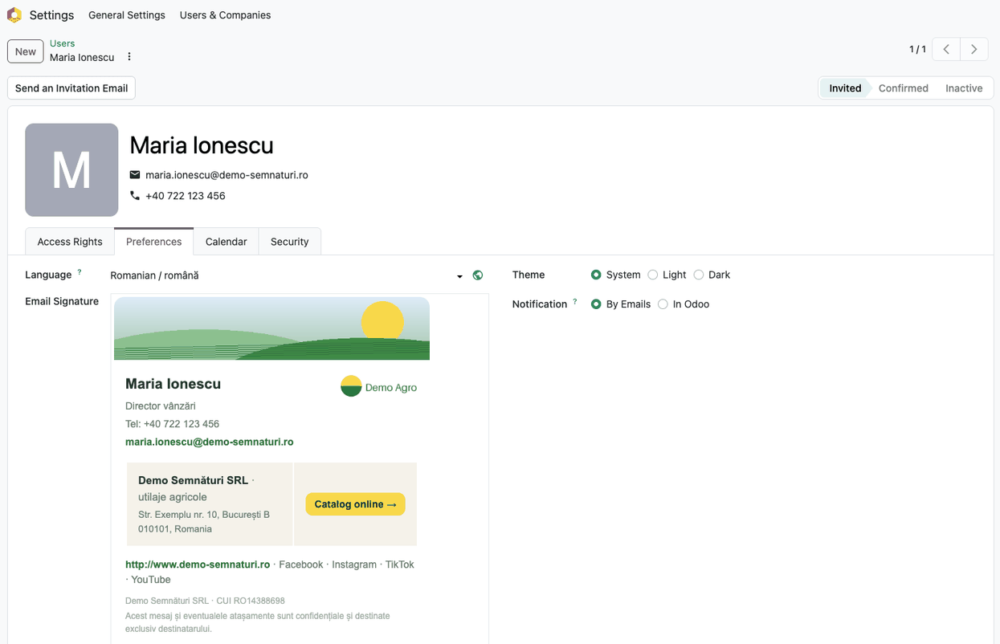
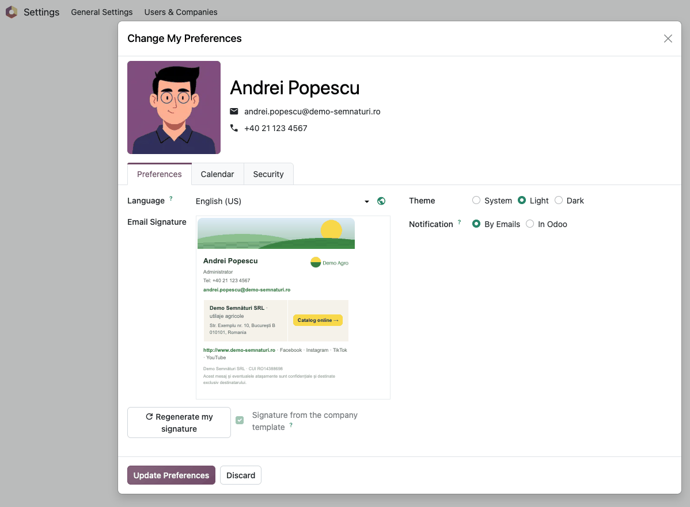

========================
Mail Signature Templates
========================

..
   !!!!!!!!!!!!!!!!!!!!!!!!!!!!!!!!!!!!!!!!!!!!!!!!!!!!
   !! This file is generated by oca-gen-addon-readme !!
   !! changes will be overwritten.                   !!
   !!!!!!!!!!!!!!!!!!!!!!!!!!!!!!!!!!!!!!!!!!!!!!!!!!!!
   !! source digest: sha256:aa26c9eb7771e5b705e3c14bbfe4c486ba870ea32954634c6672ea3b3548f2c1
   !!!!!!!!!!!!!!!!!!!!!!!!!!!!!!!!!!!!!!!!!!!!!!!!!!!!

.. |badge1| image:: https://img.shields.io/badge/maturity-Beta-yellow.png
    :target: https://odoo-community.org/page/development-status
    :alt: Beta
.. |badge2| image:: https://img.shields.io/badge/github-dhongu%2Fdeltatech-lightgray.png?logo=github
    :target: https://github.com/dhongu/deltatech/tree/20.0/deltatech_mail_signature
    :alt: dhongu/deltatech
.. |badge_fisa| image:: https://img.shields.io/badge/-Fi%C8%99%C4%83%20consultant-2ea44f.png
    :target: https://github.com/dhongu/deltatech/blob/20.0/deltatech_mail_signature/readme/FISA_CONSULTANT.md
    :alt: Fișă consultant
.. |badge_tests| image:: https://img.shields.io/badge/-17%20automated%20tests-2ea44f.png
    :target: https://github.com/dhongu/deltatech/tree/20.0/deltatech_mail_signature/tests
    :alt: 17 automated tests

|badge1| |badge2| |badge_fisa| |badge_tests|

One e-mail signature template per company, with fields, generated for
every user.

Without it, each user writes their own signature in the preferences:
different fonts, a logo pasted or not, an old phone number. This module
keeps **one template per company**, written once in the Odoo editor with
images and fields such as ``{{name}}``, ``{{job_title}}``, ``{{phone}}``
or ``{{company_address}}``, and generates from it the signature of every
internal user. Everything that sends the signature of the user (chatter,
quotations, invoices, the Mail Client) uses it with no further work.

**Features**

- Template per company, with the Odoo HTML editor (logo, banner, colors,
  links).
- Fields filled with the data of the user and of the company: name, job
  position, e-mail, phone, mobile, company name, website, phone, e-mail,
  address on one line and tax ID.
- A line whose fields are all empty (for example "Tel: {{phone}}" for a
  user without a phone) is not shown at all.
- An unknown field is refused when the template is saved, with the list
  of valid fields.
- "Generate users' signatures" on the template and "Regenerate my
  signature" in the preferences of each user.
- The signature is refreshed when the name, job position or phone of the
  user changes (can be turned off).
- Hand-written signatures are never overwritten by the mass generation
  or the refresh.
- Values are HTML-escaped, links are checked (no ``javascript:``) and
  the result goes through the HTML cleaning of Odoo.
- Images of the template are shared, so they show for recipients outside
  Odoo.

**Table of contents**

.. contents::
   :local:

Usage
=====

**Create the template**

1. Go to *Settings > Users & Companies > Signature Templates* and click
   *New*.
2. Give it a name and write the signature in the editor. Where the data
   of the user or of the company must appear, type the field, for
   example ``{{name}}`` or ``{{phone}}``. The tab *Available fields*
   lists them all.
3. Add the logo with the editor (insert image). Use PNG, JPEG or GIF, at
   most 5 images of 300 KB.
4. Save. A company can have only one active template.

**Generate the signatures**

1. On the template, click *Generate users' signatures*. The internal
   users of the company get the signature; users with a hand-written
   signature keep it, and a message tells how many.
2. A user who wants the company signature opens *Preferences* and clicks
   *Regenerate my signature*.

**Good to know**

- Put one field per line (or per table cell): a line whose fields are
  empty disappears.
- When the name, job position or phone of a user changes, their
  generated signature is generated again, unless *Refresh automatically*
  is off on the template.
- Editing a generated signature by hand turns it into a hand-written
  one: it is no longer refreshed.
- The mobile phone comes from the employee (HR app); without it
  ``{{mobile}}`` is empty.

**Screens**

|Signature templates list|

|Template form with the editor, logo and fields|

|Available fields tab|

|Generated signature in the preferences of a user|

|Preferences window with the Regenerate my signature button|

Changelog
=========

20.0.1.0.1
----------

- Port of 19.0.1.0.0 and 19.0.1.0.1 to Odoo 20. The module has a price
  on Odoo Apps: 5 EUR. Access rights and the multi-company rule are now
  in ``security/ir.access.csv``; the addresses of the companies are
  formatted with the Odoo 20 ``_display_address``. No change in
  behaviour.

19.0.1.0.1
----------

- The module has a price on Odoo Apps: 5 EUR (it was published without
  one). A small module that fills a field of Odoo for every user, priced
  at the low end of the Terrabit modules (the owner of the suite fixed
  the range at free to 10 EUR). No change in behaviour.

19.0.1.0.0
----------

- Initial version: signature template per company with fields,
  generation for users, automatic refresh.

Bug Tracker
===========

Bugs are tracked on `Terrabit Issues <https://www.terrabit.ro/helpdesk>`_.
In case of trouble, please check there if your issue has already been reported.

Do not contact contributors directly about support or help with technical issues.

Credits
=======

Authors
-------

* Terrabit
* Dorin Hongu

Maintainers
-----------

.. |maintainer-dhongu| image:: https://github.com/dhongu.png?size=40px
    :target: https://github.com/dhongu
    :alt: dhongu

Current maintainer:

|maintainer-dhongu| 

This module is part of the `dhongu/deltatech <https://github.com/dhongu/deltatech/tree/20.0/deltatech_mail_signature>`_ project on GitHub.

You are welcome to contribute.