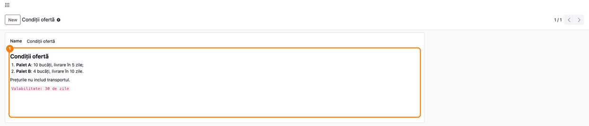

=====================
Markdown Field Widget
=====================

..
   !!!!!!!!!!!!!!!!!!!!!!!!!!!!!!!!!!!!!!!!!!!!!!!!!!!!
   !! This file is generated by oca-gen-addon-readme !!
   !! changes will be overwritten.                   !!
   !!!!!!!!!!!!!!!!!!!!!!!!!!!!!!!!!!!!!!!!!!!!!!!!!!!!
   !! source digest: sha256:7bb8018380fcd4ed0fb1db265e986910419c1c3d61a2f6b709b1d0992ea433ee
   !!!!!!!!!!!!!!!!!!!!!!!!!!!!!!!!!!!!!!!!!!!!!!!!!!!!

.. |badge1| image:: https://img.shields.io/badge/maturity-Beta-yellow.png
    :target: https://odoo-community.org/page/development-status
    :alt: Beta
.. |badge2| image:: https://img.shields.io/badge/github-dhongu%2Fdeltatech-lightgray.png?logo=github
    :target: https://github.com/dhongu/deltatech/tree/19.0/deltatech_markdown_field
    :alt: dhongu/deltatech
.. |badge_fisa| image:: https://img.shields.io/badge/-Fi%C8%99%C4%83%20consultant-2ea44f.png
    :target: https://github.com/dhongu/deltatech/blob/19.0/deltatech_markdown_field/readme/FISA_CONSULTANT.md
    :alt: Fișă consultant
.. |badge_tests| image:: https://img.shields.io/badge/-3%20automated%20tests-2ea44f.png
    :target: https://github.com/dhongu/deltatech/tree/19.0/deltatech_markdown_field/tests
    :alt: 3 automated tests

|badge1| |badge2| |badge_fisa| |badge_tests|

**Markdown Field Widget** adds a new OWL field widget — **``markdown``**
— for any ``Text`` field in the Odoo backend.

It gives users a familiar **WYSIWYG** editing experience (bold, italic,
strikethrough, headings, lists, quotes, code blocks, links), while
keeping the stored value as **raw Markdown**. The text in the database
stays portable, easy to version and perfectly readable outside of Odoo.

Conversions happen entirely in the browser, with no server-side
dependency at runtime:

- on **load**: Markdown → HTML (the `marked <https://marked.js.org/>`__
  library);
- on **save**: HTML → Markdown (the
  `turndown <https://github.com/mixmark-io/turndown>`__ library).

Both libraries are bundled locally as UMD builds, so the module works
offline and needs no external CDN.

**✨ Key features**

- WYSIWYG toolbar: bold, italic, headings, lists, quotes, code blocks
  and links.
- Stores raw Markdown — portable, diff-friendly and readable anywhere.
- Instant MD ↔ HTML round-trip, fully client-side.
- Honors ``readonly``: in read-only mode it renders the Markdown as
  HTML, without the toolbar.
- Configurable minimum editor height via the ``min_height`` option.

**⚙️ Usage**

.. code:: xml

   <field name="notes" widget="markdown"/>
   <field name="notes" widget="markdown" options="{'min_height': 300}"/>

**Table of contents**

.. contents::
   :local:

Usage
=====

Declare the field as ``Text`` on your model:

.. code:: python

   notes = fields.Text(string="Notes")

Then use the ``markdown`` widget in the form view:

.. code:: xml

   <field name="notes" widget="markdown"/>

Supported options:

- ``min_height`` — minimum height of the editing area, in pixels
  (default ``160``):

.. code:: xml

   <field name="notes" widget="markdown" options="{'min_height': 300}"/>

The widget honors ``readonly``: in read-only mode it renders the
Markdown as HTML, without the toolbar.

**Editing.** In edit mode the toolbar sits above the field; select text
and press a button to format it. The value is saved as Markdown when you
leave the field and save the record.

|Form in edit mode: the Markdown toolbar (bold, italic, strikethrough,
H1-H3, paragraph, lists, quote, code, link, clear formatting) above a
text with a heading, a bulleted list, a link and a quote|

**Read-only.** The text is shown formatted, without the toolbar.

|Read-only Markdown field showing a heading, a numbered list with bold
items, a paragraph and inline code, with no toolbar|

**Safe display.** Since 19.0.1.0.5 the HTML produced from the Markdown
is sanitized before it is displayed, in edit and read-only mode,
including for values stored earlier. Harmless inline HTML such as
``<kbd>`` or ``<mark>`` keeps its formatting; scripts, inline event
handlers, ``javascript:`` links and embedded content (``<iframe>``,
``<object>``, ``<embed>``) are not displayed. Replace embedded videos or
maps with a regular link.

Strikethrough, inline HTML such as ``<kbd>`` or ``<mark>`` and tables
are not kept when the text is edited and saved: only standard Markdown
is stored.

|Read-only Markdown field where the Ctrl and S keys are boxed and a word
is highlighted, while the embedded frame placed between the two
paragraphs is not displayed|

.. |Form in edit mode: the Markdown toolbar (bold, italic, strikethrough, H1-H3, paragraph, lists, quote, code, link, clear formatting) above a text with a heading, a bulleted list, a link and a quote| image:: https://raw.githubusercontent.com/dhongu/deltatech/19.0/deltatech_markdown_field/static/description/en/01_editare_markdown.png

.. |Read-only Markdown field where the Ctrl and S keys are boxed and a word is highlighted, while the embedded frame placed between the two paragraphs is not displayed| image:: https://raw.githubusercontent.com/dhongu/deltatech/19.0/deltatech_markdown_field/static/description/en/03_html_filtrat.png

Changelog
=========

19.0.1.0.6 (2026-11-08)
-----------------------

- Fix: strikethrough, tables and task lists are no longer lost when the
  editor is left. The HTML → Markdown step now writes them back as
  ``~~text~~``, GFM tables (with column alignment) and ``[x]`` / ``[ ]``
  items; a table Markdown cannot express (merged cells, lists or
  paragraphs in a cell) is kept as HTML instead of being flattened.
  Values already flattened by an earlier save cannot be recovered.

19.0.1.0.5 (2026-11-07)
-----------------------

- Fix: the HTML produced from the Markdown is sanitized (DOMPurify)
  before it is displayed, in edit and in read-only mode. Scripts, inline
  event handlers, ``javascript:`` links and embedded content
  (``<iframe>``, ``<object>``, ``<embed>``) are removed; Markdown
  formatting and harmless inline HTML stay as they were.

19.0.1.0.4 (2026-10-22)
-----------------------

- Listed on Odoo Apps as *Markdown Field Widget* (was *Markdown Field*).
  The technical name ``deltatech_markdown_field`` does not change.

19.0.1.0.3 (2026-10-12)
-----------------------

- Fix: on servers with Python < 3.11 (rjsmin 1.1.0) the minified asset
  bundle broke on a regular expression of the vendored marked library
  (``Invalid regular expression: /^*-+:*$/``), stopping the backend in
  non-debug mode and the JS unit tests. The expression is now wrapped in
  parentheses, so it survives minification.

19.0.1.0.2 (2026-10-11)
-----------------------

- Docs: emoji symbols added to the bold headings of the module
  description, for a uniform look on the Odoo Apps page. No code change.

19.0.1.0.1 (2026-09-29)
-----------------------

- Own module icon, instead of the generic gears it had.

Bug Tracker
===========

Bugs are tracked on `Terrabit Issues <https://www.terrabit.ro/helpdesk>`_.
In case of trouble, please check there if your issue has already been reported.

Do not contact contributors directly about support or help with technical issues.

Credits
=======

Authors
-------

* Terrabit
* Dorin Hongu

Maintainers
-----------

.. |maintainer-dhongu| image:: https://github.com/dhongu.png?size=40px
    :target: https://github.com/dhongu
    :alt: dhongu

Current maintainer:

|maintainer-dhongu| 

This module is part of the `dhongu/deltatech <https://github.com/dhongu/deltatech/tree/19.0/deltatech_markdown_field>`_ project on GitHub.

You are welcome to contribute.