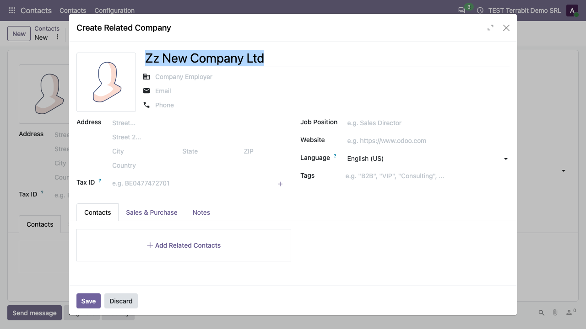

===============
No Quick Create
===============

..
   !!!!!!!!!!!!!!!!!!!!!!!!!!!!!!!!!!!!!!!!!!!!!!!!!!!!
   !! This file is generated by oca-gen-addon-readme !!
   !! changes will be overwritten.                   !!
   !!!!!!!!!!!!!!!!!!!!!!!!!!!!!!!!!!!!!!!!!!!!!!!!!!!!
   !! source digest: sha256:5cbdaa974537b19b41c19f2c0b43f10e297bb7e4f2231da6c120bd50c41b9aad
   !!!!!!!!!!!!!!!!!!!!!!!!!!!!!!!!!!!!!!!!!!!!!!!!!!!!

.. |badge1| image:: https://img.shields.io/badge/maturity-Production%2FStable-green.png
    :target: https://odoo-community.org/page/development-status
    :alt: Production/Stable
.. |badge2| image:: https://img.shields.io/badge/github-dhongu%2Fdeltatech-lightgray.png?logo=github
    :target: https://github.com/dhongu/deltatech/tree/19.0/deltatech_no_quick_create
    :alt: dhongu/deltatech
.. |badge_fisa| image:: https://img.shields.io/badge/-Fi%C8%99%C4%83%20consultant-2ea44f.png
    :target: https://github.com/dhongu/deltatech/blob/19.0/deltatech_no_quick_create/readme/FISA_CONSULTANT.md
    :alt: Fișă consultant

|badge1| |badge2| |badge_fisa|

Features:

- disables the option to create new items without editing them, for
  prevention of empty products, contacts, etc.
- applies to every many2one widget (plain, avatar, barcode, reference);
  **Create and edit...** stays available.

Odoo Online
===========

The module contains no Python code, only one JavaScript file. Besides
Odoo.sh and on-premise installations, it can be used on Odoo Online
(Custom plan): download the zip and load it from **Apps > Import
Module**.

**Table of contents**

.. contents::
   :local:

Usage
=====

1. Install the module, or on Odoo Online import the zip from **Apps >
   Import Module** (Custom plan, developer mode), then reload the page.
   There is nothing to configure.

2. Open **Contacts > Contacts**, click **New** and type a company name
   that does not exist yet in the **Company** field. The dropdown no
   longer offers **Create "..."**: only **Create and edit...** is left.
   Every many2one field behaves the same way (customer, product,
   category, salesperson).

   |New contact Jane Smith: Zz New Company Ltd is typed in the Company
   field and the dropdown shows a single option, Create and edit...|

3. Click **Create and edit...**: the **Create Company** dialog opens
   with the typed name already filled in. Complete the address and tax
   ID, then click **Save**.

   |Create Company dialog over the contact form, with the name Zz New
   Company Ltd prefilled and the Save and Discard buttons|

.. |New contact Jane Smith: Zz New Company Ltd is typed in the Company field and the dropdown shows a single option, Create and edit...| image:: https://raw.githubusercontent.com/dhongu/deltatech/19.0/deltatech_no_quick_create/static/description/en/01_lista_fara_creare_rapida.png

Changelog
=========

19.0.2.1.1 (2026-11-09)
-----------------------

- The "(importable, Odoo Online)" suffix was removed from the module
  name. Odoo Apps already shows the module as available on Odoo Online
  (Manifest > Availability), and the Apps banner now carries an "Odoo
  Online" label instead.

19.0.2.1.0 (2026-11-08)
-----------------------

- Data-only module: the empty ``__init__.py`` files (module and
  ``tests/``) were removed, so the module has no Python code at all. It
  can be installed on Odoo Online (Custom plan) as a zip from Apps >
  Import Module, as well as on Odoo.sh and on-premise.
- Odoo Apps does not mark data-only modules as available on Odoo Online,
  so the module name, the summary, the banner and the Apps Store page
  now say it: "No Quick Create (importable, Odoo Online)".

19.0.2.0.2 (2026-09-29)
-----------------------

- Own module icon, instead of the generic gears it had.

Bug Tracker
===========

Bugs are tracked on `Terrabit Issues <https://www.terrabit.ro/helpdesk>`_.
In case of trouble, please check there if your issue has already been reported.

Do not contact contributors directly about support or help with technical issues.

Credits
=======

Authors
-------

* Terrabit
* Dorin Hongu

Maintainers
-----------

.. |maintainer-dhongu| image:: https://github.com/dhongu.png?size=40px
    :target: https://github.com/dhongu
    :alt: dhongu

Current maintainer:

|maintainer-dhongu| 

This module is part of the `dhongu/deltatech <https://github.com/dhongu/deltatech/tree/19.0/deltatech_no_quick_create>`_ project on GitHub.

You are welcome to contribute.