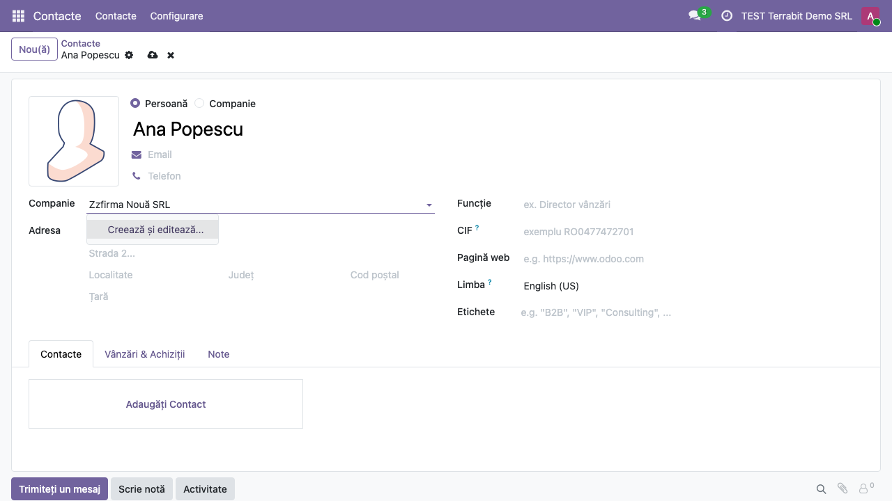
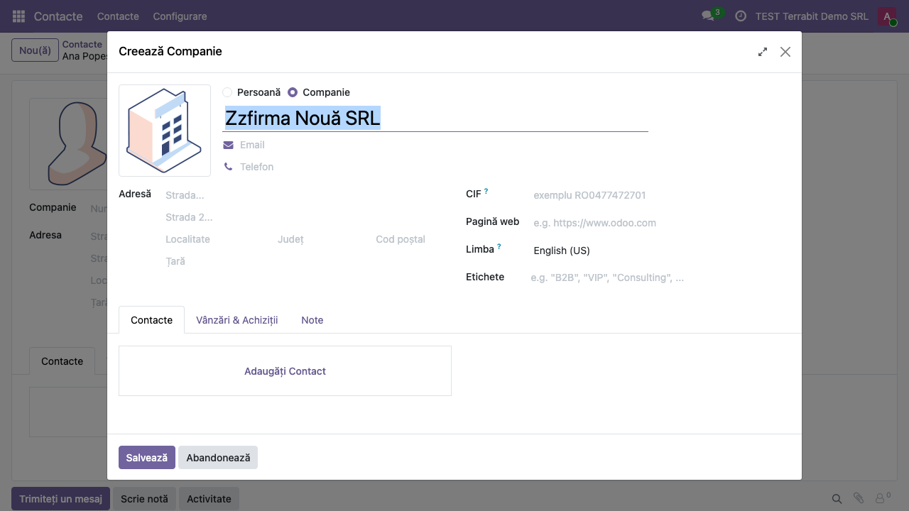

# Fișă Modul: Fără creare rapidă în câmpurile de selecție

**Modul:** `deltatech_no_quick_create`
**Utilizator principal:** Toți utilizatorii care completează documente (vânzări, achiziții, stoc, contacte)
**Prioritate:** 🟢 Scăzută (schimbă doar lista de sugestii a câmpurilor de selecție, nu datele existente)

---

## 1. Scop business

Într-un câmp de selecție (partener, produs, companie, categorie), Odoo oferă două feluri de a crea
o înregistrare nouă direct din listă: **Creează "text"**, care salvează pe loc o înregistrare doar cu
numele tastat, și **Creează și editează...**, care deschide formularul complet. Crearea rapidă
produce ușor parteneri fără adresă și CIF sau produse fără preț și unitate de măsură, de obicei
dintr-o greșeală de tastare. Modulul scoate opțiunea **Creează "text"** din toate câmpurile de
selecție; **Creează și editează...** rămâne, astfel încât orice înregistrare nouă trece prin formular.

Modulul nu are cod Python, doar un fișier JavaScript. Pe lângă Odoo.sh și instalările proprii, se
poate folosi și pe Odoo Online (planul Custom), încărcat ca arhivă zip: cu modul dezvoltator activ,
din **Aplicații → Importați Modulul**.

## 2. Bază legală și context

Modulul nu are bază legală proprie. Contextul este calitatea datelor de bază: partenerii fără CIF
sau adresă blochează ulterior facturarea și raportările (de exemplu e-Factura sau declarațiile
care cer codul fiscal al partenerului), iar produsele create din greșeală dublează nomenclatorul.

## 3. Utilizatori și roluri

| Rol | Ce face |
|---|---|
| Orice utilizator intern | Vede în câmpurile de selecție doar **Creează și editează...**; creează înregistrări noi din formular |
| Administrator | Instalează sau importă modulul; nu are nimic de configurat |

Modulul nu adaugă grupuri de drepturi și nu ocolește drepturile existente: cine nu are drept de
creare pe un model nu vede nici **Creează și editează...**. Pentru testare ajunge un utilizator
administrator.

## 4. Conturi și date implicate

Nu se folosesc conturi contabile și nu se generează note contabile. Pentru demo ajunge aplicația
**Contacte** și un nume de companie care nu există încă în bază (în capturi: *Zzfirma Nouă SRL*).

## 5. Configurare inițială

1. Instalați modulul `deltatech_no_quick_create` (depinde doar de modulele de bază `base` și `web`). Pe Odoo Online, activați
   modul dezvoltator și încărcați arhiva zip din **Aplicații → Importați Modulul**.
2. Reîncărcați pagina în browser, ca să se încarce noul fișier JavaScript. Nu există setări.

## 6. Flux de utilizare

### Pasul 1 — Lista de sugestii fără creare rapidă

Deschideți **Contacte → Contacte** și apăsați **Nou(ă)**. Lăsați tipul **Persoană**, completați
numele, apoi tastați în câmpul **Companie** un nume care nu există încă, de exemplu *Zzfirma Nouă SRL*.
Lista de sugestii nu mai are opțiunea **Creează "Zzfirma Nouă SRL"**; rămâne doar
**Creează și editează...**. La fel se comportă toate câmpurile de selecție din Odoo: clientul de pe
o comandă, produsul de pe o linie de factură, categoria unui produs.

### Pasul 2 — Crearea prin formular

Alegeți **Creează și editează...**. Se deschide fereastra **Creează Companie**, cu numele tastat deja
completat. Completați adresa, CIF-ul și celelalte date, apoi apăsați **Salvează**: compania nouă se
leagă de contact. **Abandonează** închide fereastra fără să creeze nimic.

### Note de monografie și raportare

Modulul nu generează note contabile (Dr/Cr): schimbă doar lista de sugestii a câmpurilor de selecție.

## 7. Legături cu alte module / declarații

| Modul | Rol |
|---|---|
| `web` | Componenta comună a câmpurilor de selecție, pe care modulul o modifică |
| Toate aplicațiile (Vânzări, Achiziții, Facturare, Stoc, Contacte) | Câmpurile lor de selecție pierd opțiunea de creare rapidă |
| `base_import_module` | Importul arhivei zip pe Odoo Online |

**Ce e automat:** opțiunea **Creează "text"** dispare din toate câmpurile de selecție, inclusiv cele
afișate cu avatar, cod de bare sau ca referință, fără configurare pe fiecare câmp.

**Ce rămâne manual:** completarea datelor noii înregistrări în formular. Modulul nu face câmpurile
din formular obligatorii.

## 8. Verificări pentru consultant

- [ ] Într-un câmp de selecție, la un text care nu există, lista nu mai are **Creează "text"**.
- [ ] **Creează și editează...** apare în continuare și deschide formularul cu numele precompletat.
- [ ] Același comportament pe un câmp cu avatar (de exemplu **Agent de vânzări** pe o comandă) și pe
  un câmp de produs de pe o linie de comandă.
- [ ] Un utilizator fără drept de creare pe model nu vede nicio opțiune de creare.
- [ ] Pe Odoo Online, după importul arhivei zip (modul dezvoltator, **Aplicații → Importați
  Modulul**), modulul apare în **Aplicații** și crearea rapidă dispare după reîncărcarea paginii.

## 9. Mesaje de eroare frecvente

| Mesaj | Cauză | Remediere |
|---|---|---|
| Opțiunea **Creează "text"** apare în continuare după instalare | Browserul folosește încă fișierele JavaScript vechi | Reîncărcați pagina (în ultimă instanță, cu golirea cache-ului) |
| Opțiunea apare doar într-un anumit câmp | Câmpul folosește un widget al unui modul terț care nu trece prin componenta standard a câmpurilor de selecție | Verificați widget-ul câmpului în modul dezvoltator și semnalați cazul |

## 10. Capturi de ecran

Capturile sunt în `static/description/` (cele în engleză, pentru `readme/USAGE.md`, în
`static/description/en/`), făcute în română pe o bază de test cu modulul importat din zip și
aplicația **Contacte** instalată:

| Fișier | Ce arată |
|---|---|
| `01_lista_fara_creare_rapida.png` | Câmpul Companie al unui contact nou, cu lista de sugestii care are doar Creează și editează... |
| `02_formular_creare_si_editare.png` | Fereastra Creează Companie, cu numele precompletat |

Modulul nu are `tests/test_screenshots.py`: un test Python ar contrazice varianta fără cod Python
pentru Odoo Online. Capturile s-au făcut cu Playwright, pe formularul de contact din aplicația
**Contacte**.

## 11. Observații pentru manual

- Modulul afectează toate câmpurile de selecție din toate aplicațiile, nu doar contactele.
- Crearea rapidă nu se poate reactiva pe un singur câmp: modulul se aplică global.
- Pe Odoo Online, importul unui modul cere planul Custom.
