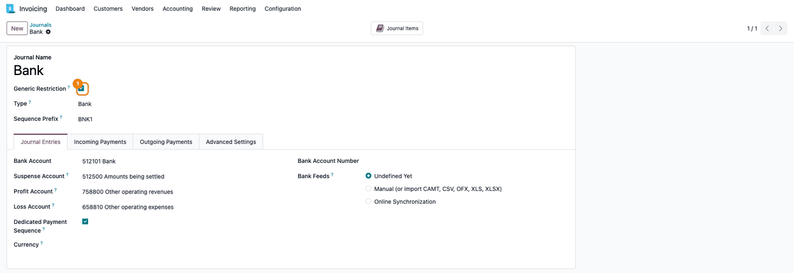
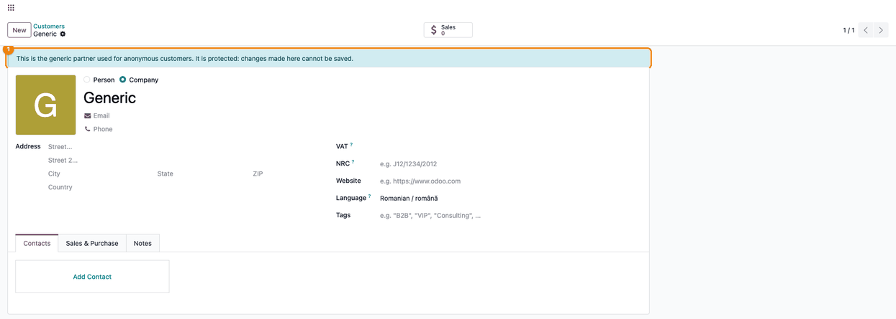
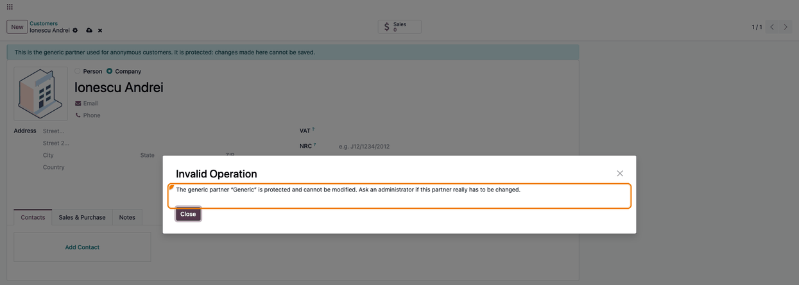

===============
Generic Partner
===============

..
   !!!!!!!!!!!!!!!!!!!!!!!!!!!!!!!!!!!!!!!!!!!!!!!!!!!!
   !! This file is generated by oca-gen-addon-readme !!
   !! changes will be overwritten.                   !!
   !!!!!!!!!!!!!!!!!!!!!!!!!!!!!!!!!!!!!!!!!!!!!!!!!!!!
   !! source digest: sha256:aba34d8ccaacdba9f79373550ccd0016303c2f884af35b9cbfc01e12578b8047
   !!!!!!!!!!!!!!!!!!!!!!!!!!!!!!!!!!!!!!!!!!!!!!!!!!!!

.. |badge1| image:: https://img.shields.io/badge/maturity-Mature-brightgreen.png
    :target: https://odoo-community.org/page/development-status
    :alt: Mature
.. |badge2| image:: https://img.shields.io/badge/github-dhongu%2Fdeltatech-lightgray.png?logo=github
    :target: https://github.com/dhongu/deltatech/tree/19.0/deltatech_partner_generic
    :alt: dhongu/deltatech
.. |badge_fisa| image:: https://img.shields.io/badge/-Fi%C8%99%C4%83%20consultant-2ea44f.png
    :target: https://github.com/dhongu/deltatech/blob/19.0/deltatech_partner_generic/readme/FISA_CONSULTANT.md
    :alt: Fișă consultant
.. |badge_tests| image:: https://img.shields.io/badge/-24%20automated%20tests%20%C2%B7%2093%25%20code%20coverage-2ea44f.png
    :target: https://app.codecov.io/gh/dhongu/deltatech/tree/19.0/deltatech_partner_generic
    :alt: 24 automated tests · 93% code coverage

|badge1| |badge2| |badge_fisa| |badge_tests|

Shops, points of sale and imports often record sales for customers who
are not identified, under one generic partner. That partner must not end
up on a real invoice, must not be paid through the wrong journals and
must not be edited by mistake, since it is reachable from every sales
document. This module declares the generic partner of each company and
enforces these rules.

**Generic partner per company**: set in **Invoicing > Configuration >
Settings**, section **Customer Invoices**, field **Generic Partner**.
The module creates a company contact named *Generic* that can be chosen
there, or any other contact can be used. The setting only declares the
partner: it is not filled in automatically on sales orders or invoices.

**No validated invoice for the generic partner**: a customer invoice or
credit note whose customer or delivery address is the generic partner
(or one of its contacts) cannot be validated. The error names the
invoice and asks for the real customer. Drafts stay allowed, so the
flows that go through the generic partner (Point of Sale, eCommerce,
imports) keep working. Vendor bills and journal entries are not
affected.

**Restricted payment journals**: bank and cash journals ticked as
**Generic Restriction** (on the journal form, next to the journal type,
and as an optional column in the journal list) are not proposed when a
payment is made for the generic partner, either in a new payment or in
the **Register Payment** wizard opened from an invoice. Only bank and
cash journals are proposed, and the default journal is always an allowed
one.

**Protect the generic partner**: tick **Protect Generic Partner** in the
same setting to prevent accidental changes. The contact form then shows
a warning banner, and any change, archiving or deletion is refused when
saving. The protection is off by default. Users who have to change the
partner are given the **Generic Partner: Editor** group; Settings
administrators already have it. Writes made by Odoo itself (chatter,
activities, portal signup tokens, geolocation) stay allowed, as do
automated flows running with elevated rights.

These accounting restrictions used to live in the separate module
``deltatech_generic_partner_restriction``, which is now an empty
transition module depending on this one.

**Table of contents**

.. contents::
   :local:

Usage
=====

1. Go to **Invoicing → Configuration → Settings**, section **Customer
   Invoices** (available without the Sales app as well): pick the
   **Generic Partner** of the company and, to keep it from being changed
   by mistake, tick **Protect Generic Partner**. Save. In a
   multi-company database, repeat this on every company.

   |Invoicing settings, Customer Invoices section: the Generic Partner
   field set to Generic and the Protect Generic Partner box ticked|

2. Go to **Invoicing → Configuration → Journals** and tick **Generic
   Restriction** on the journals that must not be used for anonymous
   customers (usually the banks).

   |Bank journal form with the Generic Restriction box ticked, above the
   journal type|

3. A customer invoice can be drafted on the generic partner (by hand,
   from a sale order, a POS or an import) and saved as usual.

   |Draft customer invoice for Generic: two Set pensule pictură at 45
   lei on account 707000 with 21% VAT, 108.90 lei in total, and the
   Confirm button|

4. **Confirm** is refused while the generic partner is the customer or
   the delivery address of a customer invoice or credit note. The
   message names the field to change: set the real customer and confirm
   again. Vendor bills and journal entries are not affected.

   |Invalid Operation dialog over the invoice: it cannot be validated
   because Generic is the generic partner, used for anonymous customers,
   and it is set as Partner|

5. On a new customer payment for the generic partner (**Invoicing →
   Customers → Payments**), the **Journal** list leaves out the
   restricted journals, and the journal proposed by default is an
   allowed one. The **Register Payment** wizard opened from a vendor
   bill on the generic partner applies the same restriction.

   |Draft payment for Generic, 108.90 lei: the Journal list is open and
   proposes only the cash journal Numerar, without the restricted bank|

6. When the protection is on, a user without the **Generic Partner:
   Editor** group sees a banner on the generic partner,

   |Contact form of Generic opened by a salesperson: a blue banner says
   it is the generic partner and that changes cannot be saved|

   and saving a change, archiving or deleting it is refused. Settings
   administrators already have the **Generic Partner: Editor** group.

   |Invalid Operation dialog after renaming Generic to Ionescu Andrei:
   the generic partner is protected and cannot be modified|

.. |Invoicing settings, Customer Invoices section: the Generic Partner field set to Generic and the Protect Generic Partner box ticked| image:: https://raw.githubusercontent.com/dhongu/deltatech/19.0/deltatech_partner_generic/static/description/en/01_setari_partener_generic.png

.. |Draft customer invoice for Generic: two Set pensule pictură at 45 lei on account 707000 with 21% VAT, 108.90 lei in total, and the Confirm button| image:: https://raw.githubusercontent.com/dhongu/deltatech/19.0/deltatech_partner_generic/static/description/en/03_factura_ciorna_generic.png
.. |Invalid Operation dialog over the invoice: it cannot be validated because Generic is the generic partner, used for anonymous customers, and it is set as Partner| image:: https://raw.githubusercontent.com/dhongu/deltatech/19.0/deltatech_partner_generic/static/description/en/04_eroare_validare_factura.png
.. |Draft payment for Generic, 108.90 lei: the Journal list is open and proposes only the cash journal Numerar, without the restricted bank| image:: https://raw.githubusercontent.com/dhongu/deltatech/19.0/deltatech_partner_generic/static/description/en/05_plata_jurnale_permise.png

Changelog
=========

19.0.2.0.5 (2026-11-03)
-----------------------

- Description rewritten after the code: the generic partner is declared
  in the Invoicing settings, section Customer Invoices, and is not
  selected automatically in sales or invoicing as the old text said. The
  banner no longer promises it.

19.0.2.0.4 (2026-11-03)
-----------------------

- A new payment for the generic partner now proposes an allowed journal
  by default, not the first bank journal of the company even when it was
  restricted.
- The **Register Payment** wizard opened from an invoice now leaves out
  the restricted journals for the generic partner as well, including the
  journal of the invoice preferred payment method.
- The generic partner setting moved from the Sales settings to the
  Invoicing settings, section Customer Invoices, so it is available
  without the Sales app (``sale_management``), for example with only
  eCommerce or Point of Sale. It now has a real description instead of a
  repeated title.
- Romanian translation of the protection message reworded to the formal
  address.

19.0.2.0.3 (2026-11-03)
-----------------------

- Consultant sheet and usage page, with Romanian and English screenshots
  generated by ``tests/test_screenshots.py``.

19.0.2.0.2 (2026-09-29)
-----------------------

- Own module icon, instead of the generic gears it had.

19.0.2.0.1 (2026-09-23)
-----------------------

- Overrides that call ``super()`` without returning its result now pass
  it on (pylint-odoo ``missing-return``). The parent methods return
  ``None`` today, so the behavior is unchanged.

Bug Tracker
===========

Bugs are tracked on `Terrabit Issues <https://www.terrabit.ro/helpdesk>`_.
In case of trouble, please check there if your issue has already been reported.

Do not contact contributors directly about support or help with technical issues.

Credits
=======

Authors
-------

* Terrabit
* Dorin Hongu

Maintainers
-----------

.. |maintainer-dhongu| image:: https://github.com/dhongu.png?size=40px
    :target: https://github.com/dhongu
    :alt: dhongu

Current maintainer:

|maintainer-dhongu| 

This module is part of the `dhongu/deltatech <https://github.com/dhongu/deltatech/tree/19.0/deltatech_partner_generic>`_ project on GitHub.

You are welcome to contribute.