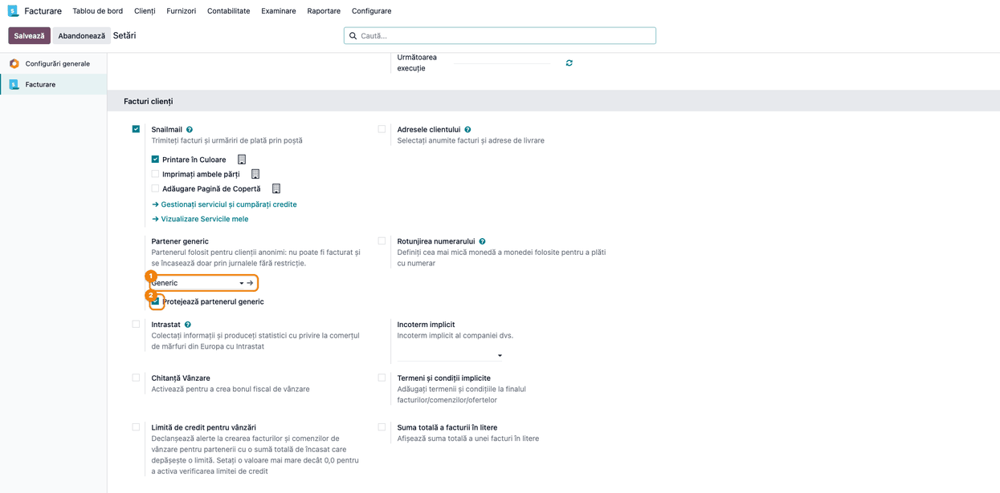
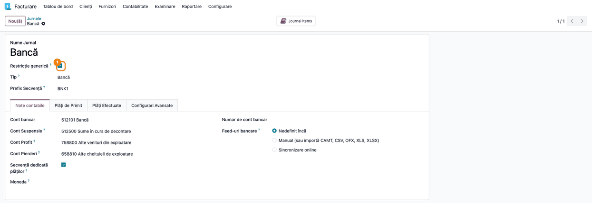
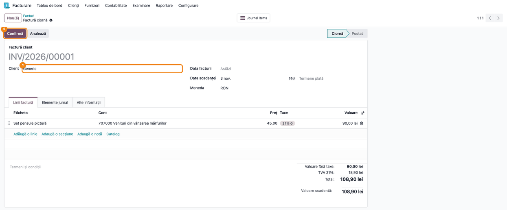
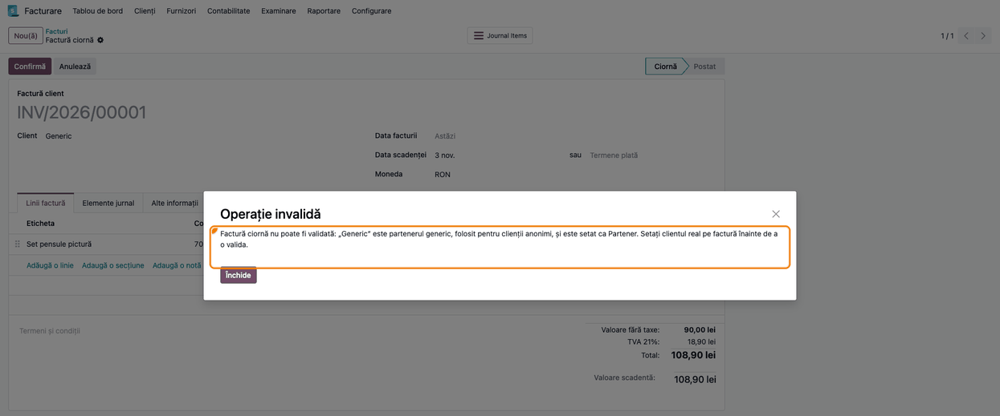
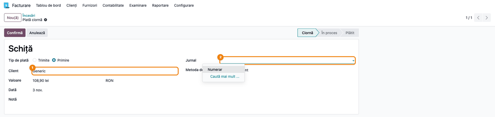
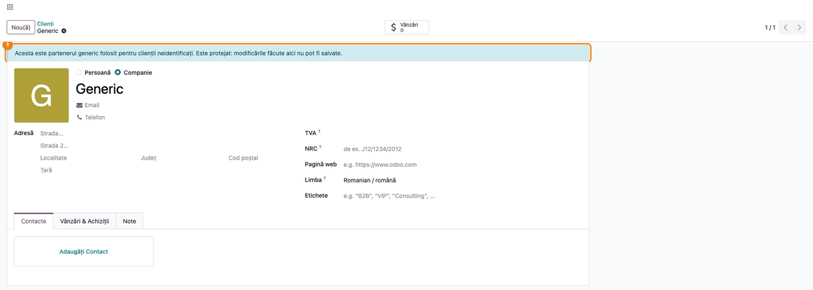
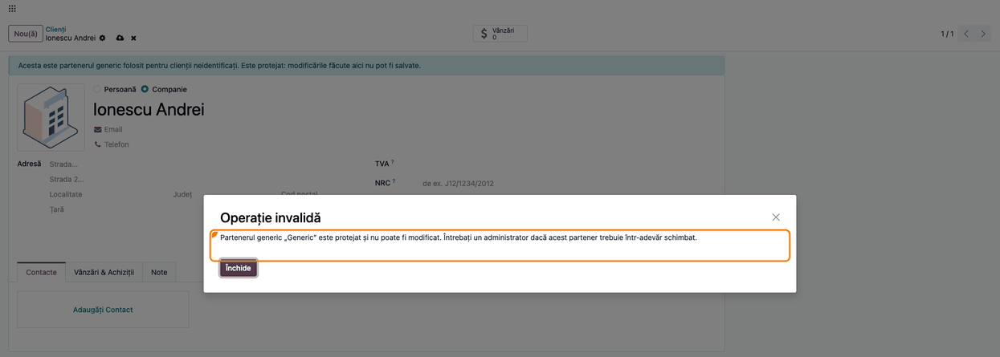

# Fișă Modul: Partener generic pentru clienți anonimi

**Modul:** `deltatech_partner_generic`
**Utilizator principal:** Administrator Odoo / contabil (configurare), vânzător și operator facturare (utilizare)
**Prioritate:** 🟡 Medie (împiedică emiterea facturilor pe un client fictiv și modificarea accidentală a lui)

---

## 1. Scop business

Magazinele, casele de marcat, e-commerce-ul și importurile au nevoie de un client „de serviciu" pentru
vânzările către persoane care nu se identifică. Fără reguli, acest client ajunge pe facturi reale, primește
plăți prin bancă sau e redenumit și completat cu datele unui client real, iar modificarea se vede apoi pe
toate documentele care îl folosesc. Modulul:

- definește, pe fiecare companie, **partenerul generic** (de obicei contactul **Generic**, creat la instalare,
  dar care trebuie ales în setări: până atunci nicio restricție nu se aplică);
- **refuză validarea** facturilor și notelor de credit de client emise pe partenerul generic, ca adresă de
  facturare sau de livrare; ciornele rămân permise, deci fluxurile care trec prin el (POS, e-commerce,
  importuri) funcționează în continuare;
- **ascunde jurnalele** bifate cu **Restricție generică** când se înregistrează o plată a partenerului generic;
- opțional, **protejează** partenerul generic: utilizatorii obișnuiți nu îl mai pot redenumi, arhiva sau șterge.

## 2. Bază legală și context

Factura trebuie să cuprindă numele și adresa beneficiarului (Codul fiscal, art. 319 alin. (20)), iar
facturile se transmit prin RO e-Factura (B2B și, din 2025, B2C), unde un client fictiv nu poate fi
identificat. De aceea o
factură reală se emite pe clientul real, nu pe partenerul generic. Vânzările către persoane neidentificate
se documentează prin bonul fiscal, nu prin factură. Modulul nu schimbă aceste reguli, doar împiedică
validarea unei facturi pe partenerul generic.

## 3. Utilizatori și roluri

| Rol | Ce face |
|---|---|
| Administrator (Setări) | Alege partenerul generic, activează protecția; are implicit dreptul de a-l modifica |
| Contabil | Bifează **Restricție generică** pe jurnalele care nu se folosesc pentru clienții anonimi |
| Vânzător / operator facturare | Lucrează cu partenerul generic pe ciorne; înlocuiește clientul înainte de validare |
| Utilizator cu grupul **Partener generic: Editor** | Poate modifica partenerul generic chiar dacă e protejat |

Roluri recomandate pentru testare: **Administration / Settings** (configurare), **Invoicing / Billing
Administrator** (jurnale, facturi, plăți) și un utilizator **Sales / User: Own Documents Only** cu
**Contact Creation**, fără grupul **Partener generic: Editor** (protecția).

## 4. Conturi și date implicate

Modulul nu are conturi proprii și nu generează note contabile: blochează validarea înainte să se
creeze nota. Facturile și plățile pe clientul real sunt cele standard.

Date minime pentru demo (cele din capturi):

- compania **Demo Magazin SRL**, pe planul de conturi RO;
- partenerul generic **Generic** (creat de modul), cu protecția activă;
- jurnalul de bancă **Bancă** bifat cu **Restricție generică**; jurnalul **Numerar** rămâne permis;
- o factură de client în ciornă pe **Generic**: 2 × **Set pensule pictură** la 45 lei + TVA 21% (90,00 + 18,90 = 108,90 lei);
- o plată de client în ciornă pe **Generic**, de 108,90 lei, pe jurnalul **Numerar**;
- vânzătorul **Popescu Maria**, fără grupul **Partener generic: Editor**.

## 5. Configurare inițială

1. Instalați modulul `deltatech_partner_generic` (depinde de `account` și `sale`). La instalare se creează
   contactul **Generic**.
2. **Facturare → Configurare → Setări**, secțiunea **Facturi clienți**, setarea **Partener generic**: alegeți
   partenerul generic al companiei (Pasul 1). În bazele cu mai multe companii, setarea se face pe fiecare
   companie. Setarea e în fila **Facturare**, deci e disponibilă și fără aplicația **Vânzări**
   (`sale_management`), de exemplu doar cu magazin online sau POS; o vede un administrator al facturării.
3. Opțional, bifați **Protejează partenerul generic** și salvați.
4. **Facturare → Configurare → Jurnale**: pe jurnalele care nu trebuie folosite pentru încasările
   clienților anonimi (de regulă bănci), bifați **Restricție generică** (Pasul 2).
5. Dați grupul **Partener generic: Editor** utilizatorilor care trebuie să poată corecta partenerul generic
   (administratorii îl au deja).

## 6. Flux de utilizare

### Pasul 1 — Alegerea și protejarea partenerului generic

**Facturare → Configurare → Setări**, secțiunea **Facturi clienți**, setarea **Partener generic**: alegeți partenerul generic și, dacă vreți ca el să nu
mai poată fi modificat, bifați **Protejează partenerul generic**. Apăsați **Salvare**.



Partenerul se alege pe compania activă: în bazele cu mai multe companii, comutați pe fiecare companie și
repetați pasul.

### Pasul 2 — Jurnalele interzise pentru clienții anonimi

**Facturare → Configurare → Jurnale**, deschideți jurnalul de bancă și bifați **Restricție generică**.



Un jurnal bifat nu mai e propus când se înregistrează o plată a partenerului generic. În listă, coloana
**Restricție generică** se poate afișa din selectorul de coloane.

### Pasul 3 — Factura în ciornă pe partenerul generic

O factură de client poate fi creată (manual, din comandă, din POS sau prin import) cu partenerul generic.
Cât timp e în ciornă, nu se întâmplă nimic: o puteți completa și salva.



### Pasul 4 — Validarea e refuzată

La **Confirmă**, Odoo refuză validarea și spune pe ce câmp e partenerul generic: **Partener** (câmpul
afișat pe factură ca **Client**) sau **Adresă livrare**.



Înlocuiți partenerul generic cu clientul real pe câmpul indicat și confirmați din nou. Regula se aplică și
dacă partenerul generic e doar compania-mamă a contactului ales. Facturile de furnizor, chitanțele de vânzare și
notele contabile nu sunt afectate.

### Pasul 5 — Plata partenerului generic

**Facturare → Clienți → Plăți** (ecranul se numește **Încasări** în breadcrumb), o plată nouă cu clientul **Generic**: în câmpul **Jurnal** apar doar
jurnalele de bancă și de numerar nebifate cu **Restricție generică**.

Găsiți pe ecran: deschideți lista câmpului **Jurnal**. Verificați că jurnalul de bancă bifat la Pasul 2
lipsește din listă. Jurnalul propus la crearea plății este și el unul permis (aici **Numerar**), chiar dacă
jurnalul restricționat e primul jurnal de bancă al companiei. La plăți, restricția se aplică doar pe
partenerul generic însuși, nu și pe contactele lui.



Restricția se aplică și în asistentul **Înregistrare plată** deschis dintr-o factură de furnizor pe
partenerul generic: jurnalele restricționate nu apar, iar dacă metoda de plată preferată a facturii e pe un
jurnal restricționat, asistentul propune în locul lui un jurnal permis. Facturile de client nu ajung aici,
pentru că nu se pot valida pe partenerul generic.

### Pasul 6 — Partenerul generic protejat

Un utilizator fără grupul **Partener generic: Editor** deschide partenerul generic (din **Vânzări → Comenzi → Clienți**, din
**Contacte** dacă e instalată, sau din orice document): deasupra formularului apare un banner albastru care spune că modificările nu pot fi
salvate.



### Pasul 7 — Modificarea e refuzată la salvare

Dacă utilizatorul îl redenumește (sau îi completează un CUI, o adresă etc.) și salvează, salvarea e
refuzată. La fel arhivarea și ștergerea.



Închideți dialogul cu **Închide**, apoi renunțați la modificări cu × de lângă numele contactului. Modificările făcute de Odoo însuși (mesaje, activități, invitații pe
portal, geolocalizare) nu sunt blocate.

### Note de monografie și raportare

Modulul nu generează note contabile. Factura refuzată la Pasul 4 rămâne în ciornă, fără nicio înregistrare;
după înlocuirea clientului, se generează nota standard a facturii de vânzare, pe clientul real:

| Operațiune | Debit | Credit | Sumă (demo) |
|---|---|---|---|
| Factură de vânzare, pe clientul real | 4111 Clienți | 707 Venituri din vânzarea mărfurilor | 90,00 |
| | 4111 Clienți | 4427 TVA colectată (21%) | 18,90 |

O plată pe partenerul generic (Pasul 5) duce la nota finală **5311 Casa în lei = 4111 Clienți (Generic)**,
108,90 lei. Ea apare fie direct din registrul de casă, fie în doi pași, prin contul de încasări în curs,
dacă metoda de plată a jurnalului are unul.

Încasarea primită înaintea facturii este un **avans**: TVA devine exigibilă la data încasării (Codul
fiscal, art. 282 alin. (2) lit. b)) și intră în decontul lunii respective, iar factura pe clientul real
(de avans sau finală) se emite cel târziu în a 15-a zi a lunii următoare încasării (art. 319 alin. (16)).
Cum pe **Generic** nu se poate valida nicio factură, suma se mută pe clientul real când acesta e
identificat (**4111 Generic = 4111 client real**, prin reconciliere sau compensare).
Vânzările anonime plătite pe loc se încasează de regulă prin bon fiscal sau sesiunea POS
(**5311 = 707 + 4427**), nu prin plată pe **Generic**.

## 7. Legături cu alte module / declarații

| Modul | Rol |
|---|---|
| `account` | Facturi, plăți, jurnale: aici se aplică restricțiile |
| `sale` | Dependență a modulului; setarea partenerului generic stă în setările **Facturare**, deci nu cere aplicația **Vânzări** (`sale_management`) |
| `deltatech_generic_partner_restriction` | Fostul modul cu restricțiile; acum modul de tranziție gol, care depinde de acesta |
| Modulele care citesc partenerul generic (POS, e-commerce, importuri) | Îl folosesc ca client implicit pe ciorne și pe bonuri |

**Ce e automat:** refuzul validării facturilor pe partenerul generic, filtrarea jurnalelor la plată,
blocarea modificărilor când protecția e activă.

**Ce rămâne manual:** alegerea partenerului generic pe fiecare companie, bifarea jurnalelor restricționate,
înlocuirea partenerului generic cu clientul real înainte de validarea facturii.

## 8. Verificări pentru consultant

- [ ] În **Facturare → Configurare → Setări**, secțiunea **Facturi clienți**, partenerul generic e ales pe fiecare companie.
- [ ] O factură de client pe **Generic** se salvează în ciornă, dar **Confirmă** e refuzat cu mesajul care
  numește câmpul **Partener**.
- [ ] O factură pe un client real, cu **Adresă livrare** = **Generic**, e refuzată cu mesajul care
  numește câmpul **Adresă livrare**.
- [ ] O notă de credit de client pe **Generic** e refuzată la fel; o factură de furnizor pe **Generic** se
  validează.
- [ ] După înlocuirea clientului cu cel real, factura se validează și nota contabilă e pe clientul real.
- [ ] O plată nouă pe **Generic** din **Facturare → Clienți → Plăți** nu are în lista **Jurnal** jurnalele
  bifate cu **Restricție generică**, iar jurnalul propus implicit e unul permis.
- [ ] **Înregistrare plată** dintr-o factură de furnizor pe **Generic** nu propune și nu listează jurnalele
  bifate cu **Restricție generică**.
- [ ] Cu **Protejează partenerul generic** bifat, un utilizator fără **Partener generic: Editor** vede bannerul și
  nu poate redenumi, arhiva sau șterge partenerul generic.
- [ ] Un administrator (sau un utilizator cu **Partener generic: Editor**) poate modifica partenerul generic
  și nu vede bannerul.
- [ ] Ceilalți parteneri se modifică normal de către același vânzător.

## 9. Mesaje de eroare frecvente

| Mesaj | Cauză | Remediere |
|---|---|---|
| `... nu poate fi validată: „Generic" este partenerul generic, folosit pentru clienții anonimi, și este setat ca Partener ...` | Factura sau nota de credit de client are partenerul generic pe **Client** (Partener) sau pe **Adresă livrare** | Setați clientul real pe câmpul indicat și confirmați din nou |
| `Partenerul generic „Generic" este protejat și nu poate fi modificat ...` | Utilizatorul fără **Partener generic: Editor** a modificat, arhivat sau șters partenerul generic | Închideți dialogul și renunțați la modificări; dacă modificarea e necesară, o face un administrator |
| Jurnalul de bancă lipsește din lista **Jurnal** la plată | Partenerul plății e cel generic, iar jurnalul e bifat cu **Restricție generică** | Încasați prin jurnalul permis sau pe clientul real |

## 10. Capturi de ecran

Capturile sunt **generate automat** de `tests/test_screenshots.py` (mixinul `ScreenshotCase` din
`deltatech_doc_screenshots`, import defensiv), în română, pe planul de conturi RO, și sunt în
`static/description/` (cele în engleză, pentru `readme/USAGE.md`, în `static/description/en/`):

1. `01_setari_partener_generic.png` — setările **Facturare**, secțiunea **Facturi clienți**, cu **Partener generic**;
2. `02_jurnal_restrictie.png` — jurnalul de bancă cu **Restricție generică** bifată;
3. `03_factura_ciorna_generic.png` — factura de client în ciornă pe **Generic**;
4. `04_eroare_validare_factura.png` — validarea refuzată;
5. `05_plata_jurnale_permise.png` — plata partenerului generic, cu jurnalele permise;
6. `06_partener_protejat.png` — partenerul generic cu bannerul de protecție;
7. `07_eroare_modificare_partener.png` — modificarea refuzată la salvare.

Regenerare:

```bash
./odoo/odoo-bin -c odoo.conf -d <db> -i l10n_ro,deltatech_partner_generic,deltatech_doc_screenshots \
    --test-tags=fise_screenshots/deltatech_partner_generic --stop-after-init --without-demo=True
```

## 11. Observații pentru manual

- Partenerul generic nu e un client de facturat: rolul lui e să țină locul clientului pe ciorne, bonuri și
  comenzi online până se află clientul real.
- Protecția e dezactivată implicit, ca bazele existente să nu-și schimbe comportamentul la actualizare.
- Bazele care aveau instalat `deltatech_generic_partner_restriction` își păstrează jurnalele bifate: scriptul
  de migrare le preia.
- Restricția de jurnale se aplică atât plăților create din **Plăți**, cât și asistentului **Înregistrare
  plată** deschis dintr-o factură. Excepție: la plata în lot a mai multor facturi pe parteneri diferiți,
  fără grupare, lista de jurnale e comună tuturor partenerilor, deci jurnalul restricționat poate rămâne
  disponibil dacă printre facturi e una pe partenerul generic.
- O încasare pe **Generic** înaintea facturii este un avans: TVA e exigibilă la încasare, iar factura pe
  clientul real se emite cel târziu în a 15-a zi a lunii următoare; dacă clientul nu se identifică,
  vânzarea se documentează prin bon fiscal (vezi „Note de monografie și raportare").
- Jurnalul propus implicit pe o plată nouă a partenerului generic e primul jurnal permis; dacă niciun
  jurnal de bancă sau numerar nu e permis, câmpul **Jurnal** rămâne gol și trebuie debifată restricția pe
  cel puțin unul.
