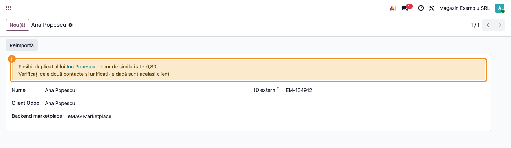
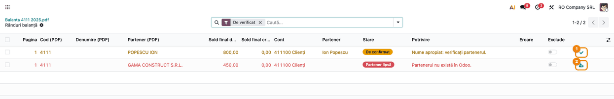

# Fișă Modul: Regulile comune de recunoaștere a partenerilor

**Modul:** `deltatech_partner_match`
**Utilizator principal:** Consultantul de implementare și administratorul bazei (modulul nu are ecrane
proprii; efectul îl văd operatorii modulelor care îl folosesc)
**Prioritate:** 🟡 Medie (decide dacă importul din marketplace refolosește un contact existent sau
creează unul nou și ce grupuri propune căutarea de dubluri; nu atinge sume sau conturi)

---

## 1. Scop business

Același partener ajunge în Odoo scris în mai multe feluri: telefonul `0722 913 456` și
`+40 722 913 456`, CUI-ul `RO 012.345` și `12345`, emailul `Maria.Ionescu@Example.com` și
`maria.ionescu@example.com`, numele „S.C. Popescu Ion S.R.L.” și „ion popescu srl”. Fiecare modul care
caută un partener existent (importul clienților din marketplace, căutarea dublurilor, importul
balanței) avea propriile reguli de comparare, deci același partener era recunoscut într-un modul și
nerecunoscut în altul.

`deltatech_partner_match` este un **modul tehnic** care ține într-un singur loc regulile după care
două fișe de partener se consideră „același partener”. **Nu are meniuri, ecrane, câmpuri, date sau
acțiuni programate și nu schimbă nimic singur.** Propune candidați, cu un scor și un motiv. Decizia
(refolosesc fișa, o semnalez ca posibil duplicat, o las neschimbată) rămâne la modulul care îl
folosește. Consultantul nu îl configurează. Trebuie doar să știe regulile, ca să explice clientului
de ce două fișe au fost sau n-au fost recunoscute ca același partener.

## 2. Bază legală și context

Nu există un temei legal propriu: modulul nu creează documente și nu face declarații. Regulile
reflectă formatul codurilor fiscale și al telefoanelor:

- **CUI / CNP**: se compară fără prefixul de țară și fără zerourile din față, deci `RO18547290`,
  `18547290` și `RO 18 547 290` sunt același cod. Cifra de control se verifică pentru CUI-ul
  românesc, pentru CNP (13 cifre) și pentru codurile de TVA din statele UE (biblioteca
  `python-stdnum`). Un cod din afara UE nu se poate verifica și nu e considerat greșit.
- **Telefon**: formatul internațional E.164 (`+40722913456`), după aceeași regulă pe care Odoo o
  folosește pentru câmpul ascuns `phone_sanitized` (modulul standard `phone_validation`): numărul
  trebuie să fie posibil și valid.
- **Email**: normalizat cu funcția standard Odoo `email_normalize` (litere mici, fără nume afișat,
  fără spații).

## 3. Utilizatori și roluri

Modulul nu are grupuri de drepturi și nu adaugă nimic în meniuri. Regulile lui lucrează cu drepturile
utilizatorului care folosește modulul apelant:

| Modul care îl folosește | Cine vede efectul | Drept necesar |
|---|---|---|
| `deltatech_partner_merge` | responsabilul cu nomenclatorul de parteneri | **Comasare parteneri / Pregătire și simulare** |
| `deltatech_marketplace` | responsabilul cu marketplace-ul | **Administrator marketplace** |
| `deltatech_ai_trial_balance_import` | contabilul care încarcă balanța de deschidere | **Contabilitate / Administrator** |

Rol recomandat la testare: administratorul, care vede toate cele trei module. Meniul **Comasare
parteneri** stă sub **Setări**, deci un utilizator care nu are acces la meniul **Setări** nu ajunge la
căutarea de dubluri doar cu grupul **Comasare parteneri / Pregătire și simulare** (detaliile
drepturilor sunt în fișa `deltatech_partner_merge`).

## 4. Conturi și date implicate

Modulul nu folosește conturi contabile și nu creează note contabile. Citește doar câmpurile fișei de
partener: **Nume**, **CUI** (`vat`), **Email**, **Telefon**, **Stradă**, **Localitate**, **Județ** și,
dacă e instalat `base_address_extended`, lista de localități (`res.city`).

Regulile, cu exemple verificate pe cod:

| Ce se compară | Regula | Exemplu |
|---|---|---|
| Nume | litere mici, fără diacritice, fără punctuație, fără formele juridice (SC, SRL, SA, PFA, II, IF, CMI, ONG, GmbH, Ltd, SARL, KFT, s.r.o. și altele), cuvintele sortate | „S.C. Popescu Ion S.R.L.” și „ion popescu srl” → `ion popescu` |
| Nume (excepții) | „SAS”, „AG”, „BV”, „NV”, „RA” **nu** se elimină, pentru că sunt și nume de familie sau inițiale | „Sas Vasile” rămâne `sas vasile` |
| CUI | doar litere și cifre, fără prefixul de țară, fără zerourile din față; sub 4 caractere nu e cod | „RO 012.345” → `12345` |
| Cifra de control | CUI românesc, CNP (13 cifre), cod de TVA UE | `RO18547290` corect, `RO18547291` greșit |
| Telefon | E.164 dacă numărul e valid; altfel, regulile formatelor românești (`0722…`, `0040…`, `40…`, `722…`) | „0722 123 456” → `+40722123456` |
| Telefon, comparat în masă | ultimele 9 cifre; un număr cu sub 7 cifre sau doar cu o cifră repetată (`0000000`) nu se compară | „+40 722 123 456” → `722123456` |
| Email | `email_normalize` | „ Maria.Ionescu@Example.com” → `maria.ionescu@example.com` |
| Stradă (căutarea de dubluri) | fără cuvintele de adresă (str, strada, nr, bl, sc, ap, et, bd, calea, șos, aleea, jud, sector și altele), cu cuvintele sortate | „Str. Lalelelor nr. 5” = „Strada Lalelelor 5” (`5 lalelelor`) |
| Stradă și localitate (scorul de la import) | toate cuvintele, orice punctuație fiind separator, cu procentul de cuvinte comune; „str”, „strada”, „nr” rămân cuvinte | „Str.Memorandumului 10” = „Str. Memorandumului 10” (1); „Str. Lalelelor nr. 5” față de „Strada Lalelelor 5” = 0,4 |

**Scorul unui candidat** (0–1), folosit de importul din marketplace:

- un candidat se caută **doar** după CUI, email sau telefon, niciodată după nume singur (altfel ar
  ieși fiecare „Ion Popescu” din bază);
- scorul combină numele (pondere **0,6**), strada (**0,25**) și localitatea (**0,15**). Strada și
  localitatea contează doar dacă sunt completate pe ambele părți; altfel ponderea lor se împarte pe
  celelalte. Exemplu: „Pop Ion”, „Strada Lalelelor 5”, „Cluj Napoca” față de „Ion Pop”,
  „Str. Lalelelor nr. 5”, „Cluj-Napoca”: nume 1, stradă 0,4 (2 din 5 cuvinte comune, pentru că aici
  „str”, „strada” și „nr” contează ca cuvinte diferite), localitate 1 → 0,6 × 1 + 0,25 × 0,4 +
  0,15 × 1 = **0,85**. Aceeași pereche de străzi e „aceeași stradă” în căutarea de dubluri, care
  folosește regula fără cuvintele de adresă;
- numele se compară cuvânt cu cuvânt: un nume de familie comun nu face două persoane asemănătoare
  („Ana Popescu” / „Ion Popescu” = 0,67; „Popescu Ion” / „Ion Popescu” = 1);
- **județul** contează doar când ambele părți au județ, județele diferă și **în ambele județe există o
  localitate cu acel nume** în lista de localități. Atunci strada și localitatea primesc 0. Exemplu:
  „Satu Nou” există și în Bacău, și în Iași, deci aceeași stradă din „Satu Nou, Iași” nu e adresa din
  „Satu Nou, Bacău”, iar scorul scade de la 1 la 0,6 (doar numele). Un județ care nu se potrivește
  cu localitatea („Sibiu” trecut în Timiș) e o greșeală de date și se ignoră. Fără lista de localități
  (`base_address_extended` neinstalat) sau cu un județ necunoscut, județul nu scade niciodată scorul.

Date minime pentru demo: o companie cu țara România și câțiva parteneri scriși diferit, ca în
exemplele de mai sus (aceiași parteneri ca în fișa `deltatech_partner_merge`: Ion Popescu / Popescu
Ion cu telefonul scris în două feluri, cele două fișe Maria Ionescu cu emailul cu litere diferite,
firmele Delta Agro cu CUI-ul scris cu și fără `RO`).

## 5. Configurare inițială

1. Modulul se instalează automat, ca dependență, odată cu `deltatech_partner_merge`,
   `deltatech_marketplace`, `deltatech_ai_trial_balance_import` sau `deltatech_ai_pdf_base` (deci și
   cu `deltatech_ai_purchase_pdf`). Nu are setări proprii.
2. Opțional, verificați cu administratorul de server că sunt instalate bibliotecile Python
   `phonenumbers`, `rapidfuzz` și `unidecode`. Fără ele rezultatele pe CUI, email și telefoanele
   românești rămân practic aceleași, iar telefoanele din alte țări scrise în format național nu se
   mai recunosc. Compararea numelor în masă e mai lentă, iar în căutarea de dubluri blocurile de
   peste 1.500 de parteneri (aceeași localitate) nu se mai compară: raportul căutării le listează. Căutarea de dubluri arată biblioteca folosită în
   câmpul **Motor** (`rapidfuzz` sau `difflib`).
3. Pentru regula județului, instalați `base_address_extended` și lista de localități (la
   `deltatech_marketplace` modulul e deja dependență). Fără ea, județul nu influențează scorul.

## 6. Flux de utilizare

Modulul nu are ecran propriu: fluxul de mai jos arată **unde se vede efectul regulilor**, în modulele
care îl folosesc. Capturile pașilor 1 și 2 sunt cele din fișa `deltatech_partner_merge`, generate pe
aceleași reguli (secțiunea 10).

### Pasul 1 — Căutarea de dubluri, cu criteriile pe CUI, telefon, email și nume

Cu `deltatech_partner_merge` instalat, deschideți **Setări → Comasare parteneri → Caută dubluri** și
apăsați **Nou**. Bifele **Același CUI**, **Același telefon**, **Același email** și **Nume asemănător**
folosesc regulile din secțiunea 4. **Asemănare nume (%)** (implicit 90) se aplică pe numele
normalizate: fără diacritice, fără forma juridică, cu cuvintele sortate. Implicit, două nume
asemănătoare se grupează doar dacă au și aceeași stradă sau același cod poștal (**Potrivire pe
nume**) și sunt în aceeași localitate (**Compară numele în cadrul**). Dacă adresele sunt în mare parte
goale, alegeți **Doar nume asemănător**. Apăsați **Caută**. Căutarea
nu modifică niciun partener.


### Pasul 2 — Citirea grupurilor: motivul arată regula aplicată

**Găsiți pe ecran:** în tab-ul **Grupuri**, coloana **Motive** arată valoarea **normalizată** pe care
s-au potrivit fișele: „același CUI 90000928” (fără `RO` și fără zerourile din față), „același email
maria.ionescu@example.com” (litere mici), „același telefon +40722913456” (format E.164), „nume 97% +
aceeași stradă”. Coloana **Scor** dă 100 pe CUI și email, 95 pe telefon și procentul asemănării pe
nume.

**Verificați** că regulile au lucrat:

- **Ion Popescu** și **Popescu Ion** sunt în același grup, cu motivul „același telefon +40722913456”,
  deși telefoanele sunt scrise `0722 913 456` și `+40 722 913 456`;
- cele două fișe **Maria Ionescu** sunt grupate pe email, deși unul are litere mari;
- **Delta Agro SRL** (`RO90000944`) și **Delta Agro S.R.L.** (`90000944`) sunt grupate pe
  „același CUI 90000944”, deși al doilea CUI e scris fără `RO`;
- **Gheorghe Vasilescu** și **Gheorghe Vasilesc** sunt grupate pe „nume 97% + aceeași stradă”, cu
  strada scrisă „Str. Lalelelor nr. 5” și „Strada Lalelelor 5”;
- **Andrei Marin** și **Elena Marin** sunt grupați pe „același telefon +40268412345”: regulile
  propun perechea, dar sunt doi oameni din aceeași familie. Operatorul o închide cu **Nu sunt
  dubluri**. Modulul doar propune, nu decide.

Restul fluxului (îmbinarea, „Nu sunt dubluri”, loturile de comasare) e descris în fișa
`deltatech_partner_merge`.


### Pasul 3 — Importul clienților din marketplace: contact refolosit sau „Posibil duplicat al”

Cu `deltatech_marketplace` instalat, deschideți **Marketplace → Backend-uri**, alegeți backend-ul, tab-ul
**Comenzi și produse**, grupul **Parteneri**:

- **Potrivește contactele asemănătoare** (bifat implicit) pornește căutarea cu regulile acestui modul
  pentru persoanele fizice negăsite exact după nume și email / telefon;
- **Prag de potrivire** (implicit 0,85): de la acest scor, și cu numele asemănător cel puțin 0,8, se
  refolosește contactul existent;
- **Prag posibil duplicat** (implicit 0,60): între cele două praguri se creează un contact nou, iar
  clientul din marketplace e marcat ca posibil duplicat.

La import, candidații se caută doar după **email și telefon** (nu după CUI) și doar printre
persoanele fizice. Deschideți apoi **Marketplace → Asocieri → Clienți**; filtrul **Posibile duplicate** arată clienții
marcați. Deschideți unul.
**Găsiți pe ecran** bannerul galben **„Posibil duplicat al lui <contact> - scor de similaritate
<scor>”**. **Verificați** cele două contacte (nume, adresă, județ). Dacă sunt același client,
unificați-le cu **Setări → Comasare parteneri → Caută dubluri** (pașii 1–2) sau cu asistentul
standard **Îmbină contacte**.



În captură, clienta Ana Popescu are același telefon cu Ion Popescu, dar alt nume: scorul 0,80 e
între **Prag posibil duplicat** (0,60) și **Prag de potrivire** (0,85), deci s-a creat un contact nou,
iar bannerul (1) trimite la contactul existent. Formularul nu arată telefonul și adresa: le vedeți
pe cele două contacte.

### Pasul 4 — Importul balanței din PDF: potrivirea partenerilor pe CUI și nume

Cu `deltatech_ai_trial_balance_import` instalat, pe o sincronizare din **Facturare → Configurare →
Contabilitate → Sincronizare plan de conturi**, după **Încarcă balanța din PDF (AI)**, fiecare rând de
balanță pe partener se potrivește cu un partener din Odoo:

1. după CUI, normalizat ca în secțiunea 4. Un CUI care nu trece cifra de control e considerat citit
   greșit din PDF și nu se folosește;
2. după numele exact, fără diacritice, punctuație și forma juridică, **cu cuvintele în ordinea lor**
   („Alfa Beta” și „Beta Alfa” pot fi două firme);
3. după un nume apropiat, cu cuvintele în orice ordine, doar ca propunere de confirmat.

**Găsiți pe ecran** nota de pe rând: „Același nume, alt cod fiscal în Odoo.”, „Nume apropiat:
verificați partenerul.”, „Nume apropiate: alegeți partenerul.”, „Mai mulți parteneri au codul fiscal
…”, „Mai mulți parteneri se numesc …”, „Partenerul nu există în Odoo.”. **Verificați** propunerile din butonul **De verificat**, apoi
**Confirmă propunerile**. Un partener lipsă nu se creează automat.



În captură, rândul POPESCU ION e potrivit după un nume apropiat cu partenerul „Ion Popescu” și
așteaptă confirmarea (1); rândul GAMA CONSTRUCT S.R.L. nu are partener în Odoo, iar butonul (2) îl
creează doar la cerere.

### Note de monografie și raportare

Modulul nu generează note contabile și nu modifică documente. Efectul lui contabil e indirect: dacă
importul din marketplace refolosește contactul corect, facturile și încasările clientului stau pe o
singură fișă (4111), iar dacă importul balanței găsește partenerul corect, soldul de deschidere
ajunge pe fișa lui.

## 7. Legături cu alte module / declarații

| Modul | Ce folosește din `deltatech_partner_match` | Unde se vede |
|---|---|---|
| `deltatech_partner_merge` | normalizarea numelui, CUI-ului, telefonului, emailului, străzii și localității; compararea numelor în masă (`similar_pairs`) | **Setări → Comasare parteneri → Caută dubluri**, coloanele **Scor** și **Motive** |
| `deltatech_marketplace` | `res.partner._find_similar_partners` pe email și telefon, cu scorul nume / stradă / localitate / județ | backend: **Potrivește contactele asemănătoare** și pragurile; client: bannerul **Posibil duplicat al lui** |
| `deltatech_ai_trial_balance_import` | normalizarea CUI-ului și a numelui (cu cuvintele în ordine), cifra de control a CUI-ului | notele de pe rândurile balanței, butonul **De verificat** |
| `deltatech_ai_pdf_base` (și `deltatech_ai_purchase_pdf`) | cifra de control a CUI / CNP / TVA UE | verificarea codului fiscal citit din PDF |

**Ce e automat:** normalizarea, selecția candidaților după CUI / email / telefon și scorul lor.

**Ce rămâne manual:** decizia. Modulul nu unifică, nu creează și nu modifică parteneri. Importul din
marketplace refolosește automat doar peste pragul setat pe backend; căutarea de dubluri și importul
balanței lasă decizia operatorului.

## 8. Verificări pentru consultant

- [ ] Modulul apare instalat (**Aplicații**, filtrul **Instalate**, căutare „Partner Match”) pe orice
      bază care are `deltatech_partner_merge`, `deltatech_marketplace`,
      `deltatech_ai_trial_balance_import` sau `deltatech_ai_pdf_base`.
- [ ] În **Setări → Comasare parteneri → Caută dubluri**, după **Caută**, două fișe cu telefonul scris
      `0722 913 456` și `+40 722 913 456` sunt în același grup, cu motivul
      „același telefon +40722913456”.
- [ ] Două firme cu CUI-ul `RO18547290` și `18547290` sunt grupate pe „același CUI 18547290”.
- [ ] Două fișe cu emailul scris cu litere diferite sunt grupate pe email, cu emailul cu litere mici.
- [ ] „Ana Popescu” și „Ion Popescu”, cu același telefon, **nu** sunt refolosite una pentru alta la
      importul din marketplace (numele are scor 0,67, sub 0,8).
- [ ] Câmpul **Motor** al căutării arată `rapidfuzz` pe server (altfel, `difflib`: e corect, dar mai
      lent).
- [ ] Pe un backend de marketplace, **Prag posibil duplicat** ≤ **Prag de potrivire** ≤ 1 (altfel
      salvarea e refuzată).
- [ ] Un client marketplace marcat **Posibil duplicat al lui** are un contact propriu nou, iar
      contactul existent indicat în banner a rămas neschimbat.

## 9. Mesaje de eroare frecvente

Modulul nu are mesaje proprii. Situațiile de mai jos sunt cele în care consultantul e întrebat „de ce
n-a recunoscut partenerul”:

| Mesaj / situație | Cauză | Remediere |
|---|---|---|
| Două fișe cu același nume nu sunt găsite ca duplicat la importul din marketplace | candidații se caută doar după email și telefon; numele singur nu selectează pe nimeni | completați telefonul sau emailul pe fișa existentă |
| Același telefon, dar contactul nu e refolosit; apare **Posibil duplicat al lui** | scorul e între **Prag posibil duplicat** și **Prag de potrivire**, sau numele are sub 0,8 (rudă care folosește același telefon) | verificați cele două contacte și unificați-le manual dacă sunt aceeași persoană |
| Aceeași adresă, dar scor mic (0,6) la import | județele diferă și ambele au o localitate cu acel nume („Satu Nou” în Bacău și în Iași) | normal: e altă adresă; dacă județul fișei e greșit, corectați-l |
| Un telefon nu e grupat cu același număr scris altfel | numărul are sub 7 cifre sau e o valoare de umplutură (`0000000`) | corectați telefonul pe fișă |
| „Mai mulți parteneri au codul fiscal …” la importul balanței | CUI-ul, normalizat, e pe mai multe fișe | unificați fișele (`deltatech_partner_merge`) sau alegeți partenerul pe rând |
| „Mai mulți parteneri se numesc …” la importul balanței | numele normalizat e pe mai multe fișe | alegeți partenerul pe rând sau unificați fișele |
| Două nume aproape identice nu sunt grupate în căutarea de dubluri | implicit se cere și aceeași stradă sau cod poștal, în aceeași localitate | alegeți **Doar nume asemănător** sau completați adresele |
| Un CUI din PDF nu se potrivește, deși partenerul există | CUI-ul citit nu trece cifra de control (citit greșit) | corectați CUI-ul pe rând sau alegeți partenerul manual |
| „Pragurile de potrivire a contactelor trebuie să respecte 0 <= posibil duplicat <= potrivire <= 1.” la salvarea backend-ului | pragurile nu sunt în ordine | puneți **Prag posibil duplicat** ≤ **Prag de potrivire** ≤ 1 |

## 10. Capturi de ecran

Modulul nu are ecrane proprii, iar efectul lui se vede în modulele care îl folosesc. Capturile din
`static/description/` sunt luate din acele module, în română, pe planul de conturi RO, pe aceleași
reguli de potrivire:

| Pasul | Fișier | Ce arată | Sursa |
|---|---|---|---|
| 1 | `01_cautare_dubluri_ciorna.png` | formularul unei căutări de dubluri, cu criteriile pe CUI, telefon, email și nume | `deltatech_partner_merge/tests/test_screenshots.py` |
| 2 | `02_cautare_dubluri_grupuri.png` | grupurile găsite, cu scorul și motivul normalizat | `deltatech_partner_merge/tests/test_screenshots.py` |
| 3 | `03_marketplace_posibil_duplicat.png` | clientul din marketplace marcat „Posibil duplicat al”, cu scorul | captură din `deltatech_marketplace` |
| 4 | `04_balanta_potrivire_parteneri.png` | rândurile de balanță pe parteneri de verificat: nume apropiat și partener lipsă | `deltatech_ai_trial_balance_import/tests/test_screenshots.py` (`10_parteneri_de_verificat.png`) |

Captura 3 e făcută cu traducerea bannerului și spațiile dintre texte corectate local: în
`deltatech_marketplace` actual, bannerul apare în engleză („Possible duplicate of … - similarity
score …”) și textele se lipesc de câmpuri, până la corectura din acel modul (secțiunea 11).

Capturile 1, 2 și 4 sunt copii ale celor din modulele sursă: la o regenerare acolo, se copiază din
nou aici. Regenerarea pentru pașii 1–2:

```bash
./odoo/odoo-bin -c odoo.conf -d test19 -i deltatech_partner_merge \
    --test-tags=/deltatech_partner_merge:TestPartnerMergeScreenshots --stop-after-init
```

## 11. Observații pentru manual

- În `deltatech_marketplace`, bannerul „Posibil duplicat al lui … - scor de similaritate …” nu e
  tradus (termenii lipsesc din `.pot`, deci intrările din `ro.po` sunt ignorate) și textele se lipesc
  de câmpuri („al luiIon Popescu”). Până la corectură, pe ecran apare textul în engleză.
- Modulul nu are un capitol propriu în manual. Regulile din secțiunea 4 se citează în capitolele
  modulelor care îl folosesc (comasarea partenerilor, importul din marketplace, importul balanței).
- Mesajul pentru client: „Odoo recunoaște același partener după CUI, email sau telefon, oricum ar fi
  scrise. Numele singur nu e suficient, iar decizia de a unifica două fișe rămâne la dumneavoastră.”
- Pragurile importului din marketplace (0,85 / 0,60) și pragul căutării de dubluri (90%) țin de
  modulele respective, nu de acest modul.
- Regula județului (versiunea 19.0.1.3.0, `readme/HISTORY.md`): pe o bază de 528.000 de parteneri,
  2,1% aveau un județ care nu se potrivea cu localitatea. Acum acest județ greșit nu mai scade
  scorul.
- Testele automate ale regulilor: `deltatech_partner_match/tests/test_partner_match_tools.py` și
  `tests/test_find_similar_partners.py` (20 de teste, toate trecute pe baza `test19_fisa_pm`).
