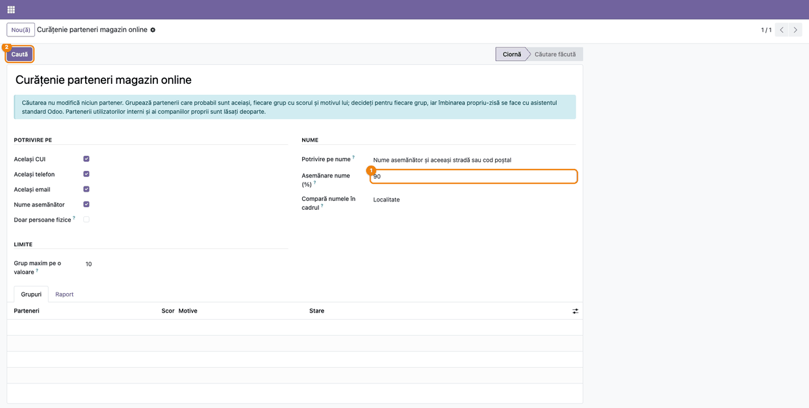
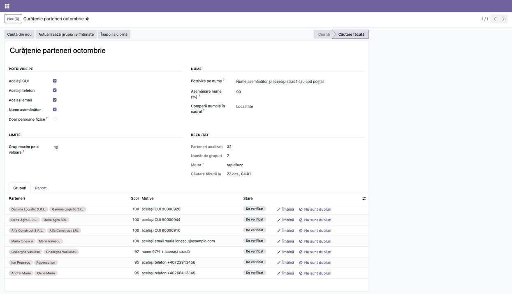
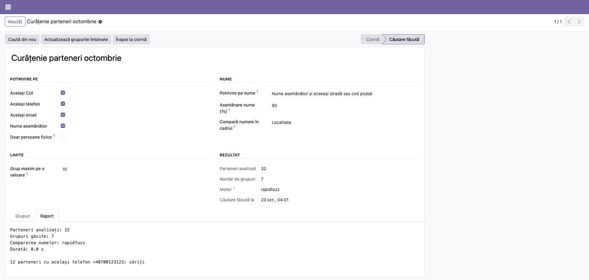
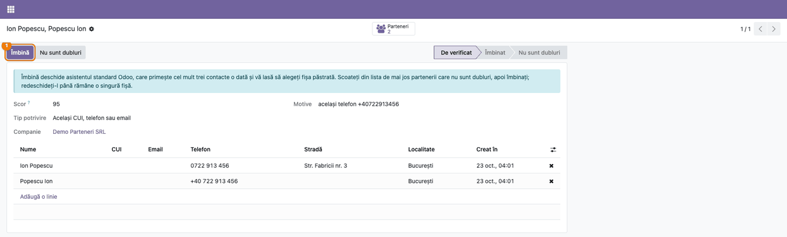
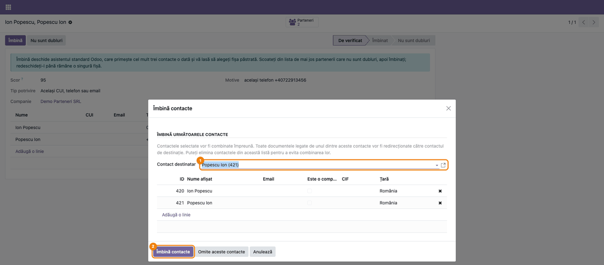
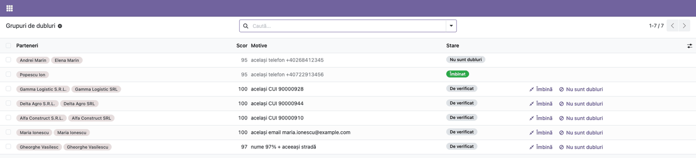
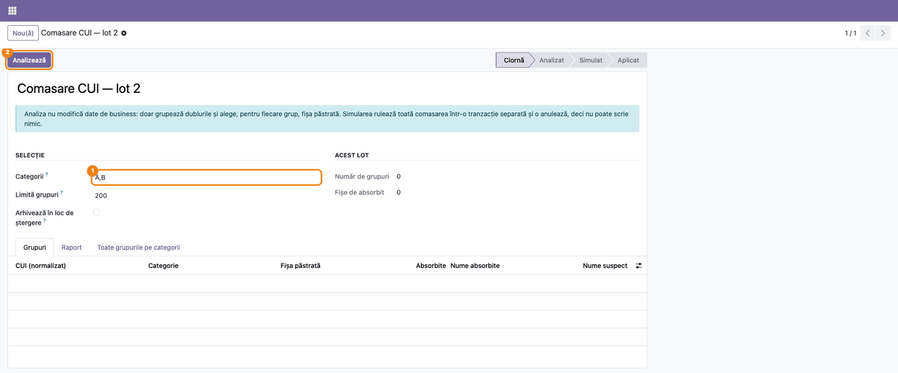
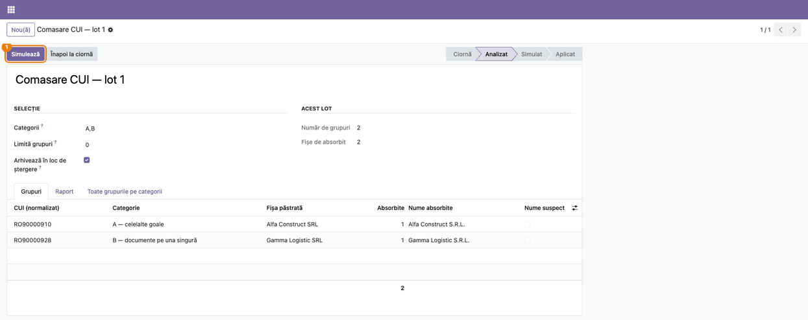
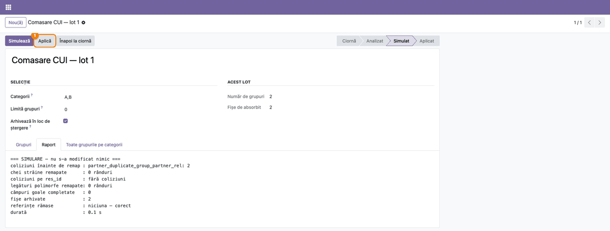
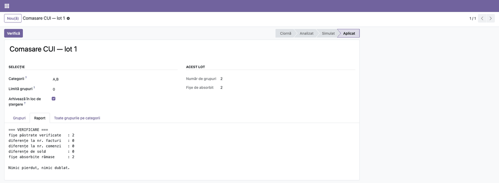

# Fișă Modul: Găsirea și comasarea partenerilor duplicați

**Modul:** `deltatech_partner_merge`
**Utilizator principal:** Administratorul bazei sau responsabilul cu nomenclatorul de parteneri (membru
al grupului **Comasare parteneri / Pregătire și simulare**), împreună cu contabilul pentru grupurile cu
documente contabile pe mai multe fișe
**Prioritate:** 🟡 Medie (dublurile strică rapoartele pe client, istoricul de vânzări și potrivirea
plăților, dar curățenia se face rar, la import sau după o perioadă de vânzări online)

---

## 1. Scop business

Fișele duplicate de parteneri apar mai ales la import și la comenzile online. Aceeași persoană fizică
cumpără de două ori și primește două fișe: o dată cu telefonul scris `0722 913 456`, a doua oară cu
`+40 722 913 456`. Același client persoană juridică ajunge introdus o dată cu CUI-ul `RO12345678` și
o dată cu `12345678`. Rezultatul: istoricul clientului e rupt în două, soldul lui apare pe două fișe,
iar rapoartele pe client nu mai spun adevărul.

Modulul are două unelte, care se completează:

- **Caută dubluri** găsește partenerii probabil duplicați după CUI, telefon, email și nume asemănător
  la aceeași adresă. Fiecare grup găsit are un scor și un motiv. Nimic nu se îmbină automat:
  operatorul decide pentru fiecare grup, iar îmbinarea se face cu asistentul standard Odoo
  **Îmbină contacte**, în care alege fișa păstrată. Potrivit pentru zeci sau sute de grupuri, mai ales
  la persoanele fizice.
- **Loturi de comasare** comasează în masă partenerii persoane juridice care au **același CUI**, pe
  loturi de sute de grupuri, cu simulare înainte și verificare după. Asistentul standard Odoo ia
  grupurile pe rând și, pe o bază mare, nu termină într-un timp rezonabil. Lotul face aceeași
  operație pentru toate grupurile deodată.

## 2. Bază legală și context

Nu există un temei legal propriu. Contextul este cel al evidenței pe parteneri: soldul unui client sau
al unui furnizor (conturile 4111, 401) trebuie să stea pe o singură fișă, ca fișa partenerului,
confirmarea de sold și scadențarul să fie corecte. Comasarea mută documentele de pe fișele absorbite
pe fișa păstrată și nu modifică sumele sau conturile documentelor.

Documentele deja transmise în afara Odoo (facturi trimise prin e-Factura, declarații depuse) rămân la
ANAF cu datele partenerului de la momentul transmiterii (secțiunea 11).

## 3. Utilizatori și roluri

| Rol | Ce face | Drept Odoo |
|---|---|---|
| Administrator | are toate drepturile modulului implicit; îmbină și fișele cu emailuri diferite, pe care asistentul standard le refuză celorlalți utilizatori | **Administrare / Setări** (`base.group_system`) |
| Responsabil nomenclator | rulează căutări de dubluri, marchează grupurile „nu sunt dubluri”, analizează și simulează loturi | **Comasare parteneri / Pregătire și simulare** (`deltatech_partner_merge.group_partner_merge_prepare`) |
| Responsabil nomenclator cu drept de îmbinare | apasă **Îmbină** pe un grup găsit și finalizează îmbinarea în asistentul standard, doar pentru fișe cu același email (sau toate fără email) | în plus, **Contact: Creare** (`base.group_partner_manager`) |
| Responsabil comasare în masă | aplică un lot simulat (șterge sau arhivează fișe) | **Comasare parteneri / Aplicare** (`deltatech_partner_merge.group_partner_merge_apply`) |
| Contabil | decide pentru grupurile din categoriile C și D ale lotului (facturi sau sold pe mai multe fișe) | — (consultat, nu operează) |

Grupurile modulului se dau din **Setări → Utilizatori și companii → Utilizatori**, pe fișa
utilizatorului: cu **modul dezvoltator** activat, secțiunea **Extra drepturi**. Fără modul
dezvoltator, secțiunea nu apare.

Asistentul standard Odoo compară emailurile fișelor ca text exact, deci contează și literele mari și
un email lipsă: un utilizator care nu e administrator poate îmbina doar fișe cu același email (sau
toate fără email). Grupurile în care fișele au emailuri diferite, inclusiv unul lipsă sau scris cu alte
litere (ca la cele două fișe **Maria Ionescu**), le îmbină administratorul, sau se uniformizează întâi
emailul pe fișe.

Roluri recomandate pentru testare: administratorul și un utilizator intern doar cu grupul
**Comasare parteneri / Pregătire și simulare**, care vede căutările și loturile, dar nu vede butonul
**Îmbină** și nu poate aplica un lot.

## 4. Conturi și date implicate

Modulul nu are conturi proprii și nu creează note contabile. La comasare, documentele fișelor absorbite
(facturi, plăți, comenzi, livrări) trec pe fișa păstrată, cu aceleași sume și aceleași conturi
(secțiunea 6, „Note de monografie și raportare”).

Date minime pentru demo (folosite și în capturi), pe compania **Demo Parteneri SRL**, plan de conturi
RO, monedă RON:

- Persoane fizice duplicate:
  - **Ion Popescu** (telefon `0722 913 456`) și **Popescu Ion** (telefon `+40 722 913 456`): același
    telefon scris diferit;
  - **Maria Ionescu** (`Maria.Ionescu@Example.com`) și **Maria Ionescu** (`maria.ionescu@example.com`):
    același email cu litere diferite;
  - **Gheorghe Vasilescu** și **Gheorghe Vasilesc**, amândoi pe **Str. Lalelelor nr. 5** / **Strada
    Lalelelor 5**, Cluj-Napoca: nume asemănător la aceeași stradă;
  - un al treilea **Gheorghe Vasilescu**, pe altă stradă din Cluj-Napoca: nu e propus ca dublură.
- Persoane juridice cu același CUI:
  - **Alfa Construct SRL** (`RO90000910`, cu o factură de client postată) și **Alfa Construct S.R.L.**
    (`RO 90000910`);
  - **Gamma Logistic SRL** (`RO90000928`) și **Gamma Logistic S.R.L.** (`ro90000928`);
  - **Delta Agro SRL** (`RO90000944`) și **Delta Agro S.R.L.** (`90000944`, fără prefixul RO).
- **Andrei Marin** și **Elena Marin**, din Brașov, cu același telefon fix `0268 412 345`: o familie, nu
  dublură; exemplul pentru **Nu sunt dubluri** (pasul 5).
- **Beta Distribuție SRL** cu adresa de facturare **Beta Distribuție – facturare**, ambele cu emailul
  `office@beta-distributie.ro`: adresă a aceluiași client, nu dublură.
- 12 parteneri cu același telefon de centrală `0700 123 123`: valoare comună prea multor parteneri,
  lăsată deoparte și raportată.

## 5. Configurare inițială

1. Instalați `deltatech_partner_merge`. Modulul depinde doar de `base`.
2. Opțional, pe server: bibliotecile Python `rapidfuzz` (compararea rapidă a numelor), `phonenumbers`
   (telefonul în format internațional) și `unidecode` (eliminarea diacriticelor). Fără ele, modulul
   funcționează, dar compară numele mai încet și doar în blocuri de cel mult 1.500 de parteneri
   (secțiunea 11).
3. Dați grupurile din secțiunea 3 utilizatorilor care fac curățenia, dacă nu sunt administratori.
4. Înainte de un lot de comasare pe o bază mare, faceți o copie de siguranță a bazei și alegeți
   **Arhivează în loc de ștergere** la primele rulări (pasul 7).

## 6. Flux de utilizare

### Partea A — Căutarea partenerilor probabil duplicați

### Pasul 1 — O căutare nouă și criteriile ei

Deschideți **Setări → Comasare parteneri → Caută dubluri** și apăsați **Nou**. Alegeți criteriile:

1. **Potrivire pe**: **Același CUI**, **Același telefon**, **Același email**, **Nume asemănător**. Toate
   sunt bifate implicit. **Doar persoane fizice** lasă deoparte companiile.
2. **Nume** (apare doar cu **Nume asemănător** bifat):
   - **Potrivire pe nume**: **Nume asemănător și aceeași stradă sau cod poștal** (implicit) sau **Doar
     nume asemănător**. Varianta implicită evită perechile false la numele uzuale (doi oameni diferiți
     cu numele Ion Popescu în același oraș);
   - **Asemănare nume (%)**: pragul de la care două nume se consideră asemănătoare, implicit 90;
   - **Compară numele în cadrul**: **Localitate** (implicit) sau **Primele litere ale numelui**. Numele
     se compară doar în interiorul aceluiași bloc, ca baza să nu fie comparată fiecare cu fiecare.
3. **Limite** → **Grup maxim pe o valoare**: un telefon, un email sau un CUI comun mai multor parteneri
   decât această valoare (implicit 10) e sărit. De obicei e o centrală sau o valoare de umplutură.

Apăsați **Caută**. Căutarea nu modifică niciun partener.



### Pasul 2 — Grupurile găsite

După căutare, formularul arată în **Rezultat** câți parteneri au fost analizați, câte grupuri s-au
găsit, biblioteca folosită la compararea numelor (**Motor**: `rapidfuzz` sau `difflib`) și data
căutării. Tab-ul **Grupuri** are câte un rând pentru fiecare grup.

**Găsiți pe ecran:** în coloana **Parteneri**, fișele din grup; în **Scor**, cea mai puternică
potrivire din grup (100 pentru același CUI sau email, 95 pentru același telefon, procentul asemănării
pentru nume); în **Motive**, de ce au fost grupate, cu valoarea găsită („același telefon
+40722913456”, „nume 97% + aceeași stradă”).

**Verificați**, înainte să îmbinați:

- partenerii din grup sunt într-adevăr aceeași persoană sau aceeași firmă (citiți motivul, nu doar
  scorul);
- un grup pe telefon sau email nu e de fapt o familie sau o firmă cu mai mulți angajați pe același
  număr;
- în grup nu sunt două firme cu CUI diferit, nici o firmă și o persoană fizică: un astfel de grup nu
  se îmbină (marcați **Nu sunt dubluri** sau scoateți fișa din grup), pentru că îmbinarea ar muta
  facturile de la o entitate juridică la alta;
- rândurile marcate cu galben au mai mult de trei parteneri: asistentul standard îi ia câte trei,
  deci îmbinarea se face în mai mulți pași (pasul 4).

Din fiecare rând, **Îmbină** deschide asistentul standard (pasul 4), iar **Nu sunt dubluri** închide
grupul (pasul 5).



### Pasul 3 — Raportul căutării

Tab-ul **Raport** rezumă căutarea: partenerii analizați, grupurile găsite, motorul de comparare și
durata. Sub rezumat sunt listate valorile sărite (de exemplu telefonul `0700 123 123`, comun la 12
parteneri, apare ca „12 parteneri cu același telefon +40700123123: săriți”) și blocurile de nume necomparate pentru că erau prea mari.

**Verificați** că valorile sărite sunt într-adevăr centrale sau valori de umplutură. Dacă un telefon
real e sărit, măriți **Grup maxim pe o valoare** și apăsați **Caută din nou**.



### Pasul 4 — Îmbinarea unui grup

Deschideți grupul din tab-ul **Grupuri** (sau din **Setări → Comasare parteneri → Grupuri de dubluri**).
Formularul grupului arată scorul, motivele și lista partenerilor, cu CUI, email, telefon, stradă,
localitate și data creării. Dacă un partener din listă nu e dublură, scoateți-l din grup înainte de
îmbinare.

Apăsați **Îmbină**. Se deschide asistentul standard Odoo **Îmbină contacte**, cu partenerii grupului
(cel mult trei o dată). În asistent:

1. alegeți **Contact destinatar**, fișa care rămâne. Asistentul propune fișa activă cea mai veche;
   alegeți-o pe cea cu numele și datele corecte;
2. apăsați **Îmbină contacte**. **Omite aceste contacte** trece la ecranul final fără să îmbine nimic; apăsați **Închide**.

Documentele fișelor absorbite trec pe fișa păstrată, iar fișele absorbite sunt șterse. La un grup cu
mai mult de trei parteneri, redeschideți **Îmbină** până rămâne o singură fișă. Grupul trece în starea
**Îmbinat** la următoarea apăsare pe **Îmbină** (apare mesajul „Nu mai e nimic de îmbinat în acest
grup.”) sau când apăsați **Actualizează grupurile îmbinate** pe formularul căutării.





### Pasul 5 — Grupurile care nu sunt dubluri și urmărirea lucrului

Pe un grup care nu e dublură, apăsați **Nu sunt dubluri**. Grupul trece în starea **Nu sunt dubluri**,
iar perechile lui sunt reținute: căutările următoare nu le mai propun. **Verifică din nou** pe un astfel
de grup îl readuce la **De verificat** și uită perechile reținute.

Grupurile nu se șterg din listă: un grup șters ar dispărea fără să rețină perechile, deci folosiți
**Nu sunt dubluri**.

Lista **Setări → Comasare parteneri → Grupuri de dubluri** arată toate grupurile, din toate căutările.
Implicit e filtrată pe **De verificat**. Scoateți filtrul ca să vedeți și grupurile îmbinate și pe cele
marcate „nu sunt dubluri”. Pe formularul căutării, **Actualizează grupurile îmbinate** trece în
**Îmbinat** grupurile rămase cu o singură fișă.



### Partea B — Comasarea în masă pe același CUI

### Pasul 6 — Un lot nou

Deschideți **Setări → Comasare parteneri → Loturi de comasare** și apăsați **Nou**. Completați:

1. **Categorii**: ce grupuri intră în lot, separate prin virgulă, implicit `A,B`:
   - **A** — o fișă are documentele, celelalte sunt goale;
   - **B** — documente pe o singură fișă;
   - **C** — facturi pe mai multe fișe;
   - **D** — sold nereconciliat pe mai multe fișe.

   C și D schimbă cifre contabile pe fișa partenerului: le tratați cu contabilul, după închiderea lunii.
2. **Limită grupuri**: câte grupuri intră în lot, implicit 200; 0 = toate cele eligibile. Pasul de eliminare a
   coliziunilor are un cost fix de circa 40 de secunde, deci loturile foarte mici sunt ineficiente.
3. **Arhivează în loc de ștergere**: fișele absorbite sunt dezactivate, nu șterse. Recomandat la
   primele rulări în producție.

Dacă apare avertismentul despre coloane fără index, apăsați **Creează indexurile** înainte de lot:
fără ele, ștergerea fișelor e foarte lentă.

Apăsați **Analizează**. Analiza nu modifică date de business: grupează partenerii cu același CUI și
alege, pentru fiecare grup, fișa păstrată.



### Pasul 7 — Lotul analizat

După analiză, lotul are starea **Analizat**. Tab-ul **Grupuri** are câte un rând pentru fiecare grup.

**Găsiți pe ecran:** **CUI (normalizat)**, cu litere mari și fără spații sau semne; **Categorie**; **Fișa
păstrată**, aleasă după volumul de documente (cele mai multe facturi, apoi cele mai multe comenzi de
vânzare, apoi cea mai veche); **Absorbite** și **Nume absorbite**. În **Acest lot**, numărul de
grupuri și de fișe de absorbit.

**Verificați:**

- fișa păstrată are numele corect; rândurile marcate cu galben (coloana **Nume suspect**) au un
  nume care pare stricat la import și se corectează manual după comasare, cu numele din **Nume
  absorbite**;
- în tab-ul **Toate grupurile pe categorii**, câte grupuri au rămas în afara lotului și din ce motiv
  (categoriile C și D, grupurile blocate).



### Pasul 8 — Simularea

Apăsați **Simulează**. Simularea rulează toată comasarea într-o tranzacție separată și o anulează la
final, deci nu poate scrie nimic. Lotul trece în **Simulat**, iar tab-ul **Raport** arată ce ar face
aplicarea.

Liniile „coliziuni” numesc tabelele în care legături duplicate către același partener se elimină
automat; nu cer nicio acțiune.

**Verificați în raport:** prima linie este **SIMULARE — nu s-a modificat nimic**; **referințe rămase**
este **niciuna — corect**; numărul de fișe șterse sau arhivate este cel din **Fișe de absorbit**.

Abia apoi apăsați **Aplică** și confirmați. Aplicarea refuză să termine dacă rămâne vreo referință
către o fișă absorbită.



### Pasul 9 — Verificarea după aplicare

După **Aplică**, lotul are starea **Aplicat**. Apăsați **Verifică**. Verificarea compară, pentru fiecare
fișă păstrată, numărul de facturi, numărul de comenzi de vânzare și soldul nereconciliat cu cele
reținute la analiză, pentru tot grupul.

**Verificați în raport:** toate liniile de diferențe sunt 0, **fișe absorbite rămase** este 0 (sau
numărul fișelor arhivate, dacă ați bifat **Arhivează în loc de ștergere**), iar ultima linie este
**Nimic pierdut, nimic dublat.** Dacă apare **DIFERENȚE GĂSITE**, nu mai rulați alte
loturi până nu lămuriți diferența.



### Note de monografie și raportare

Modulul nu generează note contabile și nu modifică sumele sau conturile notelor existente. La comasare,
fie prin asistentul standard, fie prin lot, se schimbă doar partenerul de pe documente: liniile din
4111, 401 și celelalte conturi ale fișelor absorbite trec pe fișa păstrată, cu aceleași sume.

De aceea:

- soldul total al conturilor 4111 și 401 rămâne același, iar soldul unui grup se regăsește, după
  comasare, pe fișa păstrată;
- fișa partenerului, scadențarul și confirmarea de sold arată după comasare istoricul tuturor fișelor
  grupului;
- la categoriile C și D, potrivirea plăților cu facturile se face după comasare, pe fișa păstrată, de
  contabil;
- dacă s-ar îmbina două firme cu CUI diferit, facturile postate ar trece de la o entitate juridică la
  alta, iar o declarație D394 sau D300 regenerată pentru o perioadă trecută ar ieși altfel decât cea
  depusă. De aceea astfel de grupuri nu se îmbină (pasul 2).

## 7. Legături cu alte module / declarații

| Modul / proces | Rol în flux | Tip legătură |
|---|---|---|
| `base` | partenerii și asistentul standard **Îmbină contacte** | dependență (manifest) |
| `account`, `sale` | facturile, soldul și comenzile numărate la analiza și la verificarea lotului | opțional (citite dacă sunt instalate) |
| `rapidfuzz`, `phonenumbers`, `unidecode` | compararea rapidă a numelor, telefonul internațional, eliminarea diacriticelor | bibliotecă Python opțională |
| `deltatech/scripts/partner_merge/` | aceeași procedură de lot ca scripturi SQL, pentru rulare în afara Odoo | proces |
| e-Factura / declarații depuse | documentele deja transmise nu se modifică | proces |

**Ce e automat:**
- gruparea după CUI, telefon, email și nume asemănător, cu scor și motiv;
- excluderea partenerilor utilizatorilor interni și ai companiilor proprii, a unui partener față de
  propriile contacte, a adreselor de facturare și de livrare ale aceluiași client și a partenerilor
  din companii diferite;
- reținerea perechilor marcate „nu sunt dubluri” între căutări;
- la lot: alegerea fișei păstrate, simularea, mutarea documentelor și verificarea.

**Ce rămâne manual:**
- decizia pentru fiecare grup găsit de căutare (**Îmbină** sau **Nu sunt dubluri**) și alegerea fișei
  păstrate în asistentul standard;
- grupurile de lot din categoriile C și D, cu contabilul;
- corectarea numelui pe fișele păstrate marcate în coloana **Nume suspect**;
- partenerii cu utilizatori de portal pe mai multe fișe, pe care Odoo nu îi îmbină.

## 8. Verificări pentru consultant

- [ ] Un utilizator doar cu **Comasare parteneri / Pregătire și simulare** vede **Caută dubluri** și
      **Loturi de comasare**, dar nu vede butoanele **Îmbină** (pe grup) și **Aplică** (pe lot).
- [ ] Un utilizator cu **Contact: Creare**, care nu e administrator, nu poate îmbina cele două fișe
      **Maria Ionescu** (emailuri scrise diferit); administratorul le poate îmbina.
- [ ] Căutarea grupează **Ion Popescu** (`0722 913 456`) cu **Popescu Ion** (`+40 722 913 456`), cu
      motivul „același telefon”.
- [ ] Căutarea grupează cele două fișe **Maria Ionescu** cu emailuri care diferă doar prin litere mari.
- [ ] Căutarea grupează **Delta Agro SRL** (`RO90000944`) cu **Delta Agro S.R.L.** (`90000944`), deși
      CUI-ul al doilea nu are prefixul RO.
- [ ] **Gheorghe Vasilescu** și **Gheorghe Vasilesc** de pe aceeași stradă sunt grupați cu motivul
      „nume …% + aceeași stradă”, iar al treilea Gheorghe Vasilescu, de pe altă stradă, nu e în grup.
- [ ] Partenerul unui utilizator intern și partenerul companiei nu apar în niciun grup.
- [ ] **Beta Distribuție SRL** și adresa ei de facturare, cu același email, nu sunt propuse ca dubluri.
- [ ] Telefonul `0700 123 123`, comun la 12 parteneri, nu formează un grup și apare în **Raport**.
- [ ] **Îmbină** deschide asistentul standard cu partenerii grupului; după îmbinare, **Actualizează
      grupurile îmbinate** trece grupul în **Îmbinat**.
- [ ] Un grup cu patru parteneri deschide asistentul cu doar trei; după prima îmbinare, **Îmbină** se
      poate apăsa din nou.
- [ ] Grupul **Andrei Marin / Elena Marin**, marcat **Nu sunt dubluri**, nu mai apare la **Caută din
      nou**.
- [ ] Lotul pe CUI: după **Analizează**, grupul Alfa Construct e în categoria **A**, cu fișa care are
      factura drept fișă păstrată, iar Gamma Logistic e în categoria **B**. Delta Agro nu e în lot
      (secțiunea 11).
- [ ] Raportul **Simulează** începe cu **SIMULARE — nu s-a modificat nimic** și are **referințe rămase:
      niciuna — corect**; partenerii nu se schimbă după simulare.
- [ ] După **Aplică** și **Verifică**, raportul se termină cu **Nimic pierdut, nimic dublat.**
- [ ] Soldul total al conturilor 4111 și 401 în balanța de verificare este același înainte și după
      comasare, iar fișa partenerului păstrat arată documentele întregului grup.

## 9. Mesaje de eroare frecvente

| Mesaj / simptom | Cauză probabilă | Remediere |
|---|---|---|
| Butonul **Îmbină** nu apare pe grup | Utilizatorul nu are dreptul **Contact: Creare** | Administratorul îi dă dreptul sau face el îmbinarea |
| „Nu mai e nimic de îmbinat în acest grup.” | Grupul are o singură fișă activă rămasă (a fost îmbinat) | Nimic de făcut: grupul a trecut în **Îmbinat** |
| „Toate contactele trebuie să aibă același e-mail. Numai administratorul poate fuziona contacte cu diferite e-mailuri.” | Utilizatorul nu e administrator, iar fișele au emailuri diferite (inclusiv litere mari diferite sau un email lipsă) | Îmbinarea o face administratorul, sau uniformizați întâi emailul pe fișe |
| „Din motive de siguranță, nu aveți posibilitatea să îmbinați mai mult de 3 contacte împreună…” | Au fost adăugați manual mai mult de trei parteneri în asistent | Îmbinați câte trei; redeschideți **Îmbină** din grup |
| „Nu puteți îmbina un contact cu unul dintre părinții săi.” | În grup e și o companie, și un contact al ei | Scoateți din grup contactul sau compania |
| „You cannot merge contacts linked to more than one user…” | Mai multe fișe din grup au utilizatori (de exemplu de portal) | Îmbinați doar fișele fără utilizator sau lămuriți întâi conturile de portal |
| „Asemănarea numelor trebuie să fie între 50 și 100.” | Prag în afara intervalului | Alegeți un prag între 50 și 100 (recomandat 85–95) |
| În **Raport**: „Nume necomparate în blocul … : N parteneri” | Blocul are mai mulți parteneri decât poate compara motorul (1.500 fără `rapidfuzz`) | Instalați `rapidfuzz` pe server sau alegeți **Primele litere ale numelui** |
| „Lotul … este încă în lucru…” | Alt lot e în **Analizat** sau **Simulat**; tabelele de lucru sunt comune | Aplicați celălalt lot sau readuceți-l la ciornă |
| „Nu aveți dreptul să aplicați un lot de comasare.” | Utilizatorul nu are grupul **Comasare parteneri / Aplicare** | Administratorul îi dă grupul sau aplică el lotul |
| „Rulați întâi simularea și citiți-i raportul, apoi aplicați.” | **Aplică** fără simulare | Apăsați **Simulează** |
| „Au rămas referințe către fișe absorbite… Anulat — nu s-a aplicat nimic.” | O referință către partener n-a putut fi mutată | Nu reîncercați; trimiteți raportul echipei tehnice |
| În **Verifică**: **DIFERENȚE GĂSITE** | Totalurile fișei păstrate diferă de cele reținute la analiză | Opriți loturile următoare și investigați grupurile cu diferențe |

## 10. Capturi de ecran

Capturile (`static/description/`) se generează automat din `tests/test_screenshots.py`, cu mixinul
`ScreenshotCase` din `l10n_ro_doc_screenshots` (import defensiv). Sunt în **limba română**, pe
compania **Demo Parteneri SRL**, cu planul de conturi RO și datele demo din secțiunea 4.

| # | Fișier | Conținut |
|---|---|---|
| 1 | `01_cautare_dubluri_ciorna.png` | Căutare nouă: **Potrivire pe**, **Nume**, **Limite**, butonul **Caută** |
| 2 | `02_cautare_dubluri_grupuri.png` | Căutarea după rulare: **Rezultat** și tab-ul **Grupuri**, cu scor și motive |
| 3 | `03_cautare_dubluri_raport.png` | Tab-ul **Raport**: rezumatul și telefonul de centrală sărit |
| 4 | `04_grup_dubluri.png` | Formularul unui grup: scor, motive și lista partenerilor |
| 5 | `05_asistent_imbinare.png` | Asistentul standard **Îmbină contacte**, deschis din grup |
| 6 | `06_grupuri_dubluri_lista.png` | **Grupuri de dubluri**: grupuri de verificat, îmbinate și „nu sunt dubluri” |
| 7 | `07_lot_comasare_ciorna.png` | Lot nou de comasare: **Categorii**, **Limită grupuri**, **Arhivează în loc de ștergere** |
| 8 | `08_lot_comasare_analizat.png` | Lotul analizat: grupurile pe CUI, fișa păstrată, fișele absorbite |
| 9 | `09_lot_comasare_simulare.png` | Tab-ul **Raport** după **Simulează** |
| 10 | `10_lot_comasare_verificare.png` | Tab-ul **Raport** după **Aplică** și **Verifică** |

Regenerare:

```bash
./odoo/odoo-bin -c odoo.conf -d <db> -i deltatech_partner_merge,l10n_ro,l10n_ro_doc_screenshots \
    --test-tags=fise_screenshots --stop-after-init --http-port=8987 --gevent-port=8988
```

## 11. Observații pentru manual

Păstrați ordinea de lucru:
1. căutarea de dubluri, cu criteriile implicite;
2. citirea raportului: valorile sărite și blocurile necomparate;
3. pentru fiecare grup, motivul, apoi **Îmbină** sau **Nu sunt dubluri**;
4. pentru persoanele juridice cu același CUI, pe volume mari, lotul: analiză, simulare, aplicare,
   verificare;
5. categoriile C și D, cu contabilul, după închiderea lunii.

Insistați pe două idei: **căutarea nu îmbină nimic singură**, iar **lotul se simulează întotdeauna
înainte de aplicare**.

### Limitări cunoscute

- **Asistentul standard ia cel mult trei contacte o dată:** un grup mai mare se îmbină în mai mulți
  pași.
- **Numele se compară doar în blocuri:** doi parteneri din localități diferite (sau unul fără
  localitate și unul cu) nu sunt comparați pe nume. Se găsesc totuși dacă au același CUI, telefon sau
  email.
- **Fără `rapidfuzz`** pe server, blocurile de peste 1.500 de parteneri nu se compară pe nume și apar
  în raport. Cu `rapidfuzz`, limita este 50.000 de parteneri pe bloc.
- **Telefonul** se compară pe ultimele nouă cifre; două numere din țări diferite cu aceleași ultime
  nouă cifre ar fi grupate (caz rar, motivul arată numărul).
- **Grupurile mari:** un grup format prin legături în lanț (A are telefonul lui B, B are emailul lui C)
  poate cuprinde fișe care nu seamănă direct între ele. Citiți motivele și scoateți din grup ce nu e
  dublură.
- **Lotul compară CUI-ul cu tot cu prefix:** `RO90000944` și `90000944` nu ajung în același grup de
  lot (spațiile și literele mici nu contează). Căutarea de dubluri le găsește; îmbinați-le din grupul
  ei sau corectați CUI-ul și analizați lotul din nou.
- **Lotul:** grupează doar persoane juridice active cu același CUI, în aceeași companie. Grupurile cu
  fișa propriei companii, cu utilizatori de portal pe mai multe fișe sau cu nume complet diferite sunt
  lăsate deoparte.
- **Documente transmise:** facturile trimise prin e-Factura și declarațiile depuse rămân la ANAF cu
  partenerul de la transmitere.
