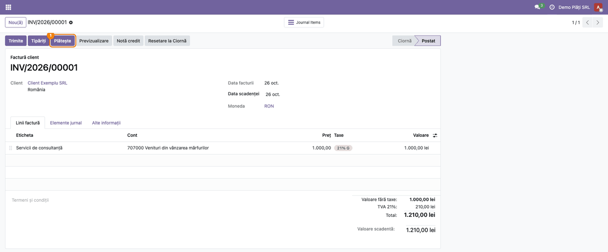
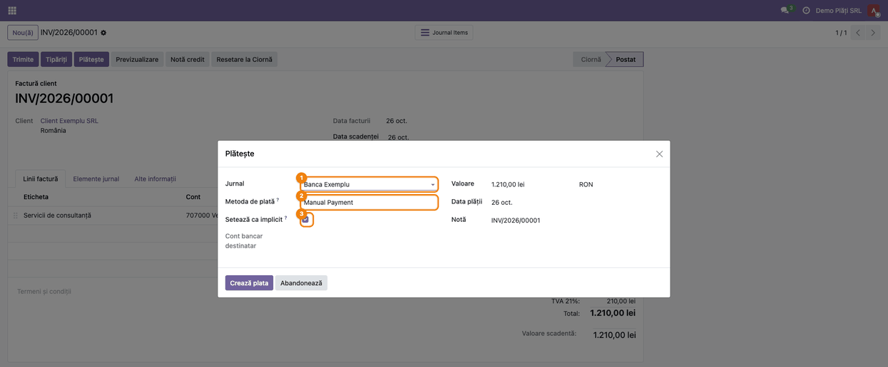
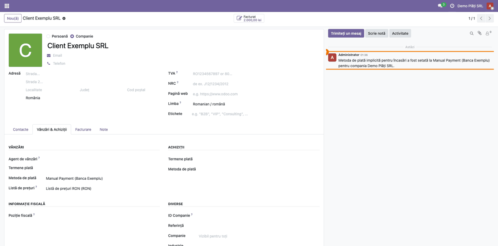
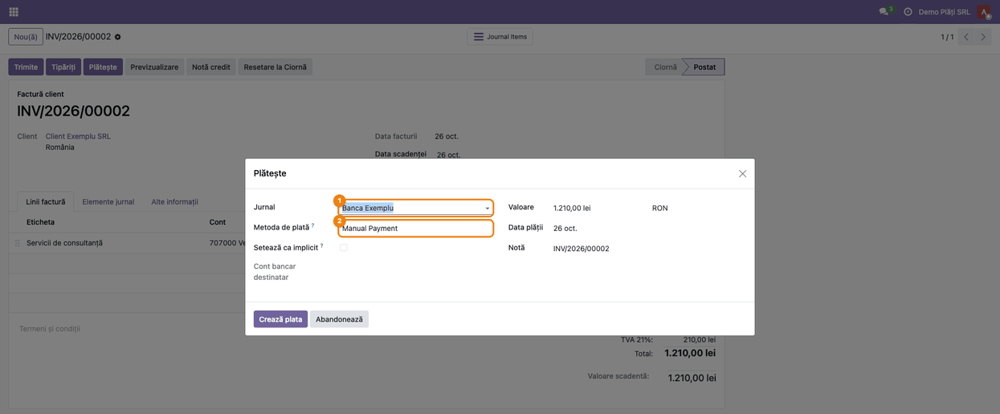

# Fișă Modul: Metoda de plată implicită pe partener

**Modul:** `deltatech_payment_default`
**Utilizator principal:** Contabil sau operator care înregistrează încasările și plățile pe facturi
**Prioritate:** 🟢 Scăzută (economisește timp și evită jurnalul greșit; fără efect contabil propriu)

---

## 1. Scop business

Mulți parteneri plătesc mereu la fel: un client virează întotdeauna în același cont bancar, un
furnizor e plătit mereu din casă. În Odoo standard, fereastra **Plătește** propune de fiecare dată
primul jurnal de bancă, iar operatorul trebuie să schimbe jurnalul la fiecare plată. Dacă uită,
plata ajunge în alt jurnal și apare la reconcilierea extrasului.

Modulul adaugă în fereastra **Plătește** bifa **Setează ca implicit**. Când o bifați, jurnalul și
metoda de plată alese se rețin pe partener, separat pentru încasări (facturi client) și pentru plăți
(facturi furnizor). La plata următoare, fereastra le propune singură.

## 2. Bază legală și context

Modul operațional, fără temei fiscal propriu. Alegerea jurnalului nu schimbă natura operațiunii, dar
pune plata în registrul corect (bancă sau casă). De aceea extrasul de cont și registrul de casă se
reconciliază fără corecturi.

## 3. Utilizatori și roluri

| Rol | Ce face |
|---|---|
| **Contabil / operator facturare** | înregistrează plata și bifează **Setează ca implicit** când partenerul plătește mereu la fel |
| **Administrator** | acordă dreptul **Contact: Creare** celor care pot reține metoda pe partener |

Drepturi: bifa apare doar utilizatorilor care au **și** drept de facturare (**Facturare** sau mai mult),
**și** dreptul **Contact: Creare** (în engleză *Contact Creation*). Motivul: bifa modifică fișa
partenerului, iar fără acest drept utilizatorul doar citește partenerii. Scrierea se face cu drepturile
utilizatorului, fără ocolirea regulilor de acces.

Roluri recomandate la testare: un contabil cu **Contact: Creare** (vede bifa) și un utilizator doar cu
**Facturare** (nu vede bifa).

## 4. Conturi și date implicate

Modulul nu creează note contabile și nu schimbă conturile plății. Reține pe partener, pe fiecare
companie, câmpul standard **Metoda de plată** din tabul **Vânzări & Achiziții**:

- secțiunea **Vânzări** → metoda folosită la **încasări** (facturi și note de credit client);
- secțiunea **Achiziții** → metoda folosită la **plăți** (facturi furnizor).

Jurnalul nu se reține separat: fiecare metodă de plată aparține unui jurnal, iar jurnalul se deduce
din ea (ex. **Manual Payment (Banca Exemplu)**).

Date minime pentru demo:
- două jurnale de bancă sau un jurnal de bancă și unul de casă (ex. **Banca Exemplu**);
- un client cu două facturi validate.

## 5. Configurare inițială

1. **Instalați modulul** `deltatech_payment_default`. Nu are setări proprii.
2. Dați dreptul **Contact: Creare** utilizatorilor care vor reține metoda pe partener:
   **Setări → Utilizatori și companii → Utilizatori** → utilizatorul → la **Contact**, nivelul **Creare**.
3. Verificați că jurnalul dorit are metode de plată active: **Facturare → Configurare → Jurnale** →
   jurnalul → tabul **Plăți de Primit** (încasări) și **Plăți Efectuate** (plăți).

## 6. Flux de utilizare

Scenariul: clientul **Client Exemplu SRL** plătește mereu în contul de la **Banca Exemplu**. Prima
factură, de 1.210,00 lei, se încasează cu bifa pusă; la a doua, fereastra propune singură banca.

### Pasul 1 — Deschideți factura și apăsați „Plătește"

**Facturare → Clienți → Facturi** → deschideți factura validată → butonul **Plătește**.



### Pasul 2 — Alegeți jurnalul și bifați „Setează ca implicit"

În fereastra **Plătește**:
1. **Jurnal** = **Banca Exemplu**;
2. **Metoda de plată** = metoda dorită din acel jurnal;
3. bifați **Setează ca implicit**;
4. apăsați **Creează plata**.

Bifa nu apare:
- dacă plătiți deodată facturi pentru **mai mulți parteneri**, pentru că jurnalul ar fi comun tuturor;
- dacă nu aveți dreptul **Contact: Creare**.



### Pasul 3 — Verificați partenerul

**Facturare → Clienți → Clienți** → deschideți partenerul → tabul **Vânzări & Achiziții**.

- **Găsiți pe ecran:** în secțiunea **Vânzări**, câmpul **Metoda de plată**; în dreapta, în istoric,
  mesajul lăsat la salvare.
- **Verificați:**
  - câmpul arată metoda și jurnalul alese (aici **Manual Payment (Banca Exemplu)**);
  - mesajul din istoric spune cine a făcut schimbarea, pentru încasări sau plăți, și pentru ce companie.

Valoarea se reține pe **firma** partener. Dacă factura a fost emisă pe o persoană de contact a firmei,
metoda se scrie tot pe firmă, iar contactele o preiau de acolo. Câmpul se poate schimba și manual,
direct pe partener.



### Pasul 4 — Factura următoare: fereastra propune singură jurnalul

Deschideți următoarea factură a clientului → **Plătește**. **Jurnal** și **Metoda de plată** sunt deja
**Banca Exemplu**; bifa nu mai e nevoie.

Propunerea funcționează și pentru facturile **deja deschise** în momentul în care ați pus bifa, dacă nu
au o metodă de plată proprie. O factură pe care ați ales explicit altă metodă de plată (câmpul
**Metoda de plată** din tabul **Alte informații**) păstrează metoda ei.



### Note de monografie și raportare

Modulul **nu** schimbă nota contabilă a plății. Ea rămâne cea standard Odoo, pe jurnalul ales:

| Operațiune | Debit | Credit |
|---|---|---|
| Încasare factură client prin bancă | 5121 Conturi la bănci în lei (sau contul de încasări în curs al metodei de plată) | 4111 Clienți |
| Plată factură furnizor prin bancă | 401 Furnizori | 5121 Conturi la bănci în lei (sau contul de plăți în curs al metodei de plată) |
| Încasare / plată prin casă | 5311 Casa în lei / 401 Furnizori | 4111 Clienți / 5311 Casa în lei |

Câștigul e la raportare: plata ajunge din prima în jurnalul corect, deci extrasul de cont și registrul
de casă se reconciliază fără mutări.

## 7. Legături cu alte module / declarații

| Modul | Rol |
|---|---|
| `account` (standard) | fereastra **Plătește**, câmpurile **Metoda de plată** de pe partener și **Metoda de plată** de pe factură |
| `sale` (standard, opțional) | comanda de vânzare preia metoda de încasare a partenerului |

**Ce e automat:**
- reținerea metodei pe partener la **Creează plata**, cu bifa pusă;
- propunerea jurnalului și metodei la plățile următoare;
- mesajul din istoricul partenerului.

**Ce rămâne manual:**
- bifa, la prima plată pentru fiecare partener și tip (încasare / plată);
- schimbarea metodei: altă plată cu bifa pusă, sau direct pe partener;
- facturile cu o metodă de plată proprie, aleasă pe factură, rămân pe acea metodă.

## 8. Verificări pentru consultant

- [ ] Fereastra **Plătește** pe o singură factură arată bifa **Setează ca implicit**.
- [ ] După **Creează plata** cu bifa, partenerul (tab **Vânzări & Achiziții**) are metoda aleasă în
      secțiunea **Vânzări** (încasări) sau **Achiziții** (plăți), iar istoricul are mesajul de schimbare.
- [ ] O plată fără bifă nu modifică partenerul.
- [ ] O factură nouă a partenerului primește metoda ca **Metoda de plată** (tab **Alte informații**), iar
      fereastra **Plătește** propune jurnalul și metoda reținute.
- [ ] O factură deschisă înainte de bifă, fără metodă proprie, primește și ea propunerea în fereastră.
- [ ] O factură emisă pe o persoană de contact primește metoda firmei.
- [ ] La plata facturilor a doi parteneri deodată, bifa nu apare.
- [ ] Un utilizator doar cu **Facturare**, fără **Contact: Creare**, nu vede bifa.
- [ ] Într-o bază cu mai multe companii, metoda reținută în compania A nu apare în compania B.

## 9. Mesaje de eroare frecvente

| Mesaj | Cauză | Remediere |
|---|---|---|
| Bifa **Setează ca implicit** nu apare | plată pentru mai mulți parteneri, sau utilizator fără **Contact: Creare** | plătiți partenerii pe rând; cereți dreptul **Contact: Creare** |
| Fereastra nu propune jurnalul reținut | pe factură e aleasă altă metodă, în câmpul **Metoda de plată** | schimbați metoda pe factură (tab **Alte informații**) sau alegeți jurnalul în fereastră |
| Fereastra nu propune jurnalul reținut, deși factura nu are metodă | jurnalul a fost arhivat sau metoda a fost scoasă din jurnal | reactivați metoda pe jurnal sau rețineți alta, cu bifa |

## 10. Capturi de ecran

Capturile sunt **generate automat** din `tests/test_screenshots.py` (mixinul `ScreenshotCase` din
`deltatech_doc_screenshots`, import defensiv), în română, pe planul de conturi RO, pe compania
„Demo Plăți SRL" în RON. Fișierele stau în `static/description/`:

1. `01_factura_buton_plateste.png` — factura validată, cu butonul **Plătește**;
2. `02_asistent_seteaza_implicit.png` — fereastra **Plătește**, cu jurnalul **Banca Exemplu** și bifa pusă;
3. `03_partener_metoda_plata.png` — partenerul, tab **Vânzări & Achiziții**, cu metoda reținută și mesajul din istoric;
4. `04_factura_noua_propunere.png` — a doua factură: fereastra propune singură jurnalul și metoda.

Regenerare:

```bash
./odoo/odoo-bin -c odoo.conf -d <db> \
    -i deltatech_payment_default,l10n_ro,deltatech_doc_screenshots \
    --test-tags=fise_screenshots --stop-after-init --http-port=8987 --gevent-port=8988
```

## 11. Observații pentru manual

- Prezentați bifa ca pe o scurtătură: se pune o dată pe partener, nu la fiecare plată.
- Subliniați separarea încasări / plăți: un partener care e și client, și furnizor are două metode
  reținute, independente.
- Precizați regula de prioritate: metoda aleasă pe factură câștigă în fața celei de pe partener.
- Metoda se reține pe firmă, nu pe persoana de contact, și pe fiecare companie separat.
