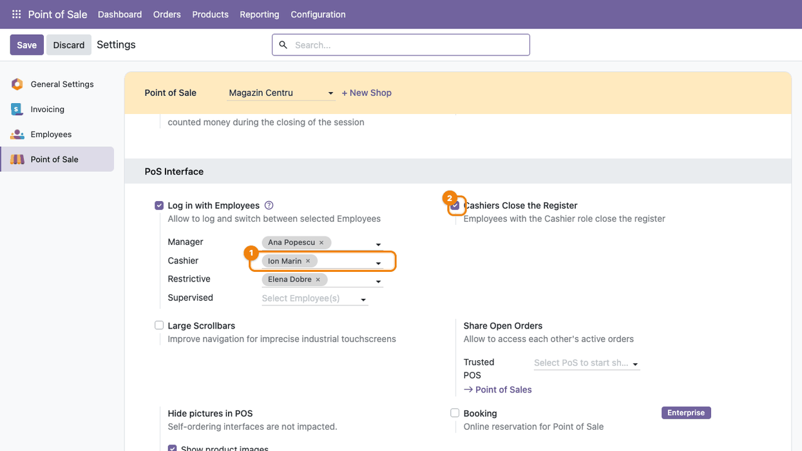
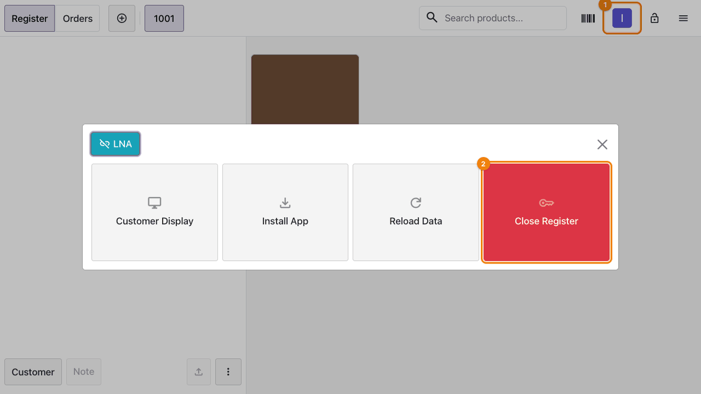
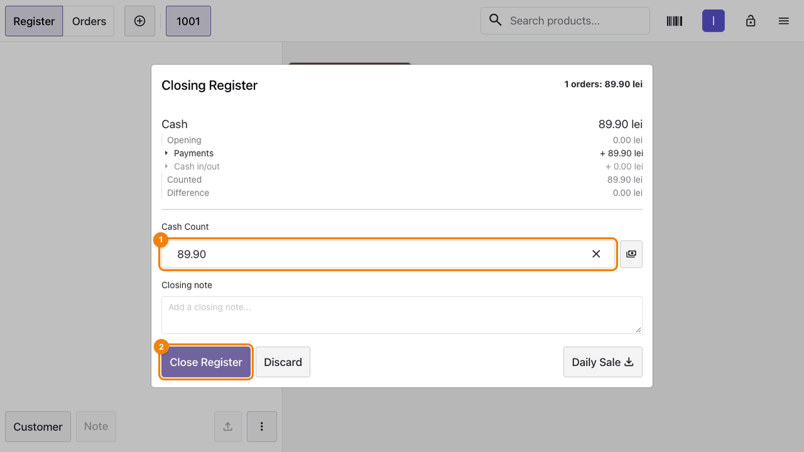
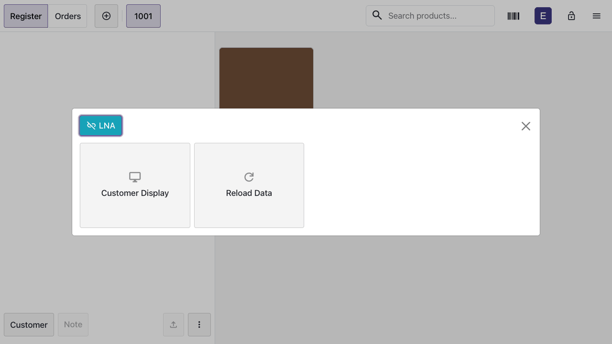

==========================
POS Cashier Close Register
==========================

..
   !!!!!!!!!!!!!!!!!!!!!!!!!!!!!!!!!!!!!!!!!!!!!!!!!!!!
   !! This file is generated by oca-gen-addon-readme !!
   !! changes will be overwritten.                   !!
   !!!!!!!!!!!!!!!!!!!!!!!!!!!!!!!!!!!!!!!!!!!!!!!!!!!!
   !! source digest: sha256:81d8ec371a2040dfc00a702ab15167f44238f2ffaa85baed16999e7e2a4ead67
   !!!!!!!!!!!!!!!!!!!!!!!!!!!!!!!!!!!!!!!!!!!!!!!!!!!!

.. |badge1| image:: https://img.shields.io/badge/maturity-Beta-yellow.png
    :target: https://odoo-community.org/page/development-status
    :alt: Beta
.. |badge2| image:: https://img.shields.io/badge/github-dhongu%2Fdeltatech-lightgray.png?logo=github
    :target: https://github.com/dhongu/deltatech/tree/20.0/deltatech_pos_cashier_close
    :alt: dhongu/deltatech
.. |badge_fisa| image:: https://img.shields.io/badge/-Fi%C8%99%C4%83%20consultant-2ea44f.png
    :target: https://github.com/dhongu/deltatech/blob/20.0/deltatech_pos_cashier_close/readme/FISA_CONSULTANT.md
    :alt: Fișă consultant

|badge1| |badge2| |badge_fisa|

With *Log in with Employees*, Odoo keeps **Close Register** for the
managers, together with other manager rights such as editing payments,
creating products and, with *Price Control*, changing prices. To let the
cashier who worked the shift close it, you would have to give all of
them.

This module moves only the button:

- **Cashiers close their own shift**: employees with the *Cashier* role
  get *Close Register* in the menu, where a manager finds it. The
  closing popup is the usual one.
- **Nothing else moves**: the other manager rights stay with the
  managers. *Restrictive* and *Supervised* employees still cannot close,
  and a cash difference above the authorized amount still needs a
  manager.
- **Per register**: a chain keeps the closing with the shop manager
  where it wants to, and gives it to the cashiers where the shop runs on
  shifts.

The option is on by default: installing the module is the decision.

**Table of contents**

.. contents::
   :local:

Usage
=====

1. Go to *Point of Sale > Configuration > Settings* and select the
   register.
2. Under *PoS Interface*, enable *Log in with Employees*, save, and put
   the employees in the *Manager*, *Cashier*, *Restrictive* and
   *Supervised* lists.
3. *Cashiers Close the Register*, next to it, is ticked. Untick it on
   the registers where the closing stays with the manager, and save.
4. Reload the register page if a session is already open: the setting is
   read when the register loads.

|Log in with Employees with the employees split by role, and Cashiers
Close the Register ticked|

An employee with the *Cashier* role now opens the menu and finds *Close
Register*.

|Register menu of an employee with the Cashier role, with Close
Register|

The closing popup is the usual one. With *Set Maximum Difference*, a
cash difference above the *Authorized Difference* still needs a manager
to close.

|The usual closing popup, opened by the cashier, with the counted cash
typed in|

*Restrictive* and *Supervised* employees still do not get *Close
Register*.

|Register menu of an employee with the Restrictive role, without Close
Register|

Changelog
=========

20.0.1.0.1 (2026-11-28)
-----------------------

- Migrated to Odoo 20.0: *Close Register* goes to the pos_hr *Cashier*
  role through ``PosAccessRightPlugin.canCloseSession``; *Restrictive*
  and *Supervised* never get it.

19.0.1.0.1 (2026-11-28)
-----------------------

- Romanian translation.
- Description: Cash In/Out is not among the manager rights in Odoo 19
  (it follows the Odoo user of the register), so it is no longer listed
  there.
- Consultant sheet (RO), usage with screenshots and demo GIF for the
  Apps Store.

19.0.1.0.0 (2026-10-23)
-----------------------

- First version: *Cashiers Close the Register* option, per register,
  that gives *Close Register* to the employees with basic rights without
  the other manager rights.

Bug Tracker
===========

Bugs are tracked on `Terrabit Issues <https://www.terrabit.ro/helpdesk>`_.
In case of trouble, please check there if your issue has already been reported.

Do not contact contributors directly about support or help with technical issues.

Credits
=======

Authors
-------

* Terrabit
* Dorin Hongu

Maintainers
-----------

.. |maintainer-dhongu| image:: https://github.com/dhongu.png?size=40px
    :target: https://github.com/dhongu
    :alt: dhongu

Current maintainer:

|maintainer-dhongu| 

This module is part of the `dhongu/deltatech <https://github.com/dhongu/deltatech/tree/20.0/deltatech_pos_cashier_close>`_ project on GitHub.

You are welcome to contribute.