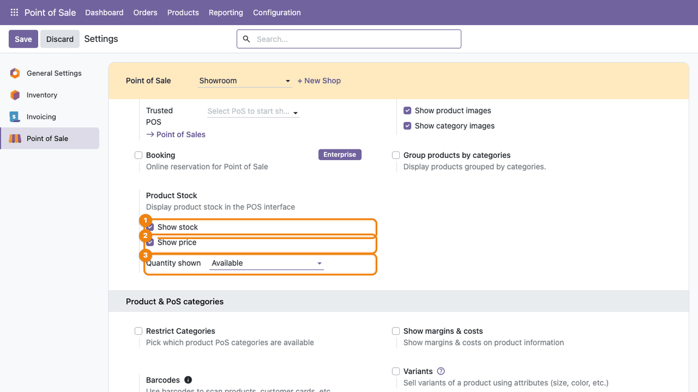
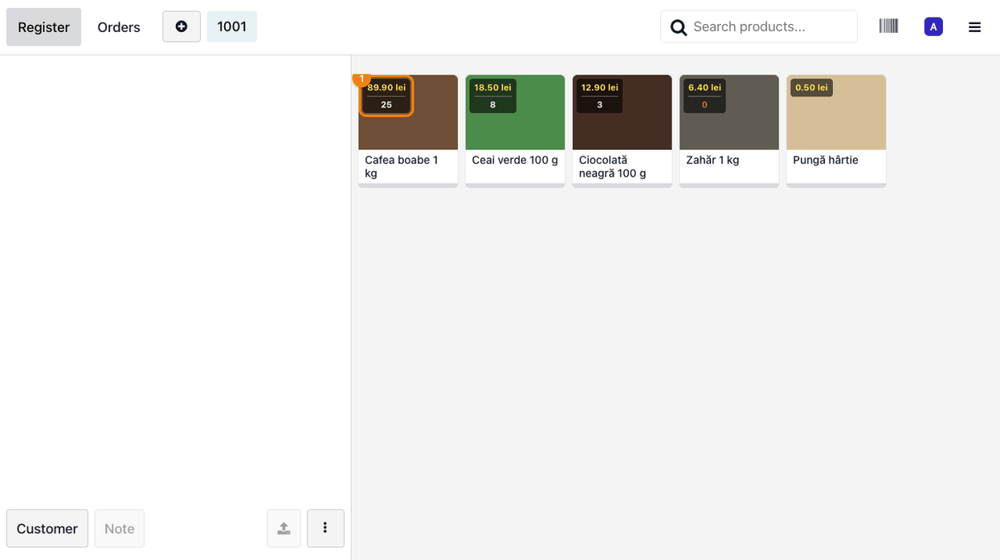
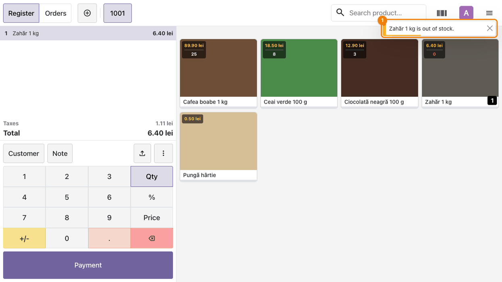
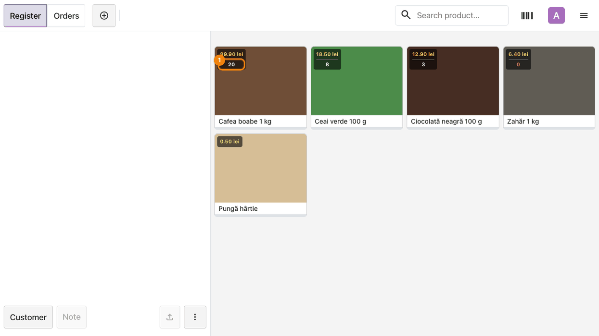

=================
POS Stock Display
=================

..
   !!!!!!!!!!!!!!!!!!!!!!!!!!!!!!!!!!!!!!!!!!!!!!!!!!!!
   !! This file is generated by oca-gen-addon-readme !!
   !! changes will be overwritten.                   !!
   !!!!!!!!!!!!!!!!!!!!!!!!!!!!!!!!!!!!!!!!!!!!!!!!!!!!
   !! source digest: sha256:d9a107823264356edf12c8f707a140138d66169ca83bb62e4c1180396883f321
   !!!!!!!!!!!!!!!!!!!!!!!!!!!!!!!!!!!!!!!!!!!!!!!!!!!!

.. |badge1| image:: https://img.shields.io/badge/maturity-Beta-yellow.png
    :target: https://odoo-community.org/page/development-status
    :alt: Beta
.. |badge2| image:: https://img.shields.io/badge/license-LGPL--3-blue.png
    :target: http://www.gnu.org/licenses/lgpl-3.0-standalone.html
    :alt: License: LGPL-3
.. |badge3| image:: https://img.shields.io/badge/github-dhongu%2Fdeltatech-lightgray.png?logo=github
    :target: https://github.com/dhongu/deltatech/tree/19.0/deltatech_pos_stock
    :alt: dhongu/deltatech
.. |badge_fisa| image:: https://img.shields.io/badge/-Fi%C8%99%C4%83%20consultant-2ea44f.png
    :target: https://github.com/dhongu/deltatech/blob/19.0/deltatech_pos_stock/readme/FISA_CONSULTANT.md
    :alt: Fișă consultant
.. |badge_tests| image:: https://img.shields.io/badge/-11%20automated%20tests%20%C2%B7%2093%25%20code%20coverage-2ea44f.png
    :target: https://app.codecov.io/gh/dhongu/deltatech/tree/19.0/deltatech_pos_stock
    :alt: 11 automated tests · 93% code coverage

|badge1| |badge2| |badge3| |badge_fisa| |badge_tests|

This module extends the Point of Sale functionality to display the stock
quantity and the price directly on the product cards.

Key features:

- Shows the stock quantity of the register's warehouse for each product,
  updated live.
- Shows product price on the same badge.
- Stock and price information is displayed as a badge on the product
  image.
- Toggle stock and price visibility through POS settings.
- Choose, per register, whether the badge shows the stock on hand or the
  available quantity (stock minus everything already reserved for other
  operations: deliveries, internal transfers, manufacturing).
- Products with nothing left show the quantity in red; adding one to the
  order raises a warning but does not block the sale.
- Compatible with the Odoo 19 OWL architecture.
- Only displays stock for storable products.

**Table of contents**

.. contents::
   :local:

Use Cases / Context
===================

Part of the Terrabit POS Ecosystem
----------------------------------

This module is a small standalone addition to standard
``point_of_sale``. It is designed to work alongside the rest of the
Terrabit POS suite and the official Romanian fiscal compliance modules,
without any overlap:

- **deltatech_pos** / **deltatech_pos_base** — print fiscal receipts and
  drive cash management on a certified cash register
- **deltatech_ecr_connect** — shared fiscal document model, ECR format
  converter and Terrabit Connect sender
- **deltatech_pos_price_sync** — pushes live product price changes to
  already open POS sessions, using the same live-bus channel as this
  module
- **deltatech_pos_fix** — corrects POS total calculation for
  tax-included fiscal position mapping
- **l10n_ro_pos_fiscal_compliance** — AMEF fiscal receipt tracking, Z
  report reconciliation and session blocking
- **l10n_ro_anaf_d394_pos** — reports POS fiscal receipts in the D394
  (op. 2) declaration to ANAF
- **l10n_ro_pos_returns** — dedicated return invoice and cash register
  line for every POS return

Usage
=====

1. Go to *Point of Sale > Configuration > Settings* and select the
   register in the *Point of Sale* field at the top. The setting is per
   register.

2. In the *PoS Interface* section, under *Product Stock*, tick *Show
   stock* and *Show price* (both are ticked by default) and choose the
   *Quantity shown*:

   - *On hand* (default): the physical stock of the register's
     warehouse;
   - *Available*: the stock minus everything already reserved for other
     operations (deliveries, internal transfers, manufacturing) that has
     not left the warehouse yet. Use it where the picking is validated
     by the warehouse, not at the till.

   Save, and reload the register page if a session is already open.

   |Product Stock block in the Point of Sale settings, with Show stock,
   Show price and Quantity shown|

3. Open the register. Each product card shows a badge with the price (in
   yellow) and, for products that track inventory, the quantity in
   stock. Products with nothing left show the quantity in red. The badge
   follows stock changes live: receipts, transfers, inventory
   adjustments and, with *Update quantities in stock* set to real time
   (the default), the sales of every register.

   |Product cards in the register with the price and stock badge, one
   product out of stock with its quantity highlighted in colour|

4. Adding a product with no stock left raises a warning, "*product* is
   out of stock.". The sale is not blocked: the product goes on the
   order as usual. The warning compares the badge with zero; the
   quantities already on the current order are not subtracted.

   |Warning shown when a product without stock is added to the order|

5. On a register set to *Available*, the badge subtracts the
   reservations: 25 kg on hand with 5 kg reserved for a delivery shows
   20.

   |Register set to Available: the coffee badge shows 20, the stock on
   hand minus a 5 kg reservation|

The stock shown is the stock of the register's warehouse: the warehouse
of its *Operation Type*, or the *Warehouse* set under *Allow Ship
Later*.

Changelog
=========

19.0.1.2.5 (2026-11-28)
-----------------------

- Romanian translation completed (the Quantity shown setting and the
  out-of-stock warning).
- Description: the on hand / available choice and the out-of-stock
  warning are listed.
- Consultant sheet (RO), usage with screenshots and demo GIF for the
  Apps Store.

19.0.1.2.4 (2026-10-25)
-----------------------

- Tests: the POS badge tests open the register by the button's class, so
  they also pass when pos_hr is installed (it labels the button "Unlock
  Register" on an opened session).

19.0.1.2.3 (2026-10-22)
-----------------------

- Listed on Odoo Apps as *POS Stock Display* (was *POS Stock*). The
  technical name ``deltatech_pos_stock`` does not change.

19.0.1.2.2 (2026-10-17)
-----------------------

- **Fix: shared products update the badge in every company.** When a
  stock change touched, in the same batch, a product shared between
  companies and a product of one company, only the registers of that
  company were notified; the registers of the other companies kept
  showing the old stock of the shared product (POSSTOCK-001). Each open
  register now receives the shared products and the products of its own
  company.

19.0.1.2.1 (2026-10-09)
-----------------------

- Apps Store banner (banner.json).

19.0.1.2.0 (2026-10-08)
-----------------------

- New POS setting **Quantity shown**: the badge can display the stock
  *on hand* (the default, unchanged behaviour) or the *available*
  quantity, which subtracts what is already reserved for orders that
  have not left the warehouse yet. Needed wherever the picking is
  validated by the warehouse rather than at the till — on hand does not
  move until then, so the cashier would otherwise be looking at stock
  that is already sold.
- ``free_qty`` is now computed on ``product.template`` by summing its
  variants. Core aggregates ``qty_available`` and the forecast onto the
  template but stops short of the free quantity, and the POS card is
  handed a template.
- ``stock.quant`` also notifies open sessions when ``reserved_quantity``
  changes, so the available badge keeps up. Restricted to the registers
  actually showing the available quantity: reservations move with every
  sale, and registers left on "on hand" must not be woken up.
- Products with nothing left to sell show the quantity in red, and
  adding one raises a warning in the register. The sale still goes
  through — a hard block would stop the cashier whenever the figure in
  Odoo is behind.

19.0.1.1.1 (2026-09-29)
-----------------------

- Own module icon, instead of the generic gears it had.

19.0.1.1.0 (2026-08-19)
-----------------------

- Fixed stale stock badge: ``qty_available`` is a non-stored computed
  field, so a sale (which writes on ``stock.quant``, not on
  ``product.template``) never bumps the template's ``write_date``. The
  POS incremental sync filters on ``write_date``, so it never re-sent
  the recalculated quantity to sessions already open — the badge could
  stay frozen at a days-old value.
- ``stock.quant`` now pushes a live ``STOCK_SYNCHRONISATION`` bus
  notification (reusing the same ``pos.bus.mixin`` channel core uses for
  ``notify_synchronisation``) whenever a product's on-hand quantity
  changes, to every open POS session with ``display_stock`` enabled. The
  frontend subscribes to it and merges the fresh ``product.template``
  data straight into the in-memory model, independent of the
  ``write_date``-based sync.

19.0.1.0.0 (2026-08-14)
-----------------------

- Migrated to Odoo 19.0.
- Stock loading moved from ``product.product`` to ``product.template``:
  in 19.0 the POS product card receives a template, so ``qty_available``
  has to be loaded on the template.
- Adapted to the 19.0 loading API: ``_load_pos_data_fields()`` now
  receives the ``pos.config`` recordset and the removed
  ``_load_pos_data()`` hook was replaced by ``_load_pos_data_read()``.
- POS JS patch adapted to the 19.0 asset paths
  (``app/components/product_card``, ``app/hooks/pos_hook``) and the
  removed ``getProductPriceFormatted()`` helper was replaced by
  ``getTaxDetails()`` + ``formatCurrency()``, honouring the
  ``iface_tax_included`` setting.
- Card template anchored on ``div.product-content``; the
  ``div.product-information-tag`` element it used to extend no longer
  exists in 19.0.
- Added a POS frontend test asserting that the badge renders both the
  price and the on-hand quantity.

Bug Tracker
===========

Bugs are tracked on `Terrabit Issues <https://www.terrabit.ro/helpdesk>`_.
In case of trouble, please check there if your issue has already been reported.

Do not contact contributors directly about support or help with technical issues.

Credits
=======

Authors
-------

* Terrabit
* Dorin Hongu

Maintainers
-----------

.. |maintainer-dhongu| image:: https://github.com/dhongu.png?size=40px
    :target: https://github.com/dhongu
    :alt: dhongu

Current maintainer:

|maintainer-dhongu| 

This module is part of the `dhongu/deltatech <https://github.com/dhongu/deltatech/tree/19.0/deltatech_pos_stock>`_ project on GitHub.

You are welcome to contribute.