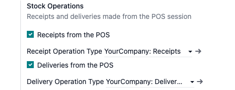
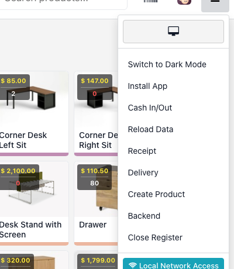
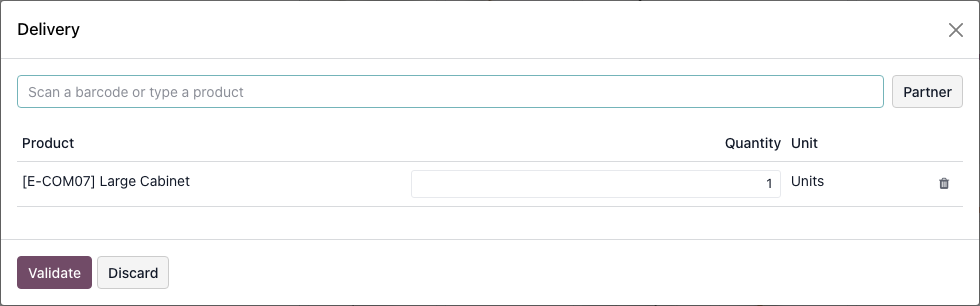
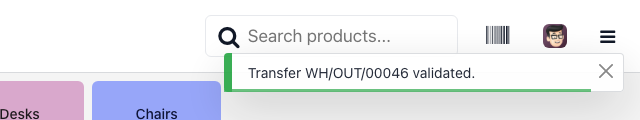
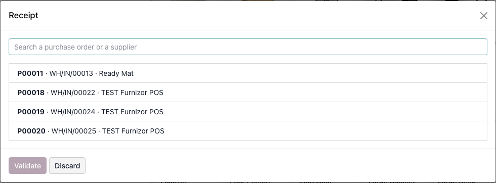
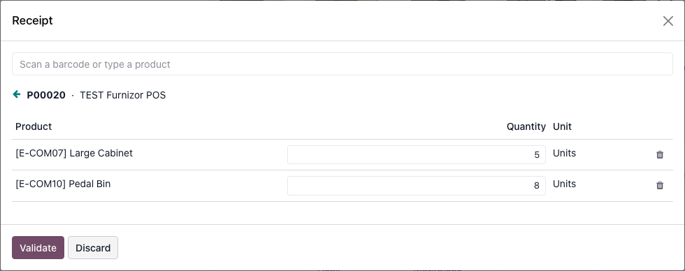
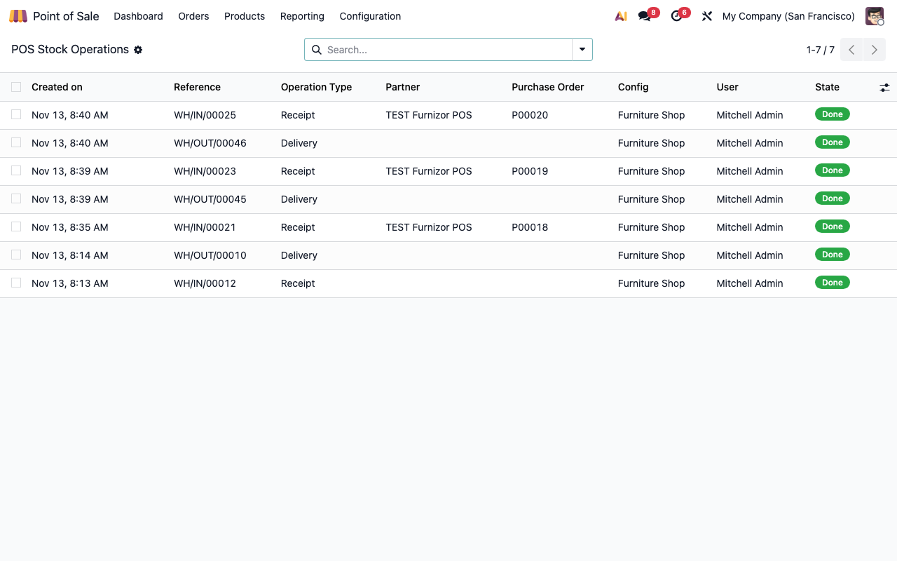

====================
POS Stock Operations
====================

..
   !!!!!!!!!!!!!!!!!!!!!!!!!!!!!!!!!!!!!!!!!!!!!!!!!!!!
   !! This file is generated by oca-gen-addon-readme !!
   !! changes will be overwritten.                   !!
   !!!!!!!!!!!!!!!!!!!!!!!!!!!!!!!!!!!!!!!!!!!!!!!!!!!!
   !! source digest: sha256:6dfe2b647e1899790e2e1174e5269d8e38af9ffa7a705f75aec6740bbd91afad
   !!!!!!!!!!!!!!!!!!!!!!!!!!!!!!!!!!!!!!!!!!!!!!!!!!!!

.. |badge1| image:: https://img.shields.io/badge/maturity-Beta-yellow.png
    :target: https://odoo-community.org/page/development-status
    :alt: Beta
.. |badge2| image:: https://img.shields.io/badge/license-LGPL--3-blue.png
    :target: http://www.gnu.org/licenses/lgpl-3.0-standalone.html
    :alt: License: LGPL-3
.. |badge3| image:: https://img.shields.io/badge/github-dhongu%2Fdeltatech-lightgray.png?logo=github
    :target: https://github.com/dhongu/deltatech/tree/19.0/deltatech_pos_stock_ops
    :alt: dhongu/deltatech
.. |badge_fisa| image:: https://img.shields.io/badge/-Fi%C8%99%C4%83%20consultant-2ea44f.png
    :target: https://github.com/dhongu/deltatech/blob/19.0/deltatech_pos_stock_ops/readme/FISA_CONSULTANT.md
    :alt: Fișă consultant
.. |badge_tests| image:: https://img.shields.io/badge/-11%20automated%20tests-2ea44f.png
    :target: https://github.com/dhongu/deltatech/tree/19.0/deltatech_pos_stock_ops/tests
    :alt: 11 automated tests

|badge1| |badge2| |badge3| |badge_fisa| |badge_tests|

Receipts against a purchase order and deliveries by piece or by pack,
from the Point of Sale session.

Key features:

- Burger-menu entries *Receipt* and *Delivery*, enabled per point of
  sale.
- **Receipts only against a purchase order:** pick a confirmed order of
  the register's warehouse, adjust the quantity received and validate;
  what did not arrive stays as a backorder. There is no free receipt.
- **Deliveries:** scan a product barcode, a pack barcode (a unit of
  measure linked to the product) or search by name; optional partner
  from the POS partner list.
- Creates and validates a standard transfer; if Odoo asks for a manual
  step, the transfer is left in Inventory and the cashier is told.
- Journal of POS stock operations under Point of Sale, with who did
  what, in which session and for which purchase order.
- Only drives the standard stock flow: accounting entries come from the
  installed localization.

**Table of contents**

.. contents::
   :local:

Usage
=====

Set up
------

1. Go to **Point of Sale ‣ Configuration ‣ Settings**, choose the
   register and, in the **Stock Operations** block, tick **Receipts from
   the POS** and/or **Deliveries from the POS**.
2. Check **Receipt Operation Type** and **Delivery Operation Type**;
   they are proposed from the register's warehouse.
3. Give each cashier who may use it the **POS stock operations** right
   (**Settings ‣ Users**).

|Stock Operations settings block with the two options and the operation
types|

Deliver from the register
-------------------------

1. Open the register menu: **Receipt** and **Delivery** appear after
   *Reload Data*.

|Register menu with the Receipt and Delivery entries|

2. Choose **Delivery**, scan a product (or a pack barcode) or type part
   of its name and pick it from the list.
3. Adjust the quantity, optionally choose a **Partner**, and press
   **Validate**.

|Delivery dialog with one product line|

The delivery transfer is created and validated, and the stock drops.

|Notification confirming the delivery transfer was validated|

Receive against a purchase order
--------------------------------

There is no free receipt: goods are received only against a confirmed
purchase order of the register's warehouse.

1. Choose **Receipt** in the register menu. The dialog lists the
   purchase orders still to receive; search by order number, supplier or
   transfer.

|Receipt dialog listing the purchase orders to receive|

2. Pick the order, then type the quantity that actually arrived on each
   line (0 leaves a line out). Scanning a product barcode sets its
   quantity to 1 and then counts up.
3. Press **Validate**. What did not arrive stays on the same purchase
   order as a backorder.

|Receipt dialog with the received quantity typed on each line|

Review the operations
---------------------

**Point of Sale ‣ Orders ‣ Stock Operations** lists every operation with
its transfer, partner, purchase order (receipts), register, user and
state. **Needs confirmation** means Odoo asked for a manual step: finish
that transfer in Inventory.

|List of POS stock operations with their transfers and states|

Changelog
=========

19.0.1.0.0 (2026-11-13)
-----------------------

- Initial version: deliveries from the POS session, by piece or by pack,
  and receipts against a purchase order (the quantity not received
  becomes a backorder). A receipt without a purchase order is not
  possible.

Bug Tracker
===========

Bugs are tracked on `Terrabit Issues <https://www.terrabit.ro/helpdesk>`_.
In case of trouble, please check there if your issue has already been reported.

Do not contact contributors directly about support or help with technical issues.

Credits
=======

Authors
-------

* Terrabit
* Dorin Hongu

Maintainers
-----------

.. |maintainer-dhongu| image:: https://github.com/dhongu.png?size=40px
    :target: https://github.com/dhongu
    :alt: dhongu

Current maintainer:

|maintainer-dhongu| 

This module is part of the `dhongu/deltatech <https://github.com/dhongu/deltatech/tree/19.0/deltatech_pos_stock_ops>`_ project on GitHub.

You are welcome to contribute.