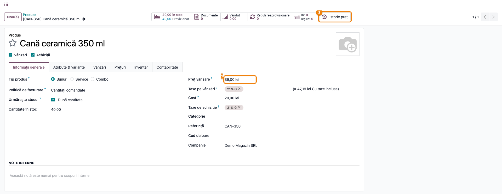
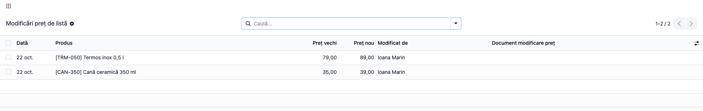
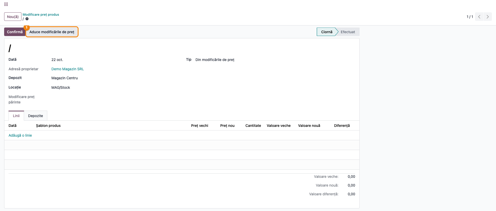
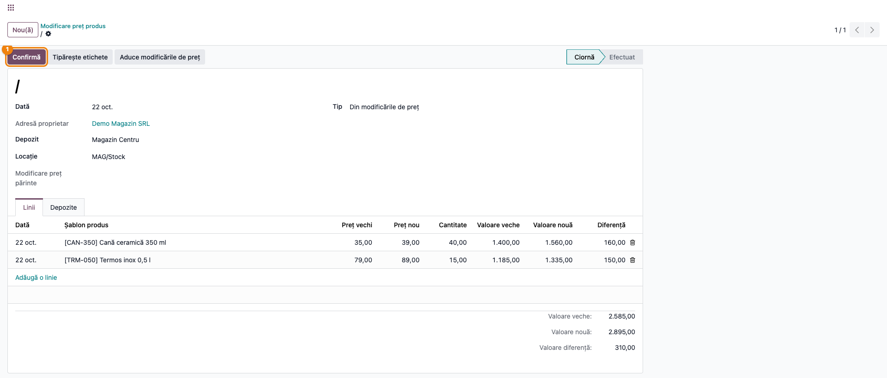
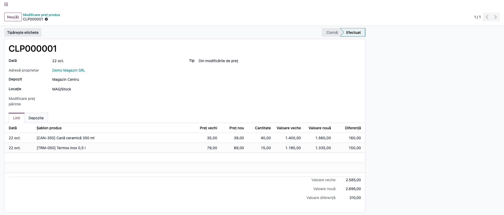
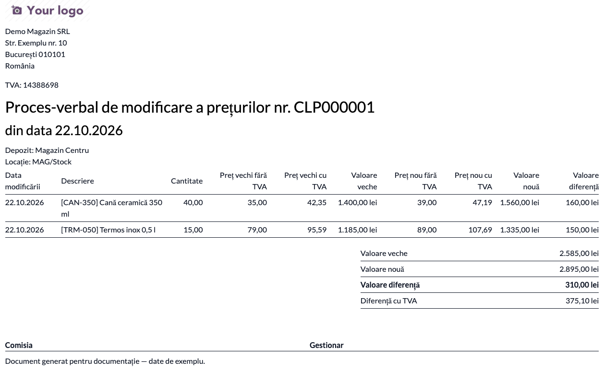
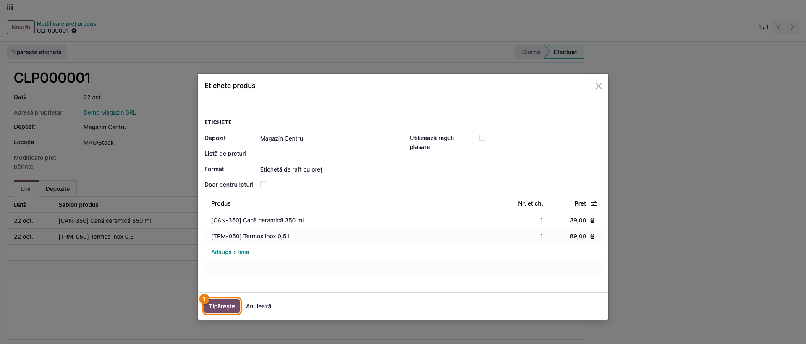
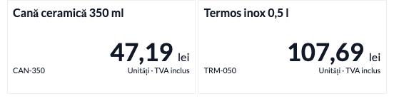

# Fișă Modul: Modificarea prețului de listă, procesul-verbal și etichetele de raft

**Modul:** `deltatech_price_change` (+ puntea `deltatech_price_change_label` pentru etichete)
**Utilizator principal:** Responsabil de prețuri / manager de vânzări (modifică prețurile, întocmește
documentul), gestionar de magazin (semnează procesul-verbal, schimbă etichetele)
**Prioritate:** 🟡 Medie (frecvent în comerțul cu amănuntul, la fiecare actualizare de prețuri)

---

## 1. Scop business

Prețurile de vânzare se schimbă des: la o nouă listă de la furnizor, la o campanie, la un import
de prețuri. Prețul nou apare imediat în Odoo, dar în magazin rămân două lucruri de făcut: un
**proces-verbal de modificare a prețurilor**, cu stocul afectat și diferența de valoare, și
**etichete noi pe raft**. Fără ajutor, cineva trebuie să-și noteze ce produse s-au schimbat și de la
ce preț. Modulul ține singur un **jurnal al modificărilor prețului de listă** (o linie pe produs și
zi). Din el, un document „Modificare preț produs” aduce cu un clic toate produsele modificate,
calculează stocul și diferențele, tipărește procesul-verbal și, prin puntea de etichete, etichetele de
raft cu prețul nou.

## 2. Bază legală și context

- **OG 99/2000 și HG 947/2000** — la vânzarea către consumatori, prețul de vânzare se afișează la
  raft, **cu TVA inclus**. După o modificare de preț, eticheta de raft trebuie înlocuită; de aceea
  eticheta propusă de modul arată prețul cu TVA.
- **OMFP 1802/2014** — la unitățile care țin evidența mărfurilor **la preț de vânzare** (cont 371 la
  preț cu amănuntul, cu 378 „Diferențe de preț la mărfuri” și 4428 „TVA neexigibilă”), schimbarea
  prețului de vânzare pentru marfa aflată în stoc modifică valoarea stocului. Procesul-verbal de
  modificare a prețurilor, semnat de comisie și de gestionar, justifică nota contabilă a diferenței
  (secțiunea 6, „Note de monografie și raportare”).
- La unitățile care țin stocul **la cost de achiziție**, procesul-verbal are rol de control intern
  (cine, când și cu cât a schimbat prețul); valoarea contabilă a stocului nu se schimbă.

## 3. Utilizatori și roluri

| Rol Odoo (Vânzări) | Ce poate face |
|---|---|
| **Administrator** | modifică prețurile, creează, încarcă și confirmă documentele de modificare preț, tipărește PV-ul și etichetele |
| **Utilizator: Doar documentele proprii** / **Toate documentele** | vede jurnalul modificărilor, documentele și butonul **Istoric preț** de pe produs, fără să le modifice |

Jurnalul se completează pentru orice utilizator care schimbă prețul unui produs, indiferent de rolul
lui în Vânzări (scrierea se face de modul).

Roluri recomandate pentru testare:
- un **Administrator vânzări**, care parcurge tot fluxul;
- un **agent de vânzări**, care trebuie să vadă **Istoric preț**, lista **Modificări preț de
  listă** și documentele, dar să nu le poată crea, modifica sau confirma. Butonul **Confirmă**
  este vizibil și pentru el, dar Odoo refuză operația cu un mesaj de acces.

## 4. Conturi și date implicate

Modulul **nu generează note contabile**. Conturile de mai jos sunt cele în care se înregistrează
manual diferența de preț la magazinele cu evidență la preț de vânzare (secțiunea 6):

| Cont | Rol |
|---|---|
| 371 „Mărfuri” | stocul magazinului, ținut la preț de vânzare cu TVA |
| 378 „Diferențe de preț la mărfuri” | adaosul comercial; preia diferența de preț fără TVA |
| 4428 „TVA neexigibilă” | TVA-ul cuprins în prețul de vânzare al stocului; preia TVA-ul diferenței. Folosiți analiticul de TVA neexigibilă al magazinului (ex. 4428.02), același cu cel din categoria produsului: 4428 se folosește în Odoo RO și pentru TVA la încasare |
| 607 „Cheltuieli privind mărfurile” | partea din stoc trecută sub costul de achiziție, la o scădere de preț sub cost |

Date minime pentru demo:
- o companie cu TVA 21% pe vânzări (în exemplu **Demo Magazin SRL**);
- un depozit (**Magazin Centru**, locația **MAG/Stock**) cu stoc din câteva produse stocabile;
- produsele din exemplu, cu taxa de vânzare 21%:

| Produs | Cod | Cost | Preț inițial | Stoc |
|---|---|---|---|---|
| Cană ceramică 350 ml | CAN-350 | 20,00 lei | 35,00 lei | 40 buc. |
| Termos inox 0,5 l | TRM-050 | 50,00 lei | 79,00 lei | 15 buc. |
| Set lingurițe (6 buc.) | LNG-006 | 12,00 lei | 24,00 lei | 30 buc. |

## 5. Configurare inițială

1. Instalați `deltatech_price_change` (dependențe: `stock`, `sale`). Pentru etichete instalați și
   `deltatech_product_labels`: puntea `deltatech_price_change_label` se instalează atunci singură.
2. Dați rolul **Vânzări: Administrator** celor care întocmesc documentele de modificare preț.
3. Numerotarea documentelor folosește secvența **Price Change** (prefix `CLP`, 6 cifre, fără goluri),
   din **Setări → Tehnic → Secvențe și identificatori → Secvențe** (modul dezvoltator). Prefixul se poate schimba acolo.
4. Nu este nevoie de nicio altă setare: jurnalul modificărilor pornește de la instalare. Modificările
   făcute **înainte** de instalare nu apar în jurnal.

## 6. Flux de utilizare

Exemplul urmărește o zi de actualizare a prețurilor la **Magazin Centru**:
- prețul cănii urcă de la 35,00 la 37,00 lei, apoi, în aceeași zi, la 39,00 lei;
- termosul urcă de la 79,00 la 89,00 lei;
- setul de lingurițe urcă la 26,00 lei, dar prețul revine la 24,00 lei înainte de sfârșitul zilei.

### Pasul 1 — Modificarea prețului pe produs

Deschideți produsul din **Vânzări → Produse → Produse** și schimbați **Preț vânzare** ①. Salvați. Nu
trebuie făcut nimic în plus: modulul notează singur modificarea. Butonul **Istoric preț** ② din
dreapta-sus deschide modificările de preț ale produsului.

Prețul se poate schimba și din lista de produse, prin import sau de un alt modul (de exemplu
actualizarea prețului la recepție): toate ajung în jurnal.



### Pasul 2 — Jurnalul modificărilor de preț

Deschideți **Vânzări → Produse → Modificări preț de listă**. Fiecare rând este **un produs într-o
zi**. Citiți rândurile:

- **Preț vechi** este prețul de **dinaintea primei modificări din zi**, iar **Preț nou** este
  prețul **curent**. Cana apare o singură dată, **35,00 → 39,00**: modificarea
  intermediară la 37,00 nu creează un rând separat;
- setul de lingurițe **nu apare**: prețul a revenit la valoarea de dinaintea primei modificări din zi, deci nu există
  nicio modificare de documentat;
- **Modificat de** arată utilizatorul care a schimbat prețul;
- **Document modificare preț** este gol: modificarea nu a intrat încă într-un document. Filtrul
  **Neincluse într-un document** arată doar aceste rânduri.

Verificați că lista conține toate produsele pe care le-ați modificat, cu prețurile corecte, înainte
de a întocmi documentul.



### Pasul 3 — Documentul nou de modificare preț

Deschideți **Vânzări → Produse → Modificare preț produs → Nou**. Completați:

- **Tip** = **Din modificările de preț**;
- **Data** — documentul preia modificările din jurnal **până la această dată inclusiv**;
- **Depozit** și **Locație** — gestiunea pentru care se face procesul-verbal; cantitățile se
  calculează pe locația aleasă (în exemplu **MAG/Stock**).

Salvați, apoi apăsați **Aduce modificările de preț** ①.



### Pasul 4 — Liniile aduse și verificarea lor

Documentul primește câte o linie pentru fiecare rând din jurnal care nu e în alt document. Citiți
tabelul înainte de confirmare:

- **Dată**, **Șablon produs**, **Preț vechi**, **Preț nou** — aceleași valori ca în jurnal (pasul 2);
- **Cantitate** — stocul produsului în locația documentului **în momentul în care s-au adus
  liniile** (cana 40, termosul 15). Cantitatea nu se mai recalculează la vânzările sau recepțiile
  de după, așa că întocmiți documentul imediat după modificarea prețurilor;
- **Valoare veche** = cantitate × preț vechi, **Valoare nouă** = cantitate × preț nou,
  **Diferență** = diferența lor. Cana: 40 × 35,00 = 1.400,00 → 40 × 39,00 = 1.560,00, diferență
  **160,00**; termosul: 15 × 79,00 = 1.185,00 → 15 × 89,00 = 1.335,00, diferență **150,00**;
- totalurile din subsol: **Valoare veche** 2.585,00, **Valoare nouă** 2.895,00, **Valoare
  diferență** **310,00** (fără TVA).

Prețurile liniilor aduse din jurnal nu se pot modifica în document. O linie greșită se șterge din
document; modificarea ei revine în jurnal și poate intra într-un document următor. Cât documentul
este **Ciornă**:

- dacă prețul produsului se schimbă din nou **în aceeași zi**, linia se actualizează singură;
- dacă prețul revine în aceeași zi la valoarea inițială, rândul din jurnal se șterge și **linia
  dispare** din document;
- o modificare făcută **într-o zi următoare** creează un rând nou în jurnal, care nu intră singur în
  document: apăsați din nou **Aduce modificările de preț** (cu data documentului mutată la acea zi)
  sau lăsați-l pentru documentul următor. Produsul apare atunci pe două linii, câte una pentru
  fiecare zi (de exemplu 35,00 → 39,00 și 39,00 → 41,00); este corect, diferențele se însumează.

Când valorile sunt corecte, apăsați **Confirmă** ①.



### Pasul 5 — Documentul confirmat

La confirmare, documentul primește numărul din secvență (**CLP000001**) și trece în starea
**Efectuat**. Pentru tipul **Din modificările de preț** confirmarea **nu mai scrie** niciun preț în
produse: prețurile erau deja schimbate. În jurnal, rândurile documentului au acum completat
**Document modificare preț**; o nouă modificare a acelorași produse, chiar în aceeași zi, pornește un
rând nou, de la prețul din document.

Dacă documentul nu are **Locație**, la confirmare modulul creează câte un document subordonat pentru
fiecare locație internă care are stoc din produsele lui, vizibile în tabul **Depozite**.



### Pasul 6 — Procesul-verbal de modificare a prețurilor

Din document, **Tipărire → Modificare preț**. Se tipărește **Procesul-verbal de modificare a
prețurilor nr. CLP000001**, care are, pe fiecare produs: data modificării, cantitatea, prețul vechi
și cel nou, **fără și cu TVA**, valoarea veche, cea nouă și diferența; jos totalurile (**Valoare
veche**, **Valoare nouă**, **Valoare diferență** fără TVA și **Diferență cu TVA**) și locurile de
semnătură pentru **Comisia** și **Gestionar**. Verificați pe document:

- cana: preț vechi 35,00 (cu TVA **42,35**), preț nou 39,00 (cu TVA **47,19**), diferență 160,00;
- termosul: preț vechi 79,00 (cu TVA **95,59**), preț nou 89,00 (cu TVA **107,69**), diferență 150,00;
- **Valoare diferență** totală = **310,00 lei** = 160,00 + 150,00;
- **Diferență cu TVA** = **375,10 lei** = 40 × (47,19 − 42,35) + 15 × (107,69 − 95,59).

Coloanele **cu TVA** sunt prețurile de pe raft; prețul unitar cu TVA se rotunjește la 2 zecimale.
Valorile de pe linii (cantitate × preț) sunt **fără TVA**; **Diferență cu TVA** se calculează din
prețurile de raft rotunjite.



### Pasul 7 — Etichetele de raft: alegerea produselor

Pe document apăsați **Tipărește etichete** (butonul apare când puntea `deltatech_price_change_label`
este instalată și documentul are linii, deci și pe **Ciornă**; tipăriți etichetele după confirmare,
când lista produselor este definitivă). Se deschide fereastra **Etichete produs**, cu:

- **Depozit** — depozitul documentului (**Magazin Centru**);
- **Format** — **Etichetă de raft cu preț**, propus implicit; se poate alege orice alt format de
  etichetă;
- **Listă de prețuri** — lăsați-o goală: cu o listă de prețuri aleasă, eticheta arată prețul din
  listă și nu mai corespunde procesului-verbal;
- câte o linie pentru fiecare produs din document, cu **Nr. etich.** = 1 și **Preț** = prețul de
  vânzare curent al produsului, **fără TVA** (eticheta îl tipărește cu TVA). Modificați **Nr. etich.**
  dacă produsul stă în mai multe locuri pe raft.

Apăsați **Tipărește** ①.



### Pasul 8 — Etichetele tipărite

Eticheta arată numele produsului, **prețul nou cu TVA** (cana **47,19 lei**, termosul **107,69 lei**),
codul produsului și unitatea de măsură, cu mențiunea **TVA inclus**. Verificați că prețul de pe
etichetă este egal cu coloana **Preț nou cu TVA** din procesul-verbal (pasul 6), apoi înlocuiți
etichetele de pe raft.



### Alte tipuri de document

Același document are și două tipuri mai vechi, în care **documentul schimbă prețul**, nu invers:

- **În produs** — completați manual produsele și prețul nou; la **Confirmă** prețul nou se scrie în
  produse. Aceste modificări nu mai apar și în jurnal: documentul este propria lor evidență;
- **În lista de prețuri** — prețul nou se scrie la confirmare ca preț fix într-o listă de prețuri,
  cu perioada de valabilitate (**Dată început**, **Dată sfârșit**).

### Note de monografie și raportare

Modulul **nu înregistrează nicio notă contabilă**. La magazinele cu evidență la **preț de vânzare**,
contabilul înregistrează manual, pe baza procesului-verbal, diferența de valoare a stocului:

| Operațiune | Notă contabilă | Exemplu (CLP000001) |
|---|---|---|
| Creștere de preț pentru marfa din stoc | **Dr 371 = Cr 378** (diferența fără TVA) + **Cr 4428** (TVA-ul diferenței) | Dr 371 **375,10** = Cr 378 **310,00** + Cr 4428 **65,10** |
| Scădere de preț, prețul nou rămâne peste costul de achiziție | aceeași notă cu sumele în **roșu**, sau nota inversă în negru: **Dr 378 + Dr 4428 = Cr 371** | — |
| Scădere de preț **sub costul de achiziție** | **Dr 378** (tot adaosul aferent stocului) + **Dr 4428** (TVA-ul diferenței) + **Dr 607** (partea de sub cost) **= Cr 371** | — |

Sumele notei se iau din procesul-verbal: **Dr 371** = **Diferență cu TVA**, **Cr 378** = **Valoare
diferență** (fără TVA), iar **Cr 4428** = diferența dintre ele. Așa nota se închide la ban și când
rotunjirea prețurilor cu TVA face ca TVA-ul diferenței să nu fie exact 21% din diferența fără TVA.

La o scădere sub cost, contul 378 nu trebuie să rămână cu sold debitor: el ține adaosul comercial al
stocului, deci nu se poate debita cu mai mult decât adaosul existent. Pierderea sub cost merge pe 607;
o depreciere care se estimează doar, fără ca prețul să fie deja scăzut, se tratează prin ajustări
(397), nu prin acest document.

Verificarea exemplului: valoarea cu TVA a stocului crește cu 40 × (47,19 − 42,35) + 15 × (107,69 −
95,59) = 193,60 + 181,50 = **375,10 lei** (**Diferență cu TVA** din PV); din ea, **310,00 lei** este
diferența fără TVA (**Valoare diferență**) și **65,10 lei** = 375,10 − 310,00 este TVA-ul. Costul de
achiziție al produselor din exemplu (20,00 și 50,00 lei) rămâne sub prețul nou.

La unitățile cu evidența stocului **la cost**, nu se face nicio notă: procesul-verbal rămâne document
de control.

## 7. Legături cu alte module / declarații

| Modul / proces | Rol în flux |
|---|---|
| `product` / `sale` | prețul de vânzare al produsului; fiecare modificare a lui intră în jurnal |
| `stock` | cantitatea din stoc pe locația documentului |
| `deltatech_product_labels` | fereastra și formatele de etichete |
| `deltatech_price_change_label` | butonul **Tipărește etichete** și formatul **Etichetă de raft cu preț** (se instalează singur lângă `deltatech_product_labels`) |
| `deltatech_purchase_price` | cu parametrul de sistem `purchase.update_list_price` activ, actualizează prețul de vânzare la recepție (adaos comercial); modificarea ajunge în jurnal ca orice altă modificare |
| `l10n_ro_stock_account_store` | evidența la preț de vânzare (371/378/4428); **nu** preia automat diferența din procesul-verbal |

Ce este automat: jurnalul zilnic al modificărilor (inclusiv comasarea mai multor modificări din
aceeași zi și ștergerea modificărilor anulate), aducerea liniilor în document, calculul stocului și
al diferențelor, numerotarea, prețurile cu TVA din PV și de pe etichete.

Ce rămâne manual: întocmirea și confirmarea documentului, semnarea procesului-verbal, tipărirea și
schimbarea etichetelor, nota contabilă a diferenței la magazinele cu evidență la preț de vânzare.

## 8. Verificări pentru consultant

- [ ] Două modificări de preț ale aceluiași produs în aceeași zi lasă **un singur** rând în jurnal,
      de la prețul inițial la cel final (cana 35,00 → 39,00).
- [ ] Un preț care revine în aceeași zi la valoarea inițială nu lasă niciun rând (setul de lingurițe).
- [ ] **Istoric preț** de pe produs deschide doar rândurile produsului.
- [ ] Documentul de tip **Din modificările de preț** aduce doar rândurile **neincluse într-un
      document** și cu data până la data documentului.
- [ ] Cantitatea pe linie este stocul din locația documentului (cana 40, termosul 15).
- [ ] Totalurile: valoare veche 2.585,00, valoare nouă 2.895,00, diferență 310,00; în PV, diferența
      cu TVA 375,10.
- [ ] La confirmare documentul primește un număr `CLP…`, iar prețurile produselor nu se schimbă.
- [ ] O modificare făcută după confirmare, în aceeași zi, apare ca rând nou, cu prețul vechi egal
      cu prețul nou din document.
- [ ] PV-ul arată prețurile cu TVA corecte (42,35 / 47,19 și 95,59 / 107,69) și locurile de semnătură.
- [ ] **Tipărește etichete** propune depozitul documentului și formatul **Etichetă de raft cu preț**.
- [ ] Prețul de pe etichetă = coloana **Preț nou cu TVA** din PV.
- [ ] Un agent de vânzări vede jurnalul și documentele, dar nu le poate confirma.
- [ ] La evidența la preț de vânzare, nota manuală are Dr 371 = **Diferență cu TVA** din PV (375,10),
      Cr 378 = **Valoare diferență** (310,00) și Cr 4428 = diferența lor (65,10), pe analiticul de
      TVA neexigibilă al magazinului.
- [ ] La o scădere de preț sub cost, 378 nu rămâne cu sold debitor: partea de sub cost merge pe 607.

## 9. Mesaje de eroare frecvente

| Mesaj / simptom | Cauză | Remediere |
|---|---|---|
| „Documentul de modificare preț în starea „Efectuat” nu poate fi șters” | Se încearcă ștergerea unui document confirmat | Documentele confirmate rămân în evidență; o greșeală se corectează cu un document nou |
| **Aduce modificările de preț** nu adaugă nicio linie | Nu există modificări neincluse într-un document până la data documentului | Verificați lista **Modificări preț de listă** cu filtrul **Neincluse într-un document** și data documentului |
| Butonul **Aduce modificările de preț** nu apare | Documentul nu este de tip **Din modificările de preț** sau nu mai este **Ciornă** | Alegeți tipul corect pe un document nou |
| O modificare de preț lipsește din jurnal | Prețul a revenit în aceeași zi la valoarea inițială, a fost scris de un document **În produs** sau s-a făcut înainte de instalarea modulului | Primele două cazuri sunt intenționate. O modificare de dinainte de instalare nu se mai poate aduce în modul (documentul **În produs** propune ca preț vechi prețul curent): documentați-o în afara modulului |
| **Cantitate** = 0 pe o linie | Produsul nu are stoc în locația documentului | Verificați **Locație**; fără locație, la confirmare se creează documente pe fiecare locație cu stoc |
| Butonul **Tipărește etichete** lipsește | `deltatech_product_labels` nu este instalat | Instalați-l; puntea `deltatech_price_change_label` se instalează singură |

## 10. Capturi de ecran

Capturile din `readme/screenshots/` sunt **generate automat** din `tests/test_screenshots.py`
(mixinul `ScreenshotCase` din `l10n_ro_doc_screenshots`, import defensiv), în **limba română**, pe
planul de conturi RO (`setup_country("ro")`), pe compania de test „Demo Magazin SRL”. Capturile 07 și
08 se generează doar când puntea `deltatech_price_change_label` este instalată.

1. `01_produs_istoric_pret.png` — produsul „Cană ceramică 350 ml” cu prețul nou și butonul
   „Istoric preț”.
2. `02_jurnal_modificari.png` — jurnalul „Modificări preț de listă”, câte un rând pe produs și zi.
3. `03_document_nou.png` — documentul nou, tip „Din modificările de preț”.
4. `04_document_linii.png` — liniile aduse din jurnal, diferență totală 310,00 lei.
5. `05_document_confirmat.png` — documentul CLP000001 confirmat.
6. `06_pv_modificare_pret.png` — procesul-verbal de modificare a prețurilor.
7. `07_etichete_wizard.png` — fereastra „Etichete produs” deschisă din document.
8. `08_etichete_pdf.png` — etichetele de raft cu prețul nou cu TVA.

Regenerare:

```bash
./odoo/odoo-bin -c odoo.conf -d <db> \
    -i l10n_ro,deltatech_price_change,deltatech_price_change_label,l10n_ro_doc_screenshots \
    --test-tags=fise_screenshots --stop-after-init
```

## 11. Observații pentru manual

Păstrați în manual ordinea firească a lucrului: **întâi se schimbă prețurile** (oricum, oriunde),
**apoi** se întocmește documentul, care le adună singur. Explicați regula „un rând pe produs și zi”,
cu exemplul cănii (35 → 37 → 39 = un singur rând 35 → 39) și al lingurițelor (24 → 26 → 24 = niciun
rând). Subliniați că eticheta de raft și coloana cu TVA din PV trebuie să coincidă și că, la
magazinele cu evidență la preț de vânzare, nota contabilă a diferenței (Dr 371 = Cr 378 + Cr 4428)
se face manual, pe baza PV-ului.
