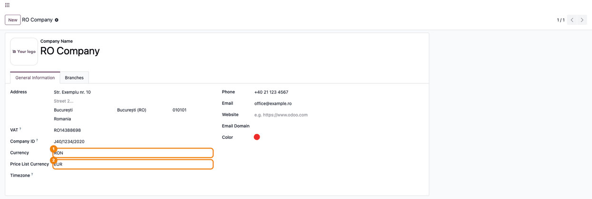
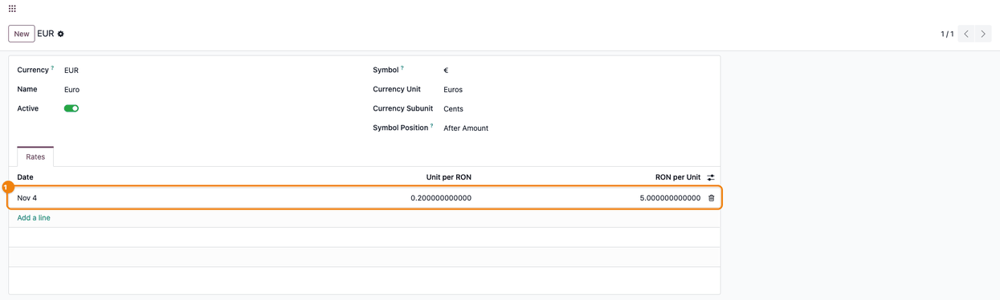
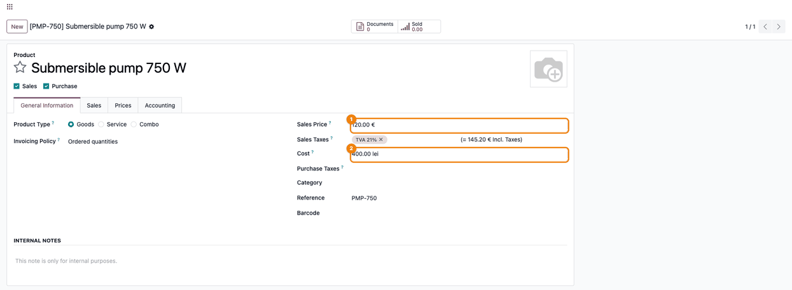
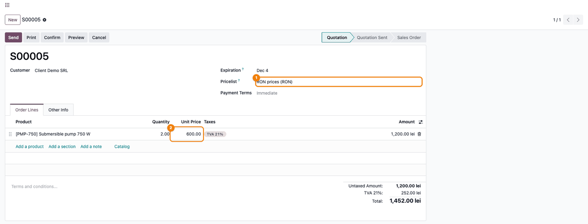

============================
Pricelist Currency Extension
============================

..
   !!!!!!!!!!!!!!!!!!!!!!!!!!!!!!!!!!!!!!!!!!!!!!!!!!!!
   !! This file is generated by oca-gen-addon-readme !!
   !! changes will be overwritten.                   !!
   !!!!!!!!!!!!!!!!!!!!!!!!!!!!!!!!!!!!!!!!!!!!!!!!!!!!
   !! source digest: sha256:560cee74ec06062dad797f5d41005cd70c1f6288f9117893d3a4f50c14bc0d5e
   !!!!!!!!!!!!!!!!!!!!!!!!!!!!!!!!!!!!!!!!!!!!!!!!!!!!

.. |badge1| image:: https://img.shields.io/badge/maturity-Mature-brightgreen.png
    :target: https://odoo-community.org/page/development-status
    :alt: Mature
.. |badge2| image:: https://img.shields.io/badge/license-LGPL--3-blue.png
    :target: http://www.gnu.org/licenses/lgpl-3.0-standalone.html
    :alt: License: LGPL-3
.. |badge3| image:: https://img.shields.io/badge/github-dhongu%2Fdeltatech-lightgray.png?logo=github
    :target: https://github.com/dhongu/deltatech/tree/20.0/deltatech_pricelist
    :alt: dhongu/deltatech
.. |badge_fisa| image:: https://img.shields.io/badge/-Fi%C8%99%C4%83%20consultant-2ea44f.png
    :target: https://github.com/dhongu/deltatech/blob/20.0/deltatech_pricelist/readme/FISA_CONSULTANT.md
    :alt: Fișă consultant

|badge1| |badge2| |badge3| |badge_fisa|

Lets a company keep the **Sales Price** of its products in a currency
other than its accounting currency, for example prices in EUR in a
company that keeps its books in RON. Sales orders and pricelists convert
the price to their own currency at the rate of the day.

**Price List Currency on the company.** Adds the **Price List Currency**
field on the company form, under **Currency**. The currency of the
product **Sales Price** becomes this currency for all the products of
the company. Products shared between companies use the price list
currency of the main company.

**Conversion in pricelists and sales.** When a pricelist or a sales
order is in another currency, the sales price is converted from the
price list currency with the standard Odoo currency rates. The **Cost**
of products stays in the company currency.

Configuration
-------------

Go to *Settings > Users & Companies > Companies*, open the company and
set **Price List Currency**. To keep the sales prices in the company
currency, set it to the same currency as **Currency**.

Limitations
-----------

- The setting applies to the whole company: all products use the same
  price list currency; it cannot be chosen per product.
- On installation every company gets EUR as **Price List Currency**. In
  a company whose currency is not EUR, the existing sales prices are
  then read as EUR amounts until the field is changed.

**Table of contents**

.. contents::
   :local:

Usage
=====

1. Open the company (*Settings > Users & Companies > Companies*). Under
   **Currency** (the accounting currency), choose the **Price List
   Currency**: the currency in which the sales prices of all the
   products of the company are kept. Save.

   |Company form, General Information tab: Currency (1) is RON and Price
   List Currency (2) is EUR|

2. Check that the price list currency has a rate (*Invoicing >
   Configuration > Accounting > Currencies*, open **EUR**, tab
   **Rates**). Odoo uses the last rate up to the date of the document.

   |The EUR currency, Rates tab: one rate (1) for Nov 4, Unit per RON
   0.200000000000 and RON per Unit 5.000000000000|

3. Open the product (*Sales > Products > Products*) and enter the
   **Sales Price** in the price list currency: the currency symbol (€)
   is shown next to it. The **Cost** stays in the company currency.

   |Product form: Sales Price (1) is 120.00 € and Cost (2) is 400.00
   lei|

4. Create a quotation (*Sales > Orders > Quotations*) with a pricelist
   in the company currency, or with no pricelist, and add the product:
   the **Unit Price** is the sales price converted at the rate of the
   quotation/order date, here 120.00 € × 5 = 600.00 lei.

   |Quotation with the pricelist RON prices (RON) (1): the Unit Price
   (2) of the pump is 600.00, the amount for 2 units 1,200.00 lei|

A pricelist in the same currency as the sales price (EUR) does not
convert it. On a pricelist in another currency, **Discount** and
**Formula** rules start from the converted price; **Fixed Price**
amounts are already in the pricelist currency. A quotation keeps the
price computed when the line was added, at the rate of its
quotation/order date: it does not follow a later rate by itself.
Customer invoices created without a sales order convert the sales price
in the same way.

Changelog
=========

19.0.1.0.3 (2026-11-03)
-----------------------

- Description rewritten from the code: the price list currency is set
  per company (default EUR), not per product.
- Documented that on installation all companies get EUR as price list
  currency.
- Summary and banner corrected; removed the readable discount formula on
  price rules, which is not active.

19.0.1.0.2 (2026-10-22)
-----------------------

- Listed on Odoo Apps as *Pricelist Currency Extension* (was *Price List
  Currency Extension*). The technical name ``deltatech_pricelist`` does
  not change.

19.0.1.0.1 (2026-09-29)
-----------------------

- Own module icon, instead of the generic gears it had.

Bug Tracker
===========

Bugs are tracked on `Terrabit Issues <https://www.terrabit.ro/helpdesk>`_.
In case of trouble, please check there if your issue has already been reported.

Do not contact contributors directly about support or help with technical issues.

Credits
=======

Authors
-------

* Terrabit
* Dorin Hongu

Maintainers
-----------

.. |maintainer-dhongu| image:: https://github.com/dhongu.png?size=40px
    :target: https://github.com/dhongu
    :alt: dhongu

Current maintainer:

|maintainer-dhongu| 

This module is part of the `dhongu/deltatech <https://github.com/dhongu/deltatech/tree/20.0/deltatech_pricelist>`_ project on GitHub.

You are welcome to contribute.