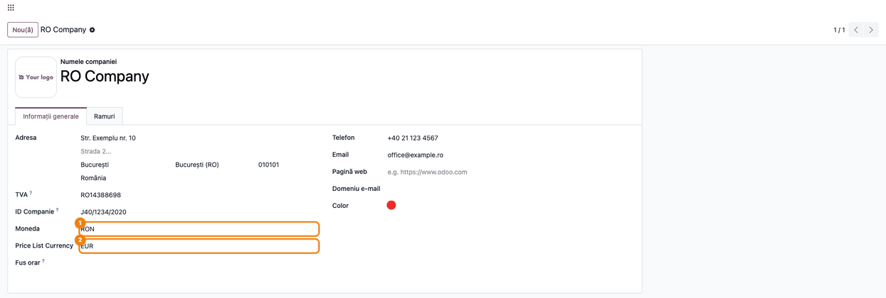
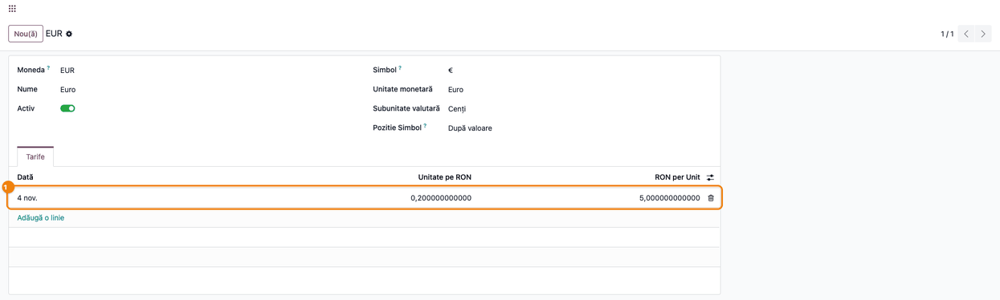
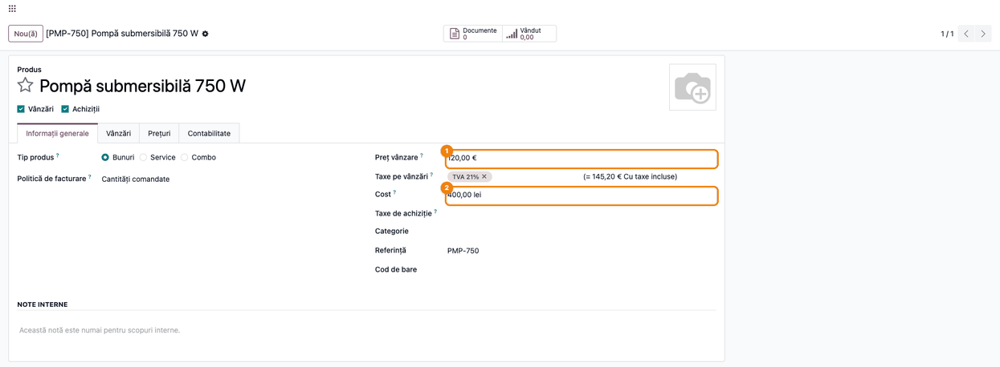
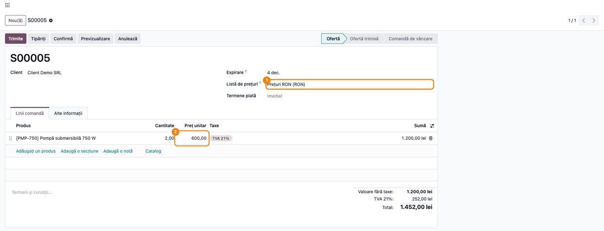

# Fișă Modul: Prețurile de vânzare într-o altă monedă decât moneda companiei

**Modul:** `deltatech_pricelist`
**Utilizator principal:** Administrator Odoo / responsabil cu prețurile (configurare); agent de vânzări (utilizare)
**Prioritate:** 🟡 Medie (schimbă moneda în care se citesc toate prețurile de vânzare ale companiei; nu generează note contabile)

---

## 1. Scop business

Multe firme din România își țin evidența contabilă în lei, dar își stabilesc prețurile de vânzare în
euro (de exemplu, distribuitorii de echipamente din import, care primesc listele de preț de la
furnizori în EUR). În Odoo standard, **Prețul de vânzare** al produsului este mereu în moneda
companiei, deci prețurile în euro trebuie recalculate manual la fiecare schimbare de curs.

Modulul `deltatech_pricelist` adaugă pe companie câmpul **Price List Currency** (moneda listei de
prețuri). Prețul de vânzare al tuturor produselor companiei se citește în această monedă, de exemplu
120,00 €, iar comenzile de vânzare, facturile și listele de prețuri în lei îl convertesc automat la
cursul zilei. **Costul** produselor rămâne în moneda companiei (lei), deci evaluarea stocului și
contabilitatea nu se schimbă.

## 2. Bază legală și context

Modulul nu are un temei legal specific: este o setare de lucru pentru prețuri. Context pentru
consultant:

- **Contabilitatea rămâne în lei.** Comenzile și facturile emise în lei au deja prețul convertit; notele
  contabile se fac în lei, ca în standard. Modulul nu schimbă moneda documentelor, doar moneda în care
  este păstrat prețul de vânzare de pe produs.
- **Cursul folosit** este cursul din Odoo, la data documentului (de regulă, cursul BNR actualizat
  automat sau introdus manual în **Valute**). Firma decide dacă vinde la cursul BNR sau la un curs
  propriu; modulul nu adaugă un curs separat.

## 3. Utilizatori și roluri

| Rol | Ce face |
|---|---|
| Administrator (drept de modificare pe companii) | Alege **Price List Currency** pe companie |
| Responsabil prețuri (Vânzări / Administrator) | Introduce prețurile de vânzare în moneda listei de prețuri; întreține listele de prețuri |
| Contabil (Facturare / Administrator) | Actualizează cursurile valutare |
| Agent de vânzări | Face oferte și comenzi; vede prețul convertit în moneda comenzii |

**Roluri recomandate la testare:** *Administrare / Setări* pentru configurare; *Vânzări / Administrator*
cu opțiunile **Valute multiple** și **Liste de prețuri** active, pentru flux.

## 4. Conturi și date implicate

Modulul **nu generează note contabile** și nu atinge conturi. Date minime pentru demo (cele din
capturi):

- compania **RO Company**, moneda **RON**, **Price List Currency** = **EUR**;
- valuta **EUR** activă, cu un curs la data de azi: **1 EUR = 5 RON** (curs rotund, ca rezultatele să
  se verifice ușor);
- produsul **Pompă submersibilă 750 W** (cod `PMP-750`), **Preț vânzare** 120,00 €, **Cost** 400,00 lei,
  TVA 21%;
- lista de prețuri **Prețuri RON**, în moneda RON, fără reguli;
- clientul **Client Demo SRL**.

Câmpul adăugat de modul: **Price List Currency** (`price_currency_id`) pe companie, sub **Moneda**.
Eticheta nu are traducere în română: apare în engleză și în interfața românească.

## 5. Configurare inițială

1. Instalați modulul (depinde de **Vânzări**, `sale`). La instalare, **toate companiile primesc EUR**
   ca **Price List Currency** — vezi avertismentul de mai jos. Și companiile create după instalare
   primesc implicit EUR: verificați câmpul la fiecare companie nouă.
2. Activați valuta în care țineți prețurile (*Facturare → Configurare → Contabilitate → Valute*,
   comutatorul **Activ** pe EUR) și opțiunea **Liste de prețuri** din *Vânzări → Configurare → Setări*,
   dacă folosiți liste de prețuri.
3. Asigurați-vă că există curs pentru valuta respectivă (actualizare automată BNR sau curs introdus
   manual), altfel conversia se face la cursul 1.

> **Atenție la instalarea pe o bază cu produse existente.** Prețurile de vânzare existente nu se
> convertesc: același număr se citește în noua monedă. Un produs care costa 600 lei devine 600 € după
> instalare, dacă moneda companiei e RON. Fie actualizați prețurile (de exemplu, prin import), fie
> setați **Price List Currency** la moneda companiei, ca prețurile să rămână cum erau.

## 6. Flux de utilizare

### Pasul 1 — Alegeți moneda listei de prețuri pe companie

**Meniu:** *Setări → Utilizatori & Companii → Companii*, deschideți compania.

În tabul **Informații generale**, sub **Moneda** (moneda contabilă a companiei), alegeți **Price List
Currency**: moneda în care se citesc prețurile de vânzare ale produselor. Salvați.

- Pentru prețuri în euro: **EUR**.
- Pentru prețuri în lei (comportamentul standard Odoo): aceeași monedă ca **Moneda**, adică **RON**.

Setarea e pe companie: toate produsele companiei folosesc aceeași monedă. Produsele fără companie
(comune mai multor companii) folosesc moneda listei de prețuri a companiei principale. Nu lăsați
câmpul gol: pe o companie fără **Price List Currency**, produsele ei preiau moneda listei de prețuri a
companiei principale, nu moneda companiei.



### Pasul 2 — Verificați cursul valutei

**Meniu:** *Facturare → Configurare → Contabilitate → Valute*, deschideți **EUR**.

1. **Găsiți pe ecran** tabul **Tarife**: fiecare rând este un curs, cu **Dată**, **Unitate pe RON** și
   **RON per Unit**.
2. **Verificați** că există un curs la data documentelor pe care le emiteți (sau înainte de ea): Odoo
   folosește ultimul curs până la data documentului. În exemplu, cursul din 4 noiembrie este
   5,000000000000 RON pentru 1 EUR.



### Pasul 3 — Introduceți prețul de vânzare în moneda listei de prețuri

**Meniu:** *Vânzări → Produse → Produse*, deschideți sau creați produsul.

În tabul **Informații generale**, **Preț vânzare** se introduce în moneda listei de prețuri: simbolul
monedei (€) apare lângă valoare. **Cost** rămâne în moneda companiei (lei). Și calculul cu taxe de
lângă **Taxe pe vânzări** este în euro.



### Pasul 4 — Vindeți în lei: prețul se convertește la curs

**Meniu:** *Vânzări → Comenzi → Oferte*, butonul **Nou**.

Alegeți clientul și o **Listă de prețuri** în lei (sau nicio listă: comanda e atunci în moneda
companiei), apoi adăugați produsul. **Preț unitar** se completează cu prețul de vânzare convertit la
cursul de la data ofertei (**Data ofertă**; după confirmare, **Data comenzii**).

1. **Găsiți pe ecran** lista de prețuri (moneda ei e afișată în paranteză) și coloana **Preț unitar** a
   liniei.
2. **Verificați** că prețul unitar = prețul de vânzare × cursul: 120,00 € × 5 = **600,00 lei**; pentru 2
   bucăți, **Valoare fără taxe** 1.200,00 lei, **TVA 21%** 252,00 lei, **Total** 1.452,00 lei.
3. **Continuați** fluxul standard: **Confirmă**, livrare, factură. Factura preia prețul în lei de pe
   comandă.



### Cum se comportă listele de prețuri (fără ecran nou)

- **Listă de prețuri în aceeași monedă ca prețul de vânzare (EUR):** prețul nu se convertește; oferta
  e în euro, cu 120,00 €.
- **Listă în altă monedă (RON):** regulile de tip **Reducere** sau **Formula** pornesc de la prețul de
  vânzare convertit în lei; de exemplu, un discount de 10% dă 540,00 lei.
- **Regulă cu Preț fixat:** suma din regulă se scrie direct în moneda listei de prețuri și nu se
  convertește.
- **Regulă pe bază de Cost:** costul (în lei) se convertește în moneda listei, ca în standard.
- **Factură fără comandă** (*Facturare → Clienți → Facturi*): prețul produsului se convertește la fel,
  în moneda facturii, la data facturii.

### Note de monografie și raportare

Modulul nu generează note contabile. Comenzile și facturile au deja prețul în moneda documentului,
deci notele de vânzare (de exemplu 4111 = 707 + 4427) se fac ca în standard, în lei. Diferențele de curs
dintre momentul ofertei și al facturii nu apar ca note: prețul de pe ofertă rămâne cel calculat la
adăugarea liniei, la cursul de la data ofertei (**Data ofertă**; după confirmare, **Data comenzii**).

## 7. Legături cu alte module / declarații

| Modul | Rol |
|---|---|
| `product` | Prețul de vânzare și moneda produsului; listele de prețuri și conversia lor |
| `sale` | Comenzile de vânzare, care preiau prețul convertit în moneda listei de prețuri |
| `account` | Facturile fără comandă, care preiau prețul convertit; cursurile valutare |
| Actualizarea automată a cursurilor (de ex. BNR) | Furnizează cursul la care se face conversia |
| `website_sale` (dacă e instalat) | Magazinul afișează prețul în moneda listei de prețuri a site-ului, convertit la fel |

**Ce e automat:** moneda prețului de vânzare pentru toate produsele companiei; conversia la cursul
zilei în comenzi, facturi și liste de prețuri în altă monedă.

**Ce rămâne manual:** alegerea monedei pe companie; actualizarea prețurilor existente la schimbarea
monedei; actualizarea cursurilor (dacă nu e automată); actualizarea prețului pe o ofertă veche (ofertă nouă, vezi §9), când
cursul s-a schimbat.

## 8. Verificări pentru consultant

- [ ] Câmpul **Price List Currency** apare pe formularul companiei, sub **Moneda**.
- [ ] Cu **Price List Currency** = EUR, **Preț vânzare** al produsului se afișează cu €, iar **Cost**
      cu lei.
- [ ] Valuta EUR are un curs la data documentelor (*Valute → EUR → Tarife*).
- [ ] Pe o ofertă cu listă de prețuri în RON, **Preț unitar** = preț de vânzare × curs (120 € × 5 =
      600,00 lei).
- [ ] Pe o ofertă cu listă de prețuri în EUR, **Preț unitar** este chiar prețul de vânzare (120,00), fără
      conversie.
- [ ] O regulă de **Reducere** 10% pe o listă în RON dă 540,00 lei (discountul se aplică după
      conversie).
- [ ] O factură creată direct, în lei, preia prețul convertit.
- [ ] Cu **Price List Currency** = RON (aceeași monedă ca a companiei), prețurile se comportă ca în Odoo
      standard.
- [ ] După instalare, pe o bază cu produse existente, prețurile de vânzare au fost verificate: nu au
      fost convertite, doar citite în noua monedă.

## 9. Mesaje de eroare frecvente

Modulul nu afișează mesaje de eroare proprii. Situațiile de mai jos se văd în valori, nu în mesaje.

| Ce vede operatorul | Cauză | Remediere |
|---|---|---|
| Prețurile produselor au simbolul € după instalare, deși au fost introduse în lei | La instalare (și la crearea unei companii noi), companiile primesc EUR ca **Price List Currency** | Setați **Price List Currency** = RON sau actualizați prețurile în euro |
| Prețurile unei filiale apar în moneda companiei principale | **Price List Currency** e gol pe filială | Completați explicit câmpul pe filială |
| **Preț unitar** în lei este egal cu prețul în euro (120,00 în loc de 600,00) | Valuta EUR nu are niciun curs, deci conversia se face la cursul 1 | Introduceți cursul EUR (*Valute → EUR → Tarife*) sau porniți actualizarea automată |
| Prețul unitar folosește un curs vechi | Cursul nu era actualizat la data ofertei sau oferta a fost creată înainte de cursul nou: conversia se face la cursul de la data ofertei (**Data ofertă**; după confirmare, **Data comenzii**) | Actualizați cursul; pentru o ofertă veche, faceți o ofertă nouă (alternativ, în modul dezvoltator, modificați **Data ofertă** și adăugați din nou liniile) |
| O companie din grup are prețuri în altă monedă decât cea așteptată | Setarea e per companie; produsele fără companie folosesc setarea companiei principale | Verificați **Price List Currency** pe fiecare companie și compania produsului |
| Pe o ofertă în lei, prețul unitar e același cu cel de pe produs, deși cursul există | Lista de prețuri a ofertei e în aceeași monedă ca prețul de vânzare (EUR), deci oferta e în euro | Alegeți lista de prețuri în lei sau lăsați oferta în euro, dacă așa a fost cerut |

## 10. Capturi de ecran

Capturile sunt **generate automat** de testul `tests/test_screenshots.py` (mixinul `ScreenshotCase`
din `deltatech_doc_screenshots`, import defensiv), în română, pe compania „RO Company" în RON, cu
cursul 1 EUR = 5 RON. Regenerare:

```bash
./odoo/odoo-bin -c odoo.conf -d <db> -i deltatech_pricelist,deltatech_doc_screenshots \
    --test-tags=/deltatech_pricelist:TestPricelistScreenshots --stop-after-init
```

| Fișier | Ce arată |
|---|---|
| `01_moneda_lista_preturi_companie.png` | Compania: Moneda RON și Price List Currency EUR |
| `02_curs_eur.png` | Valuta EUR, tabul Tarife: cursul de 5 RON pentru 1 EUR |
| `03_pret_vanzare_eur_produs.png` | Produsul: Preț vânzare 120,00 €, Cost 400,00 lei |
| `04_comanda_vanzare_pret_ron.png` | Oferta în RON: Preț unitar 600,00 lei, prețul convertit la curs |

Capturile în engleză pentru `readme/USAGE.md` (Odoo Apps) se generează din aceleași shot-uri, în
`static/description/en/`.

## 11. Observații pentru manual

- Păstrați avertismentul de la instalare: prețurile existente nu se convertesc, iar implicit toate
  companiile primesc EUR. E prima întrebare la o bază în producție.
- Explicați diferența dintre **Moneda** (contabilitate, documente) și **Price List Currency** (doar
  prețul de vânzare de pe produs); costul rămâne în moneda companiei.
- Precizați că oferta păstrează prețul calculat la adăugarea liniei, la cursul de la data ofertei (**Data ofertă**; după confirmare, **Data comenzii**):
  la o ofertă veche, prețul nu urmează singur cursul nou.
- La grupuri cu mai multe companii, menționați că produsele comune folosesc moneda listei de prețuri a
  companiei principale.
