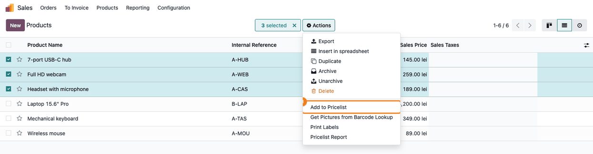

====================
Pricelist Bulk Rules
====================

..
   !!!!!!!!!!!!!!!!!!!!!!!!!!!!!!!!!!!!!!!!!!!!!!!!!!!!
   !! This file is generated by oca-gen-addon-readme !!
   !! changes will be overwritten.                   !!
   !!!!!!!!!!!!!!!!!!!!!!!!!!!!!!!!!!!!!!!!!!!!!!!!!!!!
   !! source digest: sha256:2605ab9e7a4dbe7de8179285d57e5ea860983e4598f39fb9696fea0df4af9356
   !!!!!!!!!!!!!!!!!!!!!!!!!!!!!!!!!!!!!!!!!!!!!!!!!!!!

.. |badge1| image:: https://img.shields.io/badge/maturity-Beta-yellow.png
    :target: https://odoo-community.org/page/development-status
    :alt: Beta
.. |badge2| image:: https://img.shields.io/badge/github-dhongu%2Fdeltatech-lightgray.png?logo=github
    :target: https://github.com/dhongu/deltatech/tree/19.0/deltatech_pricelist_bulk
    :alt: dhongu/deltatech

|badge1| |badge2|

Adds rules to a pricelist for many products at once and applies the same
price computation to many existing rules, instead of entering the rules
one by one.

**Add rules for many products.** The **Add Rules** button on the
pricelist form, and the **Add to Pricelist** action on the selected
products (list or kanban of products or product variants), open a wizard
where you:

- choose what the rules apply on: **Products**, **Product Variants** or
  **Product Categories**;
- pick the products, or fill the list with all the products of some
  categories and of their subcategories (**Add Products of
  Categories**);
- set once the **Min. Quantity**, the **Validity Period** and the price
  computation, with the same options as a standard rule: **Fixed
  Price**, **Discount** (optionally on another pricelist) or **Formula**
  (based on the sales price, the cost or another pricelist, with
  discount or markup, rounding, extra fee and margins);
- choose what happens when the pricelist already has a rule for the same
  product, minimum quantity and validity period: keep it, update it or
  add a new rule.

One rule is created for each product, variant or category. At the end, a
message shows how many rules were added, updated or kept, and the
resulting rules open in a list.

**Apply the same formula to many rules.** The **Apply Formula** button
on the pricelist form (all the rules of the pricelist) and the **Apply
Formula** action on the selected rules of a rules list change, on all
the rules at once:

- the price computation; the values of the other price types are
  cleared, as on the standard rule form;
- and/or the minimum quantity;
- and/or the validity period.

**Table of contents**

.. contents::
   :local:

Usage
=====

Enable the pricelists first: *Sales > Configuration > Settings*, section
**Pricing**, tick **Pricelists** and save.

**Add rules for many products**

1. Go to *Sales > Products > Pricelists* and open a pricelist. The
   header has the **Add Rules** and **Apply Formula** buttons (**Apply
   Formula** only when the pricelist has rules).

   |Pricelist form with the Add Rules and Apply Formula buttons
   highlighted in the header and two fixed price rules of a laptop in
   the Sales Prices tab|

2. Click **Add Rules**. Choose **Apply On** (products, product variants
   or product categories) and add the products. To take all the products
   of a category and of its subcategories, select it in **Add Products
   of Categories**. Set the **Min. Quantity**, the **Validity Period**
   and the price computation, then choose what to do with a rule that
   already exists for the same product, minimum quantity and validity
   period: keep it, update it or add a new rule.

   |Add Pricelist Rules wizard with five peripherals selected, a Formula
   based on the Sales Price with 10% discount, rounding to 1.00 and an
   extra fee of -0.01, and Keep the existing rule selected|

3. Click **Add Rules**. A message shows how many rules were added,
   updated or kept, and the rules open in a list.

   |Price Rules list with the message 5 rules added, 0 rules updated, 0
   existing rules kept, and one rule for each peripheral with the same
   10 % discount on sales price - 0.01 rebate|

4. You can also start from the products: in *Sales > Products >
   Products*, select the products and use *Actions > Add to Pricelist*.
   The wizard opens with the selected products; choose the pricelist.

   |Product list with three products selected and the Actions menu open
   on Add to Pricelist|

**Apply the same formula to many rules**

1. On the pricelist form, click **Apply Formula** to change all its
   rules, or select some rules in a list of pricelist rules and use
   *Actions > Apply Formula*. Remove from the list the rules you do not
   want to change.

2. Tick what to change: **Change the Price Computation**, **Change the
   Min. Quantity** and/or **Change the Validity Period**, and set the
   new values. What is not ticked stays as it is on each rule.

   |Apply Formula wizard on the 7 rules of the pricelist, with Change
   the Price Computation ticked and a Formula based on the Cost with 35%
   markup, rounding to 1.00 and an extra fee of -0.01|

3. Click **Apply**. All the selected rules get the new computation; the
   values of the old price type (e.g. the fixed price) are cleared, as
   on the standard rule form.

   |Pricelist form after the change: the message 7 rules changed and all
   the rules in the Sales Prices tab with 35 % markup on product cost -
   0.01 rebate, the minimum quantities unchanged|

.. |Pricelist form with the Add Rules and Apply Formula buttons highlighted in the header and two fixed price rules of a laptop in the Sales Prices tab| image:: https://raw.githubusercontent.com/dhongu/deltatech/19.0/deltatech_pricelist_bulk/static/description/en/01_formular_lista_preturi.png
.. |Add Pricelist Rules wizard with five peripherals selected, a Formula based on the Sales Price with 10% discount, rounding to 1.00 and an extra fee of -0.01, and Keep the existing rule selected| image:: https://raw.githubusercontent.com/dhongu/deltatech/19.0/deltatech_pricelist_bulk/static/description/en/02_asistent_adauga_reguli.png
.. |Price Rules list with the message 5 rules added, 0 rules updated, 0 existing rules kept, and one rule for each peripheral with the same 10 % discount on sales price - 0.01 rebate| image:: https://raw.githubusercontent.com/dhongu/deltatech/19.0/deltatech_pricelist_bulk/static/description/en/03_reguli_adaugate.png

.. |Apply Formula wizard on the 7 rules of the pricelist, with Change the Price Computation ticked and a Formula based on the Cost with 35% markup, rounding to 1.00 and an extra fee of -0.01| image:: https://raw.githubusercontent.com/dhongu/deltatech/19.0/deltatech_pricelist_bulk/static/description/en/05_asistent_aplica_formula.png
.. |Pricelist form after the change: the message 7 rules changed and all the rules in the Sales Prices tab with 35 % markup on product cost - 0.01 rebate, the minimum quantities unchanged| image:: https://raw.githubusercontent.com/dhongu/deltatech/19.0/deltatech_pricelist_bulk/static/description/en/06_reguli_dupa_formula.png

Changelog
=========

19.0.1.0.0 (2026-11-09)
-----------------------

- New module: add pricelist rules for many products, variants or
  categories at once, and apply the same price computation, minimum
  quantity or validity period to many rules.
- A rule based on its own pricelist is refused for every price type
  (also Discount on a pricelist), in both wizards; existing rules are
  found with one search for all the products.

Bug Tracker
===========

Bugs are tracked on `Terrabit Issues <https://www.terrabit.ro/helpdesk>`_.
In case of trouble, please check there if your issue has already been reported.

Do not contact contributors directly about support or help with technical issues.

Credits
=======

Authors
-------

* Terrabit
* Dorin Hongu

Maintainers
-----------

.. |maintainer-dhongu| image:: https://github.com/dhongu.png?size=40px
    :target: https://github.com/dhongu
    :alt: dhongu

Current maintainer:

|maintainer-dhongu| 

This module is part of the `dhongu/deltatech <https://github.com/dhongu/deltatech/tree/19.0/deltatech_pricelist_bulk>`_ project on GitHub.

You are welcome to contribute.