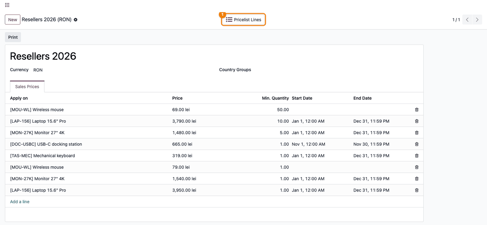
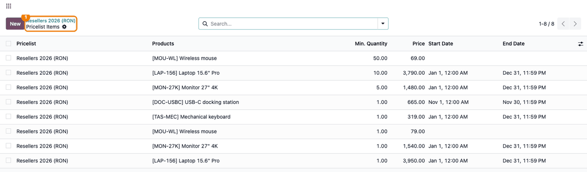
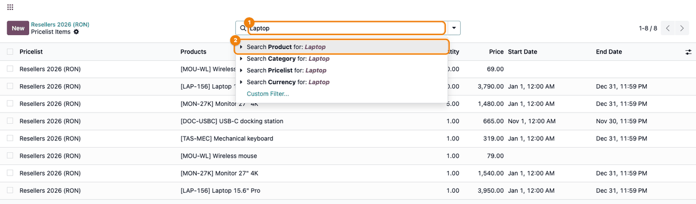
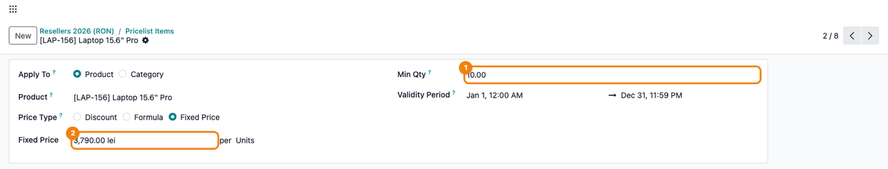
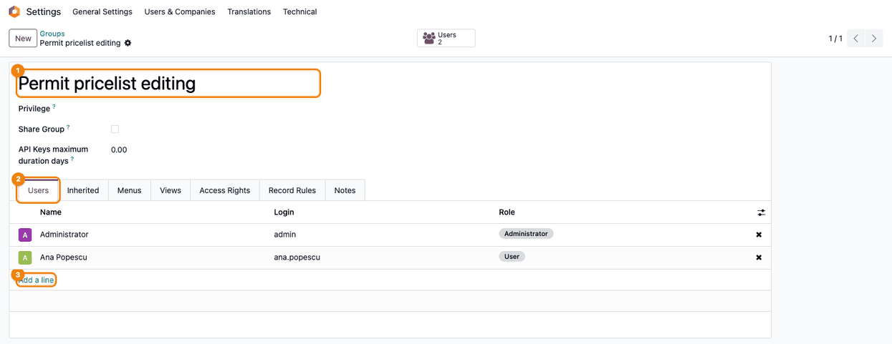
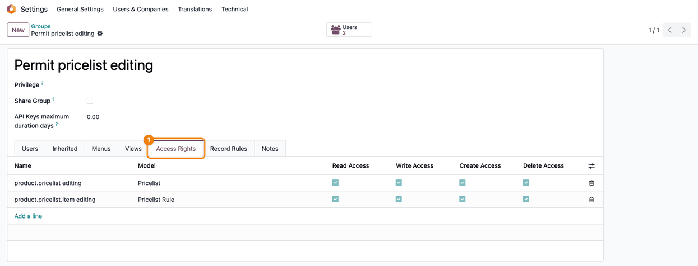

======================
Price List Line Viewer
======================

..
   !!!!!!!!!!!!!!!!!!!!!!!!!!!!!!!!!!!!!!!!!!!!!!!!!!!!
   !! This file is generated by oca-gen-addon-readme !!
   !! changes will be overwritten.                   !!
   !!!!!!!!!!!!!!!!!!!!!!!!!!!!!!!!!!!!!!!!!!!!!!!!!!!!
   !! source digest: sha256:ca71e9dc937a6aa55406e104fc858575c6d67fb4f9162b4c57eab18a4cb4f445
   !!!!!!!!!!!!!!!!!!!!!!!!!!!!!!!!!!!!!!!!!!!!!!!!!!!!

.. |badge1| image:: https://img.shields.io/badge/maturity-Alpha-red.png
    :target: https://odoo-community.org/page/development-status
    :alt: Alpha
.. |badge2| image:: https://img.shields.io/badge/github-dhongu%2Fdeltatech-lightgray.png?logo=github
    :target: https://github.com/dhongu/deltatech/tree/20.0/deltatech_pricelist_line_viewer
    :alt: dhongu/deltatech
.. |badge_fisa| image:: https://img.shields.io/badge/-Fi%C8%99%C4%83%20consultant-2ea44f.png
    :target: https://github.com/dhongu/deltatech/blob/20.0/deltatech_pricelist_line_viewer/readme/FISA_CONSULTANT.md
    :alt: Fișă consultant
.. |badge_tests| image:: https://img.shields.io/badge/-3%20automated%20tests-2ea44f.png
    :target: https://github.com/dhongu/deltatech/tree/20.0/deltatech_pricelist_line_viewer/tests
    :alt: 3 automated tests

|badge1| |badge2| |badge_fisa| |badge_tests|

This module adds a **Pricelist Lines** button to the pricelist form. The
button opens all the rules of that pricelist in a full list view, with
the standard search, filters and grouping, which makes large pricelists
much easier to review and maintain than the **Sales Prices** tab of the
form.

Key features:

- **Pricelist Lines** button on the pricelist form, opening the rules of
  the current pricelist only (columns Pricelist, Products, Min.
  Quantity, Price, Start Date, End Date; Currency, Based on and Apply On
  as optional columns);
- search on the rules by **Product**, **Category**, **Pricelist** and
  **Currency**;
- new rules created from the list get the current pricelist by default;
- the **Permit pricelist editing** group gives read, write, create and
  delete rights on pricelists and pricelist rules, so a user can manage
  prices without being a Sales Administrator.

.. IMPORTANT::
   This is an alpha version, the data model and design can change at any time without warning.
   Only for development or testing purpose, do not use in production.
   `More details on development status <https://odoo-community.org/page/development-status>`_

**Table of contents**

.. contents::
   :local:

Usage
=====

Enable pricelists first: *Sales > Configuration > Settings*, **Pricing**
section, tick **Pricelists** and save.

1. Go to *Sales > Products > Pricelists* and open a pricelist. Click the
   **Pricelist Lines** button at the top of the form.

   |Pricelist form with the Pricelist Lines button highlighted (1) and
   the rules in the Sales Prices tab|

2. The list shows all the rules of this pricelist: product, minimum
   quantity, price and validity period. The **Price** column shows the
   fixed price; for *Discount* or *Formula* rules open the rule to see
   the price. For category or all-products rules the **Products** column
   is empty; show the optional **Apply On** column.

   |The rules of the pricelist opened from the button, with the
   breadcrumb highlighted (1)|

3. Type a product name or code in the search bar (1) and choose **Search
   Product for: ...** (2). Category, pricelist and currency (with
   several active currencies) searches and the standard group by options
   are also available.

   |The search bar (1) with the text Laptop and the Search Product
   proposal (2)|

4. Click a line to open the rule, change for instance **Min Qty** or
   **Fixed Price** and save. **New** creates a rule already linked to
   the current pricelist. Start and end dates include the time: set the
   end time to 23:59 so the rule applies for the whole last day.

   |A pricelist rule opened from the list: Min Qty (1) and Fixed Price
   (2)|

5. To let a user manage prices without Sales Administrator rights,
   activate the developer mode, go to *Settings > Users & Companies >
   Groups*, open **Permit pricelist editing** (1) and add the user in
   the **Users** tab (2) with **Add a line** (3). In developer mode the
   group can also be ticked on the user form, **Access Rights** tab,
   **Extra Rights** section.

   |The Permit pricelist editing group (1), Users tab (2) and Add a line
   (3)|

   The **Access Rights** tab (1) shows the rights granted: read, write,
   create and delete on pricelists and pricelist rules.

   |The Access Rights tab (1) of the group: full rights on Pricelist and
   Pricelist Rule|

Changelog
=========

20.0.0.0.4 (2026-11-04)
-----------------------

- Migration to Odoo 20.0: access rights in ``security/ir.access.csv``;
  the *Pricelist Lines* button moved into the standard button box of the
  price list form.

19.0.0.0.4 (2026-10-09)
-----------------------

- Apps Store banner (banner.json).

19.0.0.0.3 (2026-09-29)
-----------------------

- Own module icon, instead of the generic gears it had.

Bug Tracker
===========

Bugs are tracked on `Terrabit Issues <https://www.terrabit.ro/helpdesk>`_.
In case of trouble, please check there if your issue has already been reported.

Do not contact contributors directly about support or help with technical issues.

Credits
=======

Authors
-------

* Voicu Stefan
* Terrabit

Maintainers
-----------

.. |maintainer-VoicuStefan2001| image:: https://github.com/VoicuStefan2001.png?size=40px
    :target: https://github.com/VoicuStefan2001
    :alt: VoicuStefan2001

Current maintainer:

|maintainer-VoicuStefan2001| 

This module is part of the `dhongu/deltatech <https://github.com/dhongu/deltatech/tree/20.0/deltatech_pricelist_line_viewer>`_ project on GitHub.

You are welcome to contribute.