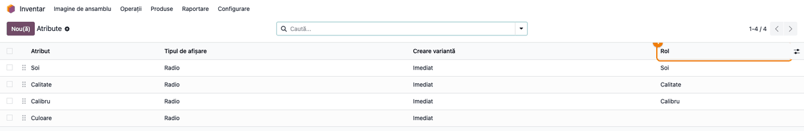
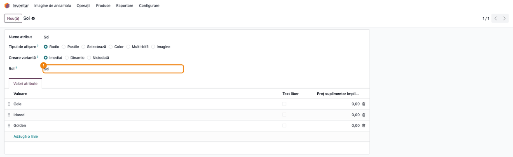
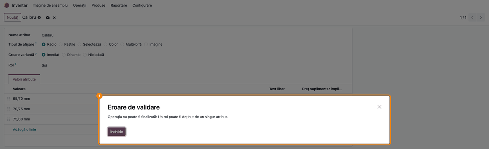

# Fișă Modul: Rolul atributului de produs

**Modul:** `deltatech_product_attribute_role`
**Utilizator principal:** Consultantul care configurează nomenclatorul de produse (administrator la
Inventar, sau administrator la Vânzări cu dreptul **Produse: Creează**)
**Prioritate:** 🟢 Scăzută (bază tehnică pentru alte module; se configurează o singură dată per
bază de date)

---

## 1. Scop business

Unele module trebuie să știe care atribut al unei variante este *soiul*, *calitatea* sau *calibrul*,
ca să completeze un lot, să tipărească un aviz sau să grupeze un raport. Dacă modulul caută atributul
după nume, legătura se rupe la prima redenumire: numele atributului se traduce, consultanții îl
corectează, iar un client îl numește „Soi”, altul „Variety”.

Modulul adaugă pe atribut câmpul **Rol**. Modulele care au nevoie de un atribut îl cer după rol, nu
după nume, iar atributul poate fi apoi redenumit sau tradus fără să strice nimic.

Modulul **nu are roluri proprii**. Lista **Rol** se completează cu rolurile aduse de modulele
instalate care le folosesc (de exemplu `inedit_apple_grading` adaugă **Soi**, **Calitate** și
**Calibru**). Fără un astfel de modul instalat, lista e goală și câmpul nu are efect.

## 2. Bază legală și context

Nu există un temei legal propriu. Contextul este operațional: documentele și rapoartele care citesc
o caracteristică a produsului (ex. soiul și calibrul pe avizul de livrare al fructelor) trebuie să
găsească mereu același atribut, oricum s-ar numi el în nomenclator.

## 3. Utilizatori și roluri

| Rol | Ce face | Drept Odoo |
|---|---|---|
| Consultant / administrator nomenclator | alege rolul fiecărui atribut, o singură dată | **Inventar: Administrator**, sau **Vânzări: Administrator** împreună cu **Produse: Creează** (primul dă meniul, al doilea dreptul de modificare; administratorii de sistem le au pe amândouă) |
| Administrator Vânzări fără **Produse: Creează** | ajunge la **Vânzări → Configurare → Produse → Atribute** și vede rolul, dar formularul e doar pentru citire | **Vânzări: Administrator** |
| Ceilalți utilizatori interni | nu ajung la lista **Atribute** (meniul **Configurare** cere drept de administrator) | **Utilizator intern** |
| Modulele care folosesc rolurile | găsesc atributul și valoarea lui pe variantă după rol | — (automat) |

Dreptul **Produse: Creează** se dă din **Setări → Utilizatori și companii → Utilizatori**, pe fișa
utilizatorului. **Vânzări: Administrator** singur nu permite modificarea atributelor.

Roluri recomandate pentru testare: un administrator Inventar (setează rolul) și un administrator
Vânzări fără **Produse: Creează** (vede rolul, dar formularul atributului e doar pentru citire).

## 4. Conturi și date implicate

Modulul nu are conturi contabile, nu creează și nu modifică note contabile.

Date minime pentru demo (folosite și în capturi):
- Compania **Demo Atribute SRL**, interfața în limba română, cu **Variante** activat.
- Un modul care adaugă roluri. În capturi, rolurile **Soi**, **Calitate** și **Calibru** sunt adăugate
  de testul de capturi, la fel cum le adaugă `inedit_apple_grading`.
- Atributele:
  - **Soi** (Gala, Idared, Golden) — rolul **Soi**;
  - **Calitate** (Extra, Cat. I, Cat. II) — rolul **Calitate**;
  - **Calibru** (65/70 mm, 70/75 mm, 75/80 mm) — rolul **Calibru**;
  - **Culoare** (Roșu, Galben) — fără rol.

## 5. Configurare inițială

1. Instalați modulul care aduce rolurile de care aveți nevoie (ex. `inedit_apple_grading`).
   `deltatech_product_attribute_role` se instalează odată cu el, ca dependență.
2. În **Inventar → Configurare → Setări**, secțiunea **Produse**, bifați **Variante** și salvați.
   Fără această setare, meniul **Atribute** nu apare.
3. Verificați că atributele există și au valorile corecte: **Inventar → Configurare → Produse →
   Atribute** (sau **Vânzări → Configurare → Produse → Atribute**).
4. Pe fiecare atribut folosit de un modul, alegeți **Rolul** (secțiunea 6, pasul 2).

## 6. Flux de utilizare

### Pasul 1 — Lista atributelor, cu coloana „Rol"

Deschideți **Inventar → Configurare → Produse → Atribute** (sau **Vânzări → Configurare → Produse →
Atribute**). Lista are coloana **Rol**, afișată implicit; o puteți ascunde sau reafișa din meniul de
coloane din dreapta antetului.

Citiți lista înainte de a modifica ceva:
1. **Găsiți pe ecran** coloana **Rol**: fiecare rând arată rolul atributului sau e gol, dacă atributul
   nu are rol.
2. **Verificați** că fiecare rol cerut de modulele instalate apare pe exact un rând (în exemplu:
   **Soi**, **Calitate**, **Calibru**) și că stă pe atributul potrivit. Un atribut fără rol (în
   exemplu **Culoare**) nu e citit de niciun modul pe baza rolului.
3. Abia apoi deschideți atributul pe care vreți să-l modificați (pasul 2).

Rolul atributelor arhivate nu apare în listă, dar rămâne ocupat (secțiunea 11).



### Pasul 2 — Alegerea rolului pe atribut

Deschideți atributul din listă (ex. **Soi**). Câmpul **Rol** stă sub **Creare variantă**. Alegeți din
listă rolul atributului și salvați. Lista **Rol** conține doar rolurile aduse de modulele instalate.

De acum, modulele care folosesc rolul **Soi** găsesc acest atribut, iar pe fiecare variantă citesc
valoarea lui (ex. **Gala**). Puteți redenumi sau traduce atributul (ex. din „Soi” în „Soi măr”),
iar legătura rămâne aceeași. Rolul nu se copiază când duplicați atributul.



### Pasul 3 — Un rol pe un singur atribut

Un rol poate sta pe un singur atribut. Dacă alegeți pe atributul **Calibru** rolul **Soi**, deja
ținut de atributul **Soi**, salvarea e refuzată cu mesajul *„Operația nu poate fi finalizată: Un rol
poate fi deținut de un singur atribut.”*

Apăsați **Închide**, apoi renunțați la modificare (butonul **×** de lângă numele atributului). Ca
să mutați rolul pe alt atribut, ștergeți-l întâi de pe atributul care îl ține, salvați, apoi
alegeți-l pe atributul nou.



### Note de monografie și raportare

Modulul nu generează note contabile și nu modifică documente. Rolul schimbă doar **care atribut**
este citit de modulele care îl folosesc. Mutarea unui rol pe alt atribut schimbă, de la acel moment,
ce citesc acele module (ex. ce soi apare pe un lot nou sau pe un aviz tipărit). Documentele deja
create și valorile salvate în ele rămân cum erau.

## 7. Legături cu alte module / declarații

| Modul / proces | Rol în flux | Tip legătură |
|---|---|---|
| `product` | atributele și variantele de produs | dependență (manifest) |
| `stock` / `sale` | meniul **Configurare → Produse → Atribute** | meniu (nu e dependență) |
| `inedit_apple_grading` | adaugă rolurile **Soi**, **Calitate**, **Calibru** și le folosește la sortarea merelor | modul care extinde lista de roluri |

**Ce e automat:**
- găsirea atributului după rol, inclusiv a unui atribut arhivat;
- citirea valorii atributului cu un anumit rol pe fiecare variantă;
- refuzul unui al doilea atribut cu același rol.

Golirea rolului pe atribute la dezinstalarea modulului care l-a adus nu o face acest modul, ci
modulul respectiv, dacă o declară (ex. `inedit_apple_grading`).

**Ce rămâne manual:**
- alegerea rolului pe fiecare atribut, o singură dată per bază de date (unele module o fac singure la
  instalare, pe atributele cu numele așteptat);
- mutarea unui rol de pe un atribut pe altul (întâi se șterge, apoi se alege);
- verificarea că fiecare rol cerut de modulele instalate are un atribut.

## 8. Verificări pentru consultant

- [ ] Cu **Variante** activat, meniul **Inventar → Configurare → Produse → Atribute** se deschide, iar
      lista are coloana **Rol**.
- [ ] Lista **Rol** din formularul atributului conține exact rolurile modulelor instalate (fără
      niciun modul care adaugă roluri, e goală).
- [ ] Fiecare rol folosit apare în coloana **Rol** pe un singur atribut, cel potrivit.
- [ ] După alegerea rolului și salvare, coloana **Rol** din listă arată rolul nou.
- [ ] Un al doilea atribut cu același rol nu se poate salva (mesajul *„Un rol poate fi deținut de un
      singur atribut.”*).
- [ ] După redenumirea atributului, documentele modulului care folosește rolul (ex. lotul sau avizul
      cu soiul) arată în continuare valoarea corectă.
- [ ] Duplicarea unui atribut cu rol creează copia fără rol.
- [ ] Un administrator Vânzări fără **Produse: Creează** vede rolul în **Vânzări → Configurare →
      Produse → Atribute**, dar formularul atributului e doar pentru citire.

## 9. Mesaje de eroare frecvente

| Mesaj / simptom | Cauză probabilă | Remediere |
|---|---|---|
| „Operația nu poate fi finalizată: Un rol poate fi deținut de un singur atribut.” | Rolul ales e deja pe alt atribut, eventual arhivat | Ștergeți rolul de pe atributul care îl ține (căutați și printre cele arhivate), apoi alegeți-l pe cel nou |
| Lista **Rol** e goală | Niciun modul instalat nu adaugă roluri | Instalați modulul care folosește rolurile (ex. `inedit_apple_grading`) |
| Meniul **Atribute** nu apare | Setarea **Variante** nu e activă | **Inventar → Configurare → Setări**, bifați **Variante** |
| Câmpul **Rol** nu se poate modifica (formularul e doar pentru citire) | Utilizatorul nu are **Inventar: Administrator** și nici **Produse: Creează** (ex. e doar **Vânzări: Administrator**) | Administratorul face schimbarea sau îi dă dreptul **Produse: Creează** |
| Un document nu mai arată soiul / calibrul | Niciun atribut nu are rolul cerut, sau varianta nu are acel atribut | Alegeți rolul pe atributul corect (pasul 2) și verificați că produsul are atributul pe variante |

## 10. Capturi de ecran

Capturile (`static/description/`) se generează automat din `tests/test_screenshots.py`, cu mixinul
`ScreenshotCase` din `deltatech_doc_screenshots` (import defensiv). Sunt în **limba română**, pe
compania **Demo Atribute SRL**, cu datele demo din secțiunea 4. Rolurile **Soi**, **Calitate** și
**Calibru** sunt adăugate de testul de capturi, ca într-un modul care le aduce cu `selection_add`.

| # | Fișier | Conținut |
|---|---|---|
| 1 | `01_lista_atribute_rol.png` | Lista **Atribute**, cu coloana **Rol** |
| 2 | `02_atribut_rol.png` | Formularul atributului **Soi**, cu câmpul **Rol** |
| 3 | `03_rol_deja_folosit.png` | Refuzul salvării când rolul **Soi** e ales și pe atributul **Calibru** |

Regenerare:

```bash
./odoo/odoo-bin -c odoo.conf -d <db> -i deltatech_product_attribute_role,stock,deltatech_doc_screenshots \
    --test-tags=fise_screenshots --stop-after-init --http-port=8987 --gevent-port=8988
```

## 11. Observații pentru manual

Prezentați modulul ca pe o setare făcută o singură dată: după instalarea modulului care aduce
rolurile, consultantul alege rolul fiecărui atribut și verifică lista. Ordinea de lucru:
1. activarea **Variantelor**;
2. verificarea listei de atribute și a coloanei **Rol**;
3. alegerea rolului pe fiecare atribut folosit;
4. verificarea unui document care citește atributul (ex. un lot sau un aviz).

Insistați pe ideea principală: **numele atributului se poate schimba liber, rolul nu**. Rolul se
mută doar conștient, de pe un atribut pe altul.

### Limitări cunoscute

- **Fără roluri proprii:** modulul singur nu face nimic vizibil în afară de câmpul gol; rolurile vin
  din alte module.
- **Atribute arhivate:** un atribut arhivat își păstrează rolul și rămâne cel găsit de modulele care
  folosesc căutarea după rol a acestui modul, deși nu mai apare în listă. Ca să eliberați rolul,
  căutați atributul cu filtrul **Arhivat** și ștergeți-i rolul.
- **Dezinstalare:** la dezinstalarea modulului care a adus un rol, rolul se golește pe atribute (așa
  îl declară `inedit_apple_grading`); la reinstalare trebuie ales din nou, dacă modulul nu o face
  singur.
- **Un atribut, un rol:** un atribut nu poate avea două roluri în același timp.
