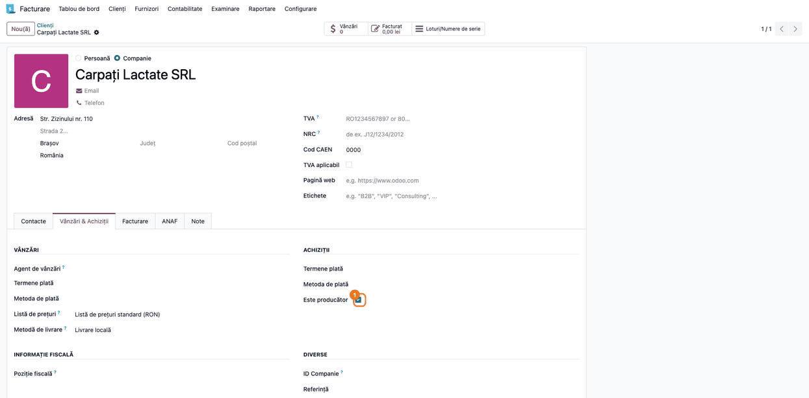
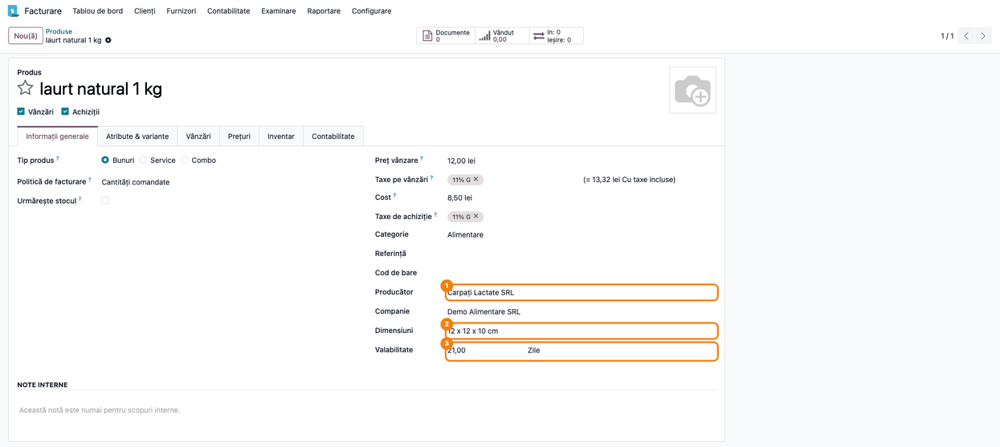
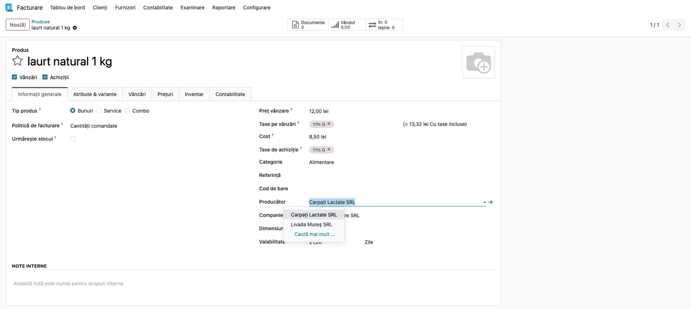
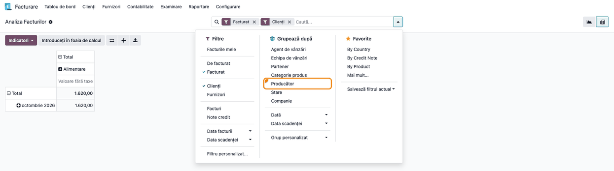
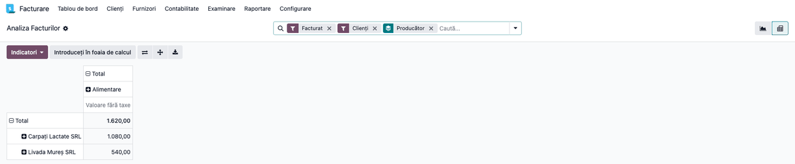

# Fișă Modul: Producătorul, dimensiunile și valabilitatea produsului, cu analiza facturilor pe producător

**Modul:** `deltatech_product_extension`
**Utilizator principal:** Responsabilul cu nomenclatorul de produse (completează datele) și
managerul comercial sau contabilul (citește vânzările pe producător)
**Prioritate:** 🟢 Scăzută (date descriptive pe produs și o grupare în plus în raport; nu
influențează stocul, prețurile sau contabilitatea)

---

## 1. Scop business

Distribuitorii vând mărfuri de la mai mulți producători, de multe ori cumpărate prin terți
(importatori, angrosiști). Furnizorul din factura de achiziție nu spune, deci, cine a fabricat
marfa. Pentru negocierea cu producătorii, pentru bonusurile de volum și pentru rapoartele cerute
de ei, vânzările trebuie citite pe **producător**.

Modulul adaugă pe produs:

- **Producător** — un partener marcat ca producător; lista de alegere conține doar partenerii
  marcați, nu toți clienții și furnizorii;
- **Dimensiuni** — un text liber (ex. „12 x 12 x 10 cm”), folosit la depozitare, transport sau
  catalog;
- **Valabilitate** și unitatea ei de măsură (ex. 21 de zile) — termenul de valabilitate al
  produsului, ca informație de nomenclator.

În **Analiza facturilor**, producătorul devine criteriu de căutare și de grupare: valoarea
facturată se poate citi pe producător, la fel ca pe categorie de produs sau pe partener.

## 2. Bază legală și context

Nu există un temei legal propriu. Câmpurile sunt date descriptive ale nomenclatorului, fără efect
fiscal sau contabil.

Valabilitatea de pe produs este o valoare de referință pentru tot produsul, nu data de expirare a
unui lot. Pentru urmărirea expirării pe loturi (data de expirare pe fiecare lot, alerte, retragerea
din vânzare), Odoo are funcția standard **Data expirării** din Inventar, care e separată de acest
modul.

## 3. Utilizatori și roluri

| Rol | Ce face | Drept Odoo |
|---|---|---|
| Responsabil nomenclator | marchează producătorii, completează producătorul, dimensiunile și valabilitatea pe produse | privilegiul **Produse** pe nivelul **Creează** (pasul 2) și **Contact** pe nivelul **Creare** (pasul 1), date pe fișa utilizatorului; administratorii de sistem le au implicit |
| Manager comercial, contabil | citește vânzările pe producător în **Analiza facturilor** | privilegiul **Contabilitate** pe nivelul **Facturare** sau mai sus |
| Utilizatori de vânzări | văd producătorul pe fișa produsului | orice utilizator intern cu acces la produse |

Roluri recomandate pentru testare: un utilizator cu privilegiile **Produse / Creează** și
**Contact / Creare**, care completează partenerii și produsele, și un utilizator cu drept de
facturare care deschide **Analiza facturilor**. Fără **Produse / Creează**, fișa produsului se
deschide doar în citire, chiar pentru un administrator de vânzări sau de facturare.

## 4. Conturi și date implicate

Modulul nu are conturi proprii și nu creează note contabile. **Analiza facturilor** arată valoarea
fără taxe a liniilor de factură deja postate.

Date minime pentru demo (folosite și în capturi):
- Companie **Demo Alimentare SRL**, plan de conturi RO, monedă RON.
- Producătorii **Carpați Lactate SRL** și **Livada Mureș SRL**, marcați **Este producător**;
  furnizorul **Logistic Expres SRL**, nemarcat; clientul **Market Central SRL**.
- Trei produse din categoria **Alimentare**, cu valabilitatea în **Zile** și TVA 11 % (cota redusă
  pentru alimente):

| Produs | Producător | Dimensiuni | Valabilitate | Preț vânzare | Facturat (fără TVA) |
|---|---|---|---|---|---|
| Iaurt natural 1 kg | Carpați Lactate SRL | 12 x 12 x 10 cm | 21 zile | 12,00 lei | 40 buc. = 480,00 lei |
| Telemea de vacă 500 g | Carpați Lactate SRL | 15 x 10 x 6 cm | 60 zile | 24,00 lei | 25 buc. = 600,00 lei |
| Mere Golden 1 kg | Livada Mureș SRL | 25 x 15 x 8 cm | 30 zile | 9,00 lei | 60 buc. = 540,00 lei |

- Trei facturi client postate în luna curentă, câte una pe produs, cu totalul fără TVA de
  1.620,00 lei.

## 5. Configurare inițială

1. Instalați `deltatech_product_extension` (depinde doar de `product` și `account`).
2. Marcați producătorii (pasul 1). Fără cel puțin un partener marcat, lista **Producător** de pe
   produs e goală.
3. Pentru valabilitate nu e nevoie de nicio setare: unitățile de timp (ex. **Zile**) vin cu Odoo,
   iar lista de unități de lângă **Valabilitate** e disponibilă oricând. Lista conține toate
   unitățile de măsură (buc., kg etc.); alegeți una de timp.

## 6. Flux de utilizare

### Pasul 1 — Marcarea partenerului ca producător

Deschideți partenerul din **Facturare → Clienți → Clienți** (sau din **Contacte**, ori din
**Achiziții → Comenzi → Furnizori**). În tab-ul **Vânzări & Achiziții**, secțiunea **Achiziții**,
bifați **Este producător** ①.

Partenerul poate fi în același timp furnizor sau client. Bifa nu schimbă nimic altceva pe
partener: doar îl face disponibil în lista **Producător** de pe produse.



### Pasul 2 — Producătorul, dimensiunile și valabilitatea pe produs

Deschideți produsul din **Facturare → Clienți → Produse** (sau din **Vânzări → Produse → Produse**,
**Inventar → Produse → Produse**). În tab-ul **Informații generale**, în coloana din dreapta:

1. **Producător** ① — sub **Categorie**, **Referință** și **Cod de bare**, înainte de **Companie**;
2. **Dimensiuni** ② — text liber, în formatul folosit de firmă (ex. „L x l x h cm”);
3. **Valabilitate** ③ — numărul și, alături, unitatea de măsură (ex. 21,00 **Zile**).

Câmpurile sunt pe produs (șablon), deci sunt aceleași pentru toate variantele lui. Butonul
**Vândut** din antet arată cantitatea vândută prin comenzi de vânzare confirmate în ultimul an, nu
din facturi: în exemplu, produsele au fost facturate direct, deci arată 0,00. Vânzările pe producător se citesc în **Analiza facturilor**.



### Pasul 3 — Alegerea producătorului din listă

La click în câmpul **Producător**, lista propune doar partenerii marcați la pasul 1. În exemplu
apar **Carpați Lactate SRL** și **Livada Mureș SRL**, dar nu și **Logistic Expres SRL** (furnizor
nemarcat) sau clientul **Market Central SRL**. **Caută mai mult ...** deschide căutarea completă,
tot doar printre producători.

Dacă producătorul căutat nu apare, partenerul lui nu e marcat: întoarceți-vă la pasul 1.



### Pasul 4 — Gruparea după producător în Analiza facturilor

Deschideți **Facturare → Raportare → Management → Analize facturi** (în baze cu aplicația
**Contabilitate**, meniul pornește din **Contabilitate**). Raportul se deschide pe facturile
**Facturat** (postate) ale **Clienților**, ca grafic. Treceți pe vizualizarea **Pivot** (iconița de
tabel din dreapta-sus), apoi apăsați săgeata din dreapta casetei de căutare și, în
coloana **Grupează după**, alegeți **Producător** (evidențiat în captură).

Producătorul este și criteriu de căutare: tastați numele lui în caseta de căutare și alegeți
**Caută Producător pentru: …**, ca să păstrați doar facturile cu produsele acelui producător.



### Pasul 5 — Citirea vânzărilor pe producător

Cu gruparea aplicată, tabelul pivot are câte un rând pe producător.

1. **Găsiți pe ecran** — rândurile **Carpați Lactate SRL** și **Livada Mureș SRL**, coloana
   **Valoare fără taxe** și rândul **Total**. Coloanele sunt implicit pe categoria produsului (aici
   una singură, **Alimentare**); când sunt mai multe categorii, valoarea pe producător se
   citește în ultima coloană din dreapta (totalul pe rând, fără nume de categorie deasupra). Filtrele **Facturat**, **Clienți** și gruparea **Producător** apar în
   caseta de căutare.
2. **Verificați**:
   - suma rândurilor de producător este egală cu **Total**; pe demo, 1.080,00 + 540,00 = 1.620,00;
   - fiecare rând este suma liniilor de factură ale produselor acelui producător; pe demo,
     Carpați Lactate = iaurt 480,00 + telemea 600,00 = 1.080,00;
   - liniile cu produse fără producător apar pe un rând separat, **Fără**; dacă există,
     completați producătorul pe acele produse;
   - perioada: filtrați după **Data facturii** dacă vreți o lună sau un trimestru anume (implicit
     sunt toate facturile postate).
   Cu **+** de lângă un producător, rândul se desface pe produs, categorie sau alt criteriu.
3. **Treceți mai departe** — exportul (⬇) scoate tabelul în Excel, de exemplu pentru raportul
   trimis producătorului; în Enterprise, **Introduceți în foaia de calcul** îl duce într-o foaie de
   calcul Odoo.



### Note de monografie și raportare

Modulul nu generează note contabile și nu modifică conturile sau sumele facturilor.

Gruparea pe producător folosește producătorul **actual** al produsului, nu pe cel de la data
facturii. Dacă schimbați producătorul unui produs, toate facturile lui, inclusiv cele vechi, trec
la noul producător în **Analiza facturilor**. Pentru un raport închis (ex. bonusul de volum pe un
trimestru trecut), exportați tabelul înainte de a corecta producătorii.

Notele de credit client sunt incluse cu semn negativ (filtrul **Clienți** cuprinde facturile și
notele de credit), deci rândul unui producător arată vânzările nete.

## 7. Legături cu alte module / declarații

| Modul / proces | Rol în flux | Tip legătură |
|---|---|---|
| `product` | fișa produsului, unde se completează câmpurile | dependență (manifest) |
| `account` | **Analiza facturilor**, extinsă cu producătorul | dependență (manifest) |
| `deltatech_sale_commission_manufacturer` | producătorul în **Raport analiză profit** (vânzare, cost, profit pe producător) | modul punte, se instalează singur lângă `deltatech_sale_commission` |
| Inventar → **Data expirării** (standard) | data de expirare pe loturi | proces separat, fără legătură cu câmpul **Valabilitate** |

**Ce e automat:**
- lista **Producător** propune doar partenerii marcați **Este producător**;
- producătorul produsului apare pe fiecare linie din **Analiza facturilor**.

**Ce rămâne manual:**
- marcarea producătorilor și completarea producătorului pe fiecare produs;
- dimensiunile și valabilitatea, care sunt doar informative: nu calculează date de expirare, nu
  blochează vânzarea și nu intră în greutate sau volum.

## 8. Verificări pentru consultant

- [ ] Pe partener, în **Vânzări & Achiziții → Achiziții**, apare bifa **Este producător**.
- [ ] Lista **Producător** de pe produs conține doar partenerii marcați; un furnizor nemarcat nu
      apare nici în **Caută mai mult ...**.
- [ ] **Dimensiuni** acceptă text liber, iar **Valabilitate** are alături unitatea de măsură.
- [ ] În **Analiza facturilor**, **Grupează după** conține **Producător**.
- [ ] Căutarea **Caută Producător pentru: …** păstrează doar facturile cu produsele acelui
      producător.
- [ ] Pe demo, gruparea arată Carpați Lactate SRL 1.080,00 și Livada Mureș SRL 540,00, cu
      totalul 1.620,00, egal cu totalul fără grupare.
- [ ] Un produs fără producător apare pe rândul **Fără**.
- [ ] După schimbarea producătorului unui produs, facturile lui vechi trec la noul producător în
      raport (comportament așteptat, secțiunea 6).
- [ ] O notă de credit client scade din rândul producătorului.

## 9. Mesaje de eroare frecvente

| Mesaj / simptom | Cauză probabilă | Remediere |
|---|---|---|
| Lista **Producător** e goală sau nu conține partenerul dorit | Partenerul nu e marcat **Este producător** | Bifați câmpul pe partener (pasul 1) |
| Fișa produsului se deschide doar în citire | Utilizatorul nu are privilegiul **Produse / Creează** | Dați-i privilegiul pe fișa utilizatorului (secțiunea 3) |
| **Producător** nu apare în **Grupează după** | Modulul nu e instalat sau actualizat pe bază | Actualizați `deltatech_product_extension` din **Aplicații** |
| Totalul unui producător pe o perioadă trecută s-a schimbat | Producătorul unui produs a fost modificat după facturare | Raportul folosește producătorul actual; păstrați exportul raportului închis |
| Vânzări pe rândul **Fără** | Produse vândute fără producător completat | Completați producătorul pe acele produse |

## 10. Capturi de ecran

Capturile (`static/description/`) se generează automat din `tests/test_screenshots.py`, cu mixinul
`ScreenshotCase` din `l10n_ro_doc_screenshots` (import defensiv). Sunt în **limba română**, pe
compania **Demo Alimentare SRL**, cu planul de conturi RO și datele demo din secțiunea 4.

| # | Fișier | Conținut |
|---|---|---|
| 1 | `01_partener_producator.png` | Partenerul **Carpați Lactate SRL**, tab-ul **Vânzări & Achiziții**, bifa **Este producător** |
| 2 | `02_produs_producator.png` | Produsul **Iaurt natural 1 kg**: **Producător**, **Dimensiuni**, **Valabilitate** în **Zile** |
| 3 | `03_alegere_producator.png` | Lista de alegere a câmpului **Producător**, doar cu producătorii marcați |
| 4 | `04_analiza_facturi_grupare.png` | **Analiza facturilor**, meniul de căutare cu **Grupează după > Producător** |
| 5 | `05_analiza_facturi_producator.png` | **Analiza facturilor** grupată pe producător (pivot) |

Regenerare:

```bash
./odoo/odoo-bin -c odoo.conf -d <db> -i l10n_ro,l10n_ro_doc_screenshots -u deltatech_product_extension \
    --test-tags=fise_screenshots/deltatech_product_extension --stop-after-init --http-port=8987 --gevent-port=8988
```

## 11. Observații pentru manual

Păstrați ordinea de lucru:
1. marcarea producătorilor;
2. completarea producătorului (și, după nevoie, a dimensiunilor și valabilității) pe produse;
3. citirea vânzărilor pe producător în **Analiza facturilor**, cu verificarea totalului.

Insistați pe două idei: producătorul nu este furnizorul (marfa cumpărată de la un angrosist are
tot producătorul ei), iar raportul folosește producătorul **actual** al produsului.

### Limitări cunoscute

- **Producător actual, nu istoric:** schimbarea producătorului pe produs mută și vânzările trecute.
- **Dimensiuni ca text:** nu sunt câmpuri separate de lungime, lățime și înălțime și nu se
  folosesc la calculul volumului sau al greutății.
- **Valabilitate informativă:** nu calculează data de expirare a loturilor și nu oprește vânzarea
  mărfii expirate.
- **Un singur producător pe produs:** pentru produsele cu mai mulți producători posibili, câmpul
  ține unul singur.
- **Etichete standard în engleză:** filtrele favorite ale **Analizei facturilor** livrate de Odoo
  (**By Country**, **By Credit Note**, **By Product**, captura 4) și opțiunea **Service** a tipului
  de produs (capturile 2 și 3) nu au traducere în română.
