# Fișă Modul: Tipărirea etichetelor de produs și de lot

**Modul:** `deltatech_product_labels`
**Utilizator principal:** Gestionar / operator de depozit (etichetează marfa la recepție și pe raft),
agent de vânzări (etichete pentru o comandă)
**Prioritate:** 🟡 Medie (folosit zilnic în depozit și magazin, fără efect contabil)

---

## 1. Scop business

Marfa din magazin, din depozit sau de pe produs trebuie etichetată: denumirea produsului, codul
de bare citit la casă sau la scanare, codul intern, prețul cu TVA și, la produsele urmărite pe
loturi, lotul.
Asistentul standard de etichete din Odoo are formatele lui fixe și pornește doar din produse și
transferuri. Modulul aduce un singur asistent, **Etichete produs**, care se deschide din
**produse**, **comenzi de vânzare**, **transferuri**, **loturi** și **liniile de stoc**, propune
singur cantitatea de etichete din document (la comenzi, adunată pe produs) și tipărește pe **machete gata făcute** pentru imprimanta de birou (coala A4
cu 24 de etichete) și pentru imprimantele termice (40×25 și 100×50 mm). La recepție poate genera
numele loturilor înainte de tipărire, iar machetele ZPL pentru imprimante Zebra se pot
**previzualiza** ca PDF înainte de a consuma etichete.

## 2. Bază legală și context

- Modulul **nu are efect fiscal sau contabil**: nu creează documente contabile și nu modifică stocul.
- Codul de bare se tipărește ca **EAN-13** când produsul are completat câmpul **Cod de bare**, altfel
  ca **Code 128** din **Referința internă**. Codurile EAN-13 se obțin de la GS1 România; Odoo nu le
  alocă.
- Pentru produsele urmărite pe loturi (de exemplu alimente), eticheta cu lotul ajută la
  **trasabilitate** (pentru alimente, cerută de Regulamentul (CE) nr. 178/2002, art. 18). Modulul
  doar tipărește lotul; evidența loturilor rămâne în modulul **Inventar**.
- Machetele A4 3x8, 40x25 și 100x50 tipăresc **prețul cu TVA**, cu moneda și, pe A4 și 100x50, mențiunea
  „TVA inclus / unitatea de măsură”. Prețul cu toate taxele incluse este cel cerut la vânzarea către
  consumatori (OG nr. 99/2000, Legea nr. 296/2004 privind Codul consumului). Prețul unitar pe kg/l, unde
  este cerut, nu se calculează de modul. Un produs fără preț iese fără bloc de preț.

## 3. Utilizatori și roluri

| Rol | Ce poate face |
|---|---|
| Orice utilizator intern | deschide asistentul **Etichete produs** din documentele pe care le vede și tipărește |
| **Inventar: Utilizator** | vede loturile și recepțiile, folosește opțiunea **Generează loturile automat** |
| **Administrare: Setări** (modul dezvoltator) | stabilește dimensiunea machetelor ZPL și parametrul `terrabit_labels.override_print_button` |

Opțiunile de lot ale asistentului (**Doar pentru loturi**, coloana **Lot**) sunt mereu vizibile, dar
au efect doar pe produsele urmărite pe loturi, adică după ce în **Inventar → Configurare → Setări**
este bifat **Loturi și numere de serie**.

Roluri recomandate pentru testare:
- un **gestionar** (Inventar: Utilizator), care parcurge tot fluxul, inclusiv recepția cu loturi;
- un **agent de vânzări** fără drepturi de inventar, care tipărește etichete dintr-o comandă de
  vânzare.

## 4. Conturi și date implicate

Modulul **nu generează note contabile** și nu atinge conturi. Date minime pentru demo:

- compania **Demo Magazin SRL**, depozitul **Magazin Centru** (cod `MAG`);
- produsele din exemplu:

| Produs | Referință internă | Cod de bare | Urmărire | Stoc |
|---|---|---|---|---|
| Cană ceramică 350 ml | CAN-350 | 5940000001018 | fără | 40 buc. |
| Termos inox 0,5 l | TRM-050 | 5940000001025 | fără | 15 buc. |
| Ulei de măsline extravirgin 1 l | ULM-001 | 5940000001032 | pe loturi | lot UL-2609-01: 12 buc., lot UL-2610-02: 8 buc. |

- comanda de vânzare către **Casa Verde SRL**: cană 10 buc., termos 5 buc. și încă o linie de cană
  de 6 buc.;
- o recepție de la **Olivia Import SRL**: 3 buc. de ulei, fără lot completat;
- o machetă ZPL de client, **Etichete 40x25 ZPL (203 DPI)**.

## 5. Configurare inițială

1. Instalați `deltatech_product_labels` (dependențe: `product`, `sale`, `stock`). La instalare apar
   cele patru machete implicite (secțiunea 6, pasul 3); nu e nevoie de altă setare.
2. Pentru etichetele cu lot, bifați **Loturi și numere de serie** în **Inventar → Configurare →
   Setări** și alegeți pe produs **Urmărire** = **După loturi**.
3. Completați pe produse **Cod de bare** (EAN-13) sau măcar **Referința internă**: fără niciunul din
   ele eticheta iese fără cod de bare.
4. Opțional: dacă vreți ca butonul standard **Tipărire Etichete** al produsului să deschidă asistentul
   Odoo în locul celui din modul, setați parametrul de sistem `terrabit_labels.override_print_button`
   (secțiunea 6, pasul 10).
5. Opțional, pentru imprimantele Zebra: machetele ZPL se definesc la implementare, ca rapoarte de tip
   **Text** pe modelul asistentului (`product.product.label`); dimensiunea etichetei se trece pe raport
   (secțiunea 6, pasul 8).

## 6. Flux de utilizare

### Pasul 1 — Tipărirea etichetelor dintr-un produs

Deschideți produsul din **Inventar → Produse → Produse** (sau **Vânzări → Produse → Produse**) și
apăsați rotița ⚙ de lângă numele înregistrării. Alegeți **Tipărire Etichete** ①, din rubrica de
acțiuni a meniului. Același asistent se deschide și din primul rând al meniului, **Etichete produs**
(cu iconița de imprimantă), și, pentru mai multe produse deodată, din lista de produse, după ce le
bifați.

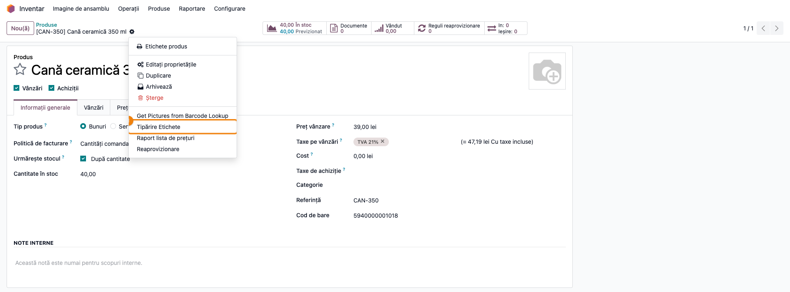

### Pasul 2 — Asistentul „Etichete produs”

Se deschide fereastra **Etichete produs**:

- **Format** — macheta de etichetă. Prima dată se propune **Etichete produs A4 3x8 (70x37 mm)**;
  după aceea, **ultima machetă tipărită de dumneavoastră** (fiecare utilizator are propria machetă
  propusă, păstrată și după închiderea sesiunii);
- **Listă de prețuri** — fără listă, eticheta are prețul de vânzare al produsului; cu o listă aleasă,
  prețul din listă, în moneda listei. Coloana **Preț** arată prețul fără TVA; pe etichetă se adaugă
  taxele de vânzare ale produsului;
- **Depozit** — se folosește de machetele care tipăresc locația din depozit (machetele de client) și
  la opțiunea **Doar pentru loturi** (pasul 6);
- **Utilizează reguli plasare** nu schimbă machetele implicite; lăsați-l nebifat;
- tabelul de jos are câte o linie pe produs: **Nr. etich.** este numărul de etichete tipărite pentru
  linia respectivă. Din produs se propune 1; modificați-l după numărul de bucăți de etichetat.

Verificați produsele și **Nr. etich.**, apoi apăsați **Tipărește** ①.

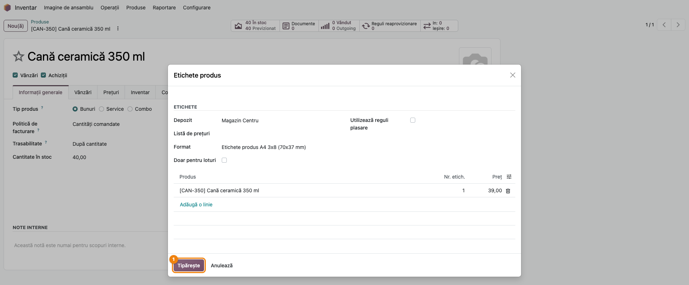

### Pasul 3 — Machetele implicite

Modulul vine cu patru machete; fiecare are formatul de hârtie al ei, așa că etichetele nu „alunecă”
de la o pagină la alta:

| Format | Pentru | Cum se tipărește |
|---|---|---|
| **Etichete produs A4 3x8 (70x37 mm)** | orice imprimantă de birou, coli A4 autoadezive cu 24 de etichete | 3 coloane × 8 rânduri, pagina nouă după fiecare 24 de etichete |
| **Etichete produs 40x25 mm (imprimantă termică)** | imprimantă termică cu role de 40×25 mm | o etichetă pe pagină |
| **Etichete produs 100x50 mm (imprimantă termică)** | imprimantă termică cu role de 100×50 mm | o etichetă pe pagină |
| **Etichete produs (continuu)** | machetă veche, fără format de hârtie propriu | etichetele una după alta, cu chenar, pe formatul de hârtie implicit al companiei |

Pe machetele A4 3x8, 40x25 și 100x50, fiecare etichetă are denumirea produsului (fără referința
internă), codul de bare, sub el referința internă și, dacă linia are lot, **Lot: …**, iar în dreapta
**prețul cu TVA** (cana 39,00 + 21% = 47,19 lei). Macheta
continuă tipărește denumirea cu referința în față (ex. „[CAN-350] Cană ceramică 350 ml”) și codul. Pentru exemplu, 3 etichete pentru cană și 2 pentru
termos:

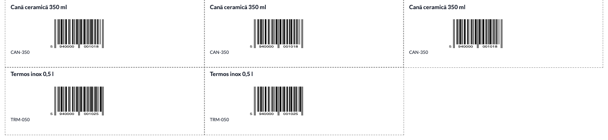

Pe machetele termice, câte o etichetă pentru cană și una pentru termos; în PDF fiecare etichetă iese
pe pagina ei, la dimensiunea rolei (chenarul punctat din capturi marchează marginea etichetei):

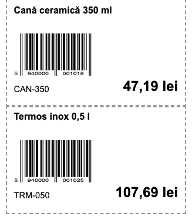

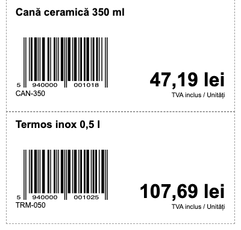

Verificați pe primele etichete că imprimanta are formatul de hârtie corect (A4 la coli, rola de
40×25 sau 100×50 la imprimanta termică) și că scanerul citește codul de bare, înainte de a tipări
tot lotul.

### Pasul 4 — Etichete pentru o comandă de vânzare

Din comanda de vânzare (**Vânzări → Comenzi → Comenzi**), deschideți rotița ⚙ și alegeți
**Tipăriți ▸ Etichete produs** (rubrica **Tipăriți** se deschide într-un submeniu). Asistentul primește câte o linie pe produs, cu **Nr. etich.** =
**cantitatea comandată**, adunată pe produs: cana apare o singură dată, cu **16** (10 + 6), termosul
cu **5**.

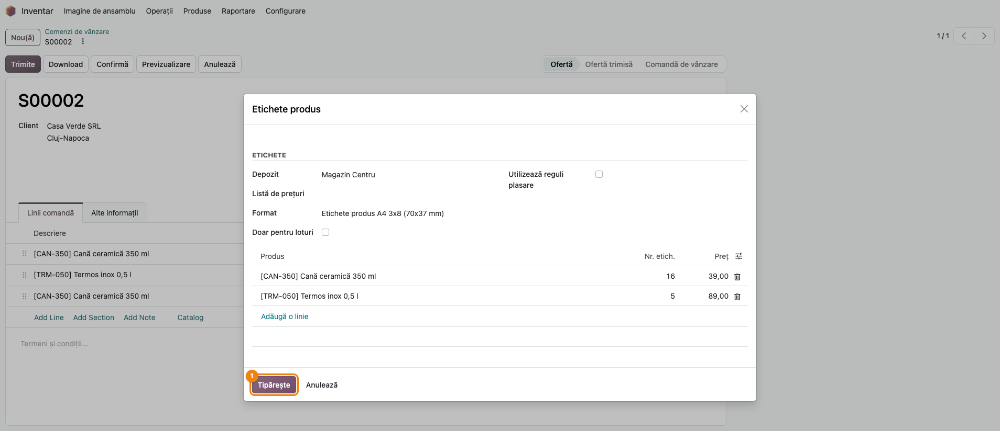

### Pasul 5 — Etichete la recepție, cu generarea loturilor

Din transfer (**Inventar → Operații → Recepții**, sau orice transfer), rotița ⚙ → **Tipăriți ▸
Etichete produs**. Asistentul primește câte o linie pe **operațiune detaliată** a transferului, cu
cantitatea ei și lotul, dacă e deja completat.

La recepții și livrări directe apare opțiunea **Generează loturile automat** ① (nu apare la
livrări; pe transferurile interne apare, dar nu are efect). Bifată, la **Tipărește** ② modulul
completează numele lotului pe fiecare linie de recepție a unui produs urmărit pe loturi care nu are
încă lot, cu următorul număr din numerotarea standard a loturilor din Odoo (un număr de forma
`0000004`), și îl tipărește pe etichete. Loturile propriu-zise se creează la **Validare**, cu aceste nume.

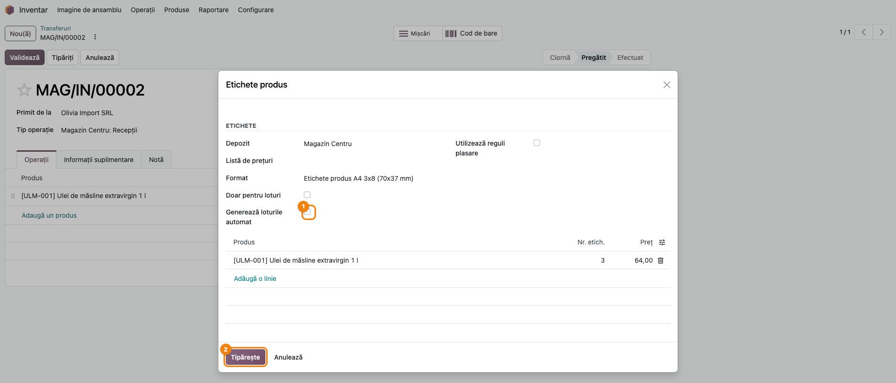

Pe etichetă apare lotul generat; verificați că același nume apare în recepție, pe linia produsului,
înainte de a valida recepția.

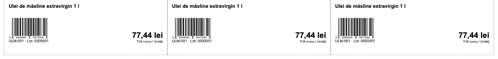

### Pasul 6 — Doar loturile din stoc ale unui produs

Pentru a reeticheta marfa din raft pe loturi, deschideți asistentul din produs (pasul 1) și bifați
**Doar pentru loturi** ①. Liniile se înlocuiesc cu câte o linie pentru **fiecare lot aflat în stoc**
în locațiile interne ale depozitului ales, cu **Nr. etich.** = cantitatea din stoc a lotului (lotul
UL-2609-01 → 12 etichete, UL-2610-02 → 8). Coloana **Lot** se afișează din butonul de coloane
opționale din dreapta tabelului. Debifarea opțiunii nu readuce liniile inițiale: închideți și
redeschideți asistentul.

Opțiunea are efect doar din produs: din comenzi și transferuri nu schimbă liniile. Deschisă din
**varianta** de produs (**Inventar → Produse → Variante produs**), propune câte o etichetă pe lot,
din toate depozitele.

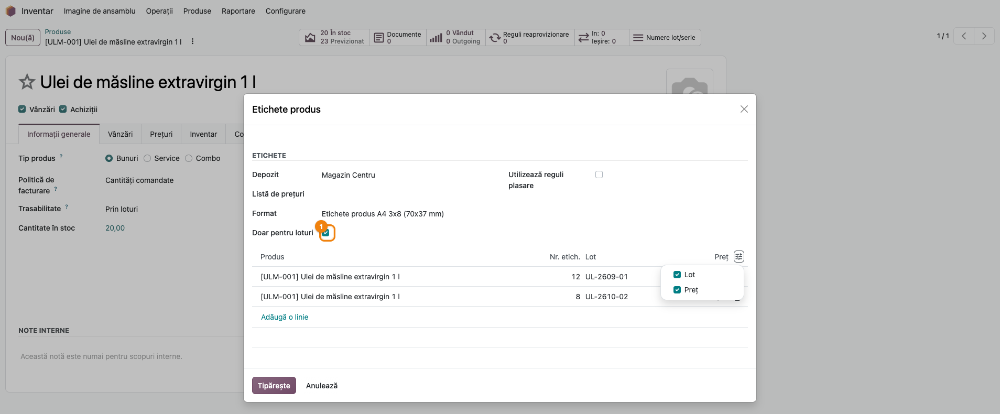

### Pasul 7 — Etichete din loturi și din stoc

Din lotul deschis în **Inventar → Produse → Lot/Număr serial** (sau din mai multe loturi bifate în
listă), rotița ⚙ → **Tipăriți ▸ Etichete produs**: câte o linie pe lot, cu **Nr. etich.** =
cantitatea în stoc a lotului (cel puțin 1).

Din liniile de stoc din **Inventar → Operații → Ajustări → Inventariere fizică**, bifați liniile și
alegeți ⚙ → **Tipăriți ▸ Etichete produs**: câte o linie pe linie de stoc, cu cantitatea și lotul ei.
Atenție: **Inventar → Raportare → Stoc** listează produse, nu linii de stoc, deci de acolo asistentul
se comportă ca din produs (o etichetă pe produs, fără lot).

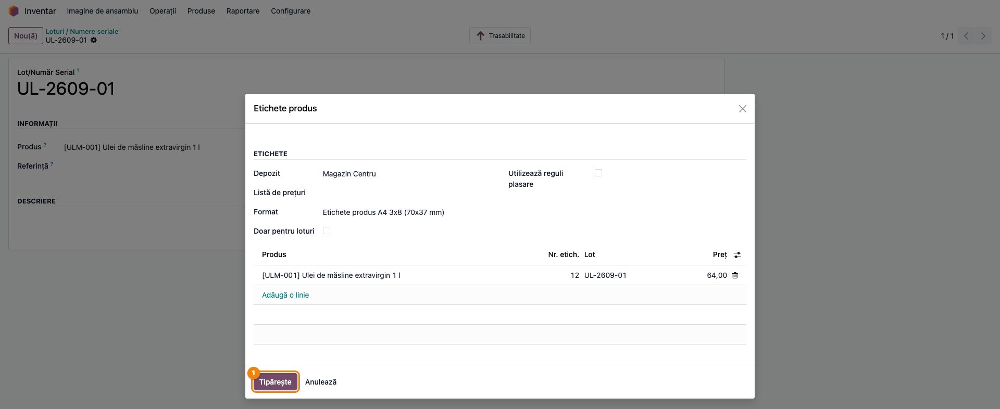

### Pasul 8 — Machetele ZPL: dimensiunea etichetei

Imprimantele Zebra primesc etichetele în limbajul **ZPL**, nu ca PDF. Machetele ZPL se adaugă la
implementare, ca rapoarte de tip **Text** pe modelul asistentului. Pentru previzualizare (pasul 9),
modulul trebuie să știe dimensiunea etichetei: activați modul dezvoltator, deschideți raportul din
**Setări → Tehnic → Acțiuni → Rapoarte** și completați, sub **Tip raport**:

- **Lățime etichetă (mm)** ① și **Înălțime etichetă (mm)** ② — de exemplu 40 și 25;
- **Rezoluție imprimantă** ③ — 152, 203, 300 sau 600 dpi, după imprimantă.

Câmpurile apar doar la rapoartele de tip **Text**. Dacă rămân goale, dimensiunea se citește din
numele raportului (ex. „Etichete **40x25** ZPL (**203 DPI**)”), iar fără nicio indicație se
folosește eticheta de 4×6 țoli (101,6×152,4 mm) la 203 dpi.

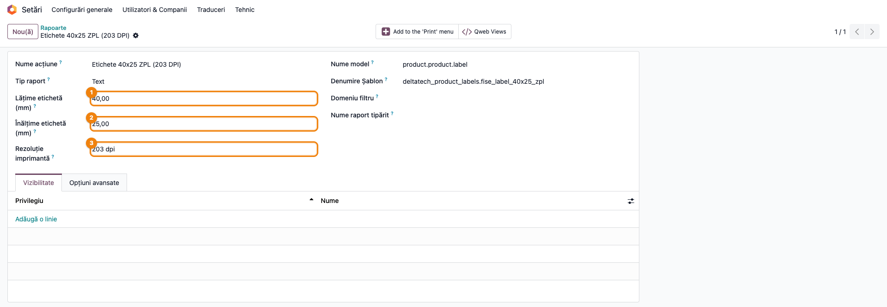

### Pasul 9 — Previzualizarea etichetelor ZPL

În asistent, cu un **Format** ZPL ales ①, apare butonul **Previzualizare** ②. Captura arată și
regula machetei propuse: după o tipărire pe macheta ZPL, asistentul o propune singur data următoare.

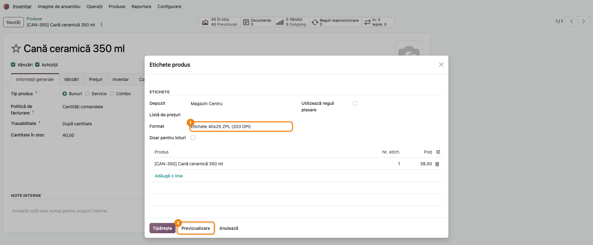

**Previzualizare** trimite textul ZPL al etichetelor la serviciul extern **Labelary**
(`api.labelary.com`), care îl transformă în PDF, deschis într-o filă nouă: o pagină pe etichetă, la
dimensiunea din pasul 8. Verificați că textul încape pe etichetă, codul de bare nu iese din margine și
lotul apare acolo unde trebuie; abia apoi apăsați **Tipărește**, care produce fișierul text cu
ZPL-ul etichetelor, de trimis la imprimantă.

Serviciul primește denumirile, codurile și loturile produselor din etichete și cere acces la
internet de pe serverul Odoo. Dacă opțiunea **Generează loturile automat** este bifată,
previzualizarea generează și loturile, ca la tipărire.

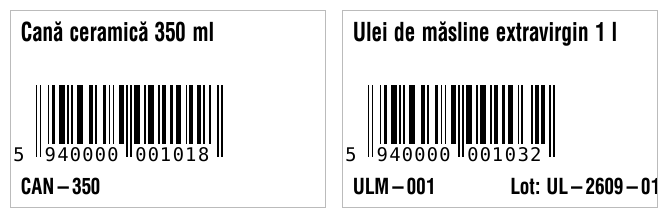

### Pasul 10 — Butonul „Tipărire Etichete” al produsului (parametru de sistem)

Implicit, **Tipărire Etichete** din produs (pasul 1) deschide asistentul modulului. Pentru a reveni
la asistentul standard Odoo (cu formatele lui de etichete pe coală), în modul dezvoltator deschideți
**Setări → Tehnic → Parametri → Parametri sistem**, creați parametrul `terrabit_labels.override_print_button`
cu valoarea `False` (scris exact așa, cu F mare) și salvați. Asistentul modulului rămâne disponibil
din **Etichete produs** (primul rând al meniului ⚙). Ștergeți parametrul sau puneți `True` ca să reveniți.

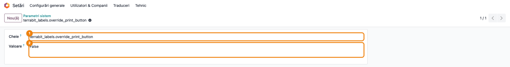

### Note de monografie și raportare

Modulul **nu înregistrează nicio notă contabilă** și nu modifică stocul. Generarea loturilor de la
pasul 5 doar completează numele lotului pe recepție; mișcarea de stoc și nota contabilă de
recepție (la evidența în timp real) apar, ca de obicei, la **Validare**, din modulele standard.

## 7. Legături cu alte module / declarații

| Modul / proces | Rol în flux |
|---|---|
| `product` | produsul, codul de bare și referința internă; butonul **Tipărire Etichete** |
| `sale` | etichete din comanda de vânzare, cu cantitățile comandate |
| `stock` | etichete din transferuri, loturi și stoc; numerotarea loturilor la recepție |
| `deltatech_price_change_label` | etichete din modificările de preț și macheta „Shelf label with price” |
| Labelary (`api.labelary.com`, serviciu extern) | transformă ZPL în PDF pentru **Previzualizare** |

Ce este automat: cantitatea de etichete propusă din document, adunarea liniilor de comandă pe
produs, alegerea codului de bare (EAN-13 sau Code 128), macheta propusă (ultima tipărită de
utilizator), numele loturilor la recepție, dimensiunea etichetei ZPL din numele raportului.

Ce rămâne manual: corectarea **Nr. etich.**, alegerea machetei, setarea imprimantei pe formatul de
hârtie al machetei, crearea machetelor ZPL de client și validarea recepției.

## 8. Verificări pentru consultant

- [ ] Din produs, **Tipărire Etichete** deschide asistentul **Etichete produs** (cu parametrul
      `terrabit_labels.override_print_button` lipsă sau `True`).
- [ ] La primul asistent al unui utilizator, **Format** = **Etichete produs A4 3x8 (70x37 mm)**; după
      o tipărire pe altă machetă, asistentul următor o propune pe aceea, doar pentru utilizatorul
      respectiv.
- [ ] Coala A4 3x8 are 24 de etichete pe pagină; 3 etichete pentru cană și 2 pentru termos ocupă
      primele 5 poziții.
- [ ] Machetele 40x25 și 100x50 tipăresc câte o etichetă pe pagină, la dimensiunea rolei.
- [ ] Pe etichetă, prețul cănii este 47,19 lei (39,00 + TVA 21%); cu o listă de prețuri aleasă,
      prețul din listă plus TVA.
- [ ] Din comanda de vânzare, cana apare o singură dată, cu 16 etichete (10 + 6).
- [ ] Din recepție, cu **Generează loturile automat** bifat, lotul generat apare pe etichetă și pe
      linia recepției, iar după **Validare** lotul există cu același nume.
- [ ] **Doar pentru loturi** din produs propune lotul UL-2609-01 cu 12 etichete și UL-2610-02 cu 8.
- [ ] Din lot, **Nr. etich.** = stocul lotului.
- [ ] **Previzualizare** apare doar la machetele ZPL (Text) și deschide un PDF cu eticheta la
      dimensiunea de pe raport.
- [ ] Cu parametrul `terrabit_labels.override_print_button` = `False`, **Tipărire Etichete** deschide
      asistentul standard Odoo.

## 9. Mesaje de eroare frecvente

| Mesaj / simptom | Cauză | Remediere |
|---|---|---|
| „Previzualizarea este disponibilă doar pentru machetele ZPL (text).” | **Format** este o machetă PDF | Machetele PDF se verifică direct cu **Tipărește** |
| „Serviciul de previzualizare a etichetelor nu este disponibil: …” | Serverul Odoo nu ajunge la `api.labelary.com` (fără internet, firewall) | Verificați accesul la internet al serverului sau tipăriți o etichetă de probă |
| „Previzualizarea etichetelor a eșuat: …” | Labelary a refuzat textul ZPL (machetă greșită) sau dimensiunea | Corectați macheta ZPL; verificați lățimea, înălțimea și rezoluția din pasul 8 |
| Eroare de server la **Tipărește**, cu „Ean13BarcodeWidget” în detalii | **Cod de bare** al produsului conține litere sau alte caractere decât cifre | Corectați codul de bare (EAN-13 are doar cifre) sau goliți-l: se tipărește atunci Code 128 din referința internă |
| Eticheta iese fără cod de bare | Produsul nu are nici **Cod de bare**, nici **Referință internă** | Completați unul dintre ele |
| Etichetele se decalează de la o pagină la alta | Imprimanta are alt format de hârtie decât macheta (ex. A4 în loc de rola de 40×25) | Setați în driverul imprimantei formatul machetei; la coli, dezactivați scalarea „potrivire în pagină” |
| Eroare la deschiderea asistentului din produs după setarea parametrului | Valoarea parametrului `terrabit_labels.override_print_button` este scrisă cu literă mică (`false`, `true`): se citește ca expresie Python | Scrieți exact `False` sau `True` |
| Nu apare **Generează loturile automat** | Transferul este o livrare (sau alt tip de operație cu loturi care nu e recepție ori livrare directă) | Opțiunea are efect doar la recepții și livrări directe; pe celelalte transferuri lotul se alege manual |
| **Doar pentru loturi** nu schimbă nimic | Asistentul a fost deschis dintr-o comandă sau dintr-un transfer, ori produsul nu are loturi în stoc în depozitul ales | Deschideți asistentul din produs; verificați **Depozit** |

## 10. Capturi de ecran

Capturile din `readme/screenshots/` sunt **generate automat** din `tests/test_screenshots.py`
(mixinul `ScreenshotCase` din `l10n_ro_doc_screenshots`, import defensiv), în **limba română**, pe
compania de test „Demo Magazin SRL”. Machetele PDF sunt pozate din randarea HTML a raportului;
captura 13 este PDF-ul primit de la Labelary și se generează doar dacă serverul de test are acces la
internet.

1. `01_produs_meniu_etichete.png` — meniul ⚙ al produsului, cu acțiunea „Tipărire Etichete”.
2. `02_asistent_din_produs.png` — asistentul „Etichete produs” deschis din produs, format A4 3x8.
3. `03_eticheta_a4_3x8.png` — coala A4 3x8 cu etichetele cănii și termosului, cu prețul cu TVA.
4. `04_eticheta_40x25.png` — macheta 40x25 mm, câte o etichetă pentru cană și termos.
5. `05_eticheta_100x50.png` — macheta 100x50 mm, câte o etichetă pentru cană și termos.
6. `06_asistent_din_comanda.png` — asistentul deschis din comanda de vânzare.
7. `07_asistent_din_receptie.png` — asistentul deschis din recepție, cu „Generează loturile automat”.
8. `08_eticheta_lot_receptie.png` — etichetele cu lotul generat la recepție și prețul cu TVA.
9. `09_asistent_doar_loturi.png` — „Doar pentru loturi”: o linie pe lot din stoc.
10. `10_asistent_din_lot.png` — asistentul deschis din lot.
11. `11_raport_zpl_dimensiuni.png` — raportul ZPL cu dimensiunea și rezoluția etichetei.
12. `12_asistent_zpl_previzualizare.png` — asistentul cu macheta ZPL propusă și butonul „Previzualizare”.
13. `13_previzualizare_zpl.png` — PDF-ul de previzualizare primit de la Labelary.
14. `14_parametru_buton_etichete.png` — parametrul de sistem `terrabit_labels.override_print_button`.

Regenerare:

```bash
./odoo/odoo-bin -c odoo.conf -d <db> \
    -i deltatech_product_labels,l10n_ro_doc_screenshots \
    --test-tags=fise_screenshots --stop-after-init
```

## 11. Observații pentru manual

Prezentați asistentul ca **un singur ecran** deschis din cinci locuri, cu o regulă simplă pentru
cantitate: din produs 1 etichetă, din comandă cantitatea comandată, din transfer cantitatea
transferată, din lot și din stoc cantitatea din stoc. Insistați pe potrivirea dintre machetă și
imprimantă (coala A4 la imprimanta de birou, rolele 40×25 și 100×50 la cea termică) și pe faptul că
asistentul ține minte ultima machetă a fiecărui utilizator. La clienții cu imprimante Zebra, arătați
**Previzualizare** ca pas obligatoriu înainte de prima tipărire pe o machetă nouă și menționați că
folosește un serviciu extern, cu acces la internet.
