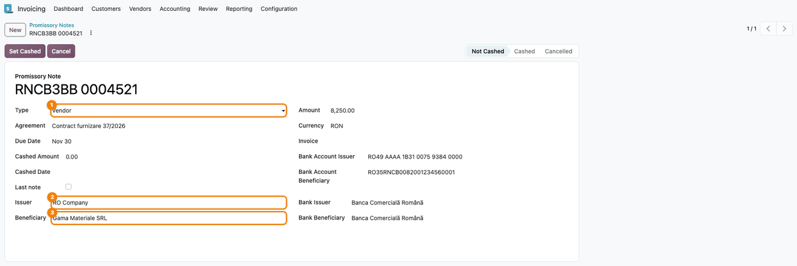

================
Promissory Notes
================

..
   !!!!!!!!!!!!!!!!!!!!!!!!!!!!!!!!!!!!!!!!!!!!!!!!!!!!
   !! This file is generated by oca-gen-addon-readme !!
   !! changes will be overwritten.                   !!
   !!!!!!!!!!!!!!!!!!!!!!!!!!!!!!!!!!!!!!!!!!!!!!!!!!!!
   !! source digest: sha256:574a8ec35ccaef3e0668e8d4e20bffc07226072ea643106e03ad322398eb7e18
   !!!!!!!!!!!!!!!!!!!!!!!!!!!!!!!!!!!!!!!!!!!!!!!!!!!!

.. |badge1| image:: https://img.shields.io/badge/maturity-Production%2FStable-green.png
    :target: https://odoo-community.org/page/development-status
    :alt: Production/Stable
.. |badge2| image:: https://img.shields.io/badge/license-AGPL--3-blue.png
    :target: http://www.gnu.org/licenses/agpl-3.0-standalone.html
    :alt: License: AGPL-3
.. |badge3| image:: https://img.shields.io/badge/github-dhongu%2Fdeltatech-lightgray.png?logo=github
    :target: https://github.com/dhongu/deltatech/tree/20.0/deltatech_promissory_note
    :alt: dhongu/deltatech
.. |badge_fisa| image:: https://img.shields.io/badge/-Fi%C8%99%C4%83%20consultant-2ea44f.png
    :target: https://github.com/dhongu/deltatech/blob/20.0/deltatech_promissory_note/readme/FISA_CONSULTANT.md
    :alt: Fișă consultant
.. |badge_tests| image:: https://img.shields.io/badge/-6%20automated%20tests-2ea44f.png
    :target: https://github.com/dhongu/deltatech/tree/20.0/deltatech_promissory_note/tests
    :alt: 6 automated tests

|badge1| |badge2| |badge3| |badge_fisa| |badge_tests|

A register of the promissory notes received from customers and issued to
vendors.

For each note you record the series and number, the issuer and the
beneficiary with their bank accounts and banks, the amount and currency,
the due date, the agreement and, optionally, the invoice it belongs to.
The type of the note fills in the company on the right side: the company
is the beneficiary of a customer note and the issuer of a vendor note.

- the notes are listed by due date, with totals for the amount and the
  cashed amount;
- the state changes with a button: *Not Cashed* → *Cashed*, or
  *Cancelled*; the state history is kept in the chatter;
- when the last note of an agreement is cashed, the users of the
  *Primeste atentionari BO* group are notified in the chatter.

The module keeps the register only: it does not create journal entries
and does not reconcile the linked invoice.

**Table of contents**

.. contents::
   :local:

Usage
=====

1. Open *Invoicing > Accounting > Promissory Notes* (with Odoo
   Enterprise: *Accounting > Accounting > Promissory Notes*). The notes
   are listed by **Due Date**, with their **Status** and the totals of
   **Amount** and **Cashed Amount**.

   |The list of promissory notes sorted by Due Date (1), with the Status
   column (2) showing Cashed, Not Cashed and Cancelled notes, and the
   totals at the bottom|

2. For a note received from a customer, press **New**, fill in **Series
   and number** and keep **Type** = **Customer**: the company becomes
   the **Beneficiary**. Choose the customer as **Issuer**: **Bank
   Account Issuer** and **Bank Issuer** are taken from the first bank
   account of the customer. Fill in the agreement, due date, amount and
   currency, check the beneficiary bank account and bank, then save.

   |A customer note in the Not Cashed state: Type Customer (1), Issuer
   the customer (2), Beneficiary the company (3), Bank Issuer (4) and
   the Set Cashed button (5)|

3. For a note issued to a vendor, choose **Type** = **Vendor**: the
   company becomes the **Issuer**. Choose the vendor as **Beneficiary**;
   its bank account and bank are filled in the same way.

   |A vendor note: Type Vendor (1), Issuer the company (2) and
   Beneficiary the vendor (3)|

4. When the note is cashed, fill in **Cashed Amount** and **Cashed
   Date** and press **Set Cashed**. If **Last note** is ticked, the
   users of the *Primeste atentionari BO* group receive a message in the
   chatter. **Set Not Cashed** reverts a cashed note; **Cancel** cancels
   a note that is not cashed.

   |The last note of an agreement after Set Cashed: Cashed Amount (1),
   Last note ticked (2), the status bar on Cashed (3) and the
   notification in the chatter (4)|

The module does not create journal entries: the accounting of the notes
is done separately. The two reports in the **Print** menu (*Promissory
Note Bill*, *Promissory Note Content*) print an empty page in this
version.

.. |The list of promissory notes sorted by Due Date (1), with the Status column (2) showing Cashed, Not Cashed and Cancelled notes, and the totals at the bottom| image:: https://raw.githubusercontent.com/dhongu/deltatech/20.0/deltatech_promissory_note/static/description/en/01_lista_bilete.png
.. |A customer note in the Not Cashed state: Type Customer (1), Issuer the customer (2), Beneficiary the company (3), Bank Issuer (4) and the Set Cashed button (5)| image:: https://raw.githubusercontent.com/dhongu/deltatech/20.0/deltatech_promissory_note/static/description/en/02_bilet_client.png

.. |The last note of an agreement after Set Cashed: Cashed Amount (1), Last note ticked (2), the status bar on Cashed (3) and the notification in the chatter (4)| image:: https://raw.githubusercontent.com/dhongu/deltatech/20.0/deltatech_promissory_note/static/description/en/04_ultimul_bilet_incasat.png

Changelog
=========

20.0.1.0.9 (2026-11-04)
-----------------------

- Migration to Odoo 20.0: ``res.bank`` is gone, so the issuer and
  beneficiary banks become text fields (``bank_issuer``,
  ``bank_beneficiary``) filled from the bank name of the partner's
  account; the pre- migration script copies the bank names of existing
  notes. Access rights in ``security/ir.access.csv``.

19.0.1.0.9 (2026-10-22)
-----------------------

- Listed on Odoo Apps as *Promissory Notes* (was *Promissory Note*). The
  technical name ``deltatech_promissory_note`` does not change.

19.0.1.0.8 (2026-10-13)
-----------------------

- The tests run again: they had been switched off since the migration to
  19.0, because the form requires both banks and the tests did not fill
  them in. They now also check the issuer/beneficiary set by the note
  type, the state changes and the notification sent when the last note
  is cashed.

19.0.1.0.7 (2026-10-09)
-----------------------

- Apps Store banner (banner.json).

19.0.1.0.6 (2026-09-29)
-----------------------

- Own module icon, instead of the generic gears it had.

19.0.1.0.5 (2026-09-24)
-----------------------

- Romanian translations for the messages recovered in the previous
  release (messages that babel could not extract while the file
  contained an f-string inside ``_()``); the ``.pot`` now lists them
  too.

19.0.1.0.4 (2026-09-24)
-----------------------

- Translatable messages built with f-strings inside ``_()`` /
  ``self.env._()`` now use a fixed text with named placeholders. An
  f-string can never be translated, and babel stopped at the first one,
  dropping every other message of the file from the ``.pot``: those
  messages are now exported for translation again.

Bug Tracker
===========

Bugs are tracked on `Terrabit Issues <https://www.terrabit.ro/helpdesk>`_.
In case of trouble, please check there if your issue has already been reported.

Do not contact contributors directly about support or help with technical issues.

Credits
=======

Authors
-------

* Terrabit
* Dorin Hongu

Maintainers
-----------

.. |maintainer-danila12| image:: https://github.com/danila12.png?size=40px
    :target: https://github.com/danila12
    :alt: danila12

Current maintainer:

|maintainer-danila12| 

This module is part of the `dhongu/deltatech <https://github.com/dhongu/deltatech/tree/20.0/deltatech_promissory_note>`_ project on GitHub.

You are welcome to contribute.