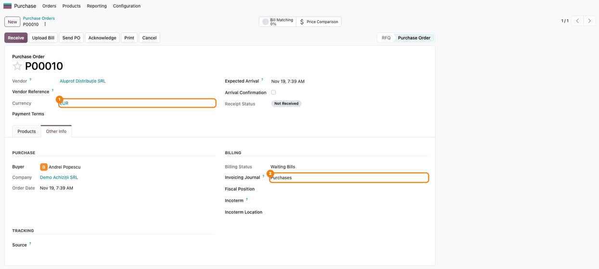
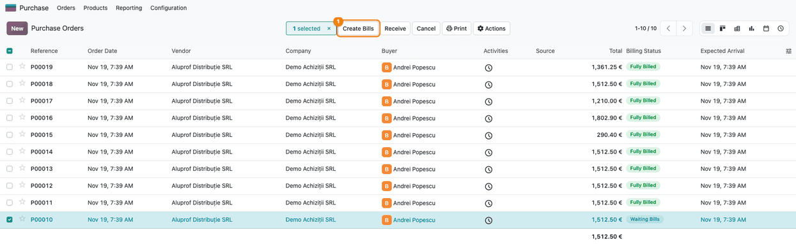
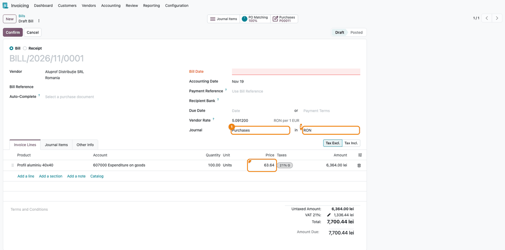
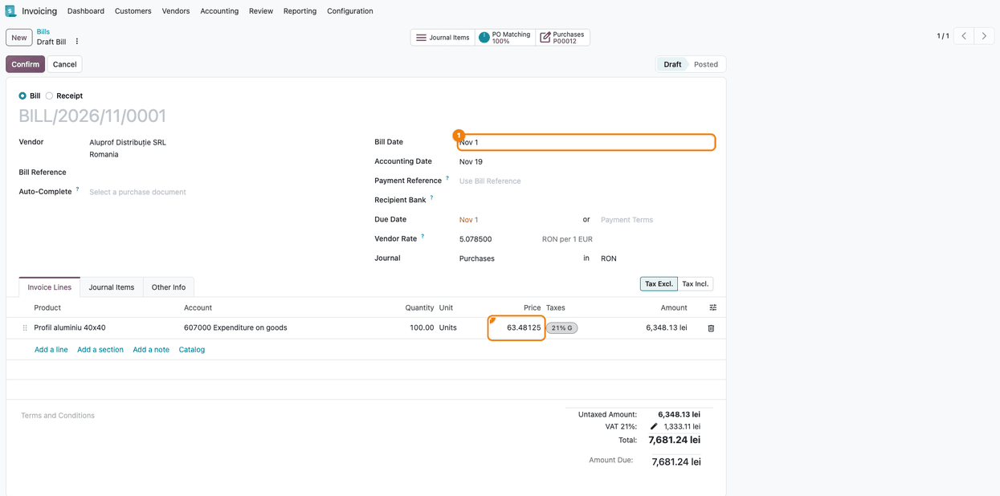
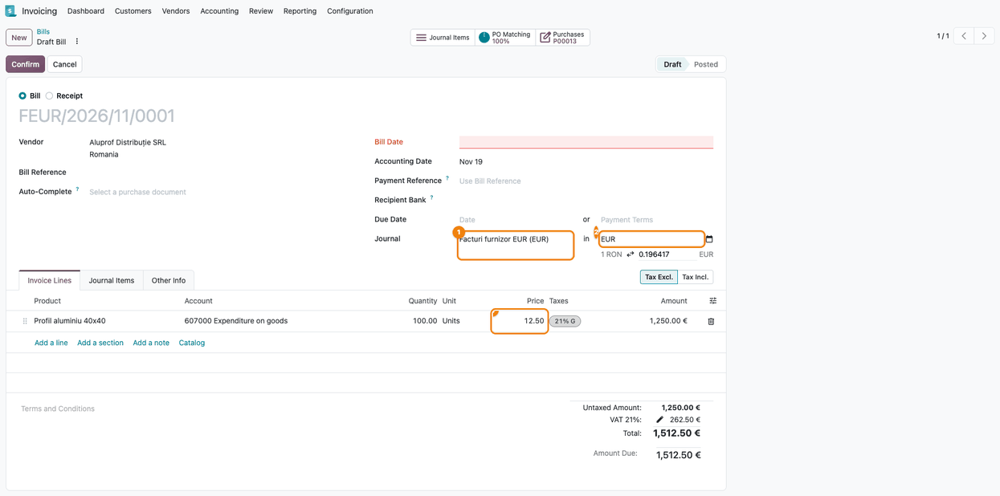
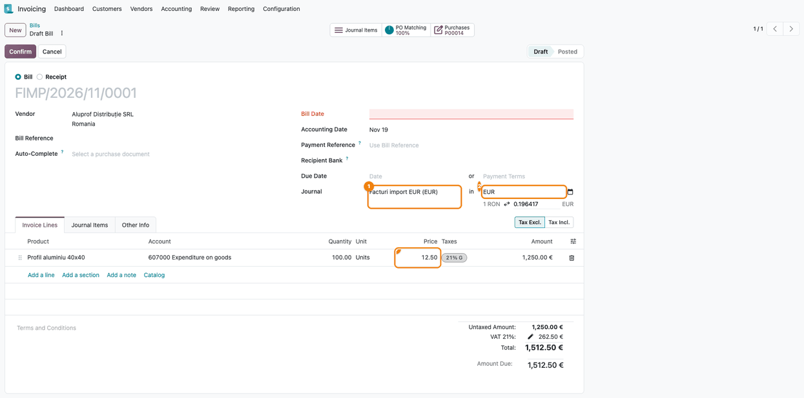
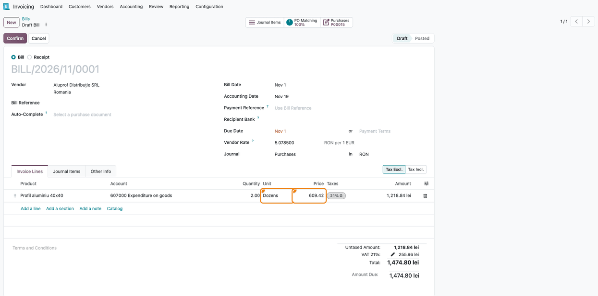
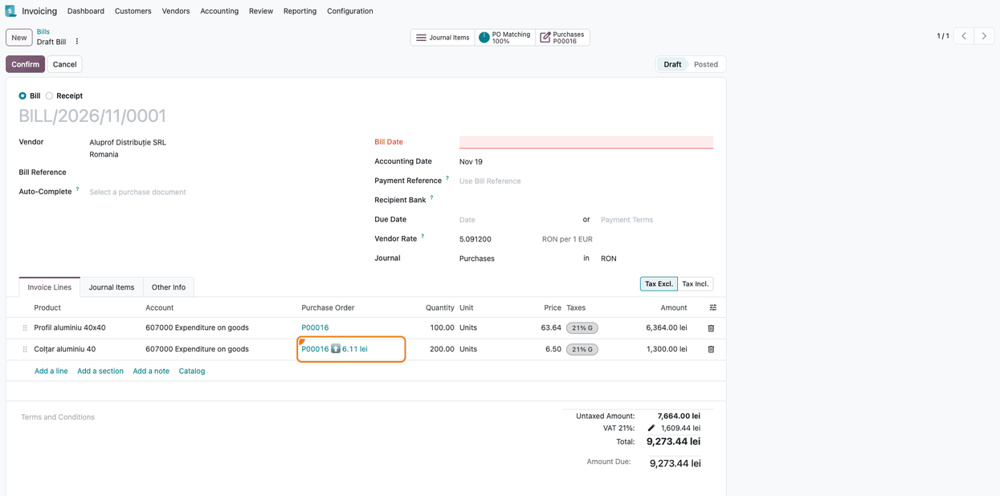
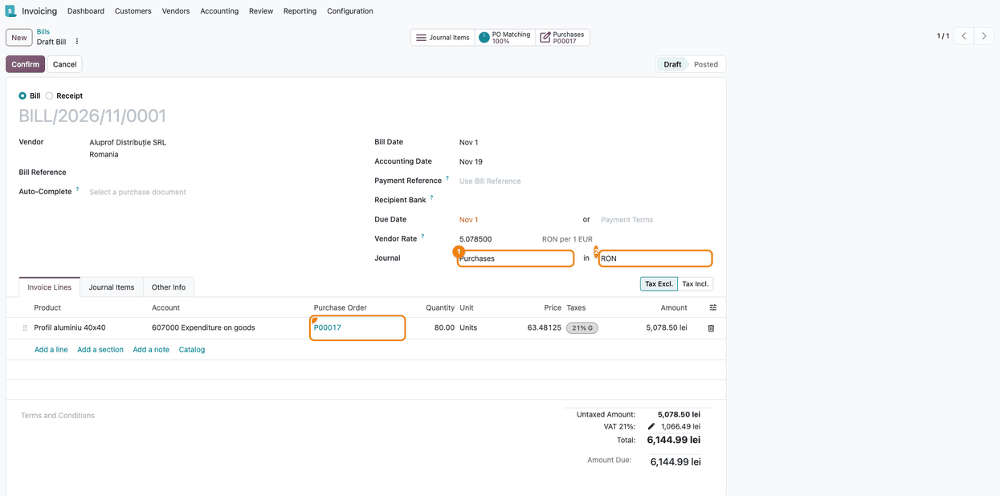

=========================
Purchase Invoice Currency
=========================

..
   !!!!!!!!!!!!!!!!!!!!!!!!!!!!!!!!!!!!!!!!!!!!!!!!!!!!
   !! This file is generated by oca-gen-addon-readme !!
   !! changes will be overwritten.                   !!
   !!!!!!!!!!!!!!!!!!!!!!!!!!!!!!!!!!!!!!!!!!!!!!!!!!!!
   !! source digest: sha256:3c5b393d190f9a578029527471453e29be8271ace74533bb668953e202c5e4a3
   !!!!!!!!!!!!!!!!!!!!!!!!!!!!!!!!!!!!!!!!!!!!!!!!!!!!

.. |badge1| image:: https://img.shields.io/badge/maturity-Beta-yellow.png
    :target: https://odoo-community.org/page/development-status
    :alt: Beta
.. |badge2| image:: https://img.shields.io/badge/github-dhongu%2Fdeltatech-lightgray.png?logo=github
    :target: https://github.com/dhongu/deltatech/tree/20.0/deltatech_purchase_currency
    :alt: dhongu/deltatech
.. |badge_fisa| image:: https://img.shields.io/badge/-Fi%C8%99%C4%83%20consultant-2ea44f.png
    :target: https://github.com/dhongu/deltatech/blob/20.0/deltatech_purchase_currency/readme/FISA_CONSULTANT.md
    :alt: Fișă consultant

|badge1| |badge2| |badge_fisa|

Bill a purchase order in another currency than the order currency,
chosen through an **Invoicing Journal** set on the order — the purchase
counterpart of *Sale Invoice Currency* (``deltatech_sale_currency``).

Typical case: a Romanian supplier quotes and confirms the order in EUR,
but issues the vendor bill in RON at the exchange rate of the bill date.

- **Invoicing Journal on the purchase order** (*Other Info* tab): the
  vendor bill is created in this journal and in its currency — the
  company currency when the journal has none. Without a journal the bill
  stays in the order currency, as in standard Odoo, so foreign suppliers
  are not affected.
- **Price conversion**: the order unit prices are converted to the bill
  currency at today's rate when the bill is created, and again at the
  rate of the *Bill Date* when it is set or changed. The price is first
  brought to the unit of measure of the bill line.
- **Vendor Rate** on the vendor bill: filled in with the Odoo (BNR) rate
  of the bill date, as bill currency for 1 unit of the order currency
  (e.g. 5.0912 RON for 1 EUR). When the supplier invoice states another
  rate, type it there and the order prices are converted at it. Changing
  the bill date brings the Odoo rate of the new date back, with a
  warning when it replaces a rate typed by hand. Shown only when the
  bill lines come from orders in one other currency.
- **Auto-Complete** on a new vendor bill takes the order journal and
  currency.
- **Price matching flag** on the bill lines compares the bill price with
  the order price converted to the bill currency, so converted lines are
  not reported as price differences.
- **One extension point**,
  ``purchase.order.line._get_invoice_price_unit()``, for another rate
  (for example the BNR rate plus a percentage agreed with the supplier).

**Table of contents**

.. contents::
   :local:

Usage
=====

1. Create a purchase order in EUR for a supplier who bills in RON
   (**Purchase → Orders → Purchase Orders**). On the **Other Info** tab,
   set **Invoicing Journal** to the vendor bills journal without
   currency, then confirm the order.

   |Purchase order in EUR with the Invoicing Journal set on the Other
   Info tab|

2. In the purchase order list, select the order and click **Create
   Bills** (or use **Upload Bill** on the order form with the supplier
   PDF).

   |Purchase order list with the order selected and the Create Bills
   button|

3. The bill is in RON, on the order journal, with the EUR prices
   converted at today's rate (Odoo 20 uses the last rate dated before
   the day).

   |Draft bill in RON on the order journal, with the converted price|

4. Set the **Bill Date** from the supplier invoice: the prices are
   converted again from the order price, at the rate of that date.
   Changing the bill **Currency** converts them again too, and price
   changes made by hand on order lines are lost, so correct prices after
   the date is final.

   |Draft bill with the Bill Date set and the price converted at that
   date's rate|

Leave **Invoicing Journal** empty for suppliers who bill in the order
currency: the bill stays in EUR with the order price, as in standard
Odoo.

|Bill in EUR for an order without invoicing journal|

With a journal in EUR on the order, the bill is created in that journal,
in EUR, with the order price.

|Bill in EUR on the journal chosen on the order|

If the bill line is in another unit of measure than the order line (e.g.
Dozens instead of Units), the order price is first brought to that unit,
then converted. Change the Unit before setting the Bill Date, or set the
date again after changing it.

|Bill line in Dozens with the price brought to the dozen and converted|

The optional **Purchase Order** column of the bill lines compares the
bill price with the order price converted to the bill currency:
converted lines show only the order, a price changed by hand shows the
difference.

|Purchase Order column: no flag on the converted line, an up arrow with
the converted order price on the line changed by hand|

A new vendor bill completed from the order with **Auto-Complete** takes
the order invoicing journal and currency, with the converted prices.

|New vendor bill auto-completed from the order, in RON on the order
journal|

When several orders of the same vendor are billed together from the
list, Odoo groups them by vendor and bill currency, not by journal:
orders with different journals but the same bill currency end up on one
bill, in the journal of the first order. Bill them one by one to keep
the journals apart.

**Vendor Rate**, in the bill header under the dates, shows the Odoo
(BNR) rate of the bill date (bill currency for 1 unit of the order
currency, e.g. 5.0912 RON for 1 EUR). If the supplier invoice states
another rate, type it there **after setting the Bill Date**: the order
prices are converted at that rate. Changing the Bill Date afterwards
brings the Odoo rate of the new date back and a warning names the rate
it replaced; clearing the field also puts the Odoo rate back. The field
is shown only when the bill lines come from orders in one other
currency, and the Purchase Order column compares with the order price at
the same rate.

|Draft bill in RON with Vendor Rate 5.100000 RON per 1 EUR and the Bill
Date set: the price is 12.50 EUR × 5.10 = 63.75, and the Purchase Order
column shows no price difference|

|Vendor rate replaced dialog after the Bill Date was changed: the vendor
rate 5.1000 was replaced with the rate of the new date, 5.0912 RON for 1
EUR, and the price is converted again to 63.64|

.. |Draft bill in RON with Vendor Rate 5.100000 RON per 1 EUR and the Bill Date set: the price is 12.50 EUR × 5.10 = 63.75, and the Purchase Order column shows no price difference| image:: https://raw.githubusercontent.com/dhongu/deltatech/20.0/deltatech_purchase_currency/static/description/en/10_factura_curs_furnizor.png
.. |Vendor rate replaced dialog after the Bill Date was changed: the vendor rate 5.1000 was replaced with the rate of the new date, 5.0912 RON for 1 EUR, and the price is converted again to 63.64| image:: https://raw.githubusercontent.com/dhongu/deltatech/20.0/deltatech_purchase_currency/static/description/en/11_avertisment_curs_inlocuit.png

Changelog
=========

20.0.1.2.0 (2026-11-19)
-----------------------

- *Vendor Rate* is no longer 0 when not typed: it shows the Odoo (BNR)
  rate of the bill date.
- Changing the bill date brings the Odoo rate of the new date back into
  *Vendor Rate*; when it replaces a rate typed by hand, a warning names
  both rates. Type the vendor rate after the bill date.

20.0.1.1.0 (2026-11-19)
-----------------------

- New *Vendor Rate* on the vendor bill: the rate stated on the supplier
  invoice (bill currency for 1 unit of the order currency). When set,
  the order prices are converted at this rate instead of the Odoo rate
  of the bill date; the price matching flag uses the same rate.

20.0.1.0.0 (2026-11-19)
-----------------------

- First version: invoicing journal on the purchase order, vendor bill in
  the journal currency, prices converted at the bill date rate.

Bug Tracker
===========

Bugs are tracked on `Terrabit Issues <https://www.terrabit.ro/helpdesk>`_.
In case of trouble, please check there if your issue has already been reported.

Do not contact contributors directly about support or help with technical issues.

Credits
=======

Authors
-------

* Terrabit
* Dorin Hongu

Maintainers
-----------

.. |maintainer-dhongu| image:: https://github.com/dhongu.png?size=40px
    :target: https://github.com/dhongu
    :alt: dhongu

Current maintainer:

|maintainer-dhongu| 

This module is part of the `dhongu/deltatech <https://github.com/dhongu/deltatech/tree/20.0/deltatech_purchase_currency>`_ project on GitHub.

You are welcome to contribute.