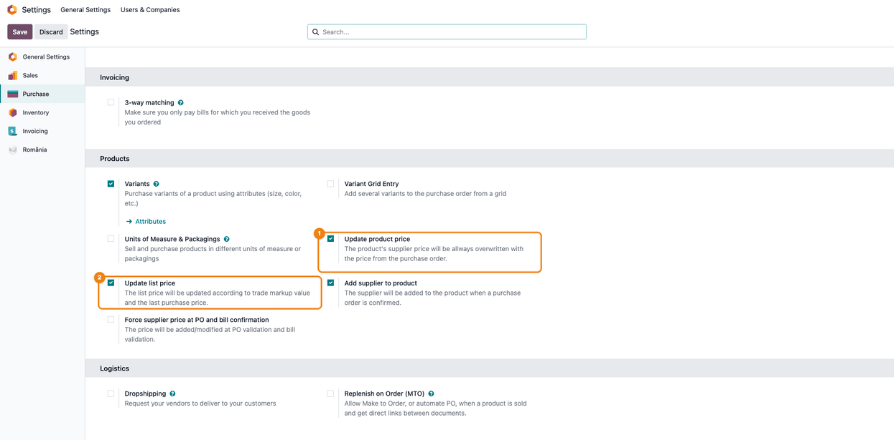
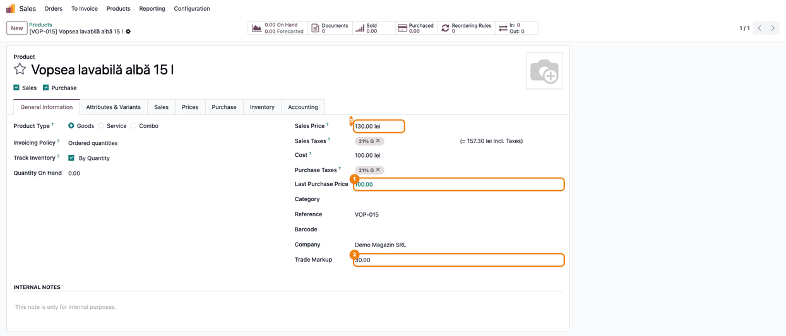
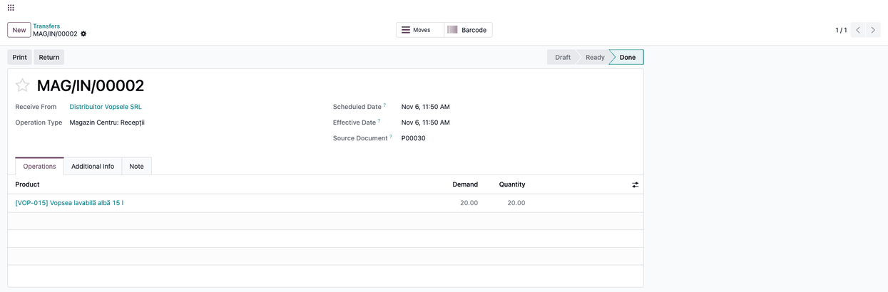

==============
Purchase Price
==============

..
   !!!!!!!!!!!!!!!!!!!!!!!!!!!!!!!!!!!!!!!!!!!!!!!!!!!!
   !! This file is generated by oca-gen-addon-readme !!
   !! changes will be overwritten.                   !!
   !!!!!!!!!!!!!!!!!!!!!!!!!!!!!!!!!!!!!!!!!!!!!!!!!!!!
   !! source digest: sha256:d3d4ca4eb45b2653975dc16b9e985bd9311e0f52db9301884b1e9a5de249f2f1
   !!!!!!!!!!!!!!!!!!!!!!!!!!!!!!!!!!!!!!!!!!!!!!!!!!!!

.. |badge1| image:: https://img.shields.io/badge/maturity-Mature-brightgreen.png
    :target: https://odoo-community.org/page/development-status
    :alt: Mature
.. |badge2| image:: https://img.shields.io/badge/github-dhongu%2Fdeltatech-lightgray.png?logo=github
    :target: https://github.com/dhongu/deltatech/tree/19.0/deltatech_purchase_price
    :alt: dhongu/deltatech
.. |badge_fisa| image:: https://img.shields.io/badge/-Fi%C8%99%C4%83%20consultant-2ea44f.png
    :target: https://github.com/dhongu/deltatech/blob/19.0/deltatech_purchase_price/readme/FISA_CONSULTANT.md
    :alt: Fișă consultant
.. |badge_tests| image:: https://img.shields.io/badge/-21%20automated%20tests%20%C2%B7%2091%25%20code%20coverage-2ea44f.png
    :target: https://app.codecov.io/gh/dhongu/deltatech/tree/19.0/deltatech_purchase_price
    :alt: 21 automated tests · 91% code coverage

|badge1| |badge2| |badge_fisa| |badge_tests|

- Features:

  - Update purchase price after receipt

  - 

    - Depends on system parameters:

      - *purchase.update_standard_price* - If set to True, the product's
        standard_price will be overwritten
      - *purchase.update_product_price* - if set to False, the product
        supplier's price will not be modified, if set to True, the
        product's supplier price will be allways overwritten
      - *purchase.add_supplier_to_product* - if set to True, the
        supplier and the price will be automatically added to the
        supplier info of the product, if set to False, no modifications
        will be made in the supplier info of the product
      - *purchase.update_list_price* - if set to True, the list price
        will be updated according to trade markup value. If set to
        False, the list price will not be updated.
      - *sale.list_price_round* - decimal number to which the list price
        is rounded

  - 

    - New fields added in product template:

      - last_purchase_price - last purchase price. It's updated at
        receipt validation
      - trade_markup - trade markup for the product. It can be updated
        with a wizard (Action->Set trade markup)

  - 

    - New feature:

      - if trade_markup **is set** for a product, at reception the sale
        price will be computed from last_purchase_price and trade_markup

**Table of contents**

.. contents::
   :local:

Usage
=====

The sale price is computed as **last purchase price × (1 + trade markup
/ 100)**, without taxes.

1. Go to **Settings → Purchase**, section **Products**, and choose the
   options:

   - **Update product price**: at receipt, the vendor price on the
     product's *Purchase* tab is replaced with the purchase order price
     (vendor lines without a minimum quantity above 1 and without a
     validity period);
   - **Update list price**: the sales price is recomputed from the last
     purchase price and the trade markup: at receipt, when the markup is
     set on several products, and when you change the markup or the last
     purchase price on the product;
   - **Add supplier to product**: the vendor and its price are added to
     the product when a purchase order is confirmed;
   - **Force supplier price at PO and bill confirmation**: the vendor
     price is also updated when the purchase order is confirmed and when
     the vendor bill is posted.

   |Purchase settings, Products section: Update product price and Update
   list price are checked and marked 1 and 2|

2. Open a product (**Sales → Products → Products**, *General
   Information* tab). Set the **Trade Markup** (30.00 means 30%). The
   **Last Purchase Price** is shown in green when it is not above the
   **Cost**, and in red when it is. With **Update list price** enabled:
   100.00 × 1.30 = **130.00**.

   |Product form: Last Purchase Price 100.00, Trade Markup 30.00, Sales
   Price 130.00 lei|

3. To set the markup on several products, select them in the list view
   and use **Actions → Set Trade Markup**. Check **Selected Line** to
   apply it to the selected products; unchecked, choose a **Vendor** and
   the markup applies to all the products of that vendor. Click **Set**.

   |Products list with two products selected and the Set Trade Markup
   dialog: Selected Line checked, Trade Markup 30.00 and the Set button|

4. Confirm a purchase order and validate its receipt. For each product
   received on the order, the **Last Purchase Price** becomes the order
   unit price, converted to the company currency and to the product unit
   of measure. Receipts without a purchase order do not change prices.

   |Validated receipt from the vendor, 20.00 units received|

5. After the receipt at 110.00, the product shows **Last Purchase
   Price** 110.00 (in red, above the cost), **Trade Markup** 30.00 and
   **Sales Price** 110.00 × 1.30 = **143.00**. The **Cost** is not
   changed by the module: it comes from the stock valuation. A product
   without markup keeps its sales price.

   |Product after the receipt: Last Purchase Price 110.00, Trade Markup
   30.00, Sales Price 143.00 lei|

6. With **Update list price** disabled, the sales price is set by hand
   and the markup follows it: changing the last purchase price (or the
   sales price) recomputes the markup. For a sales price of 13.00 and a
   corrected purchase price of 12.50, the markup becomes (13.00 − 12.50)
   / 12.50 × 100 = **4.00**. A markup typed by hand is kept.

   |Product with Update list price disabled: Last Purchase Price 12.50,
   Trade Markup recomputed to 4.00, Sales Price unchanged at 13.00 lei|

The rounding of the computed sales price is set by the system parameter
``sale.list_price_round`` (number of decimals, default 2). A pricelist
rule can use **Last Purchase Price** as its base price.

.. |Products list with two products selected and the Set Trade Markup dialog: Selected Line checked, Trade Markup 30.00 and the Set button| image:: https://raw.githubusercontent.com/dhongu/deltatech/19.0/deltatech_purchase_price/static/description/en/03_wizard_adaos.png

.. |Product with Update list price disabled: Last Purchase Price 12.50, Trade Markup recomputed to 4.00, Sales Price unchanged at 13.00 lei| image:: https://raw.githubusercontent.com/dhongu/deltatech/19.0/deltatech_purchase_price/static/description/en/06_adaos_recalculat.png

Changelog
=========

19.0.1.2.14 (2026-11-06)
------------------------

- **Fix: the trade markup no longer keeps a value computed with an old
  purchase price.** With *Update list price* disabled, changing the last
  purchase price on the product form did not touch the markup, so a
  markup derived from a mistyped purchase price stayed on the product
  after the price was corrected (e.g. -98.23% instead of ~10%). The
  markup is now recomputed from the current sale price (without taxes)
  and the new purchase price; the sale price is left unchanged.
- Consultant sheet (``readme/FISA_CONSULTANT.md``), usage guide with
  screenshots (``readme/USAGE.md``) and the screenshot test. Romanian
  translation: the trade markup is labelled *Adaos comercial* in the
  bulk action too, and the *Force supplier price* setting is translated.

19.0.1.2.13 (2026-10-07)
------------------------

- **Fix: ``product.supplierinfo.create`` lipsea decoratorul
  ``@api.model_create_multi``.** Semnătura (``vals_list``) aștepta o
  listă de dict-uri, dar fără decorator ORM-ul nu garanta asta — un apel
  cu un singur dict ar fi ajuns direct în ``super().create()`` cu forma
  greșită.

19.0.1.2.12 (2026-10-06)
------------------------

- **New vendor pricing rows no longer take the product cost as unit
  price.** On the *Purchase* tab of a product (template or variant), a
  new vendor line was pre-filled with the product cost (e.g. 99.01),
  which was easy to save by mistake as the vendor price. The unit price
  of a new line now starts at 0.

19.0.1.2.11 (2026-10-03)
------------------------

- **Fix (PURCHASEPRICE-001): the automatic sale price update uses the
  currency of the active company.** With *Update list price* enabled,
  the purchase price of a company was treated as an amount in the
  currency of the user's default company, so in a company with another
  currency the sale price was wrong (e.g. a cost of 100 EUR with a 100%
  markup became 40 EUR instead of 200 EUR). The cost is now converted
  from the currency of the company in which it was recorded, with that
  company's rates. Sale prices updated from now on in a company whose
  currency differs from the default company of the user will have
  different (correct) values.

19.0.1.2.10 (2026-10-02)
------------------------

- **Fix (PURCHASEPRICE-002): forced supplier-price update no longer
  blocks confirmation and posting.** With *Force price at validation*
  enabled, confirming a purchase order (always) and posting a vendor
  bill with a unit different from the product unit failed because the
  code used ``product_uom``, removed in Odoo 19. Both now use
  ``product_uom_id`` and convert the price to the unit of the supplier
  pricing row (e.g. 240 per dozen on the PO is written as 20 on a
  supplier row in units).

19.0.1.2.9 (2026-09-29)
-----------------------

- Own module icon, instead of the generic gears it had.

Bug Tracker
===========

Bugs are tracked on `Terrabit Issues <https://www.terrabit.ro/helpdesk>`_.
In case of trouble, please check there if your issue has already been reported.

Do not contact contributors directly about support or help with technical issues.

Credits
=======

Authors
-------

* Terrabit
* Dorin Hongu

Maintainers
-----------

.. |maintainer-dhongu| image:: https://github.com/dhongu.png?size=40px
    :target: https://github.com/dhongu
    :alt: dhongu

Current maintainer:

|maintainer-dhongu| 

This module is part of the `dhongu/deltatech <https://github.com/dhongu/deltatech/tree/19.0/deltatech_purchase_price>`_ project on GitHub.

You are welcome to contribute.