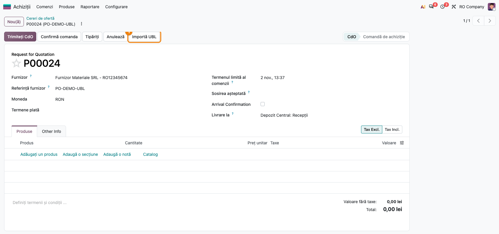
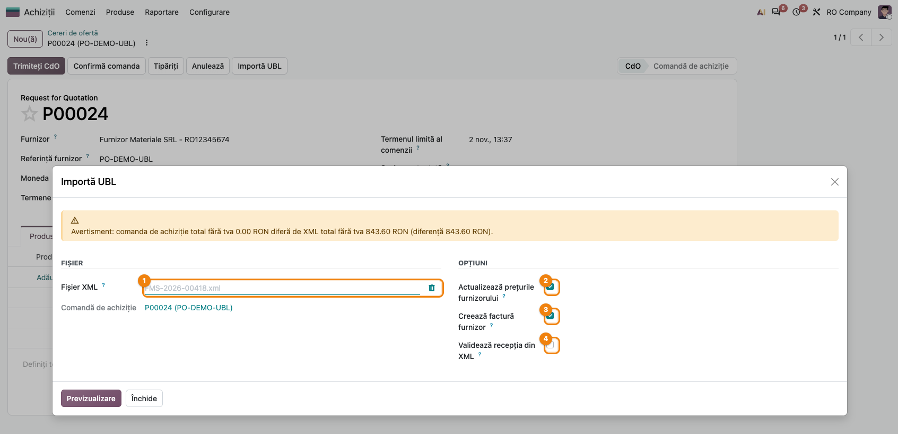
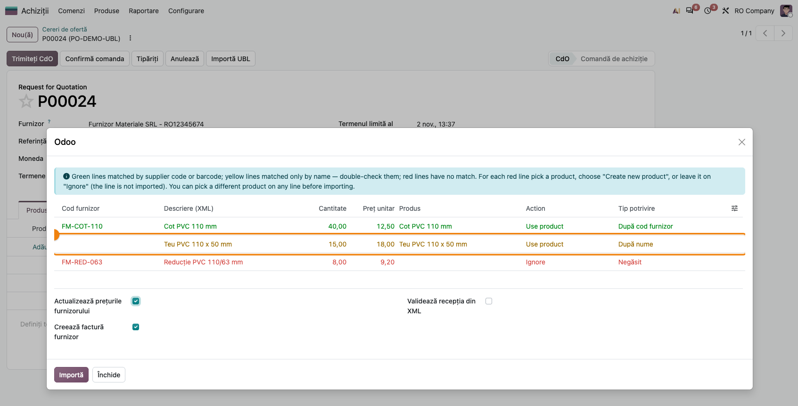
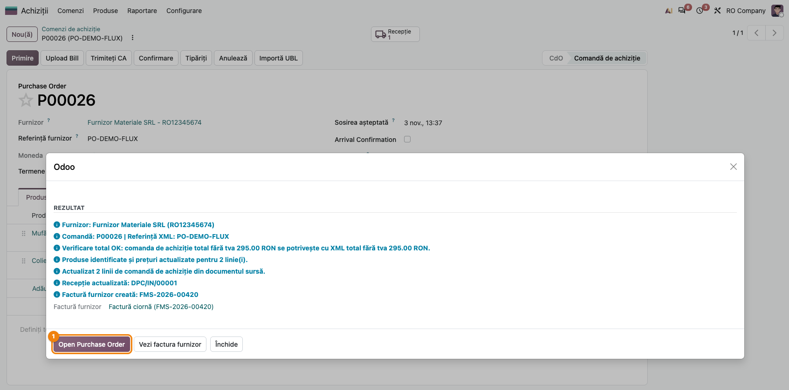
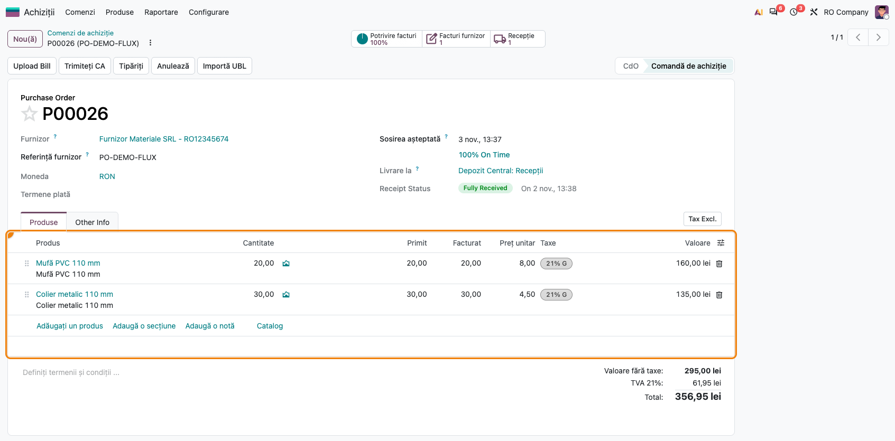
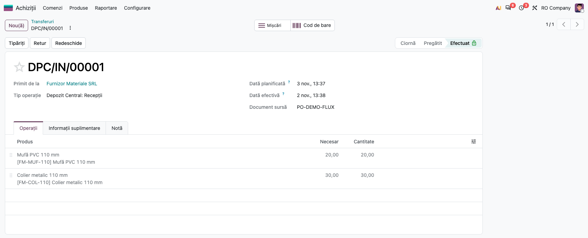
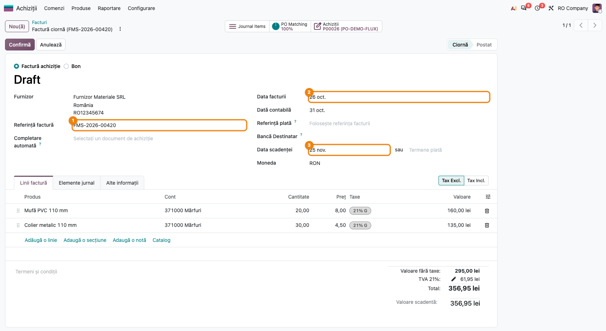
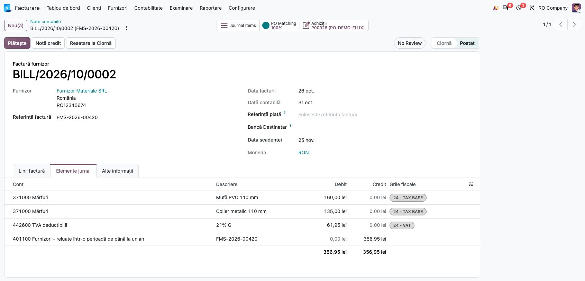
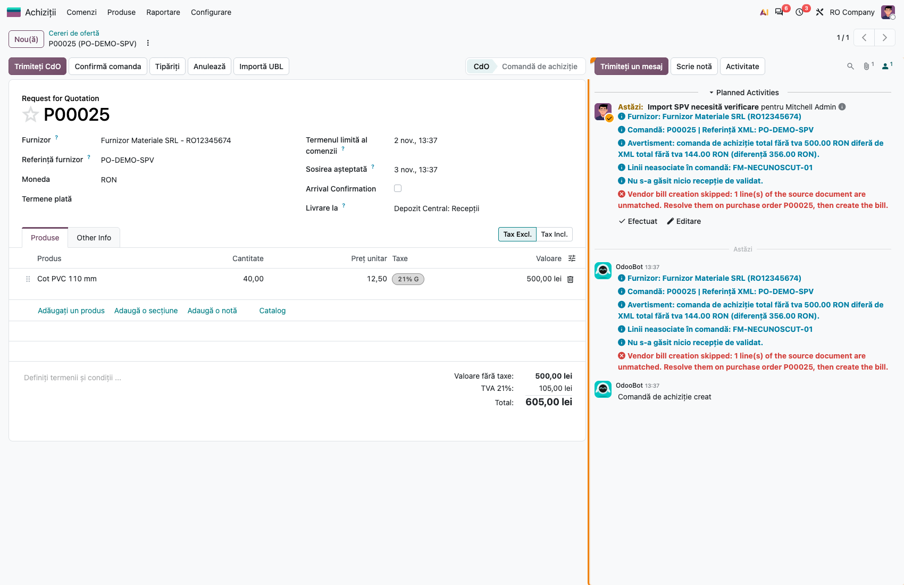

# Fișă Modul: Importul facturii de furnizor UBL (e-Factura) pe comanda de achiziție

**Modul:** `deltatech_purchase_ubl`
**Utilizator principal:** Operator achiziții, Contabil furnizori
**Prioritate:** 🔴 Ridicată (atinge prețurile de achiziție, recepția în stoc și factura furnizorului)

---

## 1. Scop business

Furnizorii din România transmit facturile în format XML UBL (e-Factura, prin SPV). Reintroducerea
manuală a liniilor pe comanda de achiziție, actualizarea prețurilor furnizorului, validarea recepției
și crearea facturii sunt operații repetitive, cu risc de greșeală. Modulul `deltatech_purchase_ubl`
citește fișierul XML al facturii și, pornind de la comanda de achiziție:

- identifică automat produsele (după cod de bare, cod furnizor, cod intern sau denumire exactă) și
  arată, înainte de import, cum a asociat fiecare linie (verde / galben / roșu);
- actualizează liniile comenzii (cantitate, preț, discount) și adaugă liniile lipsă;
- actualizează prețurile din lista de prețuri a furnizorului;
- opțional, setează cantitățile pe recepție și o validează;
- creează factura furnizorului din comandă, cu numărul, data și scadența din XML;
- compară totalul comenzii cu totalul facturii și avertizează la diferențe.

Când XML-ul este atașat automat pe comandă (de ex. de fluxul de preluare din SPV), importul rulează
singur, iar dacă ceva nu se potrivește, cumpărătorul primește o activitate „Import SPV necesită
verificare”.

## 2. Bază legală și context

Formatul importat este factura electronică UBL 2.1 folosită în sistemul național RO e-Factura
(standardul CIUS-RO). Modulul nu transmite și nu descarcă nimic din SPV; doar citește un fișier XML
deja primit. Obligațiile privind e-Factura rămân acoperite de modulele de localizare; acest modul
este un instrument operațional care preia datele facturii în fluxul de achiziții.

## 3. Utilizatori și roluri

Operator achiziții, Contabil furnizori, Gestionar (recepții).

Roluri recomandate pentru testare:
- Utilizator achiziții: lansează importul de pe comandă, verifică previzualizarea, confirmă importul
- Gestionar: verifică recepția validată din XML (cantități, stare)
- Contabil furnizori: verifică factura creată (număr, dată, scadență, taxe) și o validează

## 4. Conturi și date implicate

Modulul nu definește conturi noi. Factura furnizorului este creată cu mecanismul standard al comenzii
de achiziție („Creează factură”), deci folosește jurnalul de achiziții, contul furnizorului (401) și
conturile de stoc/cheltuieli și TVA configurate pe produse și taxe.

Date minime pentru demo:
- un furnizor cu **CUI** (codul fiscal din XML trebuie să corespundă) și, ideal, cu prețuri de
  furnizor având **Cod produs furnizor** completat
- produse stocabile cu cod de bare sau cod intern
- o comandă de achiziție **confirmată** pentru furnizor (pentru recepție și factură)
- un fișier XML UBL de factură de la furnizor, cu referința comenzii (`OrderReference`) completată,
  dacă se dorește identificarea automată a comenzii

## 5. Configurare inițială

1. Instalați modulul `deltatech_purchase_ubl` (depinde de `purchase_stock` și `account`).
2. Pe prețurile furnizorului (**Achiziții → Produse → Produse**, tab **Achiziție**), completați
   **Cod produs furnizor**, pentru ca asocierea să se facă după cod (linie verde), nu după nume.
3. Verificați că furnizorul are CUI-ul completat; fără comandă în context, furnizorul se caută după
   CUI și apoi după denumire.
4. Importul automat la atașarea unui XML pe comandă este activ implicit. Se poate dezactiva prin
   parametrul de sistem `deltatech_purchase_ubl.auto_import` = `False`
   (**Setări → Tehnic → Parametri → Parametri de sistem**, modul dezvoltator).

## 6. Flux de utilizare

### Pasul 1 — Deschiderea asistentului de import de pe comandă

Accesați **Achiziții → Comenzi → Comenzi de achiziție** și deschideți comanda furnizorului. În bara
de sus apăsați **Importă UBL**. Se deschide fereastra **Importă UBL XML**. Dacă pe comandă este deja
atașat un fișier XML de factură UBL, acesta este preluat automat în câmpul **Fișier XML**.



### Pasul 2 — Alegerea fișierului și a opțiunilor

În grupul **Fișier**, încărcați factura în câmpul **Fișier XML** (dacă nu a fost preluată automat);
câmpul **Comandă de achiziție** arată comanda pe care se face importul. În grupul **Opțiuni**:
- **Actualizează prețurile furnizorului** (bifat implicit) — scrie prețul unitar din XML în lista de
  prețuri a furnizorului; se modifică doar prețul (convertit în unitatea de măsură a liniei), moneda
  și codul produsului furnizorului (numai dacă XML-ul îl conține); **Termen livrare** și unitatea de
  măsură rămân cele ale liniei existente;
- **Creează factură furnizor** (bifat implicit) — creează factura furnizorului din comandă; atenție:
  la o factură e-Factura, care are număr de factură în XML, factura se creează chiar și cu bifa debifată;
- **Validează recepția din XML** (nebifat implicit) — setează cantitățile din XML pe recepția
  comenzii și o validează.

Deasupra pot apărea avertismente galbene:
- un avertisment că **comanda are deja linii** — liniile existente vor fi actualizate; atenție, în
  versiunea curentă textul afirmă că liniile noi nu se adaugă, dar importul **le adaugă**
  (vezi [dhongu/deltatech#3820](https://github.com/dhongu/deltatech/issues/3820));
- un avertisment de **verificare a totalului**, dacă totalul comenzii diferă de totalul din XML.



Apăsați **Previzualizare**.

### Pasul 3 — Verificarea asocierii produselor în previzualizare

Fereastra afișează un tabel cu câte un rând pentru fiecare linie a facturii: **Cod furnizor**,
**Descriere (XML)**, **Cantitate**, **Preț unitar**, **Produs** (produsul găsit), **Action** și
**Tip potrivire**.



1. **Găsiți pe ecran** culoarea fiecărui rând și coloana **Tip potrivire**:
   - **verde** — „După cod furnizor” sau „După cod de bare”: asociere sigură;
   - **galben** — „După nume”: asociere doar după denumire, trebuie verificată;
   - **roșu** — „Negăsit”: niciun produs găsit.
2. **Verificați** fiecare rând galben și roșu: produsul din coloana **Produs** este cel facturat?
   Cantitatea și prețul unitar corespund facturii? Pentru un rând greșit alegeți alt produs în
   coloana **Produs** (Tip potrivire devine „Ales manual”). Pentru un rând roșu alegeți în coloana
   **Action**: un produs existent („Use product”), **Create new product** (se creează un produs
   stocabil nou, cu prețul de furnizor din XML) sau **Ignore** (linia nu se importă).
3. **Treceți mai departe** — reverificați bifele **Actualizează prețurile furnizorului**,
   **Creează factură furnizor**, **Validează recepția din XML** de sub tabel și apăsați **Importă**.

### Pasul 4 — Citirea rezultatului importului

Fereastra trece în secțiunea **Rezultat**, cu un jurnal de mesaje (în teorie colorat: verde = operații reușite,
portocaliu/roșu = avertismente):
- „Furnizor: …” și „Comandă: … | Referință XML: …”;
- câte linii de comandă au fost actualizate și câte au fost adăugate;
- produsele create și prețurile actualizate;
- „Recepție actualizată: …” sau un avertisment că recepția nu a putut fi validată;
- „Factură furnizor creată: …” sau motivul pentru care nu a fost creată (comandă neconfirmată, nimic
  de facturat, factură existentă deja cu aceeași referință);
- rezultatul verificării totalului comenzii față de totalul din XML.



Citiți jurnalul înainte de a închide: nu vă bazați pe culori, deoarece în interfața română clasificarea
colorată nu se aplică mereu (mesajele „Avertisment”, „Linii neasociate” pot apărea ca informații);
citiți fiecare rând. Capturile de rezultat (pașii 4–6) sunt pe o comandă confirmată cu produse codificate,
spre deosebire de pașii 1–3, care arată o comandă fără linii cu cele trei culori.

### Pasul 5 — Verificarea comenzii și a recepției

Apăsați **Open Purchase Order**. Pe comandă verificați liniile (cantități, prețuri unitare,
discounturi preluate din XML) și liniile noi adăugate. Dacă ați bifat **Validează recepția din XML**,
deschideți recepția din butonul **Recepție**: cantitățile realizate sunt cele din factură, iar
recepția este validată.





Validarea recepției **nu** generează o notă contabilă proprie: în configurarea standard Odoo 20 cu evaluare
perpetuă („la facturare”) nota de stoc apare abia la confirmarea facturii (pasul 6).

### Pasul 6 — Verificarea facturii furnizorului

Din fereastra de rezultat apăsați **Vezi factura furnizor** (sau deschideți-o din butonul
**Facturi furnizor** de pe comandă). Factura este în ciornă și are completate din XML: **Referință** (numărul
facturii furnizorului), **Data facturii**, **Data scadenței** și **Document sursă** (referința
comenzii din XML). Cotele de TVA ale liniilor sunt aliniate cu procentele din XML.


1. **Găsiți** totalul facturii și comparați-l cu totalul din XML-ul furnizorului.
2. **Verificați** că furnizorul, numărul și data sunt corecte și că fiecare linie are cota de TVA din
   factura primită (atenție la liniile cu 0% — vezi secțiunea 9).
3. **Treceți mai departe** — confirmați factura cu butonul standard **Confirmă**.

După **Confirmă**, în tab-ul **Elemente jurnal** apare nota contabilă a facturii:



### Pasul 7 — Importul automat la atașarea XML-ului

Când un fișier XML de factură UBL este atașat automat pe comandă (de exemplu de fluxul de preluare a
facturilor din SPV), importul rulează fără fereastră: prețuri, linii, recepție și factură. Dacă
totalul nu se potrivește sau rămân linii neasociate, factura **nu** se creează, jurnalul colorat se
postează în istoricul comenzii, iar responsabilul comenzii primește activitatea
**„Import SPV necesită verificare”**. Rezolvați liniile pe comandă, apoi relansați importul manual
(pașii 1–6).



Dacă documentul XML este o **notă de credit**, nu se aplică pe comandă: jurnalul afișează
„Atenție: documentul … este o notă de credit; notele de credit nu se importă. Înregistrați manual
rambursarea de la furnizor.”

### Note de monografie și raportare

Modulul nu generează note contabile proprii. Notele rezultă din documentele standard create în flux
(verificate pe compania demo RO, plan de conturi `l10n_ro`, categorie de produse cu evaluare
perpetuă și contul de stoc 371 setat pe categorie):
- **Recepția validată**: în Odoo 20 evaluarea perpetuă se contabilizează „la facturare”, deci
  validarea recepției din XML **nu** generează nicio notă contabilă (nu apare niciun Dr 371 = Cr 408).
- **Factura furnizorului confirmată** (captura `09_nota_factura.png`): Dr 371 „Mărfuri” (contul de
  stoc al categoriei) + Dr 4426 „TVA deductibilă” = Cr 401 „Furnizori” (contul analitic 401100 în planul RO). În planul RO standard,
  contul de stoc implicit al categoriilor este 301; pentru mărfuri setați 371 pe categoria de
  produse. Liniile de serviciu se înregistrează pe contul de cheltuială al produsului.

Dacă recepția și factura cad în luni diferite, la închiderea lunii verificați stocul recepționat și
nefacturat (practica RO: Dr 371 = Cr 408 „Furnizori - facturi nesosite”), pentru separarea exercițiilor.
Dacă firma folosește module suplimentare de stoc ale localizării (de exemplu înregistrarea
recepției pe 408), notele pot diferi; conturile exacte depind de configurarea categoriilor de
produse, a taxelor și a jurnalului de achiziții.

## 7. Legături cu alte module / declarații

| Modul / proces | Rol în flux | Tip legătură |
|---|---|---|
| `purchase_stock` | comanda de achiziție, recepția și prețurile furnizorului | dependență (manifest) |
| `account` | factura furnizorului | dependență (manifest) |
| Preluarea facturilor din SPV (`l10n_ro_message_spv_purchase`) | atașează automat XML-ul pe comandă și declanșează importul automat | opțional |

Ce este automat: identificarea furnizorului și a comenzii din XML, asocierea produselor, actualizarea
liniilor și a prețurilor, adăugarea liniilor lipsă, validarea recepției (dacă e bifată), crearea
facturii, verificarea totalului, activitatea de verificare la importul automat.
Ce rămâne manual: verificarea rândurilor galbene/roșii în previzualizare, confirmarea facturii,
înregistrarea notelor de credit, rezolvarea liniilor neasociate la importul automat.

## 8. Verificări pentru consultant

- [ ] Butonul **Importă UBL** apare pe formularul comenzii de achiziție.
- [ ] Un XML atașat pe comandă este preluat automat în **Fișier XML** la deschiderea ferestrei.
- [ ] **Previzualizare** arată câte un rând pe linie de factură, colorat verde/galben/roșu după
      **Tip potrivire**.
- [ ] Schimbarea produsului pe un rând îl marchează „Ales manual”; „Ignore” lasă linia neimportată.
- [ ] După **Importă**, liniile existente au cantitatea și prețul din XML, iar produsele care nu erau
      pe comandă apar ca linii noi.
- [ ] Prețul de furnizor (cu **Cod produs furnizor**) este actualizat pentru produsele importate.
- [ ] Dacă înainte de import linia de furnizor avea **Termen livrare** diferit de 1, valoarea a rămas neschimbată după import.
- [ ] Cu **Validează recepția din XML** bifat, recepția comenzii este validată cu cantitățile din XML.
- [ ] Factura furnizorului are referința, data și scadența din XML; un al doilea import al aceleiași
      facturi nu creează o factură dublă.
- [ ] Pe o comandă neconfirmată, factura nu se creează și jurnalul explică motivul.
- [ ] Verificarea totalului apare în jurnal (OK sau diferența, cu moneda comenzii).
- [ ] O notă de credit XML nu modifică comanda și este semnalată în jurnal.
- [ ] La importul automat cu linii neasociate apare activitatea „Import SPV necesită verificare”.

## 9. Mesaje de eroare frecvente

| Mesaj / simptom | Cauză probabilă | Remediere |
|-----------------|-----------------|-----------|
| „Vă rugăm să selectați un fișier XML.” | Câmpul **Fișier XML** este gol | Încărcați fișierul facturii |
| „XML nevalid: …” | Fișierul nu este un XML corect (de ex. PDF sau arhivă ZIP din SPV) | Extrageți fișierul XML al facturii și reîncercați |
| „No vendor found for supplier VAT … / name …” | Importul nu e pornit de pe o comandă, iar furnizorul nu există cu acel CUI/nume | Porniți importul de pe comandă sau creați furnizorul cu CUI-ul din XML |
| Multe rânduri galbene/roșii | Prețurile furnizorului nu au **Cod produs furnizor**, produsele nu au cod de bare | Completați codurile furnizorului; la importurile următoare asocierea va fi verde |
| „Crearea facturii de furnizor a fost sărită: comanda … nu este încă confirmată…” | Comanda este în stadiul de cerere de ofertă | Confirmați comanda și relansați importul |
| „Factura de furnizor nu a fost creată: pe comanda … nu a mai rămas nimic de facturat.” | Comanda e deja facturată sau se facturează pe cantități recepționate și nimic nu e recepționat | Verificați facturile existente; validați recepția (bifați **Validează recepția din XML**) |
| „Factura furnizor există deja pentru această referință de factură (…)” | Factura a fost deja importată | Nu e nevoie de acțiune; folosiți **Vezi factura furnizor** |
| „Atenție: recepția … nu a putut fi validată; verificați-o manual.” | Cantitățile nu pot fi setate (de ex. produs cu lot/serie) | Completați și validați recepția manual |
| Avertisment de total la o factură cu avans | Comparația folosește suma de plată, nu totalul facturii (problemă cunoscută, descrisă în `readme/bugs.md`) | Verificați manual totalul facturii |
| „Vendor bill creation skipped: … line(s) of the source document are unmatched” (netradus) | La importul automat au rămas linii neasociate; factura nu s-a creat | Rezolvați liniile pe comandă, apoi creați factura sau relansați importul |
| „Nu s-a găsit nicio recepție de validat.” | Comanda nu are recepție (neconfirmată sau fără produse stocabile) | Confirmați comanda și validați recepția manual |
| Linie cu TVA 0% în XML rămâne cu TVA pe factură | Problemă cunoscută (descrisă în `readme/bugs.md`) | Corectați manual taxa pe linia facturii |
| Factură XML în altă monedă decât comanda | Moneda nu este verificată la import (problemă cunoscută, în `readme/bugs.md`) | Importați doar pe o comandă în aceeași monedă ca factura |

## 10. Capturi de ecran

Capturile sunt în `readme/screenshots/` și sunt generate automat din `tests/test_screenshots.py`
(mixinul `ScreenshotCase` din `l10n_ro_doc_screenshots`, import defensiv: fără tooling testul se
sare), pe compania demo RO în RON, interfață în română:

1. `01_buton_importa_ubl.png` — pasul 1: butonul **Importă UBL** pe comanda de achiziție.
2. `02_asistent_optiuni.png` — pasul 2: asistentul cu **Fișier XML** și cele trei opțiuni.
3. `06_preview_linie_galbena.png` — pasul 3: previzualizarea cu rânduri verde, galben (după nume) și roșu.
4. `03_jurnal_rezultat.png` — pasul 4: jurnalul de rezultat al importului.
5. `04_comanda_importata.png` — pasul 5: comanda cu liniile actualizate, **Primit** și **Facturat**.
6. `05_receptie_validata.png` — pasul 5: recepția validată cu cantitățile din XML.
7. `08_factura_furnizor.png` — pasul 6: factura furnizorului în ciornă, cu datele din XML.
8. `09_nota_factura.png` — pasul 6: **Elemente jurnal** ale facturii confirmate (Dr 371 + Dr 4426 = Cr 401).
9. `07_activitate_verificare.png` — pasul 7: activitatea „Import SPV necesită verificare” și nota colorată.

Numerele 06 și 07 au rămas de la primele capturi generate, de aceea ordinea numerică nu urmează
strict ordinea pașilor. Recepția validată nu are captură de note contabile, pentru că nu generează
nicio notă (vezi „Note de monografie”). Datele din XML-ul demo sunt din 2026, cu TVA 21%.

Regenerarea capturilor (pe o bază cu date demo și `l10n_ro` instalat, Playwright și Chrome de sistem):

```bash
./odoo/odoo-bin -c odoo.conf -d <db> --with-demo -i l10n_ro,deltatech_purchase_ubl,l10n_ro_doc_screenshots \
    --test-tags=fise_screenshots --stop-after-init
```

## 11. Observații pentru manual

Prezentați importul ca flux „comandă → Importă UBL → Previzualizare → Importă → verificare factură”
și insistați pe citirea culorilor din previzualizare: verde se poate accepta, galben se verifică,
roșu se decide (produs, produs nou sau ignorare). Recomandați completarea **Codului produs furnizor**
pe prețurile furnizorului, care face asocierea sigură. Pentru importul automat din SPV, explicați
activitatea „Import SPV necesită verificare” și faptul că factura nu se creează până la rezolvarea
liniilor. Limitările cunoscute (TVA 0%, moneda, variante de produs, comparația totalului la facturi
cu avans) sunt documentate în `readme/bugs.md`; până la corectare, verificați manual aceste cazuri.
Câteva etichete din previzualizare („Action”, „Use product”, „Create new product”, „Ignore”,
„Open Purchase Order”) apar momentan netraduse.
