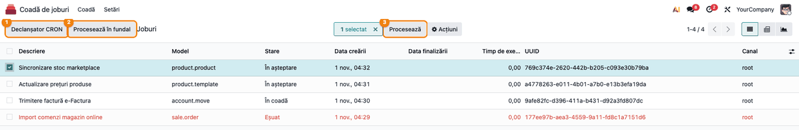
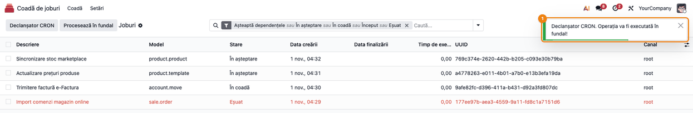

# Fișă Modul: Procesarea rapidă și sigură a cozii de joburi

**Modul:** `deltatech_queue_job`
**Utilizator principal:** Administrator Odoo / consultant tehnic
**Prioritate:** 🟢 Scăzută (modul tehnic; deschide însă o adresă publică, protejată de o cheie API)

---

## 1. Scop business

Multe operații din Odoo rulează în fundal, ca joburi în coadă: sincronizarea stocurilor și a
prețurilor cu marketplace-urile, trimiterea facturilor în e-Factura, importul comenzilor din magazinul
online. Cu modulul standard, coada se golește doar când rulează acțiunea programată, iar pe Odoo.sh
acțiunile programate nu pornesc oricât de des și sunt oprite dacă depășesc timpul limită.
Modulul accelerează și securizează procesarea: mai mulți lucrători pot lua joburi în paralel fără să
se blocheze, procesarea se oprește singură înainte de timpul limită, iar coada poate fi golită în
fiecare minut de un serviciu extern (de exemplu **cron-job.org**), printr-o adresă protejată de o
cheie API. Administratorul poate porni procesarea și manual, din lista de joburi. Modulul face și
curățenie: joburile eșuate înlocuite de un job nou identic trec în „Anulat", iar joburile terminate
rămase fără dată de finalizare sunt șterse automat după intervalul de păstrare al canalului.

## 2. Bază legală și context

Nu există temei contabil sau fiscal. Contextul este operațional și de securitate: modulul expune
două adrese publice, ambele protejate de aceeași cheie API: `/api/v1/queue/process` (procesează
coada) și `/api/v1/queue/stats` (numărul de joburi pe stări, util pentru monitorizare). Cheia se
păstrează confidențial și se regenerează dacă a fost expusă. Fără cheie generată, adresele refuză orice
apel.

## 3. Utilizatori și roluri

| Rol | Ce face |
|---|---|
| Administrator (Setări) | Generează cheia API, stabilește dimensiunea lotului și timpul maxim |
| Manager coadă de joburi | Urmărește joburile și pornește manual procesarea din listă |
| Consultant tehnic | Configurează serviciul extern (adresă, metodă, program, corp JSON) |
| Serviciul extern | Apelează adresa de procesare în fiecare minut |

Roluri recomandate pentru testare: un administrator cu drepturi de **Setări** și de manager al cozii
de joburi (meniul **Setări** din aplicația **Coadă de joburi** este vizibil doar administratorilor).

## 4. Conturi și date implicate

Modulul nu folosește conturi contabile.

Date minime pentru demo:

- câteva joburi în coadă, în stările **În așteptare**, **În coadă** și **Eșuat** (orice modul care
  pune joburi în coadă, de exemplu o sincronizare cu un marketplace);
- adresa publică a bazei accesibilă din internet, dacă se testează cu un serviciu extern.

Setările implicite: **Dimensiune lot** = 20 de joburi pe rulare, **Secunde maxime** = 50 de secunde
pe rulare. Nu există cheie API implicită.

## 5. Configurare inițială

1. **Coadă de joburi → Setări** (pagina **Setări**, secțiunea **Job din coadă**, blocul **Procesor
   coadă joburi**).
2. Apăsați **Generează cheia**, apoi **Salvează**.
3. Dacă e nevoie, ajustați **Dimensiune lot** și **Secunde maxime** și salvați.

## 6. Flux de utilizare

### Pasul 1 — Cheia API și limitele procesării

**Coadă de joburi → Setări**, blocul **Procesor coadă joburi**, setarea **Procesor extern**:

1. apăsați **Generează cheia** (①); Odoo afișează notificarea „API Key Generated"; apăsați
   **Salvează**;
2. completați **Dimensiune lot** (②), numărul maxim de joburi procesate la o rulare;
3. completați **Secunde maxime** (③), timpul maxim al unei rulări. Pentru acțiunea programată,
   păstrați-l sub timpul limită al acțiunilor programate; pentru adresa externă, sub limita cererilor
   HTTP a serverului și sub timpul de așteptare al serviciului extern (dacă acesta e mai mic, trimiteți
   un `max_seconds` mai mic în apel, vezi pasul 2).

Sub setări este mini-instrucțiunea pentru **cron-job.org**: adresa, metoda, programul, antetul și
corpul JSON al apelului.


### Pasul 2 — Configurarea serviciului extern

În serviciul extern (de exemplu cron-job.org) creați o sarcină nouă:

- **URL:** `https://<adresa bazei>/api/v1/queue/process`;
- **Metodă:** `POST`;
- **Program:** în fiecare minut (`* * * * *`);
- **Antet:** `Content-Type: application/json`;
- **Corp:**

```json
{
  "jsonrpc": "2.0",
  "params": {
    "api_key": "<cheia generată la pasul 1>"
  }
}
```

Opțional, în `params` se pot trimite `batch_size` și `max_seconds`, care au prioritate față de
valorile din setări.

Porniți sarcina o dată, manual, din serviciul extern și citiți răspunsul:

1. **Găsiți pe ecran:** rezultatul este împachetat de două ori: în răspunsul JSON, în `result` și
   apoi încă o dată în `result`, sunt câmpurile `status`, `processed` (joburi încercate), `done`
   (terminate), `failed` (eșuate), `postponed` (amânate pentru o nouă încercare), `pending_count`
   (rămase în așteptare) și `time_elapsed`:

   ```json
   {"jsonrpc": "2.0", "id": null, "result": {"jsonrpc": "2.0", "id": null, "result": {
       "status": "success", "processed": 15, "done": 13, "failed": 1, "postponed": 1,
       "pending_count": 10, "time_elapsed": 12.34, "timestamp": "2026-11-01 04:40:00"}}}
   ```
2. **Verificați:** `status` = `success`; `processed` = `done` + `failed` + `postponed`; `time_elapsed`
   este aproximativ cât **Secunde maxime** sau mai mic (puțin peste dacă ultimul job a fost lung);
   fără joburi în așteptare, mesajul este `No pending jobs in queue`.
3. **Treceți mai departe:** abia apoi activați programul de fiecare minut.

Cu o cheie greșită, rezultatul conține `status` = `error`, `message` = `Unauthorized - Invalid API key`
și `code` = 401, iar niciun job nu este procesat. **Atenție:** statusul HTTP al răspunsului este mereu
200, inclusiv la cheie greșită sau la eroare; alertele serviciului extern bazate pe statusul HTTP nu le
semnalează. Verificați periodic corpul răspunsului (`status` = `error`) sau jurnalul serviciului extern.

Pe un server cu mai multe baze de date, adresa trebuie să ajungă la baza corectă (domeniu dedicat
bazei sau filtru de baze configurat pe server).

### Pasul 3 — Procesarea manuală din lista de joburi

**Coadă de joburi → Coadă → Joburi**. Lista arată implicit joburile active (care așteaptă
dependențe, în așteptare, în coadă, pornite, eșuate). În antetul listei sunt butoanele modulului:

- **Declanșator CRON** (①) — activează acțiunea programată a cozii, dacă era inactivă, și o pornește
  în câteva secunde;
- **Procesează în fundal** (②) — procesează imediat un lot, pe un fir de execuție separat, fără să
  blocheze interfața; folosește un lot fix de cel mult 20 de joburi în cel mult 50 de secunde, nu
  valorile din setări;
- **Procesează** (③) — apare după ce bifați cel puțin un job; are efect doar dacă printre joburile
  bifate este cel puțin unul **În așteptare**, iar atunci pornește acțiunea programată, care
  procesează toată coada, nu doar joburile bifate. Notificarea verde apare oricum, chiar dacă nu s-a
  programat nimic. Un job **Eșuat** se repornește întâi cu butonul standard **Repune jobul în coadă**.

Aceleași butoane sunt și în antetul formularului unui job; acolo **Procesează în fundal** apare ca
**Procesează (fir separat)**.



### Pasul 4 — Confirmarea pornirii

După **Declanșator CRON**, Odoo afișează o notificare:

1. **Găsiți pe ecran:** notificarea din dreapta sus, cu titlul **Declanșator CRON**.
2. **Verificați:** mesajul este „Operația va fi executată în fundal!" (verde). „CRON Trigger already
   exists" (galben) înseamnă că o pornire este deja programată; „No CRON Trigger found" (roșu)
   înseamnă că nu există nicio acțiune programată marcată ca procesor al cozii.
3. **Treceți mai departe:** reîmprospătați lista după câteva secunde; joburile procesate dispar din
   filtrul implicit și se văd cu filtrul **Finalizat**.



### Ce face modulul automat, fără acțiunea operatorului

- La crearea unui job sau la schimbarea datei lui de execuție, programează pornirea acțiunii
  programate, fără să dubleze pornirile deja programate.
- Când apare un job nou cu aceeași identitate ca unul **Eșuat**, joburile eșuate vechi trec în
  **Anulat**, cu mesajul „Superseded by a new job with the same identity_key".
- Joburile anulate în lanț (dependenții unui job anulat) primesc data anulării, ca să poată fi
  șterse la curățenie.
- Curățenia automată a Odoo șterge și joburile **Finalizat** sau **Anulat** rămase fără dată de
  finalizare, mai vechi decât intervalul de păstrare al canalului lor.

### Note de monografie și raportare

Modulul nu generează note contabile (Dr/Cr). Notele generate de joburile procesate sunt cele ale
operațiilor respective (de exemplu factura trimisă sau comanda importată).

## 7. Legături cu alte module / declarații

| Modul | Rol |
|---|---|
| `queue_job` (OCA) | Coada de joburi, canalele și intervalul de păstrare |
| `queue_job_cron_jobrunner` (OCA) | Acțiunea programată care procesează coada |
| Module care pun joburi în coadă (marketplace, e-Factura, magazin online) | Produc joburile procesate |
| Servicii externe (cron-job.org) | Apelează adresa de procesare în fiecare minut |

**Ce e automat:** programarea pornirii la fiecare job nou, oprirea procesării la **Dimensiune lot** sau
**Secunde maxime**, izolarea unui job eșuat de restul lotului, anularea duplicatelor eșuate,
ștergerea joburilor vechi rămase fără dată.

**Ce rămâne manual:** generarea și păstrarea cheii API, configurarea serviciului extern, analiza
joburilor eșuate și repornirea lor cu **Repune jobul în coadă** (din formular) sau **Repune joburile în
coadă** (din **Acțiuni**, pe listă).

## 8. Verificări pentru consultant

- [ ] Meniul **Coadă de joburi → Setări** deschide direct secțiunea **Job din coadă**.
- [ ] Fără cheie generată, apelul la `/api/v1/queue/process` întoarce `Unauthorized - Invalid API key`.
- [ ] Cu cheia corectă, răspunsul are `status` = `success` și `processed` = `done` + `failed` + `postponed`.
- [ ] `processed` nu depășește **Dimensiune lot**, iar `time_elapsed` nu depășește mult **Secunde maxime**.
- [ ] Apelul cu cheie greșită are statusul HTTP 200, dar `status` = `error` în corpul răspunsului.
- [ ] **Declanșator CRON** și **Procesează în fundal** sunt vizibile în listă fără selecție;
      **Procesează** apare după bifarea unui job și are efect doar pe joburi **În așteptare**.
- [ ] **Declanșator CRON** afișează notificarea verde, iar a doua apăsare imediată pe cea galbenă
      „CRON Trigger already exists".
- [ ] Un job nou cu aceeași identitate ca un job **Eșuat** trece jobul eșuat în **Anulat**.

## 9. Mesaje de eroare frecvente

| Mesaj | Cauză | Remediere |
|---|---|---|
| `Unauthorized - Invalid API key` (cod 401) | Cheie lipsă sau greșită în corpul apelului, ori nicio cheie generată în setări | Generați cheia, salvați și copiați-o în corpul JSON din serviciul extern |
| `No pending jobs in queue` | Nu există joburi în așteptare | Nimic de făcut; mesajul este informativ |
| `CRON Trigger already exists` | O pornire a acțiunii programate este deja planificată | Așteptați câteva secunde și reîmprospătați lista |
| `No CRON Trigger found` | Acțiunea programată a cozii a fost ștearsă sau nu mai e marcată ca procesor al cozii | Verificați în **Setări → Tehnic → Acțiuni programate** sau actualizați modulul `queue_job_cron_jobrunner` |
| Mesajul erorii Python (cod 500) | Eroare neprevăzută la procesare | Citiți jurnalul serverului; verificați jobul care a eșuat |

## 10. Capturi de ecran

Capturile sunt **generate automat** din `tests/test_screenshots.py` (mixinul `ScreenshotCase` din
`deltatech_doc_screenshots`, import defensiv), în română, pe joburi demonstrative seedate de test;
aceleași ecrane în engleză sunt în `static/description/en/` pentru `readme/USAGE.md`.

| Fișier | Ce arată |
|---|---|
| `01_setari_procesor_extern.png` | Setările procesorului extern: cheia API, dimensiunea lotului, timpul maxim |
| `02_lista_joburi.png` | Lista de joburi cu butoanele de procesare din antet |
| `03_declansare_cron.png` | Notificarea de confirmare după **Declanșator CRON** |

Regenerare:

```bash
./odoo/odoo-bin -c odoo.conf -d <db> -i deltatech_queue_job,deltatech_doc_screenshots \
    --test-tags=fise_screenshots --stop-after-init
```

## 11. Observații pentru manual

- Cheia API se vede în clar în setări și în serviciul extern; se regenerează dacă a fost expusă, iar
  serviciul extern trebuie actualizat imediat (până atunci apelurile sunt refuzate).
- **Procesează în fundal** lucrează pe un fir de execuție separat, în procesul serverului web, cu un
  lot fix de 20 de joburi și 50 de secunde; pentru volume mari, preferați acțiunea programată sau
  serviciul extern.
- Alertele serviciului extern nu prind o cheie greșită: răspunsul are mereu statusul HTTP 200.
- **Secunde maxime** este un buget verificat între joburi, nu o întrerupere a jobului în curs: un job
  lung pornit aproape de limită o poate depăși.
- Joburile eșuate rămân în listă pentru diagnostic până la apariția unui job nou identic sau până la
  repornirea lor manuală.
